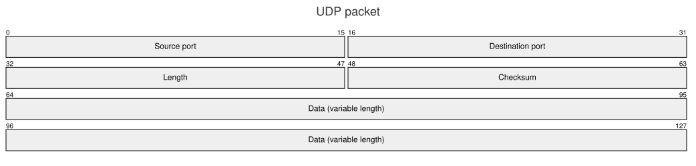

A [PacketDiagram](cref:Meziantou.Framework.Diagrams.PacketDiagram) draws the fields of a network packet or of a binary
structure, in rows of a fixed number of bits (Mermaid `packet`):

<!-- ref:../../../tests/Meziantou.Framework.Diagrams.Tests/PacketDiagramTests.cs;region=Diagrams_PacketDiagram;format=md-fenced-code-block;dedent=true -->
```csharp
var diagram = new PacketDiagram { Title = "UDP packet" };
diagram.AddField(16, "Source port");
diagram.AddField(16, "Destination port");
diagram.AddField(16, "Length");
diagram.AddField(16, "Checksum");
diagram.AddField(64, "Data (variable length)");
```
<!-- endref -->



## Fields and rows

A [PacketField](cref:Meziantou.Framework.Diagrams.PacketField) covers the bits from its
[Start](cref:Meziantou.Framework.Diagrams.PacketField.Start) to its [End](cref:Meziantou.Framework.Diagrams.PacketField.End),
both included. [AddField](cref:Meziantou.Framework.Diagrams.PacketDiagram.AddField)
adds a field after the previous one. A field that does not fit in its row continues on the next one.

[BitsPerRow](cref:Meziantou.Framework.Diagrams.PacketDiagram.BitsPerRow) is the number of bits per row (32 by default),
[BitWidth](cref:Meziantou.Framework.Diagrams.PacketDiagram.BitWidth) the width of a bit and
[RowHeight](cref:Meziantou.Framework.Diagrams.PacketDiagram.RowHeight) the height of a row.
[ShowBits](cref:Meziantou.Framework.Diagrams.PacketDiagram.ShowBits) writes the number of the first and the last bit of
each field above it, and [DescendingBitOrder](cref:Meziantou.Framework.Diagrams.PacketDiagram.DescendingBitOrder) numbers
the bits of a row from right to left.

## Mermaid syntax

<!-- ref:../../../tests/Meziantou.Framework.Mermaid.Tests/PacketDiagramParserTests.cs;region=Mermaid_PacketDiagram;format=md-fenced-code-block;dedent=true -->
```csharp
var diagram = (PacketDiagram)MermaidDocument.Parse("""
    packet
      title UDP packet
      0-15: "Source port"
      16-31: "Destination port"
      +16: "Length"
      +16: "Checksum"
      64-127: "Data (variable length)"
    """).Diagram;
```
<!-- endref -->

`packet` and `packet-beta` are read the same. A field is `start: "label"` for one bit, `start-end: "label"`, or
`+bits: "label"` after the previous field; the fields must follow each other without gap, as in Mermaid. The parser reads
the title and the accessibility statements, and `bitsPerRow`, `bitWidth`, `rowHeight`, `showBits` and `bitOrder` in the
`packet` section of the configuration.
