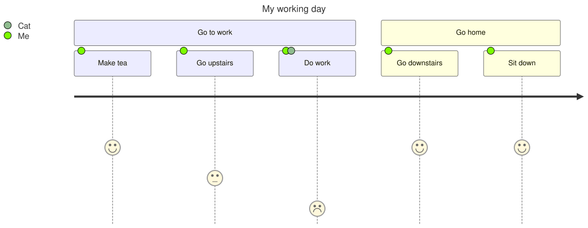

A [UserJourneyDiagram](cref:Meziantou.Framework.Diagrams.UserJourneyDiagram) draws the steps users take to reach a
goal, and how they feel at each step (Mermaid `journey`):

<!-- ref:../../../tests/Meziantou.Framework.Diagrams.Tests/UserJourneyDiagramTests.cs;region=Diagrams_UserJourney;format=md-fenced-code-block;dedent=true -->
```csharp
var diagram = new UserJourneyDiagram { Title = "My working day" };
var work = diagram.AddSection("Go to work");
work.AddTask("Make tea", 5, "Me");
work.AddTask("Go upstairs", 3, "Me");
work.AddTask("Do work", 1, "Me", "Cat");
var home = diagram.AddSection("Go home");
home.AddTask("Go downstairs", 5, "Me");
home.AddTask("Sit down", 5, "Me");
```
<!-- endref -->



## Sections and tasks

A [UserJourneySection](cref:Meziantou.Framework.Diagrams.UserJourneySection) is a part of the goal, drawn above its
tasks, in the colors of the theme: each section takes the next one. A
[UserJourneyTask](cref:Meziantou.Framework.Diagrams.UserJourneyTask) has a
[Score](cref:Meziantou.Framework.Diagrams.UserJourneyTask.Score) from 1 to 5: the higher the score, the higher its
face; the face smiles above 3, and is sad below 3. The [actors](cref:Meziantou.Framework.Diagrams.UserJourneyTask.Actors)
of a task are colored dots on it, and the legend on the left lists the actors in ordinal order, with their color.

## Mermaid syntax

<!-- ref:../../../tests/Meziantou.Framework.Mermaid.Tests/UserJourneyDiagramParserTests.cs;region=Mermaid_UserJourney;format=md-fenced-code-block;dedent=true -->
```csharp
var diagram = (UserJourneyDiagram)MermaidDocument.Parse("""
    journey
        title My working day
        section Go to work
          Make tea: 5: Me
          Go upstairs: 3: Me
          Do work: 1: Me, Cat
        section Go home
          Go downstairs: 5: Me
          Sit down: 5: Me
    """).Content;
```
<!-- endref -->

A task is `name: score: actor, actor`, a section is `section name`. The keywords ignore the case, `#` and `%%` start
comments, and a semicolon ends a statement. As in Mermaid, the tasks before the first section are in a section without
name.
