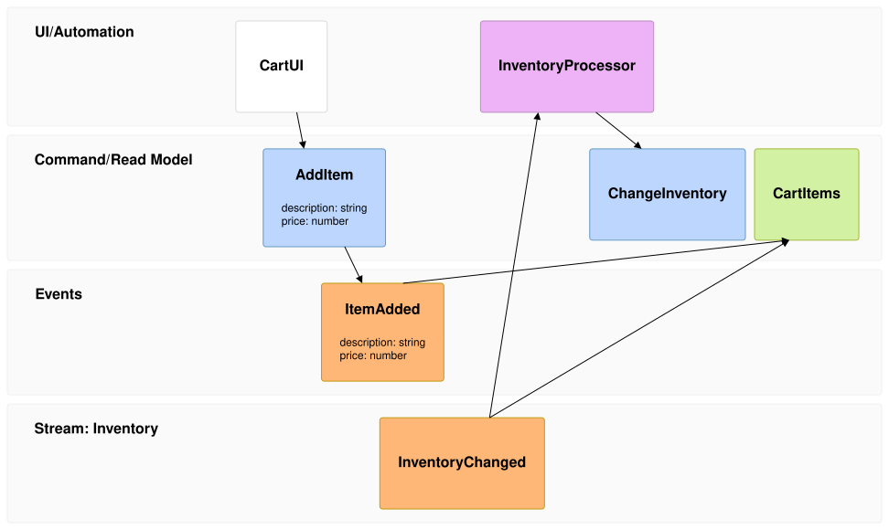

An [EventModelingDiagram](cref:Meziantou.Framework.Diagrams.EventModelingDiagram) draws an event model: a timeline of
frames, each an entity in its swimlane, and the relations between them (Mermaid `eventmodeling`):

<!-- ref:../../../tests/Meziantou.Framework.Diagrams.Tests/EventModelingDiagramTests.cs;region=Diagrams_EventModeling;format=md-fenced-code-block;dedent=true -->
```csharp
var diagram = new EventModelingDiagram();
var items = new EventModelingDataBlock("Item", new EventModelingData("description: string\nprice: number"));
diagram.DataBlocks.Add(items);
diagram.AddFrame("01", EventModelingEntityKind.Ui, "CartUI");
diagram.AddFrame("02", EventModelingEntityKind.Command, "AddItem").DataBlock = items;
var added = diagram.AddFrame("03", EventModelingEntityKind.Event, "ItemAdded");
added.DataBlock = items;

// A reset frame infers no relation from the frame before it
var external = diagram.AddFrame("04", EventModelingEntityKind.Event, "Inventory.InventoryChanged");
external.IsReset = true;
diagram.AddFrame("05", EventModelingEntityKind.Processor, "InventoryProcessor");
diagram.AddFrame("06", EventModelingEntityKind.Command, "ChangeInventory");

// A read model built from several events
var cart = diagram.AddFrame("07", EventModelingEntityKind.ReadModel, "CartItems");
cart.IsReset = true;
cart.Sources.Add(added);
cart.Sources.Add(external);
```
<!-- endref -->



## Frames and swimlanes

An [EventModelingFrame](cref:Meziantou.Framework.Diagrams.EventModelingFrame) has a number, unique in the diagram, a
[Kind](cref:Meziantou.Framework.Diagrams.EventModelingFrame.Kind) and an entity. The kind sets the swimlane and the color
of the box: the screens and the processors are in the UI/Automation swimlane, the commands and the read models in the
Command/Read Model swimlane, and the events in the Events swimlane. An entity of two parts, `Namespace.Name`, is in a
swimlane of its namespace and kind.

The boxes follow the order of the frames, left to right; a box overlaps the previous box of another swimlane, as in
Mermaid. A box shows the name of its entity and its data: the inline [Data](cref:Meziantou.Framework.Diagrams.EventModelingFrame.Data),
or the [DataBlock](cref:Meziantou.Framework.Diagrams.EventModelingFrame.DataBlock) it references.

## Relations

A frame receives input from its [Sources](cref:Meziantou.Framework.Diagrams.EventModelingFrame.Sources). Without
sources, the relation is inferred from the last frame of another swimlane before it, unless the frame is a
[reset frame](cref:Meziantou.Framework.Diagrams.EventModelingFrame.IsReset). The relations are arrows from the source to
the frame.

The [entities](cref:Meziantou.Framework.Diagrams.EventModelingDiagram.Entities), the
[notes](cref:Meziantou.Framework.Diagrams.EventModelingDiagram.Notes) and the given/when/then
[scenarios](cref:Meziantou.Framework.Diagrams.EventModelingDiagram.Scenarios) are kept for Mermaid, which does not draw
them either.

## Mermaid syntax

<!-- ref:../../../tests/Meziantou.Framework.Mermaid.Tests/EventModelingDiagramParserTests.cs;region=Mermaid_EventModeling;format=md-fenced-code-block;dedent=true -->
```csharp
var diagram = (EventModelingDiagram)MermaidDocument.Parse("""
    eventmodeling
    tf 01 ui CartUI
    tf 02 cmd AddItem { description: string }
    tf 03 evt ItemAdded [[ItemAdded]]
    rf 04 evt External.InventoryChanged
    tf 05 rmo CartItems ->> 03 ->> 04
    data ItemAdded {
      description: string
      price: number
    }
    """).Diagram;
```
<!-- endref -->

The parser reads the compact and the relaxed notations: the frames (`tf` or `timeframe`, `rf` or `resetframe`), the
kinds (`ui`, `pcr` or `processor`, `cmd` or `command`, `rmo` or `readmodel`, `evt` or `event`), the sources (`->> 01`),
the data references (`[[name]]`), the inline data (`{ ... }` or a quoted text, on one line), the data blocks
(`data name {` ... `}`, with `}` at the start of a line), the formats (`` `json` ``...), `entity`, `note` and `gwt`. The
white space separates the tokens only, and `//` and `/* */` are comments. A relation that does not follow the rules of
event modeling, such as an event that receives input from a screen, is reported as a warning. As in Mermaid, the title
is in the front matter only.

Unlike Mermaid 12.3.0, which gives each frame of a namespace its own swimlane, the frames of a namespace and kind share
one swimlane.
