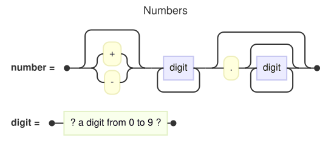

A [RailroadDiagram](cref:Meziantou.Framework.Diagrams.RailroadDiagram) draws the rules of a grammar as railroad
diagrams, also called syntax diagrams: each rule is a track from a start marker to an end marker, through terminals and
nonterminals, with branches for the choices and loops for the repetitions (Mermaid `railroad-beta`,
`railroad-ebnf-beta`, `railroad-abnf-beta` and `railroad-peg-beta`):

<!-- ref:../../../tests/Meziantou.Framework.Diagrams.Tests/RailroadDiagramTests.cs;region=Diagrams_RailroadDiagram;format=md-fenced-code-block;dedent=true -->
```csharp
var diagram = new RailroadDiagram { Title = "Numbers" };
diagram.AddRule("number", RailroadExpression.Sequence(
    RailroadExpression.Optional(RailroadExpression.Choice(RailroadExpression.Terminal("+"), RailroadExpression.Terminal("-"))),
    RailroadExpression.OneOrMore(RailroadExpression.Nonterminal("digit")),
    RailroadExpression.Optional(RailroadExpression.Sequence(RailroadExpression.Terminal("."), RailroadExpression.ZeroOrMore(RailroadExpression.Nonterminal("digit"))))));
diagram.AddRule("digit", RailroadExpression.Special("a digit from 0 to 9"));
```
<!-- endref -->



## Expressions

A [RailroadRule](cref:Meziantou.Framework.Diagrams.RailroadRule) has a name and the
[RailroadExpression](cref:Meziantou.Framework.Diagrams.RailroadExpression) it stands for, which the static methods of
`RailroadExpression` create:

| Expression | Drawing |
| --- | --- |
| [Terminal](cref:Meziantou.Framework.Diagrams.RailroadTerminal) | A literal text in a rounded box |
| [Nonterminal](cref:Meziantou.Framework.Diagrams.RailroadNonterminal) | A reference to a rule in a box |
| [Sequence](cref:Meziantou.Framework.Diagrams.RailroadSequence) | Expressions one after the other |
| [Choice](cref:Meziantou.Framework.Diagrams.RailroadChoice) | Alternatives one below the other, between two branches |
| [Optional](cref:Meziantou.Framework.Diagrams.RailroadOptional) | A bypass above the expression |
| [Repetition](cref:Meziantou.Framework.Diagrams.RailroadRepetition) | A loop below the expression, and a bypass when it can be skipped |
| [Special](cref:Meziantou.Framework.Diagrams.RailroadSpecial) | A description, `? text ?`, in a box |

A repetition has a [Minimum](cref:Meziantou.Framework.Diagrams.RailroadRepetition.Minimum) and a
[Maximum](cref:Meziantou.Framework.Diagrams.RailroadRepetition.Maximum); other bounds than zero or one to unbounded,
such as the `2*4` of ABNF, are written below the loop.

## Mermaid syntax

<!-- ref:../../../tests/Meziantou.Framework.Diagrams.Mermaid.Tests/RailroadDiagramParserTests.cs;region=Mermaid_RailroadDiagram;format=md-fenced-code-block;dedent=true -->
```csharp
var diagram = (RailroadDiagram)MermaidDocument.Parse("""
    railroad-ebnf-beta
    title "Numbers"
    number = [ "+" | "-" ] digit+ ( "." digit* )? ;
    digit = ? a digit from 0 to 9 ? ;
    """).Diagram;
```
<!-- endref -->

The keyword sets the [Notation](cref:Meziantou.Framework.Diagrams.RailroadDiagram.Notation), which the writer uses
too. Every rule ends with a semicolon.

| Notation | Keyword | Rule | Choice | Optional | Repetition | Comments |
| --- | --- | --- | --- | --- | --- | --- |
| Constructors | `railroad-beta` | `name = expression ;` | `choice(a, b)` | `optional(a)` | `zeroOrMore(a)`, `oneOrMore(a)` | `/* */` |
| EBNF | `railroad-ebnf-beta` | `name = ... ;` or `::=` | `a \| b` | `a?`, `[ a ]` | `a*`, `{ a }`, `a+` | `/* */`, `(* *)` |
| ABNF | `railroad-abnf-beta` | `name = ... ;` | `a / b` | `[ a ]`, `*1a` | `*a`, `1*a`, `2*4a`, `3a` | `; text` |
| PEG | `railroad-peg-beta` | `Name <- ... ;` | `a / b` | `a?` | `a*`, `a+` | `# text` |

As in Mermaid, an EBNF exception `a - b` is drawn as a sequence with a `-` terminal, the predicates `&a` and `!a` of PEG
and its `.` are special sequences, the numeric values of ABNF (`%x30-39`) are terminals, and an identifier cannot start
with `title`. In ABNF, a semicolon ends a rule only at the end of its line: followed by text, it starts a comment. The
writer throws an `ArgumentException` for an expression the notation cannot write, such as bounded repetitions out of
ABNF, or special sequences in ABNF.
