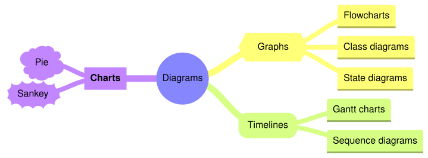

A [MindmapDiagram](cref:Meziantou.Framework.Diagrams.MindmapDiagram) draws a tree of
[nodes](cref:Meziantou.Framework.Diagrams.MindmapNode) around a root (Mermaid `mindmap`):

<!-- ref:../../../tests/Meziantou.Framework.Diagrams.Tests/MindmapDiagramTests.cs;region=Diagrams_MindmapDiagram;format=md-fenced-code-block;dedent=true -->
```csharp
var diagram = new MindmapDiagram();
var root = diagram.SetRoot("Diagrams", MindmapNodeShape.Circle);
var graphs = root.AddChild("Graphs", MindmapNodeShape.Hexagon);
graphs.AddChild("Flowcharts");
graphs.AddChild("Class diagrams");
graphs.AddChild("State diagrams");
var timelines = root.AddChild("Timelines", MindmapNodeShape.RoundedSquare);
timelines.AddChild("Gantt charts");
timelines.AddChild("Sequence diagrams");
var charts = root.AddChild(DiagramText.Markdown("**Charts**"), MindmapNodeShape.Square);
charts.AddChild("Pie", MindmapNodeShape.Cloud);
charts.AddChild("Sankey", MindmapNodeShape.Bang);
```
<!-- endref -->



## Nodes

[SetRoot](cref:Meziantou.Framework.Diagrams.MindmapDiagram.SetRoot(Meziantou.Framework.Diagrams.DiagramText,Meziantou.Framework.Diagrams.MindmapNodeShape))
sets the central node, and [AddChild](cref:Meziantou.Framework.Diagrams.MindmapNode.AddChild(Meziantou.Framework.Diagrams.DiagramText,Meziantou.Framework.Diagrams.MindmapNodeShape))
adds a node under another one. A node has a text, which can be markdown and wraps to
[MaxNodeWidth](cref:Meziantou.Framework.Diagrams.MindmapDiagram.MaxNodeWidth), and a
[shape](cref:Meziantou.Framework.Diagrams.MindmapNodeShape):

| Shape | Drawing | Mermaid |
| --- | --- | --- |
| `Default` | A rectangle with rounded top corners and a line below it | `text`, `id(-text-)` |
| `Square` | A rectangle | `id[text]` |
| `RoundedSquare` | A rectangle with rounded corners | `id(text)` |
| `Circle` | A circle | `id((text))` |
| `Bang` | An explosion | `id))text((` |
| `Cloud` | A cloud | `id)text(` |
| `Hexagon` | A hexagon | `id{{text}}` |

[NodePadding](cref:Meziantou.Framework.Diagrams.MindmapDiagram.NodePadding) is the space around the text; the rounded
squares and the hexagons take more, as in Mermaid. A node also has an optional
[Id](cref:Meziantou.Framework.Diagrams.MindmapNode.Id), [CSS classes](cref:Meziantou.Framework.Diagrams.MindmapNode.CssClasses)
that are added to its SVG element, and an [Icon](cref:Meziantou.Framework.Diagrams.MindmapNode.Icon), the classes of an
icon font such as `fa fa-book`: the icon is kept, to write it back as Mermaid, but it is not drawn.

## Layout and colors

The root is at the center. Its children are split in two halves: the first half goes to the right, the second half to
the left, and the descendants of a node go further on the same side, stacked so that subtrees never overlap. The layout
is deterministic: the same diagram always gives the same drawing. Mermaid places the nodes with a force-directed layout
instead, so the positions differ, but the shapes, the colors and the edges are the same.

Each branch of the root takes a color of the palette of the theme, and its descendants take the same color. With
[ColorBy](cref:Meziantou.Framework.Diagrams.MindmapDiagram.ColorBy) set to
[Depth](cref:Meziantou.Framework.Diagrams.MindmapColorMode.Depth), the nodes take the color of their depth instead. The
edges get thinner as they go away from the root.

## Mermaid syntax

<!-- ref:../../../tests/Meziantou.Framework.Mermaid.Tests/MindmapDiagramParserTests.cs;region=Mermaid_MindmapDiagram;format=md-fenced-code-block;dedent=true -->
```csharp
var diagram = (MindmapDiagram)MermaidDocument.Parse("""
    mindmap
      root((mindmap))
        Origins
          Long history
          Popularisation
        Research
          On effectiveness<br/>and features
        Tools
          Pen and paper
          Mermaid
    """).Diagram;
```
<!-- endref -->

The indentation makes the tree: a node is a child of the last node above it that is less indented. The first node is
the root, and a second node as indented as the root is an error. The text of a node is plain (`id[text]`), quoted
(`id["text"]`) or markdown (`` id["`**text**`"] ``). A line `::icon(fa fa-book)` sets the icon of the node above it, with
a warning since icons are not drawn, and a line `:::class1 class2` adds classes to it. The parser reads `colorBy`
(`branch` or `depth`), `padding` and `maxNodeWidth` in the `mindmap` section of the configuration.

The grammar of the mind maps has no accessibility statements: `accTitle: ...` is read as a node, and the writer
rejects a diagram with an [AccessibleTitle](cref:Meziantou.Framework.Diagrams.Diagram.AccessibleTitle) or a
[Description](cref:Meziantou.Framework.Diagrams.Diagram.Description).
