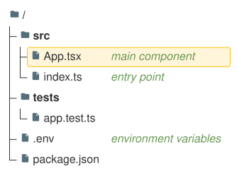

A [TreeViewDiagram](cref:Meziantou.Framework.Diagrams.TreeViewDiagram) draws a hierarchy of files and directories as
indented rows linked by lines, like the output of the `tree` command (Mermaid `treeView-beta`). The
[nodes](cref:Meziantou.Framework.Diagrams.TreeViewNode) are the children of a root directory named `/`:

<!-- ref:../../../tests/Meziantou.Framework.Diagrams.Tests/TreeViewDiagramTests.cs;region=Diagrams_TreeViewDiagram;format=md-fenced-code-block;dedent=true -->
```csharp
var diagram = new TreeViewDiagram { ShowIcons = true };
var src = diagram.AddNode("src", isDirectory: true);
var app = src.AddChild("App.tsx");
app.CssClass = "highlight";
app.Description = "main component";
src.AddChild("index.ts").Description = "entry point";
var tests = diagram.AddNode("tests", isDirectory: true);
tests.AddChild("app.test.ts");
diagram.AddNode(".env").Description = "environment variables";
diagram.AddNode("package.json");
```
<!-- endref -->



## Nodes

A node has a [Name](cref:Meziantou.Framework.Diagrams.TreeViewNode.Name), drawn as is, spaces included, and
[children](cref:Meziantou.Framework.Diagrams.TreeViewNode.Children). A node is a file or, when
[IsDirectory](cref:Meziantou.Framework.Diagrams.TreeViewNode.IsDirectory) is set, a directory, whose name is bold. A
node can have:

- a [Description](cref:Meziantou.Framework.Diagrams.TreeViewNode.Description), drawn in italic in a column after the
  widest name;
- a [CssClass](cref:Meziantou.Framework.Diagrams.TreeViewNode.CssClass), set on the group of the row in the SVG. The
  class `highlight` draws the row on an amber background;
- an [Icon](cref:Meziantou.Framework.Diagrams.TreeViewNode.Icon): `file` and `folder` are drawn, `none` hides the icon,
  and the icons of the icon packs of Mermaid, such as `logos:react`, are drawn as a question mark, as Mermaid does when
  the pack is not registered.

A node that appears twice in the tree is drawn once, at its first place.

## Icons

When [ShowIcons](cref:Meziantou.Framework.Diagrams.TreeViewDiagram.ShowIcons) is set, the nodes without an icon get
one: the directories get the folder icon, and the files get the icon of their name in
[FileNameIcons](cref:Meziantou.Framework.Diagrams.TreeViewDiagram.FileNameIcons), else the icon of their extension in
[ExtensionIcons](cref:Meziantou.Framework.Diagrams.TreeViewDiagram.ExtensionIcons) (such as `.ts`, the dot is optional
and the case is ignored), else the file icon. An icon name without a pack takes
[DefaultIconPack](cref:Meziantou.Framework.Diagrams.TreeViewDiagram.DefaultIconPack), when it is set.

## Layout and colors

A level is indented by [RowIndent](cref:Meziantou.Framework.Diagrams.TreeViewDiagram.RowIndent) plus
[PaddingX](cref:Meziantou.Framework.Diagrams.TreeViewDiagram.PaddingX), and a row is the height of its text plus twice
[PaddingY](cref:Meziantou.Framework.Diagrams.TreeViewDiagram.PaddingY). The lines are
[LineThickness](cref:Meziantou.Framework.Diagrams.TreeViewDiagram.LineThickness) wide. The names and the lines take the
colors of the theme, and the icons, the descriptions and the highlighted rows take the colors of Mermaid; the
properties [FontSize](cref:Meziantou.Framework.Diagrams.TreeViewDiagram.FontSize),
[LabelColor](cref:Meziantou.Framework.Diagrams.TreeViewDiagram.LabelColor),
[LineColor](cref:Meziantou.Framework.Diagrams.TreeViewDiagram.LineColor),
[IconColor](cref:Meziantou.Framework.Diagrams.TreeViewDiagram.IconColor),
[DescriptionColor](cref:Meziantou.Framework.Diagrams.TreeViewDiagram.DescriptionColor),
[HighlightBackground](cref:Meziantou.Framework.Diagrams.TreeViewDiagram.HighlightBackground) and
[HighlightBorderColor](cref:Meziantou.Framework.Diagrams.TreeViewDiagram.HighlightBorderColor) replace them.

## Mermaid syntax

<!-- ref:../../../tests/Meziantou.Framework.Mermaid.Tests/TreeViewDiagramParserTests.cs;region=Mermaid_TreeViewDiagram;format=md-fenced-code-block;dedent=true -->
```csharp
var diagram = (TreeViewDiagram)MermaidDocument.Parse("""
    ---
    config:
      treeView:
        showIcons: true
    ---
    treeView-beta
        src/
            App.tsx :::highlight icon(logos:react) ## main component
            index.ts ## entry point
        "my notes.txt"
        package.json
    """).Diagram;
```
<!-- endref -->

Each line is a node, nested by its indentation: a node is a child of the last node less indented than it. A name is
bare, up to its annotations, or quoted with `"` or `'`, and a name that ends with `/` is a directory. The annotations
follow the name: `:::class`, `icon(name)` (`icon()` hides the icon) and `## description`, which takes the rest of the
line. The tree can also be drawn with box-drawing characters, as the `tree` command prints it:

```text
treeView-beta
├── src/
│   ├── index.ts
│   └── utils.ts
└── package.json
```

The depth then comes from the column of the branch (`├──`, `└──`, or the heavy `┣━━` and `┗━━`), and the lines that
only hold `│` are ignored. The `title`, `accTitle` and `accDescr` statements come before the nodes. The parser reads
`rowIndent`, `paddingX`, `paddingY`, `lineThickness`, `showIcons`, `defaultIconPack`, `filenameIcons` and
`extensionIcons` in the `treeView` section of the configuration, and the theme variables `labelFontSize`, `labelColor`,
`lineColor`, `iconColor`, `descriptionColor`, `highlightBg` and `highlightStroke` in `themeVariables.treeView`.

Unlike Mermaid, `%%` starts a comment anywhere in a line, a line holds a single node, a line such as `titles` or
`├── title` is a node and not a title, and the tabs of the names drawn with box-drawing characters are kept.
