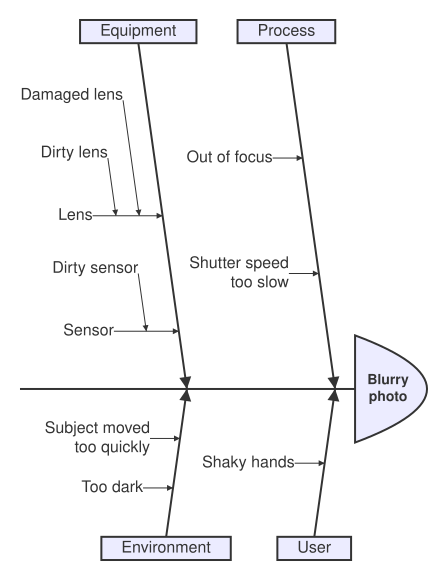

An [IshikawaDiagram](cref:Meziantou.Framework.Diagrams.IshikawaDiagram), also known as a fishbone or cause-and-effect
diagram, draws a problem, the [effect](cref:Meziantou.Framework.Diagrams.IshikawaDiagram.Effect), at the head of a
spine, and its [causes](cref:Meziantou.Framework.Diagrams.IshikawaCause) as bones (Mermaid `ishikawa-beta`):

<!-- ref:../../../tests/Meziantou.Framework.Diagrams.Tests/IshikawaDiagramTests.cs;region=Diagrams_IshikawaDiagram;format=md-fenced-code-block;dedent=true -->
```csharp
var diagram = new IshikawaDiagram { Effect = "Blurry photo" };
var process = diagram.AddCause("Process");
process.AddCause("Out of focus");
process.AddCause("Shutter speed too slow");
diagram.AddCause("User").AddCause("Shaky hands");
var equipment = diagram.AddCause("Equipment");
var lens = equipment.AddCause("Lens");
lens.AddCause("Damaged lens");
lens.AddCause("Dirty lens");
equipment.AddCause("Sensor").AddCause("Dirty sensor");
var environment = diagram.AddCause("Environment");
environment.AddCause("Subject moved too quickly");
environment.AddCause("Too dark");
```
<!-- endref -->



## Causes

The main causes are bones at 82° from the spine, alternately above and below it, from the head to the tail: the first
cause is above, the second below, and so on. Each pair of main causes starts where the texts of the previous pair end.
A cause has its own [causes](cref:Meziantou.Framework.Diagrams.IshikawaCause.Causes), drawn as smaller bones with an
arrow toward their parent: horizontal for the causes of a main cause, parallel to the main bone one level deeper, and so
on. The bones of a side are as long as the number of causes they hold requires.

The texts of the causes wrap at about 15 characters, and the effect to fit the head; a line feed starts a new line.
The diagram follows the [theme](../05-Theming.md): the lines take the line color, and the head and the boxes of the
main causes the background of the nodes. The [Padding](cref:Meziantou.Framework.Diagrams.Diagram.Padding) is 20 pixels,
as in Mermaid.

## Mermaid syntax

<!-- ref:../../../tests/Meziantou.Framework.Mermaid.Tests/IshikawaDiagramParserTests.cs;region=Mermaid_IshikawaDiagram;format=md-fenced-code-block;dedent=true -->
```csharp
var diagram = (IshikawaDiagram)MermaidDocument.Parse("""
    ishikawa-beta
        Blurry photo
        Process
            Out of focus
            Shutter speed too slow
        User
            Shaky hands
        Equipment
            Lens
                Damaged lens
                Dirty lens
            Sensor
                Dirty sensor
        Environment
            Subject moved too quickly
            Too dark
    """).Diagram;
```
<!-- endref -->

The first line after the keyword `ishikawa-beta` (or `ishikawa`, in any case) is the effect; it can also follow the
keyword on the same line. The indentation of the next lines makes the tree of the causes, as Mermaid reads it: the
indentation of the first cause is the one of the main causes, a line indented less is a main cause too, and a line is
a cause of the last line less indented than it. A tab counts as one character. A line is a text as it is written,
trimmed: `<br>` is a line break, and the other HTML stays as text. A line that starts with `%%` is a comment. The
parser reads `diagramPadding` in the `ishikawa` section of the configuration.

The Mermaid syntax has no accessibility statements: the writer throws when the
diagram has an [AccessibleTitle](cref:Meziantou.Framework.Diagrams.Diagram.AccessibleTitle) or a
[Description](cref:Meziantou.Framework.Diagrams.Diagram.Description), or a text Mermaid cannot read back, such as an
empty text or a text that starts with `%%`. A [Title](cref:Meziantou.Framework.Diagrams.Diagram.Title), from the front
matter, is drawn above the diagram.
