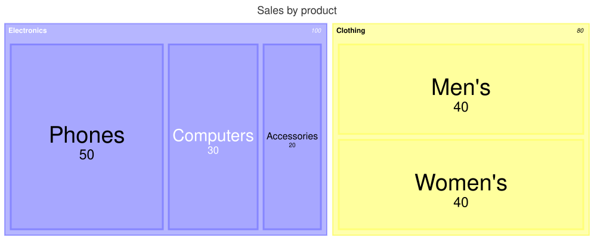

A [TreemapDiagram](cref:Meziantou.Framework.Diagrams.TreemapDiagram) draws a hierarchy as nested rectangles: each leaf
has an area proportional to its value, and each section surrounds its children, with its name and its total in a header
(Mermaid `treemap`):

<!-- ref:../../../tests/Meziantou.Framework.Diagrams.Tests/TreemapDiagramTests.cs;region=Diagrams_TreemapDiagram;format=md-fenced-code-block;dedent=true -->
```csharp
var diagram = new TreemapDiagram { Title = "Sales by product" };
var electronics = diagram.AddNode("Electronics");
electronics.AddChild("Phones", 50);
electronics.AddChild("Computers", 30);
electronics.AddChild("Accessories", 20);
var clothing = diagram.AddNode("Clothing");
clothing.AddChild("Men's", 40);
clothing.AddChild("Women's", 40);
```
<!-- endref -->



## Sections and leaves

[AddNode](cref:Meziantou.Framework.Diagrams.TreemapDiagram.AddNode) adds a top-level node, and
[AddChild](cref:Meziantou.Framework.Diagrams.TreemapNode.AddChild) a node under a section. As in Mermaid, a
[TreemapNode](cref:Meziantou.Framework.Diagrams.TreemapNode) with a [Value](cref:Meziantou.Framework.Diagrams.TreemapNode.Value)
is a leaf, and a node without one is a section, whose value is the total of its children. The values are positive
numbers.

The layout is the squarified treemap of d3-hierarchy, which Mermaid uses: the nodes of each section are sorted by
decreasing value, then placed in rows whose rectangles are as square as possible. The treemap is 10 times
[NodeWidth](cref:Meziantou.Framework.Diagrams.TreemapDiagram.NodeWidth) wide and 10 times
[NodeHeight](cref:Meziantou.Framework.Diagrams.TreemapDiagram.NodeHeight) high (1,000 by 400 pixels by default), and
[InnerPadding](cref:Meziantou.Framework.Diagrams.TreemapDiagram.InnerPadding) is the space between the nodes of a section.

## Colors and labels

Each section takes the next color of the palette of the theme, and its leaves take a lighter shade of it; the top-level
leaves are transparent. A leaf shows its name and its value in the middle, in a font that shrinks until they fit, and
hides them when they cannot fit. A section shows its name, cut with an ellipsis when it is too long, and its total.

[ValueFormat](cref:Meziantou.Framework.Diagrams.TreemapDiagram.ValueFormat) formats the values with a format specifier
of d3-format, as Mermaid does: `,` (the default) adds thousands separators, `.1f` writes one decimal, `.0%` a
percentage, and `$0,0` or `$.2f` add a dollar sign. [ShowValues](cref:Meziantou.Framework.Diagrams.TreemapDiagram.ShowValues)
hides the values.

[ClassDefinitions](cref:Meziantou.Framework.Diagrams.TreemapDiagram.ClassDefinitions) holds styles by class name, and the
[CssClass](cref:Meziantou.Framework.Diagrams.TreemapNode.CssClass) of a node applies one: the fill, the border and the
color, the weight and the size of the texts.

## Mermaid syntax

<!-- ref:../../../tests/Meziantou.Framework.Mermaid.Tests/TreemapDiagramParserTests.cs;region=Mermaid_TreemapDiagram;format=md-fenced-code-block;dedent=true -->
```csharp
var diagram = (TreemapDiagram)MermaidDocument.Parse("""
    treemap
      title Sales by product
      "Electronics"
          "Phones": 50
          "Computers": 30
          "Accessories": 20
      "Clothing"
          "Men's": 40
          "Women's": 40
    """).Diagram;
```
<!-- endref -->

`treemap` and `treemap-beta` are read the same. A line is a quoted name (between double or single quotes, without
escapes): a section, or a leaf when `: value` (or `, value`) follows it. The indentation makes the tree as in Mermaid: a
node is a child of the last section above it that is less indented, so a node more indented than a leaf is a child of
the section of the leaf. A value is made of digits and points, the commas are ignored (`1,000.5`), and it stops at a
second point or an underscore, as JavaScript reads it. `:::class` after a node sets its class, and
`classDef name fill:#f96,stroke:#333;` defines one (the name has at least two characters, as in Mermaid). The parser
reads the title and the accessibility statements, and `padding`, `nodeWidth`, `nodeHeight`, `showValues` and
`valueFormat` in the `treemap` section of the configuration.

Mermaid reads several nodes on a line and rejects a line that ends with spaces; here, a line holds one node, and the
spaces at the end of a line are ignored. A value that is not a number is an error, where Mermaid draws nothing.
