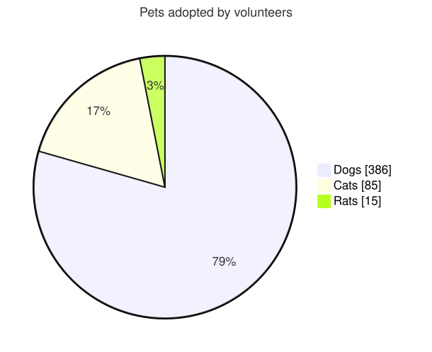

A [PieDiagram](cref:Meziantou.Framework.Diagrams.PieDiagram) draws a pie whose slices are proportional to their values,
with the percentage of each slice and a legend (Mermaid `pie`):

<!-- ref:../../../tests/Meziantou.Framework.Diagrams.Tests/PieDiagramTests.cs;region=Diagrams_PieDiagram;format=md-fenced-code-block;dedent=true -->
```csharp
var diagram = new PieDiagram { Title = "Pets adopted by volunteers", ShowData = true };
diagram.AddSlice("Dogs", 386);
diagram.AddSlice("Cats", 85);
diagram.AddSlice("Rats", 15);
```
<!-- endref -->



## Slices

A [PieSlice](cref:Meziantou.Framework.Diagrams.PieSlice) has a [Label](cref:Meziantou.Framework.Diagrams.PieSlice.Label)
and a [Value](cref:Meziantou.Framework.Diagrams.PieSlice.Value), positive or zero.
[AddSlice](cref:Meziantou.Framework.Diagrams.PieDiagram.AddSlice) adds a slice after the previous one. The slices are drawn
clockwise from the top, in their order, with their percentage of the total.

As Mermaid:

- The slices smaller than 1% of the total are not drawn: the others share the whole circle, but the legend lists every
  slice and the percentages are those of the total.
- A label keeps the value of its first slice: the following slices with the same label are ignored.
- The colors go to the slices in their order, and repeat every 12 slices.

[ShowData](cref:Meziantou.Framework.Diagrams.PieDiagram.ShowData) writes the value of each slice after its label in the
legend.

## Layout and style

| Property | Description | Default |
| --- | --- | --- |
| [TextPosition](cref:Meziantou.Framework.Diagrams.PieDiagram.TextPosition) | The distance of the percentages from the center, from 0 to 1 | 0.75 |
| [DonutHole](cref:Meziantou.Framework.Diagrams.PieDiagram.DonutHole) | The radius of the hole of a donut chart, as a ratio of the radius, up to 0.9 | 0 |
| [LegendPosition](cref:Meziantou.Framework.Diagrams.PieDiagram.LegendPosition) | Where the legend is: right, left, top, bottom or center | Right |
| [HighlightedSlice](cref:Meziantou.Framework.Diagrams.PieDiagram.HighlightedSlice) | The label of the slice drawn bigger and opaque | none |

The colors of the slices come from the theme, as the `pie1` to `pie12` theme variables of Mermaid.
[SliceColors](cref:Meziantou.Framework.Diagrams.PieDiagram.SliceColors) replaces some of them, by position. The other
properties ([StrokeColor](cref:Meziantou.Framework.Diagrams.PieDiagram.StrokeColor),
[StrokeWidth](cref:Meziantou.Framework.Diagrams.PieDiagram.StrokeWidth),
[OuterStrokeColor](cref:Meziantou.Framework.Diagrams.PieDiagram.OuterStrokeColor),
[OuterStrokeWidth](cref:Meziantou.Framework.Diagrams.PieDiagram.OuterStrokeWidth),
[Opacity](cref:Meziantou.Framework.Diagrams.PieDiagram.Opacity),
[SectionTextColor](cref:Meziantou.Framework.Diagrams.PieDiagram.SectionTextColor),
[SectionTextSize](cref:Meziantou.Framework.Diagrams.PieDiagram.SectionTextSize),
[LegendTextColor](cref:Meziantou.Framework.Diagrams.PieDiagram.LegendTextColor) and
[LegendTextSize](cref:Meziantou.Framework.Diagrams.PieDiagram.LegendTextSize)) are the other theme variables of the pie
charts of Mermaid.

## Mermaid syntax

<!-- ref:../../../tests/Meziantou.Framework.Mermaid.Tests/PieDiagramParserTests.cs;region=Mermaid_PieDiagram;format=md-fenced-code-block;dedent=true -->
```csharp
var diagram = (PieDiagram)MermaidDocument.Parse("""
    pie showData
        title Pets adopted by volunteers
        "Dogs" : 386
        "Cats" : 85
        "Rats" : 15
    """).Diagram;
```
<!-- endref -->

A slice is `"label" : value`, a line each. The label is between double or single quotes, where a backslash escapes a
character. The value is a number without exponent; a negative value is an error, as in Mermaid. `showData` follows `pie`
on its line, and the title or the first slice can follow too.

The parser reads `textPosition`, `donutHole`, `legendPosition` and `highlightSlice` in the `pie` section of the
configuration, and the `pie1` to `pie12`, `pieStrokeColor`, `pieStrokeWidth`, `pieOuterStrokeColor`,
`pieOuterStrokeWidth`, `pieOpacity`, `pieSectionTextColor`, `pieSectionTextSize`, `pieLegendTextColor` and
`pieLegendTextSize` theme variables. The differences with Mermaid:

- The title is drawn above the pie as the title of the other diagrams, so `pieTitleTextSize` and `pieTitleTextColor` are
  ignored.
- `highlightSlice: hover`, which highlights the slice under the mouse, is reported as a warning: the drawing is not
  interactive.
- A `textPosition` out of 0 to 1 is reported as a warning and ignored.
