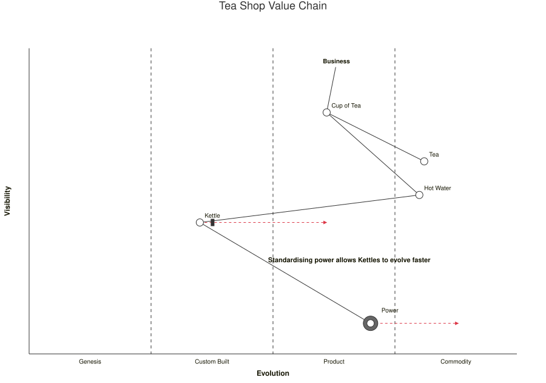

A [WardleyDiagram](cref:Meziantou.Framework.Diagrams.WardleyDiagram) draws a Wardley map: the components of a value
chain, placed by their visibility to the user, from the bottom to the top, and by their evolution, from genesis on the
left to commodity on the right, with their dependencies and their movements (Mermaid `wardley-beta`). The coordinates
are between 0 and 1:

<!-- ref:../../../tests/Meziantou.Framework.Diagrams.Tests/WardleyDiagramTests.cs;region=Diagrams_WardleyDiagram;format=md-fenced-code-block;dedent=true -->
```csharp
var map = new WardleyDiagram { Title = "Tea Shop Value Chain" };
map.AddAnchor("Business", visibility: 0.95, evolution: 0.63);
map.AddComponent("Cup of Tea", 0.79, 0.61);
map.AddComponent("Tea", 0.63, 0.81);
map.AddComponent("Hot Water", 0.52, 0.80);
map.AddComponent("Kettle", 0.43, 0.35).Inertia = true;
map.AddComponent("Power", 0.10, 0.70).Sourcing = WardleySourcing.Outsource;

map.AddLink("Business", "Cup of Tea");
map.AddLink("Cup of Tea", "Tea");
map.AddLink("Cup of Tea", "Hot Water");
map.AddLink("Hot Water", "Kettle");
map.AddLink("Kettle", "Power").Flow = WardleyFlow.Forward;

map.AddEvolve("Kettle", 0.62);
map.AddEvolve("Power", 0.89);
map.AddNote("Standardising power allows Kettles to evolve faster", 0.30, 0.49);
```
<!-- endref -->



## Components

An [anchor](cref:Meziantou.Framework.Diagrams.WardleyAnchor) is a user or a customer whose needs the value chain
serves: its name is drawn in bold. A [component](cref:Meziantou.Framework.Diagrams.WardleyComponent) is a circle with
its name above and to its right, or at its
[LabelOffset](cref:Meziantou.Framework.Diagrams.WardleyComponent.LabelOffset), in pixels. Its
[Sourcing](cref:Meziantou.Framework.Diagrams.WardleySourcing) adds a larger circle around it: very light gray for
built in house, light gray for bought, dark gray for outsourced, and three small circles for a market.
[Inertia](cref:Meziantou.Framework.Diagrams.WardleyComponent.Inertia) draws a thick bar on its right.

The elements are found by name, as in Mermaid: an anchor and a component of the same name are a single node, drawn at
the position of the component, and the last component of a name gives its position.

## Links and movements

A [link](cref:Meziantou.Framework.Diagrams.WardleyLink) joins two names. It can be
[dashed](cref:Meziantou.Framework.Diagrams.WardleyLink.IsDashed), have a
[flow](cref:Meziantou.Framework.Diagrams.WardleyFlow) drawn as arrowheads, and a
[Label](cref:Meziantou.Framework.Diagrams.WardleyLink.Label) drawn along the line. A link to a name that is not on the
map is not drawn. A [movement](cref:Meziantou.Framework.Diagrams.WardleyEvolve) is a dashed red arrow from a component
to the evolution it moves to; the last movement of a component replaces the previous ones.

## Pipelines

A [pipeline](cref:Meziantou.Framework.Diagrams.WardleyPipeline) holds the variants of a component at different stages of
evolution, at the visibility of the component: they are drawn in a box, joined by a dotted line from the least to the
most evolved, and the parent component becomes a square above the middle of the box. A link can use the name of a
component of a pipeline.

## Stages, notes and forces

The [Stages](cref:Meziantou.Framework.Diagrams.WardleyDiagram.Stages) divide the evolution axis with dashed lines:
Genesis, Custom Built, Product and Commodity when the list is empty. A
[stage](cref:Meziantou.Framework.Diagrams.WardleyStage) can have a second name, drawn after a slash, and a
[Boundary](cref:Meziantou.Framework.Diagrams.WardleyStage.Boundary): when every stage has one, the stages end at their
boundaries; otherwise they share the axis equally.

A [note](cref:Meziantou.Framework.Diagrams.WardleyNote) is a bold text. An
[annotation](cref:Meziantou.Framework.Diagrams.WardleyAnnotation) is a number in a circle; when the
[AnnotationsPosition](cref:Meziantou.Framework.Diagrams.WardleyDiagram.AnnotationsPosition) is set, a box lists the
texts of the annotations by number, inside the map. The
[Accelerators](cref:Meziantou.Framework.Diagrams.WardleyDiagram.Accelerators) and the
[Deaccelerators](cref:Meziantou.Framework.Diagrams.WardleyDiagram.Deaccelerators) are the forces on the evolution, drawn
as large arrows pointing right or left, with their name.

## Appearance

The map is drawn on a canvas of [Width](cref:Meziantou.Framework.Diagrams.WardleyDiagram.Width) by
[Height](cref:Meziantou.Framework.Diagrams.WardleyDiagram.Height) pixels, 900 by 600 by default, with the axes at
[MapPadding](cref:Meziantou.Framework.Diagrams.WardleyDiagram.MapPadding) pixels from its edges. Anything outside the
canvas is cut. [ShowGrid](cref:Meziantou.Framework.Diagrams.WardleyDiagram.ShowGrid) divides the map in quarters,
[NodeRadius](cref:Meziantou.Framework.Diagrams.WardleyDiagram.NodeRadius) sets the size of the components, and
[AxisFontSize](cref:Meziantou.Framework.Diagrams.WardleyDiagram.AxisFontSize) and
[LabelFontSize](cref:Meziantou.Framework.Diagrams.WardleyDiagram.LabelFontSize) the size of the texts. The diagram has no
[Padding](cref:Meziantou.Framework.Diagrams.Diagram.Padding), and its
[Title](cref:Meziantou.Framework.Diagrams.Diagram.Title) is drawn above the canvas. The lines and the texts follow the
[theme](../05-Theming.md); the movements are red.

## Mermaid syntax

<!-- ref:../../../tests/Meziantou.Framework.Mermaid.Tests/WardleyDiagramParserTests.cs;region=Mermaid_WardleyDiagram;format=md-fenced-code-block;dedent=true -->
```csharp
var map = (WardleyDiagram)MermaidDocument.Parse("""
    wardley-beta
    title Tea Shop Value Chain

    anchor Business [0.95, 0.63]
    component Cup of Tea [0.79, 0.61]
    component Tea [0.63, 0.81]
    component Hot Water [0.52, 0.80]
    component Kettle [0.43, 0.35] (inertia)
    component Power [0.10, 0.70] (outsource)

    Business -> Cup of Tea
    Cup of Tea -> Tea
    Cup of Tea -> Hot Water
    Hot Water -> Kettle
    Kettle +> Power

    evolve Kettle 0.62
    evolve Power 0.89

    note "Standardising power allows Kettles to evolve faster" [0.30, 0.49]
    """).Diagram;
```
<!-- endref -->

The coordinates are written `[visibility, evolution]`, the vertical position first. A value up to 1 is a fraction of
the axis, and a value between 1 and 100 a percentage; the coordinates of the components need a decimal point (`0.5`,
`50.0`). The statements are:

| Statement | Example |
| --- | --- |
| Canvas size | `size [1100, 800]` |
| Stages | `evolution Genesis@0.25 / Concept -> Custom -> Product -> Commodity` |
| Anchor | `anchor Customer [0.95, 0.9]` |
| Component | `component API [0.6, 0.7] label [-50, 10] (buy) (inertia)` |
| Link | `A -> B`, `A -.-> B` (dashed), `A +> B`, `A +< B`, `A +<> B` (flows), `A +'text'> B`, `A -> B; label` |
| Movement | `evolve API 0.85` |
| Pipeline | `pipeline Database {`, a `component Name [0.5]` per line, then `}` |
| Note | `note "text" [0.4, 0.5]` |
| Annotations | `annotations [0.1, 0.9]`, then `annotation 1,[0.6, 0.65] "text"` |
| Forces | `accelerator "Cloud" [0.2, 0.85]`, `deaccelerator "Legacy" [0.4, 0.35]` |

A name is written as is, with spaces and hyphens, or between quotes. As in Mermaid, the keywords are read before the
names, so a name that starts with one of them, such as `builder` (`build`) or `notes` (`note`), needs quotes. In a
quoted text and in a label, `#35;` and the other entity codes are characters. A pipeline needs a component or an anchor
of its name, and Mermaid checks the target of a movement only when its component is on the map. The parser reads
`width`, `height`, `padding`, `nodeRadius`, `nodeLabelOffset`, `axisFontSize`, `labelFontSize` and `showGrid` in the
`wardley-beta` section of the configuration; `size` replaces `width` and `height`.

The circles of the sourcing are gray as the renderer of Mermaid draws them; the style sheet of Mermaid 12.3.0 overrides
them with the color of the components, which makes them alike. The writer writes the elements grouped by kind, in the
order Mermaid reads them, and the characters a text cannot hold as entity codes.
