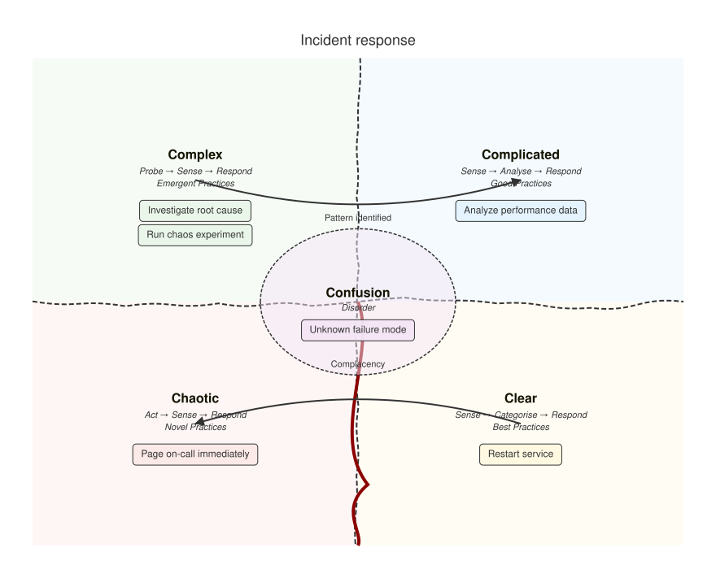

A [CynefinDiagram](cref:Meziantou.Framework.Diagrams.CynefinDiagram) draws the five domains of the Cynefin
sense-making framework, [items](cref:Meziantou.Framework.Diagrams.CynefinItem) placed in them, and
[transitions](cref:Meziantou.Framework.Diagrams.CynefinTransition) between them (Mermaid `cynefin-beta`):

<!-- ref:../../../tests/Meziantou.Framework.Diagrams.Tests/CynefinDiagramTests.cs;region=Diagrams_CynefinDiagram;format=md-fenced-code-block;dedent=true -->
```csharp
var diagram = new CynefinDiagram { Title = "Incident response" };
diagram.AddItem(CynefinDomain.Complex, "Investigate root cause");
diagram.AddItem(CynefinDomain.Complex, "Run chaos experiment");
diagram.AddItem(CynefinDomain.Complicated, "Analyze performance data");
diagram.AddItem(CynefinDomain.Clear, "Restart service");
diagram.AddItem(CynefinDomain.Chaotic, "Page on-call immediately");
diagram.AddItem(CynefinDomain.Confusion, "Unknown failure mode");
diagram.AddTransition(CynefinDomain.Complex, CynefinDomain.Complicated, "Pattern identified");
diagram.AddTransition(CynefinDomain.Clear, CynefinDomain.Chaotic, "Complacency");
```
<!-- endref -->



## Domains, items and transitions

The domains are always at the same place: complex at the top left, complicated at the top right, chaotic at the bottom
left, clear at the bottom right, and confusion in an ellipse in the center. Wavy boundaries separate the quadrants, and
a cliff goes from the center down between the clear and the chaotic domains. Below its name, each domain shows its
decision model and its practices, unless
[ShowDomainDescriptions](cref:Meziantou.Framework.Diagrams.CynefinDiagram.ShowDomainDescriptions) is `false`.

The items are badges below the names of their domains, in their order. The confusion domain shows three items, and a
badge with the number of the others. A transition is a curved arrow from the center of a domain to the center of
another one, with an optional text; a transition to the same domain is not drawn.

[Width](cref:Meziantou.Framework.Diagrams.CynefinDiagram.Width) and
[Height](cref:Meziantou.Framework.Diagrams.CynefinDiagram.Height) are the size of the domains, 800 by 600 pixels, and
the [Padding](cref:Meziantou.Framework.Diagrams.Diagram.Padding) is 40 pixels, as in Mermaid.
[BoundaryAmplitude](cref:Meziantou.Framework.Diagrams.CynefinDiagram.BoundaryAmplitude) sets how much the boundaries
wave (0 draws straight lines), and [Seed](cref:Meziantou.Framework.Diagrams.CynefinDiagram.Seed) chooses their waves
with the random generator of Mermaid: the same seed draws the same waves as Mermaid. Mermaid derives the default seed,
0, from the identifier of the SVG element, so its waves change from page to page; here, the default seed is fixed.

The backgrounds of the domains and the color of the cliff are those of the themes of Mermaid, and the lines and the
texts take the colors of the [theme](../05-Theming.md).
[Colors](cref:Meziantou.Framework.Diagrams.CynefinDiagram.Colors) replaces the colors, the widths of the lines and the
font sizes, as the `cynefin` theme variables of Mermaid do.

## Mermaid syntax

<!-- ref:../../../tests/Meziantou.Framework.Mermaid.Tests/CynefinDiagramParserTests.cs;region=Mermaid_CynefinDiagram;format=md-fenced-code-block;dedent=true -->
```csharp
var diagram = (CynefinDiagram)MermaidDocument.Parse("""
    cynefin-beta
      title Strategy categorization
      complex
        "Market research"
      complicated
        "Competitive analysis"
      clear
        "Standard pricing"
      chaotic
        "Crisis management"
      complex --> complicated : "Pattern identified"
      clear --> chaotic : "Complacency"
    """).Content;
```
<!-- endref -->

The keyword is `cynefin-beta` or `cynefin-beta:`. A domain name (`complex`, `complicated`, `clear`, `chaotic` or
`confusion`) followed by quoted texts is a domain block: the texts are its items, on its line or on the next ones. As
in Mermaid, a second block of a domain replaces the items of the first one. `from --> to : "text"` is a transition,
alone on its line. The texts are between double or single quotes, with backslash escapes such as `\n` and `\"`.

The parser reads the title and the accessibility statements, the `cynefin` section of the configuration (`width`,
`height`, `padding`, `showDomainDescriptions`, `boundaryAmplitude` and `seed`), and the `cynefin` theme variables.
Mermaid reads a width or a font size of 0 as its default, so the writer does not write them.
