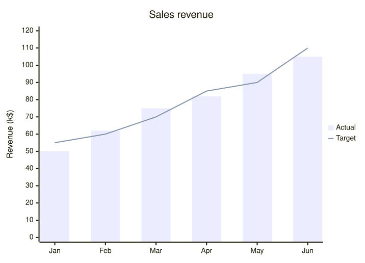

An [XyChartDiagram](cref:Meziantou.Framework.Diagrams.XyChartDiagram) draws series of values as bars and lines, over an
x axis of categories or of numbers and a y axis of numbers (Mermaid `xychart`):

<!-- ref:../../../tests/Meziantou.Framework.Diagrams.Tests/XyChartDiagramTests.cs;region=Diagrams_XyChartDiagram;format=md-fenced-code-block;dedent=true -->
```csharp
var diagram = new XyChartDiagram { Title = "Sales revenue" };
foreach (var month in new[] { "Jan", "Feb", "Mar", "Apr", "May", "Jun" })
{
    diagram.XAxis.Categories.Add(month);
}

diagram.YAxis.Title = "Revenue (k$)";
diagram.YAxis.Range = new XyChartAxisRange(0, 120);
diagram.AddBars([50, 62, 75, 82, 95, 105], "Actual");
diagram.AddLine([55, 60, 70, 85, 90, 110], "Target");
```
<!-- endref -->



## Axes

[XAxis](cref:Meziantou.Framework.Diagrams.XyChartDiagram.XAxis) and [YAxis](cref:Meziantou.Framework.Diagrams.XyChartDiagram.YAxis)
are [XyChartAxis](cref:Meziantou.Framework.Diagrams.XyChartAxis) objects:

- The x axis shows its [Categories](cref:Meziantou.Framework.Diagrams.XyChartAxis.Categories) when it has some: the value
  at an index of a series belongs to the category at the same index, and the values past the last category are not
  drawn. Without categories, it shows the numbers of its [Range](cref:Meziantou.Framework.Diagrams.XyChartAxis.Range),
  and spreads the values of each series over it. Without range either, it numbers the values of the first series from 1.
- The y axis shows the numbers of its [Range](cref:Meziantou.Framework.Diagrams.XyChartAxis.Range), or goes from the
  lowest to the highest value of the series.

An [XyChartAxisRange](cref:Meziantou.Framework.Diagrams.XyChartAxisRange) goes from its start to its end, which can be
lower to reverse the axis. The ticks are the round numbers that d3 picks, about ten of them. Each axis has a
[Title](cref:Meziantou.Framework.Diagrams.XyChartAxis.Title), and options to hide or size its labels, its ticks, its line
and its title. [LabelRotation](cref:Meziantou.Framework.Diagrams.XyChartAxis.LabelRotation) rotates the labels below a
vertical chart.

## Series

[AddBars](cref:Meziantou.Framework.Diagrams.XyChartDiagram.AddBars) and [AddLine](cref:Meziantou.Framework.Diagrams.XyChartDiagram.AddLine)
add an [XyChartBarSeries](cref:Meziantou.Framework.Diagrams.XyChartBarSeries) or an
[XyChartLineSeries](cref:Meziantou.Framework.Diagrams.XyChartLineSeries). The series are drawn in order, and take the
colors of [PlotColors](cref:Meziantou.Framework.Diagrams.XyChartDiagram.PlotColors), or of the theme, in turn. As in
Mermaid, the bars start at the bottom of the plot, not at zero.

- A series with a [Name](cref:Meziantou.Framework.Diagrams.XyChartSeries.Name) is listed in the legend, on the right of
  the plot. [ShowLegend](cref:Meziantou.Framework.Diagrams.XyChartDiagram.ShowLegend) hides it.
- [ShowDataLabels](cref:Meziantou.Framework.Diagrams.XyChartDiagram.ShowDataLabels) writes the value of each bar on it,
  or past its end with [DataLabelsOutsideBars](cref:Meziantou.Framework.Diagrams.XyChartDiagram.DataLabelsOutsideBars),
  in the largest font that fits every bar.
- [PointLabels](cref:Meziantou.Framework.Diagrams.XyChartLineSeries.PointLabels) writes a text next to the points of a
  line, in its color.

## Layout

The chart is a box of [Width](cref:Meziantou.Framework.Diagrams.XyChartDiagram.Width) by
[Height](cref:Meziantou.Framework.Diagrams.XyChartDiagram.Height) pixels (700 by 500 by default), laid out as Mermaid
does: the plot takes [PlotReservedSpacePercent](cref:Meziantou.Framework.Diagrams.XyChartDiagram.PlotReservedSpacePercent)
of the width and of the height, the title, the axes and the legend share the rest, and the plot grows over what they
leave. An element that does not fit is not drawn. The title is drawn inside the box, centered over the plot.
[Orientation](cref:Meziantou.Framework.Diagrams.XyChartDiagram.Orientation) puts the x axis on the left and the y axis
at the top.

## Mermaid syntax

<!-- ref:../../../tests/Meziantou.Framework.Diagrams.Mermaid.Tests/XyChartDiagramParserTests.cs;region=Mermaid_XyChartDiagram;format=md-fenced-code-block;dedent=true -->
```csharp
var diagram = (XyChartDiagram)MermaidDocument.Parse("""
    xychart
        title "Sales Revenue"
        x-axis [jan, feb, mar, apr, may, jun]
        y-axis "Revenue (in $)" 4000 --> 11000
        bar [5000, 6000, 7500, 8200, 9500, 10500]
        line [5000, 6000, 7500, 8200, 9500, 10500]
    """).Diagram;
```
<!-- endref -->

`xychart` and `xychart-beta` are read the same, followed by `horizontal` or `vertical`. The statements are `title`,
`x-axis title [categories]`, `x-axis title start --> end`, `y-axis title start --> end`, `bar name [values]` and
`line name [values]`, where a value of a line can have a quoted label: `line [540 "PaLM", 65]`. The parser follows the
grammar of Mermaid, quirks included: a text without quotes is made of pieces joined without their spaces
(`title Sales Revenue` is `SalesRevenue`), and after `x-axis` and `y-axis` the digits are numbers, so a title such as
`Q1` must be quoted. The entity codes, such as `#35;`, are read in quoted texts only. The labels of the values of a bar
are read but not drawn, as in Mermaid, with a warning.

The `xyChart` section of the configuration sets the options of the chart: `width`, `height`, `titleFontSize`,
`titlePadding`, `showTitle`, `showLegend`, `legendFontSize`, `legendPadding`, `plotReservedSpacePercent`,
`showDataLabel`, `showDataLabelOutsideBar`, `chartOrientation`, and the options of `xAxis` and `yAxis`. The `xyChart`
section of the theme variables sets the colors: `backgroundColor`, `titleColor`, `dataLabelColor`, `legendTextColor`,
the title, label, tick and line colors of each axis, and `plotColorPalette`. The writer writes the options in the front
matter and the colors in an `init` directive.

Differences with Mermaid:

- The axes apply wherever they are written: in Mermaid, a series written before `x-axis` is placed on the axis that
  existed when it was read.
- The values written on the bars are those of each bar: Mermaid writes the values of the first series on every bar
  series, and on the markers of the legend.
- A chart without series is drawn empty: Mermaid reports an error.
