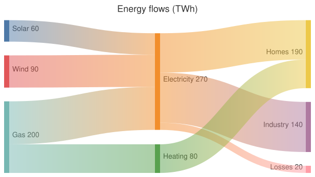

A [SankeyDiagram](cref:Meziantou.Framework.Diagrams.SankeyDiagram) draws flows between nodes: each
[link](cref:Meziantou.Framework.Diagrams.SankeyLink) goes from a source node to a target node, as wide as its value, and
the nodes are as high as the flows that go through them (Mermaid `sankey`):

<!-- ref:../../../tests/Meziantou.Framework.Diagrams.Tests/SankeyDiagramTests.cs;region=Diagrams_SankeyDiagram;format=md-fenced-code-block;dedent=true -->
```csharp
var diagram = new SankeyDiagram { Title = "Energy flows (TWh)", Height = 300 };
diagram.AddLink("Solar", "Electricity", 60);
diagram.AddLink("Wind", "Electricity", 90);
diagram.AddLink("Gas", "Electricity", 120);
diagram.AddLink("Gas", "Heating", 80);
diagram.AddLink("Electricity", "Homes", 110);
diagram.AddLink("Electricity", "Industry", 140);
diagram.AddLink("Electricity", "Losses", 20);
diagram.AddLink("Heating", "Homes", 80);
```
<!-- endref -->



## Nodes and links

[AddLink](cref:Meziantou.Framework.Diagrams.SankeyDiagram.AddLink) adds a link between two nodes, named by the link: the
nodes are the sources and the targets of the links, in the order they appear
([GetNodes](cref:Meziantou.Framework.Diagrams.SankeyDiagram.GetNodes)). The values are positive numbers. The links must
not form a cycle: a link that closes a cycle is not drawn.

The layout is the one of d3-sankey, which Mermaid uses. The nodes are placed in columns by the number of links before
them, then moved toward the nodes they are linked to. [NodeAlignment](cref:Meziantou.Framework.Diagrams.SankeyDiagram.NodeAlignment)
chooses the column of the nodes: [Justify](cref:Meziantou.Framework.Diagrams.SankeyNodeAlignment.Justify) (the default)
puts the nodes without outgoing links in the last column, [Left](cref:Meziantou.Framework.Diagrams.SankeyNodeAlignment.Left)
keeps every node in the column of its depth, [Right](cref:Meziantou.Framework.Diagrams.SankeyNodeAlignment.Right) aligns
the nodes on the last column, and [Center](cref:Meziantou.Framework.Diagrams.SankeyNodeAlignment.Center) puts the nodes
without incoming links just before their first target. [Width](cref:Meziantou.Framework.Diagrams.SankeyDiagram.Width) and
[Height](cref:Meziantou.Framework.Diagrams.SankeyDiagram.Height) are the size of the area of the nodes (600 by 400 pixels
by default), [NodeWidth](cref:Meziantou.Framework.Diagrams.SankeyDiagram.NodeWidth) the width of a node and
[NodePadding](cref:Meziantou.Framework.Diagrams.SankeyDiagram.NodePadding) the space between the nodes of a column.

## Colors and labels

The nodes take the colors of the Tableau 10 scheme, in their order, unless
[NodeColors](cref:Meziantou.Framework.Diagrams.SankeyDiagram.NodeColors) gives them one.
[LinkColoring](cref:Meziantou.Framework.Diagrams.SankeyDiagram.LinkColoring) colors the links with a
[Gradient](cref:Meziantou.Framework.Diagrams.SankeyLinkColoring.Gradient) from the color of their source to the color of
their target (the default), or with the color of their [Source](cref:Meziantou.Framework.Diagrams.SankeyLinkColoring.Source)
or of their [Target](cref:Meziantou.Framework.Diagrams.SankeyLinkColoring.Target);
[LinkColor](cref:Meziantou.Framework.Diagrams.SankeyDiagram.LinkColor) gives every link the same color instead.

The label of a node is its name and its value, between [ValuePrefix](cref:Meziantou.Framework.Diagrams.SankeyDiagram.ValuePrefix)
and [ValueSuffix](cref:Meziantou.Framework.Diagrams.SankeyDiagram.ValueSuffix), rounded to two decimals;
[ShowValues](cref:Meziantou.Framework.Diagrams.SankeyDiagram.ShowValues) hides the values. The labels are after the
nodes of the left half and before the nodes of the right half. With [LabelStyle](cref:Meziantou.Framework.Diagrams.SankeyDiagram.LabelStyle)
set to [Outlined](cref:Meziantou.Framework.Diagrams.SankeyLabelStyle.Outlined), the labels are outlined with the color of
the nodes of the theme, so they stay readable over the links, and placed by column: before the nodes of the columns that
precede the column of the largest node, after the others.

## Mermaid syntax

<!-- ref:../../../tests/Meziantou.Framework.Mermaid.Tests/SankeyDiagramParserTests.cs;region=Mermaid_SankeyDiagram;format=md-fenced-code-block;dedent=true -->
```csharp
var diagram = (SankeyDiagram)MermaidDocument.Parse("""
    sankey

    Solar,Electricity,60
    Wind,Electricity,90
    Gas,Electricity,120
    Gas,Heating,80
    Electricity,"Homes, offices",110
    Electricity,Industry,140
    Heating,"Homes, offices",80
    """).Diagram;
```
<!-- endref -->

`sankey` and `sankey-beta` are read the same. Each line is a link, `source,target,value`, as a row of a CSV file: a name
with a comma, a quote or a line break is between double quotes, and a quote in it is written twice (`"a ""b"", c"`). The
names are trimmed, and the blank lines are ignored. A value is the number that starts its field, as JavaScript reads it
(`1e3` is 1000). The parser reads `width`, `height`, `nodeWidth`, `nodePadding`, `linkColor` (`gradient`, `source`,
`target` or a color), `nodeAlignment`, `showValues`, `prefix`, `suffix`, `labelStyle` (`legacy` or `outlined`) and
`nodeColors` (a mapping of the names of the nodes to colors) in the `sankey` section of the configuration, and the title
of the front matter.

Mermaid rejects the names with characters that are not ASCII, and draws nothing for the values that are not positive
numbers and for the links that form a cycle. Here, the names can have any character, and a value that is not a positive
number or a cycle is an error. The grammar has no accessibility statements, so the writer rejects a diagram with an
[AccessibleTitle](cref:Meziantou.Framework.Diagrams.Diagram.AccessibleTitle) or a
[Description](cref:Meziantou.Framework.Diagrams.Diagram.Description).
