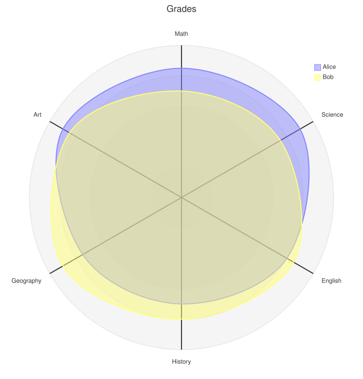

A [RadarDiagram](cref:Meziantou.Framework.Diagrams.RadarDiagram) draws axes around a center, and curves that join a value
on each axis, to compare several series over several dimensions (Mermaid `radar-beta`). It is also known as a spider,
star or polar chart, or a Kiviat diagram:

<!-- ref:../../../tests/Meziantou.Framework.Diagrams.Tests/RadarDiagramTests.cs;region=Diagrams_RadarDiagram;format=md-fenced-code-block;dedent=true -->
```csharp
var diagram = new RadarDiagram { Title = "Grades", Maximum = 100 };
diagram.AddAxis("m", "Math");
diagram.AddAxis("s", "Science");
diagram.AddAxis("e", "English");
diagram.AddAxis("h", "History");
diagram.AddAxis("g", "Geography");
diagram.AddAxis("a", "Art");
diagram.AddCurve("a", "Alice", 85, 90, 80, 70, 75, 90);
diagram.AddCurve("b", "Bob", 70, 75, 85, 80, 90, 85);
```
<!-- endref -->



## Axes and curves

A [RadarAxis](cref:Meziantou.Framework.Diagrams.RadarAxis) has a [Name](cref:Meziantou.Framework.Diagrams.RadarAxis.Name)
and a [Label](cref:Meziantou.Framework.Diagrams.RadarAxis.Label), drawn at its end. The axes are clockwise from the top.
A [RadarCurve](cref:Meziantou.Framework.Diagrams.RadarCurve) has a name, a label for the legend, and
[Values](cref:Meziantou.Framework.Diagrams.RadarCurve.Values) in the order of the axes. As Mermaid, a curve that does not
have a value for each axis is not drawn, but the legend lists it. The curves take the colors of the palette of the theme,
in their order.

## Scale

| Property | Description | Default |
| --- | --- | --- |
| [Maximum](cref:Meziantou.Framework.Diagrams.RadarDiagram.Maximum) | The value at the end of the axes | The largest value of the curves |
| [Minimum](cref:Meziantou.Framework.Diagrams.RadarDiagram.Minimum) | The value at the center | 0 |
| [Ticks](cref:Meziantou.Framework.Diagrams.RadarDiagram.Ticks) | The number of circles or polygons of the scale, up to 32 | 5 |
| [Graticule](cref:Meziantou.Framework.Diagrams.RadarDiagram.Graticule) | Circles with rounded curves, or polygons with straight curves | Circle |
| [ShowLegend](cref:Meziantou.Framework.Diagrams.RadarDiagram.ShowLegend) | Whether the legend lists the curves, in the top right corner | true |

The values out of the scale are drawn at the center or at the end of the axes.

The size of the chart is that of Mermaid: [Width](cref:Meziantou.Framework.Diagrams.RadarDiagram.Width) and
[Height](cref:Meziantou.Framework.Diagrams.RadarDiagram.Height) (600), and margins of 50.
[AxisScaleFactor](cref:Meziantou.Framework.Diagrams.RadarDiagram.AxisScaleFactor) sets the length of the axis lines,
[AxisLabelFactor](cref:Meziantou.Framework.Diagrams.RadarDiagram.AxisLabelFactor) the distance of their labels, and
[CurveTension](cref:Meziantou.Framework.Diagrams.RadarDiagram.CurveTension) how round the curves are. The colors, widths,
opacities and font sizes ([AxisColor](cref:Meziantou.Framework.Diagrams.RadarDiagram.AxisColor),
[CurveOpacity](cref:Meziantou.Framework.Diagrams.RadarDiagram.CurveOpacity),
[GraticuleColor](cref:Meziantou.Framework.Diagrams.RadarDiagram.GraticuleColor)...) are the radar theme variables of
Mermaid.

## Mermaid syntax

<!-- ref:../../../tests/Meziantou.Framework.Diagrams.Mermaid.Tests/RadarDiagramParserTests.cs;region=Mermaid_RadarDiagram;format=md-fenced-code-block;dedent=true -->
```csharp
var diagram = (RadarDiagram)MermaidDocument.Parse("""
    radar-beta
      title Restaurant Comparison
      axis food["Food Quality"], service["Service"], price["Price"]
      axis ambiance["Ambiance"]
      curve a["Restaurant A"]{4, 3, 2, 4}
      curve b["Restaurant B"]{ price: 3, service: 4, ambiance: 3, food: 3 }
      graticule polygon
      max 5
    """).Diagram;
```
<!-- endref -->

`axis` declares axes, `id` or `id["label"]`, separated by commas. `curve` declares curves, `id["label"]{values}`, where
the values are numbers in the order of the axes, or `axis: value` pairs in any order. The options are `showLegend`
(`true` or `false`), `ticks`, `max`, `min` and `graticule` (`circle` or `polygon`); the last value of an option wins. As
the grammar of Mermaid, the statements do not need their own lines, and the values of a curve can span lines.

An identifier is made of ASCII letters, digits, underscores and dashes, and starts with a letter or an underscore. As
Mermaid, an identifier cannot be a keyword, nor start with `true`, `false`, `circle`, `polygon` or `title`, which Mermaid
reads as other tokens.

The parser reads `width`, `height`, the margins, `axisScaleFactor`, `axisLabelFactor` and `curveTension` in the `radar`
section of the configuration, and the `radar` theme variables. The differences with Mermaid:

- A number of ticks that is not an integer is rounded up, and reported as a warning.
- The colors of the curves repeat after the 12 colors of the palette, where Mermaid leaves the next curves black.
- The names `accTitle` and `accDescr` are not identifiers.
