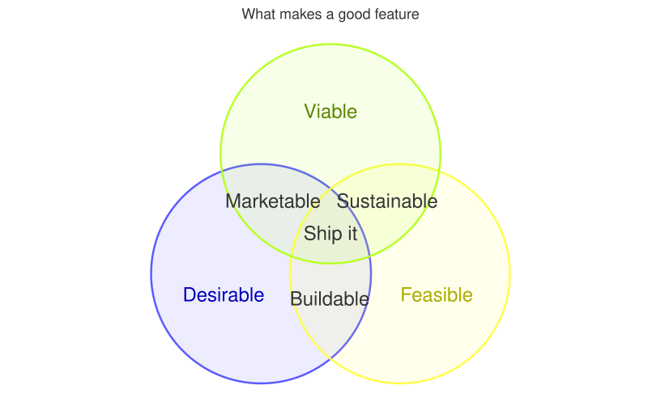
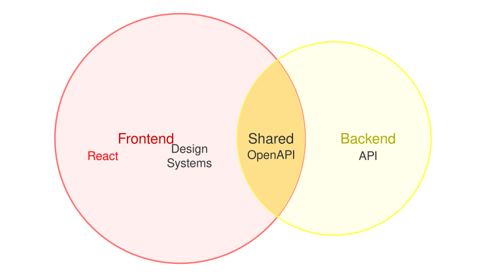

A [VennDiagram](cref:Meziantou.Framework.Diagrams.VennDiagram) draws sets as circles, and the overlaps of the sets as
the regions where the circles cross (Mermaid `venn-beta`). Add the sets with
[AddSet](cref:Meziantou.Framework.Diagrams.VennDiagram.AddSet), then their overlaps with
[AddOverlap](cref:Meziantou.Framework.Diagrams.VennDiagram.AddOverlap):

<!-- ref:../../../tests/Meziantou.Framework.Diagrams.Tests/VennDiagramTests.cs;region=Diagrams_VennDiagram;format=md-fenced-code-block;dedent=true -->
```csharp
var diagram = new VennDiagram { Title = "What makes a good feature" };
diagram.AddSet("Desirable");
diagram.AddSet("Feasible");
diagram.AddSet("Viable");
diagram.AddOverlap(["Desirable", "Feasible"], "Buildable");
diagram.AddOverlap(["Feasible", "Viable"], "Sustainable");
diagram.AddOverlap(["Desirable", "Viable"], "Marketable");
diagram.AddOverlap(["Desirable", "Feasible", "Viable"], "Ship it");
```
<!-- endref -->



## Areas and sizes

Each [VennArea](cref:Meziantou.Framework.Diagrams.VennArea) is a set, or the overlap of several sets, with a
[Label](cref:Meziantou.Framework.Diagrams.VennArea.Label) and a [Size](cref:Meziantou.Framework.Diagrams.VennArea.Size).
A set without a label shows its identifier; an overlap without a label shows nothing. The size is the area of the
circle, or of the overlap, relative to the other sizes: without one, a set has a size of 10 and an overlap of two sets
2.5, as in Mermaid. A set of size 0 is not drawn, nor its overlaps.

The circles are laid out with the algorithm of venn.js, the library Mermaid uses: the circles are moved until their
overlaps have the requested areas, as closely as circles allow. An overlap of three sets or more adds the overlaps of
its pairs of sets, with a quarter of the size of the smaller set, so the circles cross where the overlap is drawn.
The sets that do not overlap are packed side by side. The layout is deterministic: the same diagram gives the same
drawing on every platform.

The diagram is 800 by 450 pixels, as in Mermaid; set [Width](cref:Meziantou.Framework.Diagrams.VennDiagram.Width) and
[Height](cref:Meziantou.Framework.Diagrams.VennDiagram.Height) to change it. The texts and the outlines grow with the
width.

## Texts and styles

[AddText](cref:Meziantou.Framework.Diagrams.VennDiagram.AddText) places a text inside an area: the texts of an area are
laid out in a grid around its label, and wrap to the width of their cell. A
[VennStyle](cref:Meziantou.Framework.Diagrams.VennStyle) sets the fill, the opacity of the fill, the outline and the
color of the label of an area, or the color of a text, by its identifier:

<!-- ref:../../../tests/Meziantou.Framework.Diagrams.Tests/VennDiagramTests.cs;region=Diagrams_VennDiagramTexts;format=md-fenced-code-block;dedent=true -->
```csharp
var diagram = new VennDiagram();
diagram.AddSet("A", "Frontend", size: 20);
diagram.AddSet("B", "Backend", size: 12);
diagram.AddOverlap(["A", "B"], "Shared", size: 3);
diagram.AddText(["A"], "A1", "React");
diagram.AddText(["A"], "A2", "Design Systems");
diagram.AddText(["B"], "B1", "API");
diagram.AddText(["A", "B"], "AB1", "OpenAPI");
diagram.AddStyle(["A"], new VennStyle { Fill = "#ff6b6b" });
diagram.AddStyle(["A", "B"], new VennStyle { Fill = "#ffe08a", TextColor = "#333333" });
diagram.AddStyle(["A1"], new VennStyle { TextColor = "red" });
```
<!-- endref -->



A circle is filled with its color at an opacity of 0.1, and outlined with it; its label is the color, darker (lighter
in a dark theme). An overlap is transparent, unless a style fills it. The colors of the sets come from the
[theme](../05-Theming.md), in the order of the sets, and [SetColors](cref:Meziantou.Framework.Diagrams.VennDiagram.SetColors)
replaces them (Mermaid `venn1` to `venn8`).

## Mermaid syntax

<!-- ref:../../../tests/Meziantou.Framework.Diagrams.Mermaid.Tests/VennDiagramParserTests.cs;region=Mermaid_VennDiagram;format=md-fenced-code-block;dedent=true -->
```csharp
var diagram = (VennDiagram)MermaidDocument.Parse("""
    venn-beta
      title Team skills
      set A["Frontend"]:20
        text A1["React"]
        text A2["Design Systems"]
      set B["Backend"]:12
        text B1["API"]
      union A,B["Shared"]:3
        text AB1["OpenAPI"]
      style A fill:#ff6b6b
      style A,B color:#333
      style A1 color:red
    """).Diagram;
```
<!-- endref -->

The keyword `venn-beta` starts the diagram, and the keywords are read in any case:

- `set id` declares a set, and `union a,b` an overlap of sets declared before it. An identifier is a word or a quoted
  string. Both take an optional label, `["label"]` or `[label]`, and an optional size, `:20`.
- `text id ["label"]` on an indented line after a `set` or a `union` places a text in that area; `text a,b id` names the
  sets of the area, at the start of a line.
- `style a,b fill:#ff6b6b, color:red` styles an area, or a text by its identifier, with `fill`, `fill-opacity`,
  `stroke`, `stroke-width` and `color`; the parser warns about the other properties.
- `title text` sets the title, which cannot contain `#` nor `;`, as the front matter `title`.

The statements need no line break between them. `%%` starts a comment, and the entity codes (`#quot;`) are decoded in
the strings, the labels and the title. The parser reads `width` and `height` in the `venn` section of the configuration,
and the theme variables `venn1` to `venn8` and `vennSetTextColor`.

The differences with Mermaid:

- The title is drawn above the circles, as for the other diagrams: Mermaid draws it inside the 450 pixels.
- The texts are placed in the circles as they are drawn: Mermaid lays them out a second time, with a padding of 8
  pixels instead of 15, so they can be a few pixels off the circles.
- A negative or infinite size, more than 32 sets, or more texts than `MaxNodes` is an error.
- The hand-drawn look and `useDebugLayout` are not supported.

The Mermaid syntax has no accessibility statements: the writer throws when the diagram has an
[AccessibleTitle](cref:Meziantou.Framework.Diagrams.Diagram.AccessibleTitle) or a
[Description](cref:Meziantou.Framework.Diagrams.Diagram.Description), and when an overlap names a set that no earlier
set declares.
