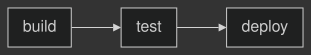

[DiagramTheme](cref:Meziantou.Framework.Diagrams.DiagramTheme) holds the colors and the font of a diagram. The library
has the five themes of Mermaid: [Default](cref:Meziantou.Framework.Diagrams.DiagramTheme.Default),
[Dark](cref:Meziantou.Framework.Diagrams.DiagramTheme.Dark), [Forest](cref:Meziantou.Framework.Diagrams.DiagramTheme.Forest),
[Neutral](cref:Meziantou.Framework.Diagrams.DiagramTheme.Neutral) and [Base](cref:Meziantou.Framework.Diagrams.DiagramTheme.Base),
with the colors Mermaid 12 computes for them. A theme is a record: change some of its colors with `with`:

<!-- ref:../../tests/Meziantou.Framework.Diagrams.Tests/FlowchartTests.cs;region=Diagrams_Themes;format=md-fenced-code-block;dedent=true -->
```csharp
var flowchart = new FlowchartDiagram { Theme = DiagramTheme.Dark, Direction = DiagramDirection.LeftToRight };
flowchart.AddEdge("build", "test");
flowchart.AddEdge("test", "deploy");

// A theme is a record: change some of its colors with "with"
var custom = new FlowchartDiagram { Theme = DiagramTheme.Default with { NodeBackground = (SceneColor)"#e0f2fe", NodeBorderColor = (SceneColor)"#0369a1" } };
custom.AddEdge("build", "test");
```
<!-- endref -->



The properties have the names of the theme variables of Mermaid, in the documentation of each one.

## Fonts

[FontSize](cref:Meziantou.Framework.Diagrams.DiagramTheme.FontSize) is 16 pixels, as in Mermaid. The texts are measured
with the metrics of Helvetica, and the SVG asks for `Helvetica, Arial, sans-serif`. To measure with another font, set
[TextMeasurer](cref:Meziantou.Framework.Diagrams.Diagram.TextMeasurer) (see
[text measurement](../VectorGraphics/04-TextMeasurement.md)); [FontFamily](cref:Meziantou.Framework.Diagrams.DiagramTheme.FontFamily)
only changes the CSS `font-family` of the SVG.

## Themes in Mermaid text

The configuration of a Mermaid text chooses the theme with `theme`, and changes its colors with `themeVariables`. The
`base` theme derives every color from `primaryColor`, `background` and `darkMode`, as Mermaid does:

<!-- ref:../../tests/Meziantou.Framework.Diagrams.Mermaid.Tests/MermaidDocumentTests.cs;region=Mermaid_ThemeVariables;format=md-fenced-code-block;dedent=true -->
```csharp
var document = MermaidDocument.Parse("""
    %%{init: {'theme': 'base', 'themeVariables': {'primaryColor': '#bbf7d0', 'lineColor': '#166534', 'fontSize': '14px'}}}%%
    flowchart LR
        A --> B
    """);

// The base theme derives the other colors from primaryColor, as Mermaid does
var theme = document.Diagram.Theme;
Assert.Equal((SceneColor)"#bbf7d0", theme.NodeBackground);
Assert.Equal((SceneColor)"#166534", theme.LineColor);
Assert.Equal(14, theme.FontSize);
```
<!-- endref -->

The other themes take the variables as they are. The themes `neo` and `redux` of Mermaid 12, and the hand-drawn look,
are not supported: the parser reports a warning and uses the default theme (or the dark theme for their dark variants).
