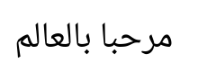

Shaping turns characters into positioned glyphs: the font chooses the forms of the letters that join, makes ligatures,
places the marks and kerns the pairs. A renderer draws the glyphs of shaping, not the glyphs of the character map.

## Shape a run

`TextShaper.AddText` puts the characters of a text in a `GlyphBuffer`, and `TextShaper.Shape` replaces them with the
glyphs of the font and their positions:

<!-- ref:../../tests/Meziantou.Framework.Imaging.Tests/TextShaperTests.cs;region=Fonts_Shape;format=md-fenced-code-block;dedent=true -->
```csharp
static string Shape(FontFace face, string text, params ReadOnlySpan<ShapingFeature> features)
{
    var buffer = new GlyphBuffer(face.Data.Limits);
    TextShaper.AddText(buffer, text);
    TextShaper.Shape(buffer, face, UnicodeScript.Latin, languages: [], isRightToLeft: false, features);

    // Each glyph: its identifier, the index of the first character of its cluster, and its advance in font units
    var glyphs = new List<string>();
    for (var i = 0; i < buffer.Length; i++)
    {
        glyphs.Add(string.Create(CultureInfo.InvariantCulture, $"{buffer.Info[i].Glyph}@{buffer.Info[i].Cluster}+{buffer.Positions[i].XAdvance}"));
    }

    return string.Join(' ', glyphs);
}

// The pair "AV" is kerned: the advance of A is reduced
Assert.Equal("34@0+599 55@1+600", Shape(face, "AV"));

// The features to turn on or off, besides the default ones
Assert.Equal("34@0+639 55@1+600", Shape(face, "AV", new ShapingFeature("kern", 0)));
```
<!-- endref -->

For each glyph, the buffer has:

- `Info[i].Glyph`, the glyph to draw, and `Info[i].Cluster`, the index of the first character of its cluster in the text.
  The glyphs that shaping ties together (a ligature, a letter and its marks) share a cluster: a caret, a selection or a
  line break never separates them.
- `Positions[i].XAdvance` and `YAdvance`, how far the pen moves after the glyph, and `XOffset` and `YOffset`, where the
  glyph is drawn from the pen. They are in font units.

`Info[i].IsUnsafeToBreak` marks the glyphs before which the text cannot be broken without shaping both parts again:
what the font did there depends on the characters on both sides, such as joined letters or a kerned pair.

## Draw the glyphs

Draw each glyph at the pen position plus its offset, then move the pen by its advance. This example shapes Arabic text,
and draws its glyphs with the drawing API of [Meziantou.Framework.Imaging](../Imaging/07-Drawing/01-Overview.md),
through an `OutlineSink` that adds the outlines to a path (see [Glyphs](04-Glyphs.md#decode-an-outline)):

<!-- ref:../../tests/Meziantou.Framework.Imaging.Tests/Documentation/DocumentationImageTests.cs;region=Fonts_PathSink;format=md-fenced-code-block;dedent=true -->
```csharp
// Adds the outline of a glyph to a path, scaled from font units: the y axis of a font goes up, the one of an image down
private sealed class PathSink(VectorPathBuilder builder, double originX, double originY, double scale) : OutlineSink
{
    public override void MoveTo(double x, double y) => builder.MoveTo(X(x), Y(y));

    public override void LineTo(double x, double y) => builder.LineTo(X(x), Y(y));

    public override void QuadraticTo(double controlX, double controlY, double x, double y) => builder.QuadraticBezierTo(X(controlX), Y(controlY), X(x), Y(y));

    public override void CubicTo(double control1X, double control1Y, double control2X, double control2Y, double x, double y) => builder.CubicBezierTo(X(control1X), Y(control1Y), X(control2X), Y(control2Y), X(x), Y(y));

    public override void Close() => builder.Close();

    private double X(double x) => originX + (x * scale);

    private double Y(double y) => originY - (y * scale);
}
```
<!-- endref -->

<!-- ref:../../tests/Meziantou.Framework.Imaging.Tests/Documentation/DocumentationImageTests.cs;region=Fonts_DrawShapedText;format=md-fenced-code-block;dedent=true -->
```csharp
static VectorPath ShapeToPath(FontFace face, string text, double size, PointD origin)
{
    // Arabic is written from right to left, with joined letters: shaping chooses the form of each letter
    var buffer = new GlyphBuffer(face.Data.Limits);
    TextShaper.AddText(buffer, text);
    TextShaper.Shape(buffer, face, UnicodeScript.Arabic, OpenTypeLanguage.GetTags("ar"), isRightToLeft: true, features: []);

    // The glyphs are in the order they are drawn, from the left; positions are in font units
    var scale = size / face.UnitsPerEm;
    var builder = new VectorPathBuilder();
    using var scratch = new GlyphScratch(face.Data.Environment.CreateAllocator("outline"));
    var penX = 0;
    for (var i = 0; i < buffer.Length; i++)
    {
        var position = buffer.Positions[i];
        var x = origin.X + ((penX + position.XOffset) * scale);
        var y = origin.Y - (position.YOffset * scale);
        var budget = new GlyphBudget(face.Data.Limits);
        face.DecodeOutline(buffer.Info[i].Glyph, new PathSink(builder, x, y, scale), scratch, ref budget);
        penX += position.XAdvance;
    }

    return builder.Build();
}

// "Hello, world" in Arabic, drawn with the drawing API of Meziantou.Framework.Imaging
var text = "\u0645\u0631\u062D\u0628\u0627 \u0628\u0627\u0644\u0639\u0627\u0644\u0645";
using var image = new Image<Rgba32>(220, 80, Colors.White);
image.Draw(canvas => canvas.Fill(Colors.Black, ShapeToPath(face, text, size: 40, origin: new PointD(16, 52))));
```
<!-- endref -->



The glyphs of a right-to-left run are given in the order they are drawn, from the left; their clusters decrease.

## Runs

A run has one font, one script, one language and one direction. Split a text into runs before shaping it:

- the script runs of `Unicode.EnumerateScriptRuns` (see [Scripts](../Unicode/04-Scripts.md#split-a-text-into-runs-of-one-script));
- the levels of `UnicodeBidi`, a run having one level (see [Bidirectional text](../Unicode/11-BidirectionalText.md));
- the characters the font has: give the others to another font.

| Parameter of `Shape` | Description |
| --- | --- |
| `script` | The `UnicodeScript` of the run: it selects the shaping model and the script of the layout tables |
| `languages` | The OpenType tags of the language, by order of preference: `OpenTypeLanguage.GetTags("ar")`; empty for the default language system |
| `isRightToLeft` | The run is laid out from right to left |
| `features` | The features to turn on or off, besides the default ones |
| `isVertical` | The run is laid out from top to bottom, its glyphs upright, with the vertical forms of the font |
| `scratch` | The working storage that measures the outlines of a font without vertical origins, for a vertical run |
| `cache` | A `ShapingCache` the runs of a layout share; `Trim` it before keeping it for the next layout |
| `areCharactersMirrored` | The characters of a right-to-left run are already replaced by their mirrored forms |

When a run is a part of a longer text, give the characters around it with `GlyphBuffer.SetContext`: the letters of a
joining script take the forms they have in the whole text.

## Features

The features applied to every horizontal run are the ones the OpenType specification asks for by default: `ccmp`,
`locl`, `rlig`, `calt`, `clig`, `liga`, `rclt`, the direction features, the fractions around a fraction slash, and
`abvm`, `blwm`, `mark`, `mkmk`, `curs`, `dist` and `kern` for positioning. Complex scripts add the features of their
shaping model.

A `ShapingFeature` turns a feature on (1) or off (0), or selects an alternate (a larger value), for the whole run or for
the clusters between `Start` and `End`:

- `new ShapingFeature("liga", 0)` turns the ligatures off;
- `new ShapingFeature("smcp")` turns the small capitals on;
- `new ShapingFeature(ShapingFeature.ToTag("salt"), 2, start, end)` selects the second stylistic alternate of a range.

## Limits

The glyphs of a shaped text are bounded by `FontResourceLimits.MaxTextGlyphs`, and the work of the lookups of the font
is in proportion with the text: a font cannot make shaping run without end. `Shape` throws `InvalidFontException` for a
malformed layout table, and `FontResourceLimitException` when the glyphs exceed the limit.
