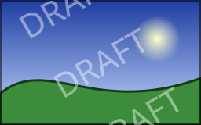
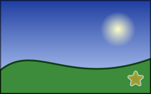

A watermark marks an image as yours, or as a draft: a text repeated across the picture, or a logo in a corner. Both are
drawn with the canvas of the image, with a color or an opacity that lets the picture show through.

## Repeat a text across the image

<!-- ref:../../../samples/Meziantou.Framework.Imaging.Samples/Examples.cs;region=Imaging_DrawWatermark;format=md-fenced-code-block;dedent=true -->
```csharp
public static void DrawWatermark(string fontPath, string inputPath, string outputPath)
{
    using var image = Image.Load(inputPath);
    var layout = TextLayout.Create("DRAFT", Font.Load(fontPath), size: image.Width / 6.0);
    var ink = new SolidBrush(new Rgba32(255, 255, 255, 110));
    var center = new PointD(image.Width / 2.0, image.Height / 2.0);

    image.Draw(canvas =>
    {
        // Everything the callback draws is turned around the center of the image: the text is drawn as usual
        canvas.Transform(AffineTransform.CreateRotation(-30, center), turned =>
        {
            for (var row = -1; row <= 1; row++)
            {
                var middle = new PointD(center.X, center.Y + (row * layout.Height * 1.5));
                turned.FillText(ink, layout, layout.GetOrigin(middle, TextHorizontalAnchor.Center, TextVerticalAnchor.Center));
            }
        });
    });

    image.Save(outputPath);
}
```
<!-- endref -->



- [TextLayout.Create](cref:Meziantou.Framework.Imaging.Typography.TextLayout.Create) shapes the text once, with the font and the size; the example sizes it from the width of the image,
  so the watermark keeps its proportions on images of any size. Fonts are loaded from files: see
  [Fonts](../08-Text/02-Fonts.md).
- The alpha of the brush (110 out of 255) makes the text translucent.
- `canvas.Transform` turns everything that its callback draws, here by 30 degrees around the center of the image. See
  [Transformations](../07-Drawing/04-Transformations.md).
- `layout.GetOrigin` places the text by its center instead of its top-left corner. See
  [Drawing text](../08-Text/03-DrawingText.md).

## Draw a logo in a corner

<!-- ref:../../../samples/Meziantou.Framework.Imaging.Samples/GuideExamples.cs;region=Imaging_AddLogoWatermark;format=md-fenced-code-block;dedent=true -->
```csharp
public static void AddLogoWatermark(string inputPath, string logoPath, string outputPath)
{
    using var image = Image.Load(inputPath);
    using var logo = Image.Load(logoPath);

    // The logo takes at most a quarter of the width and of the height of the image, whatever their sizes
    logo.Resize(new ResizeOptions(image.Width / 4, image.Height / 4) { AllowUpscaling = false });

    // At a position on whole pixels, the pixels of the logo are drawn as they are, faded by the opacity
    var margin = image.Width / 40;
    var position = new PointD(image.Width - logo.Width - margin, image.Height - logo.Height - margin);

    // Draw paints every frame of an animation identically
    image.Draw(canvas => canvas.DrawImage(logo.Frames[0], position, opacity: 0.6));
    image.Save(outputPath);
}
```
<!-- endref -->



- The logo is resized to the image, so that it covers the same part of a small and of a large picture. Use a logo with a
  transparent background, such as a PNG file: its transparent pixels stay transparent.
- [DrawImage](cref:Meziantou.Framework.Imaging.Drawing.DrawingCanvas.DrawImage) draws a frame of another image at a position, and its `opacity` (from 0 to 1) fades it. At a position on
  whole pixels, the pixels of the logo are not interpolated. Other overloads stretch the image to a rectangle, draw a
  part of it, or place it with a transformation.
- The logo is drawn as it is stored: no color profile is applied. Convert the logo and the image to the same color
  space first when they have different profiles (see [Color management](../09-Color/03-ColorManagement.md)).
- An image that is not yet upright (a photo with an EXIF orientation) gets the logo in the wrong corner: call
  [AutoOrient](cref:Meziantou.Framework.Imaging.ImageProcessingExtensions.AutoOrient) before drawing.

## Watermark an animation

[Image.Draw](cref:Meziantou.Framework.Imaging.Image.Draw) draws on every frame of the image, so both examples work on animated GIF, APNG and WebP files: the watermark
is painted identically on each frame, and the durations and the loop count are kept. The output format must store
animations. See [Drawing on animations](../07-Drawing/07-DrawingOnAnimations.md).

## Make the watermark harder to remove

A watermark in a corner is easy to crop. A text repeated across the whole image, or a logo drawn in the middle with a low
opacity, is harder to remove. Publish the watermarked copy only, never the original file next to it.
