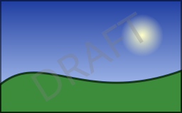
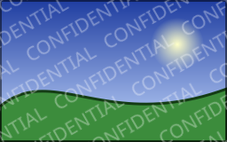
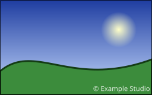
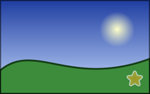

A watermark marks an image as yours, or as a draft: a text across the picture, a text repeated over all of it, or a logo
in a corner. [AddWatermark](cref:Meziantou.Framework.Imaging.ImageProcessingExtensions.AddWatermark) draws a text watermark in place; a logo is drawn with the canvas of the image.

## Draw a text across the image

<!-- ref:../../../samples/Meziantou.Framework.Imaging.Samples/GuideExamples.cs;region=Imaging_AddWatermark;format=md-fenced-code-block;dedent=true -->
```csharp
public static void AddWatermark(string fontPath, string inputPath, string outputPath)
{
    using var image = Image.Load(inputPath);

    // By default, the text is gray at 30% opacity, along the diagonal, and as large as 80% of the image allows
    image.AddWatermark("DRAFT", new ImageWatermarkOptions(Font.Load(fontPath)));
    image.Save(outputPath);
}
```
<!-- endref -->



- [ImageWatermarkOptions](cref:Meziantou.Framework.Imaging.ImageWatermarkOptions) takes the fonts of the text: the library never picks a font by itself, so the watermark looks the
  same on every machine. Fonts are loaded from files: see [Fonts](../08-Text/02-Fonts.md). A character that is in
  none of the fonts throws an `ArgumentException` before any pixel changes.
- By default, the text is gray (128, 128, 128) at 30% opacity, along the diagonal from the bottom-left corner to the
  top-right corner, and as large as fits in 80% of the image: the watermark keeps its proportions on images of any
  size. `FontSize` (in pixels), `Rotation` (in degrees, counterclockwise), `Color` and `Opacity` change them.
- The text is placed by the box of what it draws (its ink), not by its line: the center of the ink is on the center of
  the image.

## Repeat a text across the image

<!-- ref:../../../samples/Meziantou.Framework.Imaging.Samples/GuideExamples.cs;region=Imaging_AddTiledWatermark;format=md-fenced-code-block;dedent=true -->
```csharp
public static void AddTiledWatermark(string fontPath, string inputPath, string outputPath)
{
    using var image = Image.Load(inputPath);
    var options = new ImageWatermarkOptions(Font.Load(fontPath))
    {
        IsTiled = true,
        FontSize = image.Width / 12.0,
        Rotation = 30,
        Color = new Rgba32(255, 255, 255),
        Opacity = 0.35,
    };

    // Rows of copies cover the image, each one offset by half a copy: the text cannot be cropped out
    image.AddWatermark("CONFIDENTIAL", options);
    image.Save(outputPath);
}
```
<!-- endref -->



- With `IsTiled`, the text is repeated in rows along the turned text, each row offset by half a copy, with a copy in
  the center of the image. `TileSpacing` is the gap between two copies, along the text and between the rows, in
  pixels; it is the height of the text by default.
- Without a `FontSize`, a tiled text is a twentieth of the diagonal of the image.
- The copies are drawn once in a pattern ([PatternBrush](cref:Meziantou.Framework.Imaging.Drawing.PatternBrush)) that fills the image: the cost depends on the size of the
  image, not on the number of copies.

## Write a text in a corner

<!-- ref:../../../samples/Meziantou.Framework.Imaging.Samples/GuideExamples.cs;region=Imaging_AddCornerWatermark;format=md-fenced-code-block;dedent=true -->
```csharp
public static void AddCornerWatermark(string fontPath, string inputPath, string outputPath)
{
    using var image = Image.Load(inputPath);
    var options = new ImageWatermarkOptions(Font.Load(fontPath))
    {
        Position = WatermarkPosition.BottomRight,
        FontSize = image.Height / 14.0,
        Color = new Rgba32(255, 255, 255),
        Opacity = 0.8,
    };

    // In a corner, the text is horizontal, at a fortieth of the smaller side of the image from its edges
    image.AddWatermark("© Example Studio", options);
    image.Save(outputPath);
}
```
<!-- endref -->



- `Position` places the text in a corner, against an edge or in the center ([WatermarkPosition](cref:Meziantou.Framework.Imaging.WatermarkPosition)). In a corner or
  against an edge, the text is horizontal by default, and the box of the turned text is at `Margin` pixels from the
  edges: a fortieth of the smaller side of the image by default.
- Without a `FontSize`, the text is a twentieth of the diagonal of the image.
- An image that is not yet upright (a photo with an EXIF orientation) gets the text in the wrong corner: call
  [AutoOrient](cref:Meziantou.Framework.Imaging.ImageProcessingExtensions.AutoOrient) first.

To draw a text in a way the options do not offer (an outline, a shadow, several lines with their own styles), draw it
with the canvas of the image: see [Turn a text](../08-Text/03-DrawingText.md#turn-a-text).

## Draw a logo in a corner

<!-- ref:../../../samples/Meziantou.Framework.Imaging.Samples/GuideExamples.cs;region=Imaging_AddLogoWatermark;format=md-fenced-code-block;dedent=true -->
```csharp
public static void AddLogoWatermark(string inputPath, string logoPath, string outputPath)
{
    using var image = Image.Load(inputPath);
    using var logo = Image.Load(logoPath);

    // The logo takes at most a quarter of the width and of the height of the image, whatever their sizes
    logo.Resize(new ResizeOptions(image.Width / 4, image.Height / 4) { AllowUpscaling = false });

    // At a position on whole pixels, the pixels of the logo are drawn as they are, faded by the opacity
    var margin = image.Width / 40;
    var position = new PointD(image.Width - logo.Width - margin, image.Height - logo.Height - margin);

    // Draw paints every frame of an animation identically
    image.Draw(canvas => canvas.DrawImage(logo.Frames[0], position, opacity: 0.6));
    image.Save(outputPath);
}
```
<!-- endref -->



- The logo is resized to the image, so that it covers the same part of a small and of a large picture. Use a logo with a
  transparent background, such as a PNG file: its transparent pixels stay transparent.
- [DrawImage](cref:Meziantou.Framework.Imaging.Drawing.DrawingCanvas.DrawImage) draws a frame of another image at a position, and its `opacity` (from 0 to 1) fades it. At a position on
  whole pixels, the pixels of the logo are not interpolated. Other overloads stretch the image to a rectangle, draw a
  part of it, or place it with a transformation.
- The logo is drawn as it is stored: no color profile is applied. Convert the logo and the image to the same color
  space first when they have different profiles (see [Color management](../09-Color/03-ColorManagement.md)).
- An image that is not yet upright (a photo with an EXIF orientation) gets the logo in the wrong corner: call
  [AutoOrient](cref:Meziantou.Framework.Imaging.ImageProcessingExtensions.AutoOrient) before drawing.

## Watermark an animation

[AddWatermark](cref:Meziantou.Framework.Imaging.ImageProcessingExtensions.AddWatermark) and [Image.Draw](cref:Meziantou.Framework.Imaging.Image.Draw) draw on every frame of the image, so all the examples work on animated GIF, APNG and WebP files: the watermark
is painted identically on each frame, and the durations and the loop count are kept. The output format must store
animations. See [Drawing on animations](../07-Drawing/07-DrawingOnAnimations.md).

## Make the watermark harder to remove

A watermark in a corner is easy to crop. A text repeated across the whole image, or a logo drawn in the middle with a low
opacity, is harder to remove. Publish the watermarked copy only, never the original file next to it.
