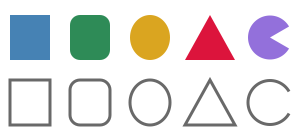
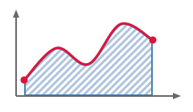
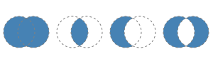
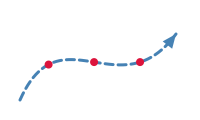

The canvas fills and strokes the common shapes directly. Any other shape is a [VectorPath](cref:Meziantou.Framework.Imaging.Drawing.VectorPath): built once, then drawn,
transformed, combined or measured as many times as needed.

## Draw simple shapes

<!-- ref:../../../samples/Meziantou.Framework.Imaging.Samples/DrawingExamples.cs;region=Imaging_DrawBasicShapes;format=md-fenced-code-block;dedent=true -->
```csharp
public static void DrawBasicShapes(string outputPath)
{
    using var image = new Image<Rgba32>(300, 140, Colors.White);
    var pen = new Pen(Colors.DimGray, 3);
    PointD[] triangle = [new(210, 15), new(235, 60), new(185, 60)];
    PointD[] outlinedTriangle = [new(210, 80), new(235, 125), new(185, 125)];

    image.Draw(canvas =>
    {
        // Filled shapes
        canvas.FillRectangle(Colors.SteelBlue, new RectangleD(10, 15, 40, 45));
        canvas.FillRoundedRectangle(Colors.SeaGreen, new RectangleD(70, 15, 40, 45), 10);
        canvas.FillEllipse(Colors.Goldenrod, new PointD(150, 37.5), 20, 22.5);
        canvas.FillPolygon(Colors.Crimson, triangle);
        canvas.FillPie(Colors.MediumPurple, new PointD(270, 37.5), 22, 30, 300); // from 30 degrees, clockwise

        // The same shapes, stroked: the pen is centered on their outline
        canvas.StrokeRectangle(pen, new RectangleD(10, 80, 40, 45));
        canvas.StrokeRoundedRectangle(pen, new RectangleD(70, 80, 40, 45), 10);
        canvas.StrokeEllipse(pen, new PointD(150, 102.5), 20, 22.5);
        canvas.StrokePolygon(pen, outlinedTriangle);
        canvas.StrokeArc(pen, new PointD(270, 102.5), 22, 30, 300); // the arc alone, without the sides of the slice
    });

    image.Save(outputPath);
}
```
<!-- endref -->



| Shape | Fill | Stroke |
| --- | --- | --- |
| Whole canvas | `Fill(brush)` | |
| Rectangle | [FillRectangle](cref:Meziantou.Framework.Imaging.Drawing.DrawingCanvas.FillRectangle) | [StrokeRectangle](cref:Meziantou.Framework.Imaging.Drawing.DrawingCanvas.StrokeRectangle) |
| Rounded rectangle | [FillRoundedRectangle](cref:Meziantou.Framework.Imaging.Drawing.DrawingCanvas.FillRoundedRectangle) | [StrokeRoundedRectangle](cref:Meziantou.Framework.Imaging.Drawing.DrawingCanvas.StrokeRoundedRectangle) |
| Ellipse, circle | [FillEllipse](cref:Meziantou.Framework.Imaging.Drawing.DrawingCanvas.FillEllipse), [FillCircle](cref:Meziantou.Framework.Imaging.Drawing.DrawingCanvas.FillCircle) | [StrokeEllipse](cref:Meziantou.Framework.Imaging.Drawing.DrawingCanvas.StrokeEllipse), [StrokeCircle](cref:Meziantou.Framework.Imaging.Drawing.DrawingCanvas.StrokeCircle) |
| Slice of a disk, arc | [FillPie](cref:Meziantou.Framework.Imaging.Drawing.DrawingCanvas.FillPie) | [StrokeArc](cref:Meziantou.Framework.Imaging.Drawing.DrawingCanvas.StrokeArc) |
| Polygon | [FillPolygon](cref:Meziantou.Framework.Imaging.Drawing.DrawingCanvas.FillPolygon) | [StrokePolygon](cref:Meziantou.Framework.Imaging.Drawing.DrawingCanvas.StrokePolygon) |
| Line, polyline | | [StrokeLine](cref:Meziantou.Framework.Imaging.Drawing.DrawingCanvas.StrokeLine), [StrokePolyline](cref:Meziantou.Framework.Imaging.Drawing.DrawingCanvas.StrokePolyline) |
| Bézier curve | | [StrokeBezier](cref:Meziantou.Framework.Imaging.Drawing.DrawingCanvas.StrokeBezier) (one or two control points) |
| Curve through points | [FillClosedCurve](cref:Meziantou.Framework.Imaging.Drawing.DrawingCanvas.FillClosedCurve) | [StrokeCurve](cref:Meziantou.Framework.Imaging.Drawing.DrawingCanvas.StrokeCurve), [StrokeClosedCurve](cref:Meziantou.Framework.Imaging.Drawing.DrawingCanvas.StrokeClosedCurve) |
| Any path | `Fill(brush, path)` | `Stroke(pen, path)` |

- The radius of a rounded rectangle is limited to half its sides. A [CornerRadii](cref:Meziantou.Framework.Imaging.Drawing.CornerRadii) gives each corner its own radius (a
  tab, a speech bubble; zero for a square corner); when the radii of the two corners of a side add up to more than the
  side, every radius is reduced by the same factor, as CSS does.
- A slice or an arc starts at an angle and turns by a sweep, in degrees from the positive x axis, clockwise on the
  image. A sweep beyond 360 degrees is the whole ellipse.

## Draw a curve through points

[StrokeCurve](cref:Meziantou.Framework.Imaging.Drawing.DrawingCanvas.StrokeCurve) draws a smooth curve that goes through a list of points, such as the line of a chart. [StrokeClosedCurve](cref:Meziantou.Framework.Imaging.Drawing.DrawingCanvas.StrokeClosedCurve)
and [FillClosedCurve](cref:Meziantou.Framework.Imaging.Drawing.DrawingCanvas.FillClosedCurve) go back from the last point to the first one.

<!-- ref:../../../samples/Meziantou.Framework.Imaging.Samples/Examples.cs;region=Imaging_DrawChart;format=md-fenced-code-block;dedent=true -->
```csharp
public static void DrawChart(string outputPath)
{
    using var image = new Image<Rgba32>(240, 140, Colors.White);
    PointD[] values = [new(30, 100), new(70, 60), new(110, 80), new(150, 30), new(190, 50)];

    // Hatching: a tile of 6 by 6 with a stripe, drawn once, repeated, and turned by the transformation of the brush
    var hatch = new PatternBrush(new Rectangle(0, 0, 6, 6), tile => tile.FillRectangle(Colors.LightSteelBlue, new Rectangle(0, 0, 3, 6)))
    {
        Transform = AffineTransform.CreateRotation(45),
    };
    var axis = new Pen(Colors.DimGray, 2) { EndMarker = LineMarker.Arrow };
    var line = new Pen(Colors.Crimson, 3) { StartMarker = LineMarker.Circle, EndMarker = LineMarker.Circle };
    var border = new Pen(Colors.SteelBlue, 2) { Alignment = PenAlignment.Inside };

    // The area under the curve: the curve through the values, closed by the axis
    var area = new VectorPathBuilder().MoveTo(values[0]).CurveTo(values.AsSpan(1)).LineTo(190, 120).LineTo(30, 120).Close().Build();

    image.Draw(canvas =>
    {
        // The outline is inside the area: it does not go over the axis
        canvas.Fill(hatch, area);
        canvas.Stroke(border, area);

        // The head of each arrow has its tip at the end of the line
        canvas.StrokeLine(axis, new PointD(20, 120), new PointD(225, 120));
        canvas.StrokeLine(axis, new PointD(20, 120), new PointD(20, 12));

        // The curve goes smoothly through every value, with a disk at both ends
        canvas.StrokeCurve(line, values);
    });

    image.Save(outputPath);
}
```
<!-- endref -->



The curve is made of cubic Bézier curves from each point to the next one; at each point, it has the direction of the
line between the points around it. The `tension` says how far it keeps that direction: 0.5 (the default) is a
Catmull-Rom spline, 0 gives straight segments, and 1 the roundest curve. Where the points turn sharply, the curve can go
beyond them. [CurveTo](cref:Meziantou.Framework.Imaging.Drawing.VectorPathBuilder.CurveTo), [AddCurve](cref:Meziantou.Framework.Imaging.Drawing.VectorPathBuilder.AddCurve) and [AddClosedCurve](cref:Meziantou.Framework.Imaging.Drawing.VectorPathBuilder.AddClosedCurve) add the same curves to a path.

## Build a path

A [VectorPathBuilder](cref:Meziantou.Framework.Imaging.Drawing.VectorPathBuilder) adds segments to a path, then [Build](cref:Meziantou.Framework.Imaging.Drawing.VectorPathBuilder.Build) returns it:

<!-- ref:../../../samples/Meziantou.Framework.Imaging.Samples/DrawingExamples.cs;region=Imaging_DrawPathBuilder;format=md-fenced-code-block;dedent=true -->
```csharp
public static void DrawPin(string outputPath)
{
    // The outline of a map pin: two curves from its tip, and the top half of a circle between them
    var pin = new VectorPathBuilder()
        .MoveTo(60, 110)
        .QuadraticBezierTo(30, 70, 30, 45)
        .ArcTo(30, 30, 0, largeArc: false, clockwise: true, 90, 45)
        .QuadraticBezierTo(90, 70, 60, 110)
        .Close()
        .AddCircle(new PointD(60, 45), 12) // a second contour, inside the first one
        .Build();

    using var image = new Image<Rgba32>(120, 120, Colors.White);
    image.Draw(canvas =>
    {
        // With the even-odd rule, the circle is inside two contours: it is a hole
        canvas.Fill(Colors.Crimson, pin, FillRule.EvenOdd);
        canvas.Stroke(new Pen(Colors.DarkRed, 2) { LineJoin = LineJoin.Round }, pin);
    });

    image.Save(outputPath);
}
```
<!-- endref -->


| Method | Adds |
| --- | --- |
| [MoveTo](cref:Meziantou.Framework.Imaging.Drawing.VectorPathBuilder.MoveTo) | Starts a new contour at a point |
| [LineTo](cref:Meziantou.Framework.Imaging.Drawing.VectorPathBuilder.LineTo) | A straight segment |
| [QuadraticBezierTo](cref:Meziantou.Framework.Imaging.Drawing.VectorPathBuilder.QuadraticBezierTo), [CubicBezierTo](cref:Meziantou.Framework.Imaging.Drawing.VectorPathBuilder.CubicBezierTo) | A Bézier curve with one or two control points |
| [ArcTo](cref:Meziantou.Framework.Imaging.Drawing.VectorPathBuilder.ArcTo) | An arc of an ellipse (see below) |
| [CurveTo](cref:Meziantou.Framework.Imaging.Drawing.VectorPathBuilder.CurveTo) | A smooth curve through points, from the current point |
| [Close](cref:Meziantou.Framework.Imaging.Drawing.VectorPathBuilder.Close) | A straight segment back to the start of the contour, and closes it |
| [AddRectangle](cref:Meziantou.Framework.Imaging.Drawing.VectorPathBuilder.AddRectangle), [AddRoundedRectangle](cref:Meziantou.Framework.Imaging.Drawing.VectorPathBuilder.AddRoundedRectangle), [AddEllipse](cref:Meziantou.Framework.Imaging.Drawing.VectorPathBuilder.AddEllipse), [AddCircle](cref:Meziantou.Framework.Imaging.Drawing.VectorPathBuilder.AddCircle), [AddPolygon](cref:Meziantou.Framework.Imaging.Drawing.VectorPathBuilder.AddPolygon) | A closed contour of that shape |
| [AddArc](cref:Meziantou.Framework.Imaging.Drawing.VectorPathBuilder.AddArc), [AddPie](cref:Meziantou.Framework.Imaging.Drawing.VectorPathBuilder.AddPie) | An open arc around a center, or the closed slice between an arc and its center |
| [AddCurve](cref:Meziantou.Framework.Imaging.Drawing.VectorPathBuilder.AddCurve), [AddClosedCurve](cref:Meziantou.Framework.Imaging.Drawing.VectorPathBuilder.AddClosedCurve) | A smooth curve through points |

A path holds any number of contours. An open contour is closed by a straight segment when it is filled, and gets the
caps of the pen when it is stroked.

[ArcTo](cref:Meziantou.Framework.Imaging.Drawing.VectorPathBuilder.ArcTo) comes in two forms:

- The arc of SVG paths: the radii and the rotation of the ellipse, the large-arc and direction flags, and the end
  point. Radii too small to reach the end point are enlarged.
- The arc around a center: the radii, the angle of its first point and its sweep. A straight segment joins the current
  point to the start of the arc.

An arc is an element of the path like a curve: it ends exactly on its end point, and it stays an arc when the path is
transformed.

## Choose what is inside: fill rules

When contours overlap or a contour crosses itself, the [FillRule](cref:Meziantou.Framework.Imaging.Drawing.FillRule) decides what is inside:

<!-- ref:../../../samples/Meziantou.Framework.Imaging.Samples/DrawingExamples.cs;region=Imaging_DrawFillRules;format=md-fenced-code-block;dedent=true -->
```csharp
public static void DrawFillRules(string outputPath)
{
    // A star drawn as one contour that crosses itself: each point is two tips further than the previous one
    var center = new PointD(55, 60);
    var points = new PointD[5];
    for (var i = 0; i < points.Length; i++)
    {
        points[i] = AffineTransform.CreateRotation(i * 144, center).Transform(new PointD(center.X, center.Y - 48));
    }

    var star = new VectorPathBuilder().AddPolygon(points).Build();
    var outline = new Pen(Colors.DarkSlateBlue, 2) { LineJoin = LineJoin.Round };

    using var image = new Image<Rgba32>(220, 110, Colors.White);
    image.Draw(canvas =>
    {
        // Non-zero (the default): everything the contour winds around, the pentagon in the middle included
        canvas.Fill(Colors.Orange, star);
        canvas.Stroke(outline, star);

        // Even-odd: the pentagon is inside the contour twice, so it is not filled
        var right = star.Transform(AffineTransform.CreateTranslation(110, 0));
        canvas.Fill(Colors.Orange, right, FillRule.EvenOdd);
        canvas.Stroke(outline, right);
    });

    image.Save(outputPath);
}
```
<!-- endref -->


- [FillRule.NonZero](cref:Meziantou.Framework.Imaging.Drawing.FillRule.NonZero) (the default) fills everything the contours wind around.
- [FillRule.EvenOdd](cref:Meziantou.Framework.Imaging.Drawing.FillRule.EvenOdd) makes a hole wherever an even number of contours overlap. It is the simplest way to cut a hole in
  a shape, as the map pin above does.

[Fill](cref:Meziantou.Framework.Imaging.Drawing.DrawingCanvas.Fill), [FillPolygon](cref:Meziantou.Framework.Imaging.Drawing.DrawingCanvas.FillPolygon), [FillClosedCurve](cref:Meziantou.Framework.Imaging.Drawing.DrawingCanvas.FillClosedCurve) and [Clip](cref:Meziantou.Framework.Imaging.Drawing.DrawingCanvas.Clip) take a fill rule.

## Use SVG path data

[VectorPath.ParseSvgPathData](cref:Meziantou.Framework.Imaging.Drawing.VectorPath.ParseSvgPathData) reads the `d` attribute of an SVG `path` element, the format icons come in:

<!-- ref:../../../samples/Meziantou.Framework.Imaging.Samples/Examples.cs;region=Imaging_DrawIcon;format=md-fenced-code-block;dedent=true -->
```csharp
public static string DrawIcon(string outputPath)
{
    // The path data of an icon of 24 by 24 pixels, as the "d" attribute of an SVG file has it
    var heart = VectorPath.ParseSvgPathData("M12 21.35l-1.45-1.32C5.4 15.36 2 12.28 2 8.5 2 5.42 4.42 3 7.5 3c1.74 0 3.41.81 4.5 2.09C13.09 3.81 14.76 3 16.5 3 19.58 3 22 5.42 22 8.5c0 3.78-3.4 6.86-8.55 11.54L12 21.35z");

    // A path is scaled before it is drawn or cut: its curves stay curves
    var icon = heart.Transform(AffineTransform.CreateScale(4, 4));
    var outline = new Pen(Colors.Crimson, 3) { LineCap = LineCap.Round, LineJoin = LineJoin.Round };

    using var image = new Image<Rgba32>(96, 96, Colors.White);
    image.Draw(canvas =>
    {
        canvas.Fill(Colors.MistyRose, icon);

        // The first three quarters of the outline
        canvas.Stroke(outline, icon.Trim(0, icon.GetLength() * 0.75));
    });

    image.Save(outputPath);
    return icon.ToSvgPathData();
}
```
<!-- endref -->


- Every command is supported (`M L H V C S Q T A Z`, absolute and relative), with the grammar of SVG, in the
  coordinates of the canvas (Y grows downward, as in SVG).
- The whole text must be valid: an error throws a `FormatException` that gives its position, where a browser would
  draw what comes before it. [TryParseSvgPathData](cref:Meziantou.Framework.Imaging.Drawing.VectorPath.TryParseSvgPathData) returns `false` instead.
- [ToSvgPathData](cref:Meziantou.Framework.Imaging.Drawing.VectorPath.ToSvgPathData) writes a path in the same format, with absolute coordinates. Lines and curves read back exactly, arcs
  to a few units in the last place.

## Combine paths

[Combine](cref:Meziantou.Framework.Imaging.Drawing.VectorPath.Combine) returns the outline of what two paths fill, combined by a [PathCombineMode](cref:Meziantou.Framework.Imaging.Drawing.PathCombineMode):

<!-- ref:../../../samples/Meziantou.Framework.Imaging.Samples/DrawingExamples.cs;region=Imaging_CombinePaths;format=md-fenced-code-block;dedent=true -->
```csharp
public static void DrawCombinedPaths(string outputPath)
{
    var first = new VectorPathBuilder().AddCircle(new PointD(27, 45), 22).Build();
    var second = new VectorPathBuilder().AddCircle(new PointD(47, 45), 22).Build();
    PathCombineMode[] modes = [PathCombineMode.Union, PathCombineMode.Intersect, PathCombineMode.Exclude, PathCombineMode.Xor];
    var guide = new Pen(Colors.Gray, 1) { DashPattern = [3, 3] };

    using var image = new Image<Rgba32>(300, 90, Colors.White);
    image.Draw(canvas =>
    {
        for (var i = 0; i < modes.Length; i++)
        {
            // The result is a path: it is filled, stroked or combined again like any other one
            var cell = AffineTransform.CreateTranslation(i * 75, 0);
            canvas.Fill(Colors.SteelBlue, first.Combine(second, modes[i]).Transform(cell));
            canvas.Stroke(guide, first.Transform(cell));
            canvas.Stroke(guide, second.Transform(cell));
        }
    });

    image.Save(outputPath);
}
```
<!-- endref -->



| Mode | Keeps |
| --- | --- |
| [Union](cref:Meziantou.Framework.Imaging.Drawing.PathCombineMode.Union) | What one of the paths fills |
| [Intersect](cref:Meziantou.Framework.Imaging.Drawing.PathCombineMode.Intersect) | What both paths fill |
| [Exclude](cref:Meziantou.Framework.Imaging.Drawing.PathCombineMode.Exclude) | What the first path fills and the second one does not |
| [Xor](cref:Meziantou.Framework.Imaging.Drawing.PathCombineMode.Xor) | What only one of the paths fills |

What each path fills is decided by a [FillRule](cref:Meziantou.Framework.Imaging.Drawing.FillRule), the same for both paths, or one for each path with the overload
that takes two: a star drawn as one contour that crosses itself keeps its center with the non-zero rule and loses it
with the even-odd rule, whatever the rule of the shape it is combined with.

[Simplify](cref:Meziantou.Framework.Imaging.Drawing.VectorPath.Simplify) returns the outline of what one path fills: a path that crosses itself, or whose contours overlap, becomes
the boundary of its area. The result of both is made of closed contours that do not cross: the outer ones turn
clockwise on the image and the holes the other way, so both fill rules paint the same pixels.

The result is made of straight segments, so combine paths at the size they are drawn at. The time grows with the number
of segments and of their crossings: pass a `CancellationToken` for paths that come from untrusted input.

## Grow, shrink and round a shape

<!-- ref:../../../samples/Meziantou.Framework.Imaging.Samples/Examples.cs;region=Imaging_DrawSticker;format=md-fenced-code-block;dedent=true -->
```csharp
public static void DrawSticker(string outputPath)
{
    // A star: a point above the center, at the radius of a tip or of a notch, turned by a tenth of a turn each time
    var center = new PointD(60, 62);
    var points = new PointD[10];
    for (var i = 0; i < points.Length; i++)
    {
        points[i] = AffineTransform.CreateRotation(i * 36, center).Transform(new PointD(center.X, center.Y - (i % 2 == 0 ? 44 : 20)));
    }

    // Its corners become arcs of a circle of radius 4
    var star = new VectorPathBuilder().AddPolygon(points).Build().RoundCorners(4);

    // The outline of the star 6 pixels further out, with round corners: the white border of a sticker
    var border = star.Offset(6, LineJoin.Round);

    // And 5 pixels further in: a line that follows the shape, inside it
    var seam = new Pen(new Rgba32(255, 255, 255, 170), 1.5) { DashPattern = [4, 3] };
    var inner = star.Offset(-5, LineJoin.Round);

    using var image = new Image<Rgba32>(120, 120);
    image.Draw(canvas =>
    {
        canvas.Shadow(new Rgba32(0, 0, 0, 90), new PointD(0, 2), 3, shadowed => shadowed.Fill(Colors.White, border));
        canvas.Fill(Colors.Goldenrod, star);
        canvas.Stroke(seam, inner);
    });

    image.Save(outputPath);
}
```
<!-- endref -->


- `Offset(distance)` moves the outline of a shape outward by a distance, or inward when it is negative: a margin around
  a shape, an outline at a distance of it, a shape that fits inside another one. Every side moves by the distance, a
  hole gets smaller when the shape grows, and what is narrower than twice the distance disappears when it shrinks. The
  [LineJoin](cref:Meziantou.Framework.Imaging.Drawing.LineJoin) gives the shape of the corners that move away ([Miter](cref:Meziantou.Framework.Imaging.Drawing.LineJoin.Miter) by default; with [Round](cref:Meziantou.Framework.Imaging.Drawing.LineJoin.Round), the result is everything
  within the distance of the shape). Curves stay round. The result is made of straight segments, as with [Combine](cref:Meziantou.Framework.Imaging.Drawing.VectorPath.Combine).
- `RoundCorners(radius)` replaces each corner between two straight segments by an arc of that radius: a polygon, a star
  or an arrow with soft corners. Corners where a curve or an arc starts or ends are kept, and the result stays smooth
  when it is enlarged.

## Measure and cut a path

A path answers the questions a drawing asks about a shape:

<!-- ref:../../../samples/Meziantou.Framework.Imaging.Samples/Examples.cs;region=Imaging_DrawRoute;format=md-fenced-code-block;dedent=true -->
```csharp
public static void DrawRoute(string outputPath)
{
    using var image = new Image<Rgba32>(200, 120, Colors.White);
    var route = new VectorPathBuilder().MoveTo(20, 100).CubicBezierTo(60, 10, 120, 110, 176, 34).Build();

    // An arrow head that points to the right, with its tip at the origin
    var arrowHead = new VectorPathBuilder().AddPolygon([new PointD(0, 0), new PointD(-14, -6), new PointD(-14, 6)]).Build();

    // The end of the route and its direction there. The transformation turns the x axis to that direction, then
    // moves the origin to the end of the route.
    var length = route.GetLength();
    _ = route.TryGetPointAtDistance(length, out var tip, out var direction);
    var head = arrowHead.Transform(new AffineTransform(direction.X, direction.Y, -direction.Y, direction.X, tip.X, tip.Y));

    var line = new Pen(Colors.SteelBlue, 3) { DashPattern = [8, 5], LineCap = LineCap.Round };
    image.Draw(canvas =>
    {
        canvas.Stroke(line, route);
        canvas.Fill(Colors.SteelBlue, head);

        // A milestone at each quarter of the way
        for (var i = 1; i <= 3; i++)
        {
            _ = route.TryGetPointAtDistance(length * i / 4, out var milestone, out _);
            canvas.FillCircle(Colors.Crimson, milestone, 4);
        }
    });

    image.Save(outputPath);
}
```
<!-- endref -->



| Member | Gives |
| --- | --- |
| `Contains(point, fillRule)` | Whether a point is inside: what a fill paints |
| [GetLength()](cref:Meziantou.Framework.Imaging.Drawing.VectorPath.GetLength) | The length of the path |
| [TryGetPointAtDistance](cref:Meziantou.Framework.Imaging.Drawing.VectorPath.TryGetPointAtDistance) | The point at a distance along the path, and the direction of the path there |
| [TryGetClosestPoint](cref:Meziantou.Framework.Imaging.Drawing.VectorPath.TryGetClosestPoint) | The point of the path nearest to a position, and its distance along the path: where a click falls on a line |
| [StrokeContains](cref:Meziantou.Framework.Imaging.Drawing.VectorPath.StrokeContains) | Whether a pen that strokes the path paints a point: a click on a line, with its caps, joins, dashes and markers |
| [Bounds](cref:Meziantou.Framework.Imaging.Drawing.VectorPath.Bounds), [GetTightBounds()](cref:Meziantou.Framework.Imaging.Drawing.VectorPath.GetTightBounds) | The box of the points and control points, and the box the path really reaches |
| `GetBounds(pen)` | A box that contains what a pen paints, without computing the stroke |
| `Widen(pen)` | The path a pen paints when it strokes the path: fill it with the non-zero rule |
| [EnumerateSegments()](cref:Meziantou.Framework.Imaging.Drawing.VectorPath.EnumerateSegments) | The segments of the path, as the builder methods that add them, without allocating |
| [Reverse()](cref:Meziantou.Framework.Imaging.Drawing.VectorPath.Reverse) | The path followed from its end |
| `Trim(start, end)` | The part of the path between two distances: a line drawn progressively, the arc of a gauge |
| `Transform(transform)` | The path moved, turned or scaled: curves stay curves, so it stays smooth when enlarged |

With [Widen](cref:Meziantou.Framework.Imaging.Drawing.VectorPath.Widen), the other members answer for a stroke too: the exact bounds of a stroke are the tight bounds of the
widened path. [StrokeContains](cref:Meziantou.Framework.Imaging.Drawing.VectorPath.StrokeContains) answers what the widened path contains without creating it: only the parts of the path
near the point are stroked, so a click on a long path stays cheap. The widened path is made of overlapping
pieces; [Simplify](cref:Meziantou.Framework.Imaging.Drawing.VectorPath.Simplify) turns it into one outline. Lengths and positions are measured on the path as it is drawn, with its
curves replaced by short chords: transform a path before cutting it, not after.

Each of these members walks the whole path. To ask many questions about the same path (a marker that moves along it,
a pointer that moves over it), create a [VectorPathMeasure](cref:Meziantou.Framework.Imaging.Drawing.VectorPathMeasure) once: it keeps the chords of the path and gives the same
length, points at a distance and closest points, finding a distance by a binary search and skipping the parts of the
path that are far from a position. A path cannot change once it is built, so a measure stays valid as long as it is kept.
