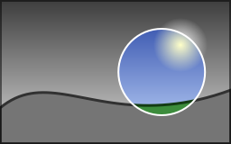
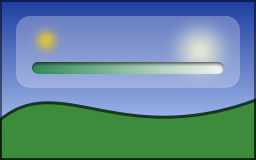
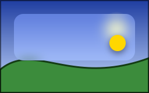
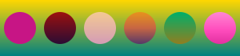

Most effects take a callback: what the callback draws is drawn on a layer, the effect applies to the layer as a whole,
then the layer is drawn on the canvas. Effects nest in any order, with transformations too.

## Clip a drawing to a shape

`canvas.Clip(path, callback)` (or a rectangle) runs a callback whose drawings only change the inside of the path. The
clip lasts as long as the callback, and a clip started inside another one keeps what both let through.

<!-- ref:../../../samples/Meziantou.Framework.Imaging.Samples/DrawingExamples.cs;region=Imaging_DrawSpotlight;format=md-fenced-code-block;dedent=true -->
```csharp
public static void DrawSpotlight(string inputPath, string outputPath)
{
    using var image = Image.Load(inputPath);
    var spot = new PointD(image.Width * 0.7, image.Height / 2.0);

    // The image and a circle: with the even-odd rule, the circle is a hole, so the clip is everything around it
    var around = new VectorPathBuilder()
        .AddRectangle(new RectangleD(0, 0, image.Width, image.Height))
        .AddCircle(spot, 48)
        .Build();

    image.Draw(canvas =>
    {
        canvas.Clip(around, outside => outside.FilterBackdrop(ColorMatrix.CreateGrayscale()), FillRule.EvenOdd);
        canvas.StrokeCircle(new Pen(Colors.White, 2), spot, 48);
    });

    image.Save(outputPath);
}
```
<!-- endref -->



- The edge of a clip is antialiased like the edge of a shape.
- A clip takes a fill rule: with [FillRule.EvenOdd](cref:Meziantou.Framework.Imaging.Drawing.FillRule.EvenOdd), a circle inside a rectangle is a hole, so the clip is everything
  around the circle.
- A rectangle on whole pixels is exact and free. Any other clip keeps one value per pixel of its bounds while it lasts.

## Fade a group of shapes: layers

`canvas.Layer(opacity, callback)` draws the callback on a transparent image of the size of the canvas, then draws that
image on the canvas as a whole. Shapes that overlap, drawn one after the other with a translucent paint, show through
each other; in a layer they are drawn as they are, then faded together:

<!-- ref:../../../samples/Meziantou.Framework.Imaging.Samples/Examples.cs;region=Imaging_DrawBadge;format=md-fenced-code-block;dedent=true -->
```csharp
public static void DrawBadge(string outputPath)
{
    using var image = new Image<Rgba32>(220, 120, Colors.WhiteSmoke);
    var card = new RectangleD(30, 24, 160, 64);
    var face = new LinearGradientBrush(new PointD(0, 24), new PointD(0, 88), [new GradientStop(0, Rgba32.ParseHex("#4F8EF7")), new GradientStop(1, Rgba32.ParseHex("#2456C8"))]) { ColorSpace = GradientColorSpace.Oklab };
    var shine = new SolidBrush(new Rgba32(255, 255, 255, 90)) { BlendMode = BlendMode.SoftLight };
    var mark = new SolidBrush(Colors.White);

    image.Draw(canvas =>
    {
        // The card and its shadow: black at a third of its opacity, 6 pixels down, blurred
        canvas.Shadow(new Rgba32(0, 0, 0, 85), new PointD(0, 6), 5, shadowed =>
            shadowed.FillRoundedRectangle(face, card, new CornerRadii(18, 18, 4, 18)));

        // A light that lightens the top of the card without hiding it, only where the card is
        canvas.Clip(new VectorPathBuilder().AddRoundedRectangle(card, new CornerRadii(18, 18, 4, 18)).Build(), clipped =>
            clipped.FillEllipse(shine, new PointD(110, 20), 120, 34));

        // Two disks that overlap, faded together: they do not show through each other
        canvas.Layer(0.6, layer =>
        {
            layer.FillCircle(mark, new PointD(96, 56), 16);
            layer.FillCircle(mark, new PointD(118, 56), 16);
        });
    });

    image.Save(outputPath);
}
```
<!-- endref -->


- A layer has the coordinates of the canvas. Layers and clips nest, and a clip that is active when a layer starts
  applies to the layer as a whole.
- `canvas.Layer(bounds, opacity, callback)` holds the pixels of a rectangle only: what the callback draws outside it is
  lost, and the layer costs the pixels of the rectangle, however large the canvas. Otherwise, start a layer inside a
  [Clip](cref:Meziantou.Framework.Imaging.Drawing.DrawingCanvas.Clip) when it covers a small part of a large canvas.
- A layer also takes a compositing operator and a blend mode (see below). With an operator other than source-over, the
  opacity is a coverage of what the operator makes; pass [LayerOpacity.Group](cref:Meziantou.Framework.Imaging.Drawing.LayerOpacity.Group) for the group opacity of CSS, which fades
  the layer, then combines it.

## Shadows, blurs and masks

<!-- ref:../../../samples/Meziantou.Framework.Imaging.Samples/Examples.cs;region=Imaging_DrawGlass;format=md-fenced-code-block;dedent=true -->
```csharp
public static void DrawGlassPanel(string photoPath, string outputPath)
{
    using var image = Image.Load(photoPath);
    var bounds = new RectangleD(16, 16, image.Width - 32, 72);
    var panel = new VectorPathBuilder().AddRoundedRectangle(bounds, 14).Build();
    var track = new RectangleD(bounds.X + 16, bounds.Bottom - 26, bounds.Width - 32, 12);
    var fade = new LinearGradientBrush(new PointD(track.X, 0), new PointD(track.Right, 0), [new GradientStop(0, Colors.White), new GradientStop(1, Colors.Black)]);

    image.Draw(canvas =>
    {
        // Frosted glass: what is behind the panel is blurred, then lightened, inside the panel only
        canvas.Clip(panel, glass =>
        {
            glass.BlurBackdrop(6);
            glass.Fill(new Rgba32(255, 255, 255, 70));
        });

        // A light on the panel, out of focus
        canvas.Blur(5, glow => glow.FillCircle(Colors.Gold, new PointD(bounds.X + 30, bounds.Y + 24), 8));

        // The track of a gauge, pressed into the panel: the shadow of its edge falls inside it, from the top
        canvas.InnerShadow(new Rgba32(0, 0, 0, 150), new PointD(0, 2), 1.5, well =>
        {
            well.FillRoundedRectangle(Colors.WhiteSmoke, track, 6);

            // Its level fades out to the right: it is kept by the luminance of a gradient from white to black
            well.Mask(
                mask => mask.Fill(fade),
                level => level.FillRoundedRectangle(Colors.SeaGreen, track, 6),
                MaskMode.Luminance);
        });
    });

    image.Save(outputPath);
}
```
<!-- endref -->



| Method | Draws |
| --- | --- |
| `Shadow(color, offset, blur, callback)` | The drawings with their shadow under them: a drop shadow, or a glow without offset |
| `InnerShadow(color, offset, blur, callback)` | The drawings with a shadow inside them, for a shape that looks cut out or pressed in |
| `Blur(blur, callback)` | The drawings out of focus |
| `BlurBackdrop(blur)` | What is already drawn, blurred where the clip lets drawings through: frosted glass |
| `Mask(mask, content, mode)` | The content, kept in proportion to what the mask draws |

- A shadow is the shape of everything the callback drew, as a whole, blurred by a Gaussian blur of the given standard
  deviation, moved by the offset and painted with the color: the alpha of the color makes it translucent.
- A blur blurs colors and alpha together: a transparent pixel does not darken its neighbors. Shadows and blurs take a
  drawing that reaches an edge of the canvas to continue beyond it, so they do not fade along that edge.
- [MaskMode.Alpha](cref:Meziantou.Framework.Imaging.Drawing.MaskMode.Alpha) (the default) keeps the content where the mask is opaque, whatever its colors: a shape, a text, a
  gradient to a transparent color. [MaskMode.Luminance](cref:Meziantou.Framework.Imaging.Drawing.MaskMode.Luminance), as the masks of SVG, keeps it where the mask is light: white
  keeps, black removes, and a gradient from white to black fades.
- The cost grows with the pixels the clip shows and with the blur: draw the shadow of a small shape inside [Clip](cref:Meziantou.Framework.Imaging.Drawing.DrawingCanvas.Clip), with
  room for the shadow.

## Change colors with a color filter

`canvas.Filter(matrix, callback)` gives new colors to what the callback draws, as a whole: a photo drawn in gray
levels, an icon in the color of a theme, a disabled button. `canvas.FilterBackdrop(matrix)` changes what is already
drawn, where the clip lets drawings through, as the spotlight above does with [ColorMatrix.CreateGrayscale()](cref:Meziantou.Framework.Imaging.ColorMatrix.CreateGrayscale). The
matrices (gray levels, sepia, a tint, brightness, contrast, saturation, a negative…) are those of
[Color adjustments and effects](../06-Processing/06-ColorAdjustmentsAndEffects.md).

## Apply CSS filters and backdrop filters

A [Filter](cref:Meziantou.Framework.Imaging.Drawing.Filter) is what the `filter` and `backdrop-filter` properties of CSS apply:

<!-- ref:../../../samples/Meziantou.Framework.Imaging.Samples/Examples.cs;region=Imaging_DrawFilters;format=md-fenced-code-block;dedent=true -->
```csharp
public static void DrawFrostedCard(string photoPath, string outputPath)
{
    using var image = Image.Load(photoPath);
    var card = new RectangleD(24, 24, image.Width - 48, 80);
    var shape = new VectorPathBuilder().AddRoundedRectangle(card, 16).Build();

    // backdrop-filter: blur(16px) saturate(1.4), and filter: drop-shadow(0 4px 12px rgb(0 0 0 / 47%))
    var glass = new FilterChain(new BlurFilter(8), new ColorMatrixFilter(ColorMatrix.CreateSaturation(1.4)));
    var lift = new DropShadowFilter(new Rgba32(0, 0, 0, 120), new PointD(0, 4), 6);

    image.Draw(canvas =>
    {
        // The card starts with what is behind it, blurred, inside its rounded corners, then is lightened
        canvas.Clip(shape, clipped => clipped.BackdropLayer(glass, card, 1, panel => panel.Fill(new Rgba32(255, 255, 255, 60))));

        // The badge and its shadow, as a whole
        canvas.Filter(lift, badge => badge.FillCircle(Colors.Gold, new PointD(card.Right - 30, card.Bottom - 30), 14));
    });

    image.Save(outputPath);
}
```
<!-- endref -->



| Filter | Does |
| --- | --- |
| [BlurFilter](cref:Meziantou.Framework.Imaging.Drawing.BlurFilter) | A Gaussian blur, with one standard deviation or one per axis, and an [EdgeMode](cref:Meziantou.Framework.Imaging.Drawing.BlurFilter.EdgeMode) for what it reads beyond the canvas |
| [ColorMatrixFilter](cref:Meziantou.Framework.Imaging.Drawing.ColorMatrixFilter) | A color matrix: the filter functions of CSS that change colors |
| [DropShadowFilter](cref:Meziantou.Framework.Imaging.Drawing.DropShadowFilter) | A shadow of the alpha, moved, blurred and colored, under the drawing (or alone, with [ShadowOnly](cref:Meziantou.Framework.Imaging.Drawing.DropShadowFilter.ShadowOnly)) |
| [FilterChain](cref:Meziantou.Framework.Imaging.Drawing.FilterChain) | Several filters, applied one after the other |

- `canvas.Filter(filter, callback)` filters what the callback draws, including what it draws beyond the canvas within
  the reach of the filter: a shape out of view casts its shadow on the canvas.
- `canvas.BackdropLayer(filter, bounds, opacity, callback)` starts a layer with what is already drawn behind a
  rectangle, filtered; the callback draws on it, then it is drawn with its opacity. The clip around it gives it its
  shape.
- The lengths of a filter are lengths of the drawing: a transformation that enlarges the drawing enlarges its blurs and
  its offsets.
- `filter.TryGetBounds(bounds, out result)` gives the rectangle a filter paints in when what it filters stays in a
  rectangle: the size of an image that keeps the whole shadow.

## Apply SVG filter graphs

A [FilterGraph](cref:Meziantou.Framework.Imaging.Drawing.FilterGraph) is the `filter` element of SVG: primitives computed in order, each one reading the drawing
([FilterInput.SourceGraphic](cref:Meziantou.Framework.Imaging.Drawing.FilterInput.SourceGraphic)), its alpha ([FilterInput.SourceAlpha](cref:Meziantou.Framework.Imaging.Drawing.FilterInput.SourceAlpha)), the result of the primitive before it (the
default) or of any earlier one (`FilterInput.FromResult(index)`):

<!-- ref:../../../samples/Meziantou.Framework.Imaging.Samples/Examples.cs;region=Imaging_DrawFilterGraph;format=md-fenced-code-block;dedent=true -->
```csharp
public static void DrawGlowingRing(string outputPath)
{
    using var image = new Image<Rgba32>(160, 160, new Rgba32(16, 20, 40));

    // <feMorphology in="SourceAlpha" operator="dilate" radius="3"/> <feGaussianBlur stdDeviation="6"/>
    // <feFlood flood-color="#33ccff"/> <feComposite operator="in" in2="(the blur)"/>
    // <feMerge> <feMergeNode in="(the glow)"/> <feMergeNode in="SourceGraphic"/> </feMerge>
    var glow = new FilterGraph(
        new MorphologyPrimitive(FilterMorphologyOperator.Dilate, 3, 3) { Input = FilterInput.SourceAlpha },
        new GaussianBlurPrimitive(6),
        new FloodPrimitive(new Rgba32(51, 204, 255)),
        new CompositePrimitive(FilterCompositeOperator.In, FilterInput.FromResult(1)),
        new MergePrimitive(FilterInput.FromResult(3), FilterInput.SourceGraphic));

    image.Draw(canvas => canvas.Filter(glow, ring => ring.StrokeCircle(new Pen(new Rgba32(255, 255, 255), 6), new PointD(80, 80), 40)));
    image.Save(outputPath);
}
```
<!-- endref -->


| Primitive | SVG element |
| --- | --- |
| [FloodPrimitive](cref:Meziantou.Framework.Imaging.Drawing.FloodPrimitive), [ImagePrimitive](cref:Meziantou.Framework.Imaging.Drawing.ImagePrimitive) | `feFlood`, `feImage` (what a callback draws) |
| [OffsetPrimitive](cref:Meziantou.Framework.Imaging.Drawing.OffsetPrimitive), [TilePrimitive](cref:Meziantou.Framework.Imaging.Drawing.TilePrimitive), [MergePrimitive](cref:Meziantou.Framework.Imaging.Drawing.MergePrimitive) | `feOffset`, `feTile`, `feMerge` |
| [ColorMatrixPrimitive](cref:Meziantou.Framework.Imaging.Drawing.ColorMatrixPrimitive), [ComponentTransferPrimitive](cref:Meziantou.Framework.Imaging.Drawing.ComponentTransferPrimitive) | `feColorMatrix`, `feComponentTransfer` |
| [CompositePrimitive](cref:Meziantou.Framework.Imaging.Drawing.CompositePrimitive), [BlendPrimitive](cref:Meziantou.Framework.Imaging.Drawing.BlendPrimitive) | `feComposite`, `feBlend` |
| [GaussianBlurPrimitive](cref:Meziantou.Framework.Imaging.Drawing.GaussianBlurPrimitive), [DropShadowPrimitive](cref:Meziantou.Framework.Imaging.Drawing.DropShadowPrimitive), [MorphologyPrimitive](cref:Meziantou.Framework.Imaging.Drawing.MorphologyPrimitive) | `feGaussianBlur`, `feDropShadow`, `feMorphology` |
| [ConvolveMatrixPrimitive](cref:Meziantou.Framework.Imaging.Drawing.ConvolveMatrixPrimitive), [DisplacementMapPrimitive](cref:Meziantou.Framework.Imaging.Drawing.DisplacementMapPrimitive), [TurbulencePrimitive](cref:Meziantou.Framework.Imaging.Drawing.TurbulencePrimitive) | `feConvolveMatrix`, `feDisplacementMap`, `feTurbulence` |
| [DiffuseLightingPrimitive](cref:Meziantou.Framework.Imaging.Drawing.DiffuseLightingPrimitive), [SpecularLightingPrimitive](cref:Meziantou.Framework.Imaging.Drawing.SpecularLightingPrimitive) | `feDiffuseLighting`, `feSpecularLighting`, with a [DistantLight](cref:Meziantou.Framework.Imaging.Drawing.DistantLight), a [PointLight](cref:Meziantou.Framework.Imaging.Drawing.PointLight) or a [SpotLight](cref:Meziantou.Framework.Imaging.Drawing.SpotLight) |

Each primitive computes in its [Subregion](cref:Meziantou.Framework.Imaging.Drawing.FilterPrimitive.Subregion), within the [Region](cref:Meziantou.Framework.Imaging.Drawing.FilterGraph.Region) of the filter (the canvas by default). Primitives
compute in linear light by default, as `color-interpolation-filters` of SVG, or in sRGB with [ColorSpace](cref:Meziantou.Framework.Imaging.Drawing.FilterPrimitive.ColorSpace).

## Blend modes

The [BlendMode](cref:Meziantou.Framework.Imaging.Drawing.BlendMode) of a brush mixes the color of its paint with the color of the pixels under it. Each disk is the same
magenta, painted with [Normal](cref:Meziantou.Framework.Imaging.Drawing.BlendMode.Normal), [Multiply](cref:Meziantou.Framework.Imaging.Drawing.BlendMode.Multiply), [Screen](cref:Meziantou.Framework.Imaging.Drawing.BlendMode.Screen), [Overlay](cref:Meziantou.Framework.Imaging.Drawing.BlendMode.Overlay), [Difference](cref:Meziantou.Framework.Imaging.Drawing.BlendMode.Difference) and [Color](cref:Meziantou.Framework.Imaging.Drawing.BlendMode.Color):

<!-- ref:../../../samples/Meziantou.Framework.Imaging.Samples/DrawingExamples.cs;region=Imaging_DrawBlendModes;format=md-fenced-code-block;dedent=true -->
```csharp
public static void DrawBlendModes(string outputPath)
{
    BlendMode[] modes = [BlendMode.Normal, BlendMode.Multiply, BlendMode.Screen, BlendMode.Overlay, BlendMode.Difference, BlendMode.Color];
    var background = new LinearGradientBrush(new PointD(0, 0), new PointD(0, 70), [new GradientStop(0, Colors.Gold), new GradientStop(1, Colors.Teal)]);

    using var image = new Image<Rgba32>(300, 70);
    image.Draw(canvas =>
    {
        canvas.Fill(background);
        for (var i = 0; i < modes.Length; i++)
        {
            // The same color each time: only the blend mode of the brush changes
            var paint = new SolidBrush(Colors.MediumVioletRed) { BlendMode = modes[i] };
            canvas.FillCircle(paint, new PointD(25 + (i * 50), 35), 20);
        }
    });

    image.Save(outputPath);
}
```
<!-- endref -->



| [BlendMode](cref:Meziantou.Framework.Imaging.Drawing.BlendMode) | Effect |
| --- | --- |
| [Multiply](cref:Meziantou.Framework.Imaging.Drawing.BlendMode.Multiply) | Darkens: a shadow, a texture, a tint over a photo |
| [Screen](cref:Meziantou.Framework.Imaging.Drawing.BlendMode.Screen) | Lightens: a glow |
| [Overlay](cref:Meziantou.Framework.Imaging.Drawing.BlendMode.Overlay), [HardLight](cref:Meziantou.Framework.Imaging.Drawing.BlendMode.HardLight), [SoftLight](cref:Meziantou.Framework.Imaging.Drawing.BlendMode.SoftLight) | Darken or lighten, by the lightness of the pixel or of the paint |
| [Darken](cref:Meziantou.Framework.Imaging.Drawing.BlendMode.Darken), [Lighten](cref:Meziantou.Framework.Imaging.Drawing.BlendMode.Lighten) | Keep the darker or the lighter color |
| [ColorDodge](cref:Meziantou.Framework.Imaging.Drawing.BlendMode.ColorDodge), [ColorBurn](cref:Meziantou.Framework.Imaging.Drawing.BlendMode.ColorBurn) | Brighten or darken the pixel to reflect the paint |
| [Difference](cref:Meziantou.Framework.Imaging.Drawing.BlendMode.Difference), [Exclusion](cref:Meziantou.Framework.Imaging.Drawing.BlendMode.Exclusion) | Invert |
| [Hue](cref:Meziantou.Framework.Imaging.Drawing.BlendMode.Hue), [Saturation](cref:Meziantou.Framework.Imaging.Drawing.BlendMode.Saturation), [Color](cref:Meziantou.Framework.Imaging.Drawing.BlendMode.Color), [Luminosity](cref:Meziantou.Framework.Imaging.Drawing.BlendMode.Luminosity) | Take some of the three from the paint and the rest from the pixel: [Color](cref:Meziantou.Framework.Imaging.Drawing.BlendMode.Color) tints a gray image |

These are the blend modes of CSS and of image editors, with the formulas of the W3C. A paint keeps its own color on a
transparent pixel, since there is nothing to mix it with. `canvas.Layer` takes a blend mode too, to mix a whole drawing
at once.

## Erase and combine with compositing operators

A brush is painted over the pixels unless its [CompositeMode](cref:Meziantou.Framework.Imaging.Drawing.CompositeMode) says otherwise. [DestinationOut](cref:Meziantou.Framework.Imaging.Drawing.CompositeMode.DestinationOut) makes an eraser:

<!-- ref:../../../samples/Meziantou.Framework.Imaging.Samples/DrawingExamples.cs;region=Imaging_DrawEraser;format=md-fenced-code-block;dedent=true -->
```csharp
public static void DrawTicket(string outputPath)
{
    // A paint that removes the pixels where it is opaque, whatever its color
    var eraser = new SolidBrush(Colors.Black) { CompositeMode = CompositeMode.DestinationOut };
    var perforation = new Pen(eraser, 4) { DashPattern = [0, 8], LineCap = LineCap.Round };

    // The image starts transparent
    using var image = new Image<Rgba32>(240, 110);
    image.Draw(canvas =>
    {
        canvas.FillRoundedRectangle(Colors.Goldenrod, new RectangleD(10, 10, 220, 90), 8);

        // Two notches and a line of holes: the pixels become transparent again
        canvas.FillCircle(eraser, new PointD(170, 10), 10);
        canvas.FillCircle(eraser, new PointD(170, 100), 10);
        canvas.StrokeLine(perforation, new PointD(170, 26), new PointD(170, 86));
    });

    image.Save(outputPath);
}
```
<!-- endref -->


| [CompositeMode](cref:Meziantou.Framework.Imaging.Drawing.CompositeMode) | Result |
| --- | --- |
| [SourceOver](cref:Meziantou.Framework.Imaging.Drawing.CompositeMode.SourceOver) (the default) | The paint over the pixels |
| [Source](cref:Meziantou.Framework.Imaging.Drawing.CompositeMode.Source) | The paint replaces the pixels, alpha included: a transparent color erases |
| [DestinationOver](cref:Meziantou.Framework.Imaging.Drawing.CompositeMode.DestinationOver) | The paint behind the pixels |
| [DestinationIn](cref:Meziantou.Framework.Imaging.Drawing.CompositeMode.DestinationIn) | The pixels kept where the paint is opaque: a mask |
| [DestinationOut](cref:Meziantou.Framework.Imaging.Drawing.CompositeMode.DestinationOut) | The pixels erased where the paint is opaque: an eraser, with any shape and any gradient |
| [SourceIn](cref:Meziantou.Framework.Imaging.Drawing.CompositeMode.SourceIn), [SourceOut](cref:Meziantou.Framework.Imaging.Drawing.CompositeMode.SourceOut), [SourceAtop](cref:Meziantou.Framework.Imaging.Drawing.CompositeMode.SourceAtop), [DestinationAtop](cref:Meziantou.Framework.Imaging.Drawing.CompositeMode.DestinationAtop), [Xor](cref:Meziantou.Framework.Imaging.Drawing.CompositeMode.Xor) | The operators of Porter and Duff that combine both |
| [Clear](cref:Meziantou.Framework.Imaging.Drawing.CompositeMode.Clear) | The pixels erased, whatever the paint |
| [Plus](cref:Meziantou.Framework.Imaging.Drawing.CompositeMode.Plus) | The paint added to the pixels, light to light, up to white (`plus-lighter` of CSS) |

An operator changes only what a shape covers: a pixel the shape does not touch never changes. On a frame without alpha,
the pixels stay opaque and get the color the result would have over black, so an eraser darkens them. A layer drawn
with [DestinationIn](cref:Meziantou.Framework.Imaging.Drawing.CompositeMode.DestinationIn) makes a mask of any drawing, a text included, and with [DestinationOut](cref:Meziantou.Framework.Imaging.Drawing.CompositeMode.DestinationOut) an eraser of it.
`canvas.Clear(color)` replaces every pixel by a color ([Colors.Transparent](cref:Meziantou.Framework.Imaging.Colors.Transparent) erases the canvas).

## Transparency groups

`canvas.Group(options, content, mask)` composites its drawings as a whole, as the transparency groups of PDF do.
[GroupOptions](cref:Meziantou.Framework.Imaging.Drawing.GroupOptions) sets the opacity, the blend mode, the mask mode and the bounds of the group:

- An isolated group ([IsIsolated](cref:Meziantou.Framework.Imaging.Drawing.GroupOptions.IsIsolated), the default) starts transparent, as a layer. A non-isolated group starts with the
  pixels under it, which its blend modes mix with.
- In a knockout group ([IsKnockout](cref:Meziantou.Framework.Imaging.Drawing.GroupOptions.IsKnockout)), each element drawn with `KnockoutElement(opacity, content, mask)` replaces the
  elements before it where it covers them: two overlapping translucent squares show the second one only where they
  overlap.
