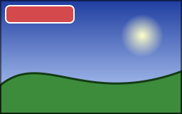

By default, shapes are antialiased and composited on the stored sample values of the image, as browsers do. The
callbacks of this page change that for what they draw.

## Choose how edges are drawn

<!-- ref:../../../samples/Meziantou.Framework.Imaging.Samples/DrawingExamples.cs;region=Imaging_DrawEdges;format=md-fenced-code-block;dedent=true -->
```csharp
public static void DrawEdges(string outputPath)
{
    using var image = new Image<Rgba32>(72, 24, Colors.Black);
    var thin = new Pen(Colors.White, 1);

    image.Draw(canvas =>
    {
        // Left: the default, each pixel on an edge is painted in proportion to the part of it the shape covers
        DrawShapes(canvas, 0);

        // Middle: hard edges, each pixel is painted entirely or not at all
        canvas.Antialiasing(enabled: false, hard => DrawShapes(hard, 24));

        // Right: the edges are mixed in linear light, so they are not darker than they should be
        canvas.Compositing(CompositingSpace.LinearSrgb, light => DrawShapes(light, 48));
    });

    // Enlarged 4 times, each pixel as a square, to show the edges
    image.Resize(new ResizeOptions(288, 96) { Filter = ResamplingFilter.NearestNeighbor });
    image.Save(outputPath);

    void DrawShapes(DrawingCanvas canvas, double x)
    {
        canvas.FillCircle(Colors.Gold, new PointD(x + 12, 9), 6);
        canvas.StrokeLine(thin, new PointD(x + 2, 21), new PointD(x + 22, 16.5));
    }
}
```
<!-- endref -->


- **Antialiased** (the default): each pixel is painted in proportion to the area of it the shape covers, computed
  exactly, overlaps included.
- **Hard edges**: `canvas.Antialiasing(false, callback)` paints a pixel entirely when its center is inside the shape,
  and not at all otherwise, as browsers do. An opaque paint then writes its color and nothing else, which pixel art,
  masks of whole pixels and images that keep the colors of a palette need.
- **Linear light**: `canvas.Compositing(CompositingSpace.LinearSrgb, callback)` mixes the paints with the pixels in
  linear light instead of on the stored values. Edges, translucent paints and shadows then mix light as light mixes:
  with sRGB samples, half of white over black is the gray 188 instead of 128, and a thin light line on a dark
  background keeps its weight. [Blur](cref:Meziantou.Framework.Imaging.Drawing.DrawingCanvas.Blur) and [BlurBackdrop](cref:Meziantou.Framework.Imaging.Drawing.DrawingCanvas.BlurBackdrop) blur light too: red next to green blurs to a yellow, not to a
  dark olive.

Hard edges and linear light combine, as in this sprite:

<!-- ref:../../../samples/Meziantou.Framework.Imaging.Samples/Examples.cs;region=Imaging_DrawRendering;format=md-fenced-code-block;dedent=true -->
```csharp
public static void DrawSprite(string outputPath)
{
    using var image = new Image<Rgba32>(32, 32, Colors.Black);
    var thin = new Pen(Colors.White, 1);

    image.Draw(canvas =>
    {
        // Without antialiasing, every pixel is the paint or what was there: the colors stay those of the palette
        canvas.Antialiasing(enabled: false, sprite =>
        {
            sprite.FillCircle(Colors.Gold, new PointD(16, 18), 9);
            sprite.FillRectangle(Colors.Crimson, new RectangleD(11.5, 14.5, 9, 3));
        });

        // In linear light, the edge of a thin light line on a dark background is not darker than the line
        canvas.Compositing(CompositingSpace.LinearSrgb, light => light.StrokeLine(thin, new PointD(2, 2.3), new PointD(30, 5.7)));
    });

    image.Save(outputPath);
}
```
<!-- endref -->


Linear light uses the transfer function of the image: sRGB for an untagged image or an sRGB profile, the transfer
characteristics of a CICP color description, or the tone curves of another ICC profile (Display P3, Adobe RGB and the
other matrix-based profiles, and gray ones). A profile that only has lookup tables is rejected.

## Keep the precision of many translucent layers

On a canvas of 8-bit samples, every draw call rounds its result to 8 bits, and many translucent drawings on top of each
other, nested layers and filters accumulate those roundings. `canvas.HighPrecision(callback)` draws the callback on a
copy of the pixels with 16-bit samples, then writes the result back: each color is rounded once. It costs 8 bytes per
pixel the clip shows, for each frame, while the callback runs. On a canvas of 16-bit samples ([Rgba64](cref:Meziantou.Framework.Imaging.Rgba64), for instance),
the callback draws on the canvas itself.

## Avoid bands in slow gradients

On an image of 8 bits per component, a gradient between two close colors over a long distance shows bands: each
sample is rounded to the nearest of 256 values, so tens of pixels in a row get the same one. Set
[Dither](cref:Meziantou.Framework.Imaging.Drawing.GradientBrush.Dither) on the brush to round each pixel up or down by a fixed pattern (the 8x8 Bayer matrix) instead: over a few
pixels, the samples average to the color between two steps, and the bands disappear. The pattern is the same at every
drawing, so the result is reproducible; a color that 8 bits hold exactly, such as the color of a stop, is kept. Images
of 16 bits per component or of floating-point components are not dithered: their steps do not show.

## Make curves smoother

Curves, ellipses, arcs, round joins and round caps are drawn as short straight chords that stay within 1/16 of a pixel
of them. `canvas.Flattening(tolerance, callback)` sets a smaller tolerance, from 1/1024 to 1/16, for what the callback
draws, so that the same shape described by different curves (in a page and in its reference) differs less on its
edges. Each time the tolerance is halved, a curve costs about 1.4 times the chords.

## Draw colors of a color profile

The color of a paint is a set of sample values of the image, whatever its color space: the red (255, 0, 0) is the most
saturated red the image can hold, which is not the same color on an sRGB image and on a Display P3 one.
`canvas.PaintProfile(profile, callback)` says what the colors of the paints are instead:

<!-- ref:../../../samples/Meziantou.Framework.Imaging.Samples/Examples.cs;region=Imaging_DrawColorManaged;format=md-fenced-code-block;dedent=true -->
```csharp
public static void DrawBrandColors(string inputPath, string outputPath)
{
    // A photograph whose ICC profile is not the one of sRGB (Display P3, Adobe RGB): its samples are not sRGB colors
    using var image = Image.Load(inputPath);
    var brand = Rgba32.ParseHex("#E63946");
    var label = new RectangleD(8, 8, 96, 24);
    var outline = new Pen(Colors.White, 2);

    image.Draw(canvas =>
    {
        // The colors of the callback are colors of sRGB: they are converted to the color space of the image, so
        // that the banner has the color its hexadecimal value means, whatever the profile of the photograph
        canvas.PaintProfile(IccProfile.Srgb, managed =>
        {
            managed.FillRoundedRectangle(brand, label, 6);
            managed.StrokeRoundedRectangle(outline, label, 6);
        });
    });

    // The profile of the photograph is kept: the file still says what its samples are
    image.Save(outputPath);
}
```
<!-- endref -->



- Inside the callback, a color is a color of the ICC profile: [IccProfile.Srgb](cref:Meziantou.Framework.Imaging.Metadata.IccProfile.Srgb) for the colors of CSS, of a design tool
  or of [Colors](cref:Meziantou.Framework.Imaging.Colors). It is converted to the color space of the image: its ICC profile, else its CICP color description,
  else sRGB. The red of sRGB is (234, 51, 35) on a Display P3 image, and looks the same on both.
- What is converted is the colors the caller gives: solid brushes, the stops of gradients, the colors of shadows and of
  [Clear](cref:Meziantou.Framework.Imaging.Drawing.DrawingCanvas.Clear), the brushes of a text. What is already samples is not: images that are drawn (convert them with
  [ConvertColorProfile](cref:Meziantou.Framework.Imaging.ImageProcessingExtensions.ConvertColorProfile) first), the glyphs a font draws with its own colors, the constants of a color matrix.
- A color the image cannot hold is clipped. On a grayscale image, a color becomes the gray of its luminance. An image of
  PQ or HLG samples is rejected.

See [Color management](../09-Color/03-ColorManagement.md) for the profiles of images.

## What the result guarantees

- **The same pixels everywhere.** Coverage and compositing use exact integer arithmetic, so a drawing gives the same
  pixels on every platform. Linear light and the gradients mixed in linear light, Oklab or Oklch use the power functions
  of the platform: a sample very close to a rounding boundary can differ by one.
- **Untouched pixels stay untouched.** A pixel a shape does not cover is not written, bit for bit, and a pixel covered
  entirely by an opaque color gets exactly that color.
- **Frames without alpha stay opaque**, and a pixel that would stay fully transparent keeps its hidden color.
- **Floating-point images** ([RgbaFloat](cref:Meziantou.Framework.Imaging.RgbaFloat), [RgbaHalf](cref:Meziantou.Framework.Imaging.RgbaHalf)) are composited in double precision without clipping the colors, so
  [Plus](cref:Meziantou.Framework.Imaging.Drawing.CompositeMode.Plus) adds light beyond white. A [SolidBrush](cref:Meziantou.Framework.Imaging.Drawing.SolidBrush)
  created from [RgbaFloat](cref:Meziantou.Framework.Imaging.RgbaFloat), and floating-point images drawn directly or with an image brush,
  retain their sample precision and range on a floating-point target. Layers, filters, shadows and blurs read the pixels as 16-bit colors, and
  reject values outside the range from 0 to 1.
- **Metadata.** The first shape that changes a pixel removes the EXIF thumbnail, which no longer matches the image.
  Everything else, cursor hotspots included, is kept.
