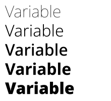

A [Font](cref:Meziantou.Framework.Imaging.Typography.Font) is one face of a font file. The library never picks a font by itself: you give it a file, a stream or bytes,
or you ask for an installed font by its family name. Load a font once and reuse it: a font is immutable and
thread-safe.

## Load a font file

[Font.Load](cref:Meziantou.Framework.Imaging.Typography.Font.Load) reads a font from a path, a stream or a span of bytes ([Font.LoadAsync](cref:Meziantou.Framework.Imaging.Typography.Font.LoadAsync) from a path or a stream). The
format is detected from the content, never from the extension:

<!-- ref:../../../samples/Meziantou.Framework.Imaging.Samples/Examples.cs;region=Imaging_LoadFont;format=md-fenced-code-block;dedent=true -->
```csharp
public static string DescribeFont(string path)
{
    // TrueType, OpenType, WOFF and WOFF2 are detected from the content of the file.
    var font = Font.Load(path);
    var metrics = font.GetMetrics(size: 16);
    var hasEuro = font.ContainsGlyph(new Rune('€'));
    return string.Create(
        CultureInfo.InvariantCulture,
        $"{font.FamilyName} {font.SubfamilyName}: {font.GlyphCount} glyphs, ascent {metrics.Ascent:0.##}, descent {metrics.Descent:0.##}, euro sign: {hasEuro}");
}
```
<!-- endref -->

- [FamilyName](cref:Meziantou.Framework.Imaging.Typography.Font.FamilyName) and [SubfamilyName](cref:Meziantou.Framework.Imaging.Typography.Font.SubfamilyName) are the typographic names when the font has them, the legacy ones otherwise.
- [Metrics](cref:Meziantou.Framework.Imaging.Typography.Font.Metrics) gives the metrics in font units, and `GetMetrics(size)` scales them to a size in pixels: ascent, descent,
  line gap, cap height, x-height, underline and strikethrough.
- [ContainsGlyph](cref:Meziantou.Framework.Imaging.Typography.Font.ContainsGlyph) says whether the font has a character. To draw characters a font lacks, give the text a
  [stack of fonts](04-TextLayout.md#fallback-fonts).

| | Supported |
| --- | --- |
| Containers | TrueType and OpenType (`.ttf`, `.otf`), collections (`.ttc`, `.otc`), WOFF 1.0 and WOFF 2.0, collections included |
| Outlines | TrueType (`glyf`), CFF and CFF2 |
| Variable fonts | Axes, named instances and everything an instance varies: outlines, advances, metrics and the positions of the layout tables |
| Color glyphs | `COLR` versions 0 and 1 with the palettes of `CPAL`, and glyphs that are images (`sbix`, `CBDT`) |
| Bitmaps without colors | The one-bit strikes of `EBDT`, on request (see below) |

A font collection holds several faces in one file. [Font.Load](cref:Meziantou.Framework.Imaging.Typography.Font.Load) gives its first face; [FontCollection.Load](cref:Meziantou.Framework.Imaging.Typography.FontCollection.Load) gives them
all (a file that holds one font is a collection of one). The faces of a collection share the bytes of the file.

## Use an installed font

[Font.LoadInstalled](cref:Meziantou.Framework.Imaging.Typography.Font.LoadInstalled) finds a family among the fonts installed on the machine, and loads its face that is the closest
to a weight and an italic, with the font matching of CSS. It returns `null` when the family is not installed: another
family is never used instead.

<!-- ref:../../../samples/Meziantou.Framework.Imaging.Samples/Examples.cs;region=Imaging_LoadInstalledFont;format=md-fenced-code-block;dedent=true -->
```csharp
public static string? DescribeInstalledFont(string familyName)
{
    // The installed face of the family closest to the style: a bold face, or the bold instance of a variable font.
    // Null when the family is not installed: another family is never used instead
    var font = Font.LoadInstalled(familyName, weight: 700);
    if (font is null)
        return null;

    return string.Create(CultureInfo.InvariantCulture, $"{font.FamilyName} {font.SubfamilyName}, weight {font.Weight}");
}
```
<!-- endref -->

- When the face is a variable font, its weight axis (and its italic or slant axis) is set to the style you ask for:
  `LoadInstalled("Inter", 700)` gives a bold instance.
- The installed fonts are those [SystemFontCollection.Default](cref:Meziantou.Framework.Fonts.SystemFontCollection.Default) of `Meziantou.Framework.Fonts`, a dependency of the
  library, finds on Windows, macOS and Linux. [LoadInstalled](cref:Meziantou.Framework.Imaging.Typography.Font.LoadInstalled) also takes another collection, such as the fonts of
  directories you choose ([SystemFontCollection.Create](cref:Meziantou.Framework.Fonts.SystemFontCollection.Create)), and `Font.Load(face)` loads one of its faces.
- A file is read once while one of its fonts is in use: loading the same face with the same options again gives the
  same font.
- The fonts of a machine are not those of another one. A text drawn with an installed font can look different, or
  not be drawable, elsewhere. To get the same pixels everywhere, ship the font file with your application.

## Variable fonts

A variable font is one file for a whole family: its axes ([Font.VariationAxes](cref:Meziantou.Framework.Imaging.Typography.Font.VariationAxes)) say what varies, such as the weight
or the width, and in what range. [Font.WithVariations](cref:Meziantou.Framework.Imaging.Typography.Font.WithVariations) gives the font of an instance:

<!-- ref:../../../samples/Meziantou.Framework.Imaging.Samples/Examples.cs;region=Imaging_VariableFont;format=md-fenced-code-block;dedent=true -->
```csharp
public static void DrawWeights(string variableFontPath, string outputPath)
{
    var font = Font.Load(variableFontPath);

    // The axes say what can vary, and in what range
    var weight = font.VariationAxes.First(axis => axis.Tag == "wght");

    using var image = new Image<Rgba32>(220, 200, new Rgba32(255, 255, 255));
    image.Draw(canvas =>
    {
        for (var i = 0; i < 5; i++)
        {
            // An instance is a font: it shares the data of the font it comes from
            var value = weight.Minimum + ((weight.Maximum - weight.Minimum) * i / 4);
            var instance = font.WithVariations(new FontVariationSetting("wght", value));
            canvas.FillText(new Rgba32(0, 0, 0), "Variable", instance, size: 32, new PointD(10, i * 38));
        }
    });

    image.Save(outputPath);
}
```
<!-- endref -->



- A font is loaded at its default instance. [WithVariations](cref:Meziantou.Framework.Imaging.Typography.Font.WithVariations) takes the values of some axes by their tag (`wght`,
  `wdth`, `slnt`, `ital`, `opsz`, or a tag of the font). An axis you do not name stays at its default, a value out of
  range is brought to the nearest end, and a tag the font does not have is ignored.
- [NamedInstances](cref:Meziantou.Framework.Imaging.Typography.Font.NamedInstances) lists the instances the font names ("Light", "Bold Condensed"), which [WithVariations](cref:Meziantou.Framework.Imaging.Typography.Font.WithVariations) also
  accepts. [Variations](cref:Meziantou.Framework.Imaging.Typography.Font.Variations) gives the values of a font, and [Weight](cref:Meziantou.Framework.Imaging.Typography.Font.Weight) the value of its weight axis.
- An instance is a [Font](cref:Meziantou.Framework.Imaging.Typography.Font) like any other: it shares the bytes of the font it comes from and is cheap to create. Use it
  wherever a font is expected, in a [TextStyle](cref:Meziantou.Framework.Imaging.Typography.TextStyle) or a [FontStack](cref:Meziantou.Framework.Imaging.Typography.FontStack).
- A font that does not vary has no axis and is its only instance.

## Color glyphs

Some fonts have glyphs with their own colors, such as emoji. [Font.HasColorGlyphs](cref:Meziantou.Framework.Imaging.Typography.Font.HasColorGlyphs) says so, and [Font.ColorPalettes](cref:Meziantou.Framework.Imaging.Typography.Font.ColorPalettes)
gives the palettes of the font. [FillText](cref:Meziantou.Framework.Imaging.Drawing.DrawingCanvas.FillText) draws these glyphs with their colors; you can see one in the example of
[fallback fonts](04-TextLayout.md#fallback-fonts).

- The brush of the text paints the parts of a glyph the font leaves to the text color. [TextStyle.ColorPaletteIndex](cref:Meziantou.Framework.Imaging.Typography.TextStyle.ColorPaletteIndex)
  selects another palette of the font.
- The alpha of a solid brush, and the opacity of any brush, fade the whole glyph, as browsers draw an emoji in a
  translucent color.
- The colors of a palette are drawn as sample values, without color management, like the colors of a brush.
- A color glyph is drawn after the other glyphs of the text. [StrokeText](cref:Meziantou.Framework.Imaging.Drawing.DrawingCanvas.StrokeText) and [TextLayout.ToPath](cref:Meziantou.Framework.Imaging.Typography.TextLayout.ToPath) use the outline the
  font gives to the glyph itself, which can be empty.
- A glyph stored as an image (`sbix`, `CBDT`) is taken from the smallest strike that is at least as large as the
  text, and scaled to the size of the text.

Some fonts made for screens of low resolution, mostly Chinese, Japanese and Korean ones, also have a one-bit bitmap of
each glyph for a few sizes. They are not used by default. A font loaded with [FontLoadOptions.UseEmbeddedBitmaps](cref:Meziantou.Framework.Imaging.Typography.FontLoadOptions.UseEmbeddedBitmaps) uses
them for a text whose size in pixels per em is exactly the size of a strike; at other sizes, the outline is drawn.

## Fonts are immutable and thread-safe

A font has no state and no cache: share one instance across threads and across texts. A font is not disposable: it
keeps the bytes of its file (the expanded font for WOFF and WOFF2) for its lifetime. Loading validates what every use
needs (the table directory, the required tables, the character map); the data of a glyph is validated the first time
the glyph is used, when a layout is created.

## Fonts are untrusted input

A font file from a user is as dangerous as an image from a user: its glyphs can be made of glyphs or call subroutines
that describe an outline far larger than the file. Loading and using a font is bounded by the limits of
[FontLoadOptions.Configuration](cref:Meziantou.Framework.Imaging.Typography.FontLoadOptions.Configuration):

| Limit | Default | What it bounds |
| --- | --- | --- |
| [MaxEncodedBytes](cref:Meziantou.Framework.Imaging.ImageResourceLimits.MaxEncodedBytes) | 256 MiB | The bytes read from the file or the stream |
| [MaxFontBytes](cref:Meziantou.Framework.Imaging.ImageResourceLimits.MaxFontBytes) | 256 MiB | The bytes a font keeps, checked before a WOFF or WOFF2 file is expanded |
| [MaxGlyphComplexity](cref:Meziantou.Framework.Imaging.ImageResourceLimits.MaxGlyphComplexity) | 1,000,000 | The points, components and charstring operators needed to produce one glyph, and the instructions run to hint it |

The limits of text layouts ([MaxTextLength](cref:Meziantou.Framework.Imaging.ImageResourceLimits.MaxTextLength), [MaxTextGlyphs](cref:Meziantou.Framework.Imaging.ImageResourceLimits.MaxTextGlyphs), [MaxTextLines](cref:Meziantou.Framework.Imaging.ImageResourceLimits.MaxTextLines)) come from the configuration of the
font too. See [Resource limits](../05-LoadingAndSaving/07-ResourceLimits.md).

A font fails with the exceptions of images, with [ImageFormat.Unknown](cref:Meziantou.Framework.Imaging.ImageFormat.Unknown): [UnknownImageFormatException](cref:Meziantou.Framework.Imaging.UnknownImageFormatException) when the data is
not a font, [InvalidImageContentException](cref:Meziantou.Framework.Imaging.InvalidImageContentException) for a malformed font, [UnsupportedImageFeatureException](cref:Meziantou.Framework.Imaging.UnsupportedImageFeatureException) for a feature the
library does not support, and [ImageResourceLimitException](cref:Meziantou.Framework.Imaging.ImageResourceLimitException) for a limit. See
[Handling errors](../05-LoadingAndSaving/08-ErrorHandling.md).

## What is not supported

- Glyphs in SVG (`SVG ` table): their outlines are drawn instead.
- Fonts without outlines (bitmap-only fonts), PostScript Type 1 fonts and Type 1 charstrings.
- The hints of CFF outlines, and the variation of the hinting values of TrueType (`cvar`).
- The metadata and private blocks of WOFF and WOFF2 files. Table checksums are not verified.
