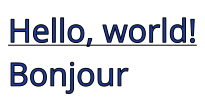
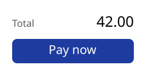
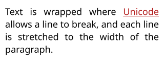
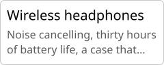
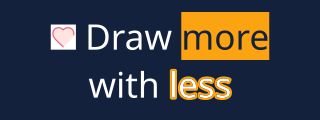

Text is drawn in two steps: [TextLayout.Create](cref:Meziantou.Framework.Imaging.Typography.TextLayout.Create) lays out the text (it finds its glyphs, their positions and its
lines), then `canvas.FillText` draws the layout. Because the layout is what is drawn, it is also what you measure to
size an image or to place a text.

## Draw a string

<!-- ref:../../../samples/Meziantou.Framework.Imaging.Samples/Examples.cs;region=Imaging_DrawText;format=md-fenced-code-block;dedent=true -->
```csharp
public static void DrawLabel(string fontPath, string outputPath)
{
    var font = Font.Load(fontPath);

    // A layout holds the glyphs of a text and their positions: it measures the text and is what is drawn
    var layout = TextLayout.Create("Hello, world!\nBonjour", font, size: 32);

    const int Margin = 8;
    using var image = new Image<Rgba32>((int)Math.Ceiling(layout.Width) + (2 * Margin), (int)Math.Ceiling(layout.Height) + (2 * Margin), new Rgba32(255, 255, 255));
    var outline = new Pen(new Rgba32(0, 0, 0), 1) { LineJoin = LineJoin.Round };
    image.Draw(canvas =>
    {
        // The origin is the top-left corner of the layout; its first baseline is layout.Baseline below
        var origin = new PointD(Margin, Margin);
        canvas.FillText(new Rgba32(30, 60, 160), layout, origin);
        canvas.StrokeText(outline, layout, origin);

        // A line under the first line of text, at its baseline
        canvas.StrokeLine(outline, new PointD(Margin, Margin + layout.Baseline + 3), new PointD(Margin + layout.Width, Margin + layout.Baseline + 3));
    });

    image.Save(outputPath);
}
```
<!-- endref -->



- `TextLayout.Create(text, font, size)` lays out a text of one font. The size is in pixels per em, not in points.
- A line break of the text (`\n`, `\r\n` and the other Unicode line breaks) starts a new paragraph. Without a maximum
  width, each paragraph is one line.
- The origin of [FillText](cref:Meziantou.Framework.Imaging.Drawing.DrawingCanvas.FillText) is the top-left corner of the layout. Its first baseline is `layout.Baseline` below it.
- [FillText](cref:Meziantou.Framework.Imaging.Drawing.DrawingCanvas.FillText) fills the glyphs with a brush; [StrokeText](cref:Meziantou.Framework.Imaging.Drawing.DrawingCanvas.StrokeText) strokes their outlines with a pen, and [TextLayout.ToPath](cref:Meziantou.Framework.Imaging.Typography.TextLayout.ToPath)
  gives them as a [VectorPath](cref:Meziantou.Framework.Imaging.Drawing.VectorPath), to use the text as any other shape.
- `canvas.FillText(brush, text, font, size, origin)` is a shortcut that creates a layout on each call. Create the
  layout yourself to measure the text or to draw it more than once.

Creating a layout does all the work: it shapes the text and decodes every glyph it uses, which validates the font
data. Drawing it then allocates nothing. Layouts, styles, options and rich texts are immutable and thread-safe.

## Place a text

[GetOrigin](cref:Meziantou.Framework.Imaging.Typography.TextLayout.GetOrigin) gives the origin to draw a layout at so that a point of its box lands on an anchor: a corner, the middle of
a side, the center, or a point of the first baseline. Another overload aligns the box in a rectangle:

<!-- ref:../../../samples/Meziantou.Framework.Imaging.Samples/Examples.cs;region=Imaging_PlaceText;format=md-fenced-code-block;dedent=true -->
```csharp
public static void DrawPayButton(string fontPath, string outputPath)
{
    var font = Font.Load(fontPath);
    var label = TextLayout.Create("Pay now", font, size: 20);
    var caption = TextLayout.Create("Total", font, size: 16);
    var amount = TextLayout.Create("42.00", font, size: 24);

    using var image = new Image<Rgba32>(240, 120, new Rgba32(255, 255, 255));
    image.Draw(canvas =>
    {
        // GetOrigin gives the top-left corner to draw a layout at so that a point of its box lands on an anchor.
        // The ink box centers what is drawn, the tail of the y included; the layout box would center the line
        var button = new RectangleD(20, 64, 200, 40);
        canvas.FillRoundedRectangle(new Rgba32(30, 60, 160), button, radius: 8);
        canvas.FillText(new Rgba32(255, 255, 255), label, label.GetOrigin(button, TextHorizontalAnchor.Center, TextVerticalAnchor.Center, TextBounds.Ink));

        // Two sizes on one baseline: the caption from the left, the amount aligned to the right
        var baseline = 44;
        canvas.FillText(new Rgba32(90, 90, 90), caption, caption.GetOrigin(new PointD(20, baseline), TextHorizontalAnchor.Left, TextVerticalAnchor.Baseline));
        canvas.FillText(new Rgba32(0, 0, 0), amount, amount.GetOrigin(new PointD(220, baseline), TextHorizontalAnchor.Right, TextVerticalAnchor.Baseline));
    });

    image.Save(outputPath);
}
```
<!-- endref -->



| [TextBounds](cref:Meziantou.Framework.Imaging.Typography.TextBounds) | The box that is placed | Use it to |
| --- | --- | --- |
| [Layout](cref:Meziantou.Framework.Imaging.Typography.TextBounds.Layout) (the default) | The advances of the glyphs and the ascents and descents of the fonts | Line up texts, whatever their letters |
| [Ink](cref:Meziantou.Framework.Imaging.Typography.TextBounds.Ink) | What is drawn (`layout.InkBounds`) | Center a text by its visible shape, such as a label in a button or a digit in a circle |

[TextVerticalAnchor.Baseline](cref:Meziantou.Framework.Imaging.Typography.TextVerticalAnchor.Baseline) puts the first baseline on the anchor, whatever box is measured: use it to put texts of
several sizes on one line, as the caption and the amount above.

## Wrap a paragraph

[TextLayoutOptions](cref:Meziantou.Framework.Imaging.Typography.TextLayoutOptions) say how the lines are wrapped and aligned. A [TextStyle](cref:Meziantou.Framework.Imaging.Typography.TextStyle) holds how the text is set, and a
[RichText](cref:Meziantou.Framework.Imaging.Typography.RichText) gives each part of a text its own style:

<!-- ref:../../../samples/Meziantou.Framework.Imaging.Samples/Examples.cs;region=Imaging_DrawParagraph;format=md-fenced-code-block;dedent=true -->
```csharp
public static void DrawParagraph(string fontPath, string outputPath)
{
    var font = Font.Load(fontPath);
    var regular = new TextStyle(font, 18);
    var emphasis = new TextStyle(font, 18) { Brush = new SolidBrush(new Rgba32(180, 30, 30)), Decorations = TextDecorations.Underline };

    // A span is not a word or a line: the layout wraps the whole text, and shapes the letters of two spans together
    var text = new RichTextBuilder()
        .Append("Text is wrapped where ", regular)
        .Append("Unicode", emphasis)
        .Append(" allows a line to break, and each line is stretched to the width of the paragraph.", regular)
        .Build();
    var layout = TextLayout.Create(text, new TextLayoutOptions { MaxWidth = 300, Alignment = TextAlignment.Justify });

    using var image = new Image<Rgba32>(320, (int)Math.Ceiling(layout.Height) + 20, new Rgba32(255, 255, 255));

    // The brush of the call paints the spans that have none
    image.Draw(canvas => canvas.FillText(new Rgba32(0, 0, 0), layout, new PointD(10, 10)));
    image.Save(outputPath);
}
```
<!-- endref -->



With [MaxWidth](cref:Meziantou.Framework.Imaging.Typography.TextLayoutOptions.MaxWidth), lines are wrapped where the Unicode line breaking algorithm allows it. The white space that ends a
wrapped line does not count in its width.

| Option | Default | What it does |
| --- | --- | --- |
| [MaxWidth](cref:Meziantou.Framework.Imaging.Typography.TextLayoutOptions.MaxWidth) | No limit | The width lines are wrapped at and aligned in |
| [Alignment](cref:Meziantou.Framework.Imaging.Typography.TextLayoutOptions.Alignment) | [Start](cref:Meziantou.Framework.Imaging.Typography.TextAlignment.Start) | [Start](cref:Meziantou.Framework.Imaging.Typography.TextAlignment.Start), [Center](cref:Meziantou.Framework.Imaging.Typography.TextAlignment.Center), [End](cref:Meziantou.Framework.Imaging.Typography.TextAlignment.End), or [Justify](cref:Meziantou.Framework.Imaging.Typography.TextAlignment.Justify), which stretches each line but the last one of a paragraph; lines that cannot be stretched stay start-aligned |
| [Justification](cref:Meziantou.Framework.Imaging.Typography.TextLayoutOptions.Justification) | [InterWord](cref:Meziantou.Framework.Imaging.Typography.TextJustification.InterWord) | Where a justified line is stretched: U+0020 spaces and U+00A0 no-break spaces; with [Auto](cref:Meziantou.Framework.Imaging.Typography.TextJustification.Auto), also U+3000 ideographic spaces and between the characters of Chinese, Japanese, Korean and Thai text; with [InterCharacter](cref:Meziantou.Framework.Imaging.Typography.TextJustification.InterCharacter), between every two characters but the letters of cursive scripts |
| [FirstLineIndent](cref:Meziantou.Framework.Imaging.Typography.TextLayoutOptions.FirstLineIndent) | 0 | The indent of the first line of each paragraph; negative for a hanging indent, which indents the lines after the first one instead |
| [LineHeight](cref:Meziantou.Framework.Imaging.Typography.TextLayoutOptions.LineHeight) | The fonts' height | A fixed height for every line, the glyphs centered in it |
| [TabSize](cref:Meziantou.Framework.Imaging.Typography.TextLayoutOptions.TabSize) | 8 | The distance between two tabulation stops, in spaces |
| [TabStops](cref:Meziantou.Framework.Imaging.Typography.TextLayoutOptions.TabStops) | None | Tabulation stops at positions in pixels, each aligning the text after the tabulation at its start, its end, its middle or its decimal separator ([TextTabStop](cref:Meziantou.Framework.Imaging.Typography.TextTabStop)); the stops of [TabSize](cref:Meziantou.Framework.Imaging.Typography.TextLayoutOptions.TabSize) follow the last one |
| [Wrapping](cref:Meziantou.Framework.Imaging.Typography.TextLayoutOptions.Wrapping) | [Wrap](cref:Meziantou.Framework.Imaging.Typography.TextWrapping.Wrap) | [NoWrap](cref:Meziantou.Framework.Imaging.Typography.TextWrapping.NoWrap) breaks lines only at the line breaks of the text |
| [WordBreak](cref:Meziantou.Framework.Imaging.Typography.TextLayoutOptions.WordBreak) | `Normal` | [BreakAll](cref:Meziantou.Framework.Imaging.Typography.TextWordBreak.BreakAll) also breaks between any two letters; [KeepAll](cref:Meziantou.Framework.Imaging.Typography.TextWordBreak.KeepAll) does not break between ideographs |
| [LineBreak](cref:Meziantou.Framework.Imaging.Typography.TextLayoutOptions.LineBreak) | `Normal` | How strictly Chinese and Japanese punctuation is kept off the start and the end of a line |
| [LineBreakStrategy](cref:Meziantou.Framework.Imaging.Typography.TextLayoutOptions.LineBreakStrategy) | [Greedy](cref:Meziantou.Framework.Imaging.Typography.TextLineBreakStrategy.Greedy) | [Optimal](cref:Meziantou.Framework.Imaging.Typography.TextLineBreakStrategy.Optimal) chooses the breaks of a whole paragraph together, so that its lines are evenly filled (Knuth and Plass), in about twice the time |
| [OverflowWrap](cref:Meziantou.Framework.Imaging.Typography.TextLayoutOptions.OverflowWrap) | `Normal` | [Anywhere](cref:Meziantou.Framework.Imaging.Typography.TextOverflowWrap.Anywhere) cuts a word that is wider than [MaxWidth](cref:Meziantou.Framework.Imaging.Typography.TextLayoutOptions.MaxWidth) between two characters |

[Start](cref:Meziantou.Framework.Imaging.Typography.TextAlignment.Start) and [End](cref:Meziantou.Framework.Imaging.Typography.TextAlignment.End) follow the direction of each paragraph: see [Text layout](04-TextLayout.md) for right-to-left text,
vertical lines and hyphenation.

## Style parts of a text

[RichTextBuilder.Append](cref:Meziantou.Framework.Imaging.Typography.RichTextBuilder.Append) adds a part of the text with its style. A span is not a word or a line: the layout wraps the
whole text, and the letters of two spans that only differ by what is painted are shaped together, so they still kern
and join. A [TextStyle](cref:Meziantou.Framework.Imaging.Typography.TextStyle) has a [FontStack](cref:Meziantou.Framework.Imaging.Typography.FontStack) (a [Font](cref:Meziantou.Framework.Imaging.Typography.Font) converts to one) and a size, and optionally:

| Property | What it does |
| --- | --- |
| [Brush](cref:Meziantou.Framework.Imaging.Drawing.Brush) | The paint of the text; without it, the brush given to [FillText](cref:Meziantou.Framework.Imaging.Drawing.DrawingCanvas.FillText) |
| [BackgroundBrush](cref:Meziantou.Framework.Imaging.Typography.TextStyle.BackgroundBrush) | A rectangle behind the text of the style on each line, from the ascent to the descent of its font: a highlight |
| [Outline](cref:Meziantou.Framework.Imaging.Typography.TextStyle.Outline) | A pen that strokes the glyphs after they are filled; with [PenAlignment.Outside](cref:Meziantou.Framework.Imaging.Drawing.PenAlignment.Outside), the stroke is around the glyphs |
| [Decorations](cref:Meziantou.Framework.Imaging.Typography.TextStyle.Decorations) and [DecorationBrush](cref:Meziantou.Framework.Imaging.Typography.TextStyle.DecorationBrush) | Underline, strikethrough and overline, drawn with the metrics of the font, and their paint |
| [LetterSpacing](cref:Meziantou.Framework.Imaging.Typography.TextStyle.LetterSpacing) and [WordSpacing](cref:Meziantou.Framework.Imaging.Typography.TextStyle.WordSpacing) | Space added after each character and to each space, in pixels; negative to tighten |
| [Features](cref:Meziantou.Framework.Imaging.Typography.TextStyle.Features) | OpenType features to turn on or off: `new FontFeature("smcp")`, `new FontFeature("liga", 0)` |
| [Synthesis](cref:Meziantou.Framework.Imaging.Typography.TextStyle.Synthesis), [Language](cref:Meziantou.Framework.Imaging.Typography.TextStyle.Language), [Hyphenator](cref:Meziantou.Framework.Hyphenator) | See [Text layout](04-TextLayout.md) |

[FillText](cref:Meziantou.Framework.Imaging.Drawing.DrawingCanvas.FillText) paints the backgrounds of the whole layout first, then the text, then the outlines: a background never
hides a glyph. [StrokeText](cref:Meziantou.Framework.Imaging.Drawing.DrawingCanvas.StrokeText) and [ToPath](cref:Meziantou.Framework.Imaging.Typography.TextLayout.ToPath) leave the backgrounds out.

## Cut a text that is too long

[MaxLines](cref:Meziantou.Framework.Imaging.Typography.TextLayoutOptions.MaxLines) and [MaxHeight](cref:Meziantou.Framework.Imaging.Typography.TextLayoutOptions.MaxHeight) keep the first lines of a text (the first line is always kept), and [Trimming](cref:Meziantou.Framework.Imaging.Typography.TextLayoutOptions.Trimming) ends the
last one with an ellipsis:

<!-- ref:../../../samples/Meziantou.Framework.Imaging.Samples/TextExamples.cs;region=Imaging_TrimText;format=md-fenced-code-block;dedent=true -->
```csharp
public static bool DrawProductCard(string fontPath, string outputPath)
{
    var font = Font.Load(fontPath);
    var title = TextLayout.Create("Wireless headphones", new TextStyle(font, 20));

    // At most two lines in the width of the card: the last line that fits ends with an ellipsis, after the last
    // word that leaves room for it
    var options = new TextLayoutOptions { MaxWidth = 220, MaxLines = 2, Trimming = TextTrimming.Word };
    var description = TextLayout.Create(
        "Noise cancelling, thirty hours of battery life, a case that folds flat and a cable for the plane.",
        new TextStyle(font, 16),
        options);

    using var image = new Image<Rgba32>(240, (int)Math.Ceiling(title.Height + description.Height) + 24, new Rgba32(255, 255, 255));
    image.Draw(canvas =>
    {
        canvas.StrokeRoundedRectangle(new Pen(new Rgba32(200, 200, 200), 1), new RectangleD(0.5, 0.5, image.Width - 1, image.Height - 1), 6);
        canvas.FillText(new Rgba32(0, 0, 0), title, new PointD(10, 8));
        canvas.FillText(new Rgba32(90, 90, 90), description, new PointD(10, 12 + title.Height));
    });

    image.Save(outputPath);

    // A part of the text is not in the layout: a caller can show the whole text elsewhere, in a tooltip for example
    return description.IsTruncated;
}
```
<!-- endref -->



- [TextTrimming.Word](cref:Meziantou.Framework.Imaging.Typography.TextTrimming.Word) ends the line after the last word that leaves room for the ellipsis, [Character](cref:Meziantou.Framework.Imaging.Typography.TextTrimming.Character) after the last
  character. Without trimming, the lines that do not fit are left out.
- [Ellipsis](cref:Meziantou.Framework.Imaging.Typography.TextLayoutOptions.Ellipsis) replaces the ellipsis (U+2026, or three periods when the font does not have it).
- With `Wrapping = NoWrap`, trimming also cuts a line that is wider than [MaxWidth](cref:Meziantou.Framework.Imaging.Typography.TextLayoutOptions.MaxWidth).
- [IsTruncated](cref:Meziantou.Framework.Imaging.Typography.TextLayout.IsTruncated) says that a part of the text is not in the layout.

## Fit a text in a box

[TextLayout.CreateToFit](cref:Meziantou.Framework.Imaging.Typography.TextLayout.CreateToFit) lays out a text at the largest size, up to the size of its styles, at which it fits a box:
a title that fills a card, a label that never overflows its button. A placeholder leaves room in a line for something
that is not text, such as an icon:

<!-- ref:../../../samples/Meziantou.Framework.Imaging.Samples/Examples.cs;region=Imaging_DrawFittedText;format=md-fenced-code-block;dedent=true -->
```csharp
public static double DrawTitleCard(string fontPath, string iconPath, string outputPath)
{
    var font = Font.Load(fontPath);
    using var icon = Image.Load(iconPath);
    using var image = new Image<Rgba32>(320, 120, Rgba32.ParseHex("#14213D"));

    // The styles: a word on a background, a word with a contour around its letters, and the rest
    var title = new TextStyle(font, 64) { Brush = new SolidBrush(Colors.White) };
    var highlight = new TextStyle(font, 64) { Brush = new SolidBrush(Rgba32.ParseHex("#14213D")), BackgroundBrush = new SolidBrush(Rgba32.ParseHex("#FCA311")) };
    var contour = new TextStyle(font, 64) { Brush = new SolidBrush(Colors.White), Outline = new Pen(Rgba32.ParseHex("#FCA311"), 2) { Alignment = PenAlignment.Outside, LineJoin = LineJoin.Round } };

    // Room for the icon in the line, as tall as a capital letter and standing on the baseline
    var capHeight = font.GetMetrics(64).CapHeight;
    var text = new RichTextBuilder()
        .AppendPlaceholder(capHeight, capHeight, capHeight, title)
        .Append(" Draw ", title)
        .Append("more", highlight)
        .Append(" with ", title)
        .Append("less", contour)
        .Build();

    // The largest size at which the text fits the card, less its margins: every length of the styles has it
    var box = new RectangleD(16, 12, image.Width - 32, image.Height - 24);
    var layout = TextLayout.CreateToFit(text, box.Width, box.Height, new TextLayoutOptions { Alignment = TextAlignment.Center });
    var origin = new PointD(box.X, box.Y + ((box.Height - layout.Height) / 2));

    image.Draw(canvas =>
    {
        canvas.FillText(Colors.White, layout, origin);

        // What the placeholder made room for, where the layout put it
        var place = layout.Placeholders[0];
        canvas.DrawImage(icon.Frames[0], new RectangleD(origin.X + place.X, origin.Y + place.Y, place.Width, place.Height), ImageSampling.Smooth);
    });

    image.Save(outputPath);
    return layout.Scale;
}
```
<!-- endref -->



- Every length of the styles is multiplied by one factor, which `layout.Scale` gives: the sizes, the spacings, the
  indent, a fixed line height and the placeholders. The widths of the outline pens are not scaled. A text is made
  smaller, never larger.
- The text fits when none of it is cut, no line is wider than the box and its lines are not taller. Lines are wrapped
  at the width of the box, as the options say. A [vertical text](04-TextLayout.md#vertical-text) turns the box: its
  columns are wrapped at the height of the box, and they fit when they are not wider than the box together.
- Finding the factor creates up to fifteen layouts. A text that does not fit at `minimumScale` (0.1 by default) is laid
  out at that scale and cut as the options say.
- `RichTextBuilder.AppendPlaceholder(width, height, baseline, style)` is one character of the text: it moves with the
  words around it, and its line is tall enough for it. `layout.Placeholders` gives the rectangle of each one, from the
  top-left corner of the layout, for you to draw in.

## Turn a text

A text is drawn like any shape: the transformations of the canvas apply to it. Here, a text is repeated along a
diagonal over a picture:

<!-- ref:../../../samples/Meziantou.Framework.Imaging.Samples/Examples.cs;region=Imaging_DrawWatermark;format=md-fenced-code-block;dedent=true -->
```csharp
public static void DrawWatermark(string fontPath, string inputPath, string outputPath)
{
    using var image = Image.Load(inputPath);
    var layout = TextLayout.Create("DRAFT", Font.Load(fontPath), size: image.Width / 6.0);
    var ink = new SolidBrush(new Rgba32(255, 255, 255, 110));
    var center = new PointD(image.Width / 2.0, image.Height / 2.0);

    image.Draw(canvas =>
    {
        // Everything the callback draws is turned around the center of the image: the text is drawn as usual
        canvas.Transform(AffineTransform.CreateRotation(-30, center), turned =>
        {
            for (var row = -1; row <= 1; row++)
            {
                var middle = new PointD(center.X, center.Y + (row * layout.Height * 1.5));
                turned.FillText(ink, layout, layout.GetOrigin(middle, TextHorizontalAnchor.Center, TextVerticalAnchor.Center));
            }
        });
    });

    image.Save(outputPath);
}
```
<!-- endref -->


See [Transformations](../07-Drawing/04-Transformations.md) for the other transformations of the canvas, and
[Add a watermark](../03-Guides/06-AddAWatermark.md) for a complete solution.
