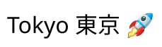
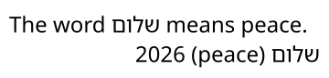
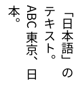
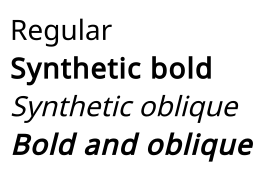

A layout turns characters into positioned glyphs: it chooses a font for each character, orders mixed directions,
breaks lines and shapes each run of text with the OpenType tables of its font. This page covers the options that
change how that is done. For the basics, see [Drawing text](03-DrawingText.md).

## Fallback fonts

A [TextStyle](cref:Meziantou.Framework.Imaging.Typography.TextStyle) takes a [FontStack](cref:Meziantou.Framework.Imaging.Typography.FontStack): a primary font, then the fonts used for the characters the ones before it lack.
Each character is drawn with the first font of the stack that has it:

<!-- ref:../../../samples/Meziantou.Framework.Imaging.Samples/TextExamples.cs;region=Imaging_FontStackFallback;format=md-fenced-code-block;dedent=true -->
```csharp
public static void DrawFontStack(string latinFontPath, string japaneseFontPath, string emojiFontPath, string outputPath)
{
    // Each character is drawn with the first font of the stack that has it. An emoji is looked for first in the
    // fonts that have color glyphs, and is drawn with its own colors
    var fonts = new FontStack(Font.Load(latinFontPath), Font.Load(japaneseFontPath), Font.Load(emojiFontPath));
    var layout = TextLayout.Create("Tokyo 東京 \U0001F680", new TextStyle(fonts, 32));

    using var image = new Image<Rgba32>((int)Math.Ceiling(layout.Width) + 20, (int)Math.Ceiling(layout.Height) + 20, new Rgba32(255, 255, 255));
    image.Draw(canvas => canvas.FillText(new Rgba32(0, 0, 0), layout, new PointD(10, 10)));
    image.Save(outputPath);
}
```
<!-- endref -->



- A character and the marks and selectors that follow it are drawn with the first font that has all of them.
- An emoji is first looked for in the fonts that have color glyphs (a character that is an emoji by default, or that is
  followed by the emoji presentation selector U+FE0F), and a character followed by the text presentation selector
  U+FE0E in the fonts without them. When no font of that kind has it, the stack is searched in its order.
- A character no font of the stack has is drawn with the missing glyph of the primary font: nothing throws, and
  `layout.HasMissingGlyphs` says so. Check it when the text comes from a user.

### Installed fonts as fallback

A stack only has the fonts it is given, so a text is drawn the same way on every machine. [WithInstalledFallback()](cref:Meziantou.Framework.Imaging.Typography.FontStack.WithInstalledFallback)
also looks for a character that none of them has among the fonts installed on the machine:

<!-- ref:../../../samples/Meziantou.Framework.Imaging.Samples/Examples.cs;region=Imaging_InstalledFallback;format=md-fenced-code-block;dedent=true -->
```csharp
public static void DrawWithInstalledFallback(string fontPath, string outputPath)
{
    // Without fallback, a stack only has the fonts it is given, and a text is drawn the same way on every machine.
    // With it, a character none of them has (an ideograph, an emoji) is drawn with an installed font that has it
    var fonts = new FontStack(Font.Load(fontPath)).WithInstalledFallback();
    var layout = TextLayout.Create("Hello, \u4E16\u754C \U0001F600", new TextStyle(fonts, 32));

    using var image = new Image<Rgba32>((int)Math.Ceiling(layout.Width) + 20, (int)Math.Ceiling(layout.Height) + 20, new Rgba32(255, 255, 255));
    image.Draw(canvas => canvas.FillText(new Rgba32(0, 0, 0), layout, new PointD(10, 10)));
    image.Save(outputPath);
}
```
<!-- endref -->

The installed fonts are searched in this order: the families of [InstalledFontFallbackOptions.PreferredFamilies](cref:Meziantou.Framework.Imaging.Typography.InstalledFontFallbackOptions.PreferredFamilies);
for an emoji, the color emoji font of the platform (Segoe UI Emoji, Apple Color Emoji, Noto Color Emoji); the families
the platforms usually use for the script of the character; then every family that has it. In a family, the face is
the one closest to the style of the primary font. The font found for a character is loaded once and kept by the
stack. With fallback, the result depends on the fonts of the machine.

The Han ideographs have different forms in Chinese, Japanese and Korean, so their installed fonts are chosen by
[TextStyle.Language](cref:Meziantou.Framework.Imaging.Typography.TextStyle.Language):

| Language | Families, then those of Simplified Chinese |
| --- | --- |
| `ja` | Yu Gothic, Hiragino Sans, Noto Sans CJK JP |
| `ko` | Malgun Gothic, Apple SD Gothic Neo, Noto Sans CJK KR |
| `zh-Hant`, `zh-TW`, `zh-MO` | Microsoft JhengHei, PingFang TC, Noto Sans CJK TC |
| `zh-HK`, `yue` | PingFang HK, Noto Sans CJK HK, then those of Traditional Chinese |
| `zh`, `zh-Hans`, no language, any other language | Microsoft YaHei, PingFang SC, Noto Sans CJK SC |

The fonts of the stack itself are used in their order whatever the language, and [PreferredFamilies](cref:Meziantou.Framework.Imaging.Typography.InstalledFontFallbackOptions.PreferredFamilies) still
come first.

## Right-to-left and mixed directions

Each paragraph is ordered by the Unicode Bidirectional Algorithm: left-to-right and right-to-left text can be mixed,
mirrored characters such as parentheses are mirrored, and each line is put in display order:

<!-- ref:../../../samples/Meziantou.Framework.Imaging.Samples/TextExamples.cs;region=Imaging_DrawBidiText;format=md-fenced-code-block;dedent=true -->
```csharp
public static void DrawMixedDirections(string latinFontPath, string hebrewFontPath, string outputPath)
{
    var fonts = new FontStack(Font.Load(latinFontPath), Font.Load(hebrewFontPath));
    const string Shalom = "\u05E9\u05DC\u05D5\u05DD"; // "shalom", in Hebrew letters

    // Two paragraphs, each in the direction of its first letter: the first one is left-to-right with a Hebrew word
    // in it, the second one right-to-left with an English word and a number in it. Its parentheses are mirrored
    var text = $"The word {Shalom} means peace.\n{Shalom} (peace) 2026";

    // Start is the left of a left-to-right paragraph and the right of a right-to-left one
    var layout = TextLayout.Create(text, new TextStyle(fonts, 24), new TextLayoutOptions { MaxWidth = 340, Alignment = TextAlignment.Start });

    using var image = new Image<Rgba32>(360, (int)Math.Ceiling(layout.Height) + 20, new Rgba32(255, 255, 255));
    image.Draw(canvas => canvas.FillText(new Rgba32(0, 0, 0), layout, new PointD(10, 10)));
    image.Save(outputPath);
}
```
<!-- endref -->



- By default ([TextDirection.Auto](cref:Meziantou.Framework.Imaging.Typography.TextDirection.Auto)), the direction of a paragraph is the one of its first strong character.
  [TextLayoutOptions.Direction](cref:Meziantou.Framework.Imaging.Typography.TextLayoutOptions.Direction) imposes it on every paragraph.
- [Alignment](cref:Meziantou.Framework.Imaging.Typography.TextLayoutOptions.Alignment) follows the direction: [Start](cref:Meziantou.Framework.Imaging.Typography.TextAlignment.Start) is the left of a left-to-right paragraph and the right of a right-to-left
  one, and [End](cref:Meziantou.Framework.Imaging.Typography.TextAlignment.End) the other side.
- [TextLine.IsRightToLeft](cref:Meziantou.Framework.Imaging.Typography.TextLine.IsRightToLeft) gives the direction of the paragraph of a line.
- Arabic, Hebrew, Syriac and the other right-to-left scripts are shaped as their fonts are made for: the letters of
  Arabic and Syriac join, and marks are placed on their letters.

## Vertical text

[TextLayoutOptions.WritingMode](cref:Meziantou.Framework.Imaging.Typography.TextLayoutOptions.WritingMode) sets the text in vertical lines, as Chinese, Japanese and Korean often are:
[VerticalRightToLeft](cref:Meziantou.Framework.Imaging.Typography.TextWritingMode.VerticalRightToLeft) lines follow each other to the left, [VerticalLeftToRight](cref:Meziantou.Framework.Imaging.Typography.TextWritingMode.VerticalLeftToRight) to the right, as Mongolian is:

<!-- ref:../../../samples/Meziantou.Framework.Imaging.Samples/Examples.cs;region=Imaging_DrawVerticalText;format=md-fenced-code-block;dedent=true -->
```csharp
public static void DrawVerticalText(string fontPath, string outputPath)
{
    var style = new TextStyle(Font.Load(fontPath), 24);

    // Lines go down and follow each other to the left, and are wrapped at the height of the layout. The ideographs
    // and the kana are upright, with the vertical forms the font has for the brackets and the punctuation; the
    // Latin letters are on their side.
    var layout = TextLayout.Create(
        "「日本語」のテキスト。ABC 東京、日本。",
        style,
        new TextLayoutOptions { WritingMode = TextWritingMode.VerticalRightToLeft, MaxHeight = 160 });

    // The layout is as wide as its columns: the first one is on its right
    using var image = new Image<Rgba32>((int)Math.Ceiling(layout.Width) + 20, 180, new Rgba32(255, 255, 255));
    image.Draw(canvas => canvas.FillText(new Rgba32(0, 0, 0), layout, new PointD(10, 10)));
    image.Save(outputPath);
}
```
<!-- endref -->



- What is said of the width of a horizontal line is said of the height of a vertical one: [MaxHeight](cref:Meziantou.Framework.Imaging.Typography.TextLayoutOptions.MaxHeight) is where lines
  are wrapped and what they are aligned in, [LineHeight](cref:Meziantou.Framework.Imaging.Typography.TextLayoutOptions.LineHeight) is the width of a line, and [FirstLineIndent](cref:Meziantou.Framework.Imaging.Typography.TextLayoutOptions.FirstLineIndent) moves the
  indented lines down. [Width](cref:Meziantou.Framework.Imaging.Typography.TextLayout.Width) and [Height](cref:Meziantou.Framework.Imaging.Typography.TextLayout.Height) stay the size of the layout on the image.
- [Orientation](cref:Meziantou.Framework.Imaging.Typography.TextLayoutOptions.Orientation) says which characters are upright. By default ([Mixed](cref:Meziantou.Framework.Imaging.Typography.TextOrientation.Mixed)), each one is set as the Unicode Standard says:
  ideographs, kana, Hangul and emoji are upright, the letters of horizontal scripts are on their side, turned a
  quarter of a turn clockwise. [Upright](cref:Meziantou.Framework.Imaging.Typography.TextOrientation.Upright) sets every character upright, and [Sideways](cref:Meziantou.Framework.Imaging.Typography.TextOrientation.Sideways) every character on its side.
- A few characters can be set across the line in the room of one (tate-chu-yoko): the text of a style whose
  [IsCombinedUpright](cref:Meziantou.Framework.Imaging.Typography.TextStyle.IsCombinedUpright) is set, and the runs of ASCII digits that are not longer than [CombineUprightDigits](cref:Meziantou.Framework.Imaging.Typography.TextLayoutOptions.CombineUprightDigits) (2, 3 or
  4), such as a date or a number.
- The vertical metrics and forms of the font are used (`vhea`, `vmtx`, `VORG`, `vert`). A font without vertical
  metrics, which is every font not made for vertical text, centers each glyph in an advance of its ascent and descent.
- A vertical layout is not hinted. There is no ruby, and punctuation is neither compressed nor hung.

## Hyphenation and scripts without spaces

A word is broken at a soft hyphen (U+00AD) of the text, and the line then ends with a hyphen. That is the default
(`Hyphenation = Manual`); [None](cref:Meziantou.Framework.Imaging.Typography.TextHyphenation.None) never breaks a word, not even at a soft hyphen.

With `Hyphenation = Automatic`, a word is also broken where the patterns of its style allow it:
[TextStyle.Hyphenator](cref:Meziantou.Framework.Imaging.Typography.TextStyle.Hyphenator) is a [Hyphenator](cref:Meziantou.Framework.Hyphenator) of `Meziantou.Framework.Unicode`, loaded from TeX hyphenation patterns for
the language of the text. No patterns are provided with the library. [HyphenCharacter](cref:Meziantou.Framework.Imaging.Typography.TextLayoutOptions.HyphenCharacter) replaces the hyphen drawn at
the end of the line.

Thai, Lao, Khmer and Burmese are written without spaces between words, and the Unicode algorithm leaves their line
breaks to a dictionary. Without one, such a text is only broken at a space, or anywhere with
`OverflowWrap = Anywhere`. Set [TextLayoutOptions.LineBreakDictionary](cref:Meziantou.Framework.Imaging.Typography.TextLayoutOptions.LineBreakDictionary) to a [LineBreakDictionary](cref:Meziantou.Framework.LineBreakDictionary) of
`Meziantou.Framework.Unicode`, loaded from a list of words, to break lines between words. No word list is provided
with the library.

Lines are broken one after the other, each as full as possible, not by optimizing the whole paragraph.

## Synthetic bold and oblique

When you only have the regular font of a family, [TextStyle.Synthesis](cref:Meziantou.Framework.Imaging.Typography.TextStyle.Synthesis) imitates its bold and its italic from the
outlines:

<!-- ref:../../../samples/Meziantou.Framework.Imaging.Samples/TextExamples.cs;region=Imaging_SyntheticStyles;format=md-fenced-code-block;dedent=true -->
```csharp
public static void DrawSyntheticStyles(string fontPath, string outputPath)
{
    // Only the regular font is available: the bold thickens its glyphs and the oblique slants them. A bold or an
    // italic font, or an instance of a variable font, looks better when there is one
    var font = Font.Load(fontPath);
    var text = new RichTextBuilder()
        .Append("Regular\n", new TextStyle(font, 28))
        .Append("Synthetic bold\n", new TextStyle(font, 28) { Synthesis = FontSynthesis.Bold })
        .Append("Synthetic oblique\n", new TextStyle(font, 28) { Synthesis = FontSynthesis.Oblique })
        .Append("Bold and oblique", new TextStyle(font, 28) { Synthesis = FontSynthesis.Bold | FontSynthesis.Oblique })
        .Build();
    var layout = TextLayout.Create(text);

    using var image = new Image<Rgba32>((int)Math.Ceiling(layout.Width) + 20, (int)Math.Ceiling(layout.Height) + 20, new Rgba32(255, 255, 255));
    image.Draw(canvas => canvas.FillText(new Rgba32(0, 0, 0), layout, new PointD(10, 10)));
    image.Save(outputPath);
}
```
<!-- endref -->



- [Oblique](cref:Meziantou.Framework.Imaging.Typography.FontSynthesis.Oblique) slants every outline to the right around the baseline, by about 14 degrees. The advances do not change,
  marks follow their letter, and decorations stay straight.
- [Bold](cref:Meziantou.Framework.Imaging.Typography.FontSynthesis.Bold) thickens each glyph by a stroke of its outline 1/24 of the size wide, and each glyph takes 1/24 of the size
  more room. It is a way to fill: [StrokeText](cref:Meziantou.Framework.Imaging.Drawing.DrawingCanvas.StrokeText) and [TextLayout.ToPath](cref:Meziantou.Framework.Imaging.Typography.TextLayout.ToPath) use the outlines of the font, slanted but not
  thickened.
- Glyphs a font draws with its own colors, such as emoji, are drawn as they are.
- A real bold or italic font, or an [instance of a variable font](02-Fonts.md#variable-fonts), always looks better.

## Language

[TextStyle.Language](cref:Meziantou.Framework.Imaging.Typography.TextStyle.Language) is the language of the text, as a BCP 47 tag (`"sr"`, `"tr"`, `"zh-Hant"`). A font can draw the
same characters differently for different languages: the Cyrillic letters of Serbian and Bulgarian, the ideographs of
Chinese, Japanese and Korean, the ligatures around the dotless i of Turkish. The language selects the forms the font
has for it, or the default ones when the font has none.

- The script, the region and the variants of the tag count where a language has several written forms: `zh-Hans`
  and `zh-Hant`, `zh-HK`, `el-polyton`.
- The language selects these forms, and the installed fonts of the Han ideographs of a stack with
  [installed fallback](#installed-fonts-as-fallback). It does not change where lines break.
- A language the font has no forms for changes nothing.

## Shaping

Each run of one script, direction and font is shaped with the OpenType Layout tables of its font: the `GSUB` table
substitutes glyphs (ligatures, contextual forms, the forms of joining scripts) and the `GPOS` table positions them
(kerning, marks). A font without `GPOS` kerning is kerned by its `kern` table.

| Scripts | Shaping |
| --- | --- |
| Latin, Greek, Cyrillic, Han, kana and the other scripts that need no analysis | The default features of the font |
| Arabic, Syriac, N'Ko, Mongolian, Adlam and the other joining scripts | Each letter takes the form its neighbors ask for |
| Hebrew, Thai, Lao, Hangul, Khmer, Myanmar, and the Indic scripts (Devanagari, Bengali, Tamil, …) | A model of their own: reordering, syllables, marks |
| Tibetan, Javanese, Balinese, Sinhala and the other scripts of the universal model | The Universal Shaping Engine model |

- The default features are those a client applies to horizontal text: `ccmp`, `locl`, `rlig`, `calt`, `clig`, `liga`,
  `kern`, `mark`, `mkmk` and the others the scripts need. [TextStyle.Features](cref:Meziantou.Framework.Imaging.Typography.TextStyle.Features) turns other features on (`smcp`,
  `tnum`, `ss01`) or turns default ones off (`new FontFeature("liga", 0)`).
- A character typed as one code point or as a letter and a combining mark gives the same result: the text is put in
  the form the font has glyphs for.
- Control characters are not drawn, and format characters (joiners, variation selectors, a soft hyphen where the line
  is not broken) are invisible.
- The glyphs and positions are compared with those of HarfBuzz, a reference shaper, on the fonts of every script that
  has a model.

What layout does not do yet: letter spacing is added between the letters of every script, including those that join;
justification does not lengthen Arabic words (kashida), and shares its room equally between its places instead of by
priority. A line without a place to stretch stays start-aligned.
