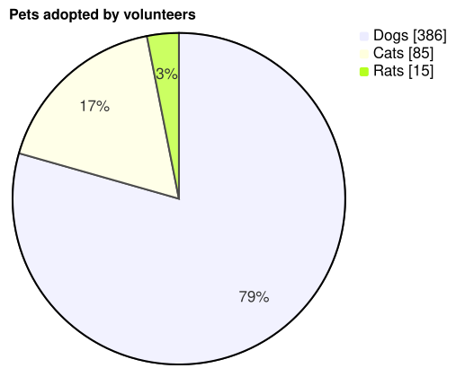

A [PieChart](cref:Meziantou.Framework.Mermaid.PieChart) draws a pie whose slices are proportional to their values,
with the percentage of each slice and a legend (Mermaid `pie`):

<!-- ref:../../../tests/Meziantou.Framework.Mermaid.Tests/PieChartTests.cs;region=Mermaid_PieChart;format=md-fenced-code-block;dedent=true -->
```csharp
var diagram = new PieChart { Title = "Pets adopted by volunteers", ShowData = true };
diagram.AddSlice("Dogs", 386);
diagram.AddSlice("Cats", 85);
diagram.AddSlice("Rats", 15);
```
<!-- endref -->



The chart is drawn with [Meziantou.Framework.Charts](../../Charts/01-Introduction.md), in the colors of the Mermaid
theme. To change the drawing beyond what Mermaid can say, get the plot with
[ToPlot](cref:Meziantou.Framework.Mermaid.MermaidChart.ToPlot) (see [Customize the drawing](01-Overview.md#customize-the-drawing)).

## Slices

A [PieSlice](cref:Meziantou.Framework.Mermaid.PieSlice) has a [Label](cref:Meziantou.Framework.Mermaid.PieSlice.Label)
and a [Value](cref:Meziantou.Framework.Mermaid.PieSlice.Value), positive or zero.
[AddSlice](cref:Meziantou.Framework.Mermaid.PieChart.AddSlice) adds a slice after the previous one. The slices are drawn
clockwise from the top, in their order, with their percentage of the total.

As Mermaid:

- The slices smaller than 1% of the total are not drawn: the others share the whole circle, but the legend lists every
  slice and the percentages are those of the total.
- A label keeps the value of its first slice: the following slices with the same label are ignored.
- The colors go to the slices in their order, and repeat every 12 slices.

[ShowData](cref:Meziantou.Framework.Mermaid.PieChart.ShowData) writes the value of each slice after its label in the
legend, as JavaScript writes numbers: with an exponent from `1e+21`.

## Layout and style

| Property | Description | Default |
| --- | --- | --- |
| [TextPosition](cref:Meziantou.Framework.Mermaid.PieChart.TextPosition) | The distance of the percentages from the center, from 0 to 1 | 0.75 |
| [DonutHole](cref:Meziantou.Framework.Mermaid.PieChart.DonutHole) | The radius of the hole of a donut chart, as a ratio of the radius, up to 0.9 | 0 |
| [LegendPosition](cref:Meziantou.Framework.Mermaid.PieChart.LegendPosition) | Where the legend is: right, top or bottom | Right |
| [HighlightedSlice](cref:Meziantou.Framework.Mermaid.PieChart.HighlightedSlice) | The label of the slice drawn 5% bigger and opaque | none |

The colors of the slices come from the theme, as the `pie1` to `pie12` theme variables of Mermaid.
[SliceColors](cref:Meziantou.Framework.Mermaid.PieChart.SliceColors) replaces some of them, by position. The other
theme variables of the pie charts of Mermaid are drawn too:

| Property | Description | Default |
| --- | --- | --- |
| [StrokeColor](cref:Meziantou.Framework.Mermaid.PieChart.StrokeColor), [StrokeWidth](cref:Meziantou.Framework.Mermaid.PieChart.StrokeWidth) | The borders of the slices | black, 2 |
| [OuterStrokeColor](cref:Meziantou.Framework.Mermaid.PieChart.OuterStrokeColor), [OuterStrokeWidth](cref:Meziantou.Framework.Mermaid.PieChart.OuterStrokeWidth) | The circle around the pie | black, 2 |
| [Opacity](cref:Meziantou.Framework.Mermaid.PieChart.Opacity) | The opacity of the slices, except the highlighted one | 0.7 |
| [SectionTextColor](cref:Meziantou.Framework.Mermaid.PieChart.SectionTextColor), [SectionTextSize](cref:Meziantou.Framework.Mermaid.PieChart.SectionTextSize) | The percentages | theme, 17 |
| [LegendTextColor](cref:Meziantou.Framework.Mermaid.PieChart.LegendTextColor), [LegendTextSize](cref:Meziantou.Framework.Mermaid.PieChart.LegendTextSize) | The texts of the legend; the title uses the color too | theme, 17 |

## What differs from Mermaid

The drawing looks like the other charts of Meziantou.Framework.Charts, not like Mermaid's own output: the title is on
the left, and the legend has small swatches and truncates the labels longer than 160 pixels. Above or below the pie,
the legend wraps its items in rows.

Some properties are written back to Mermaid, but not drawn:

- [PieLegendPosition.Left](cref:Meziantou.Framework.Mermaid.PieLegendPosition.Left) and
  [PieLegendPosition.Center](cref:Meziantou.Framework.Mermaid.PieLegendPosition.Center): the legend is drawn on the
  right.

## Mermaid syntax

<!-- ref:../../../tests/Meziantou.Framework.Mermaid.Tests/PieDiagramParserTests.cs;region=Mermaid_PieDiagram;format=md-fenced-code-block;dedent=true -->
```csharp
var diagram = (PieChart)MermaidDocument.Parse("""
    pie showData
        title Pets adopted by volunteers
        "Dogs" : 386
        "Cats" : 85
        "Rats" : 15
    """).Content;
```
<!-- endref -->

A slice is `"label" : value`, a line each. The label is between double or single quotes, where a backslash escapes a
character. The value is a number without exponent; a negative value is an error, as in Mermaid. `showData` follows `pie`
on its line, and the title or the first slice can follow too.

The parser reads `textPosition`, `donutHole`, `legendPosition` and `highlightSlice` in the `pie` section of the
configuration, and the `pie1` to `pie12`, `pieStrokeColor`, `pieStrokeWidth`, `pieOuterStrokeColor`,
`pieOuterStrokeWidth`, `pieOpacity`, `pieSectionTextColor`, `pieSectionTextSize`, `pieLegendTextColor` and
`pieLegendTextSize` theme variables. The differences with Mermaid:

- The title is drawn above the pie as the title of the other charts, so `pieTitleTextSize` and `pieTitleTextColor` are
  ignored.
- `highlightSlice: hover`, which highlights the slice under the mouse, is reported as a warning: the drawing is not
  interactive.
- A `textPosition` out of 0 to 1 is reported as a warning and ignored.
