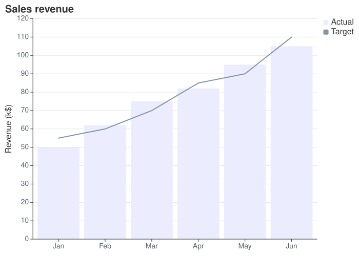

An [XyChart](cref:Meziantou.Framework.Mermaid.XyChart) draws series of values as bars and lines, over an
x axis of categories or of numbers and a y axis of numbers (Mermaid `xychart`):

<!-- ref:../../../tests/Meziantou.Framework.Mermaid.Tests/XyChartTests.cs;region=Mermaid_XyChart;format=md-fenced-code-block;dedent=true -->
```csharp
var diagram = new XyChart { Title = "Sales revenue" };
foreach (var month in new[] { "Jan", "Feb", "Mar", "Apr", "May", "Jun" })
{
    diagram.XAxis.Categories.Add(month);
}

diagram.YAxis.Title = "Revenue (k$)";
diagram.YAxis.Range = new XyChartAxisRange(0, 120);
diagram.AddBars([50, 62, 75, 82, 95, 105], "Actual");
diagram.AddLine([55, 60, 70, 85, 90, 110], "Target");
```
<!-- endref -->



The chart is drawn with [Meziantou.Framework.Charts](../../Charts/01-Introduction.md): a bar mark or a line mark per
series, in the colors of the XY charts of the Mermaid theme. It looks like the other charts of Charts, not like the
output of Mermaid.

## Axes

[XAxis](cref:Meziantou.Framework.Mermaid.XyChart.XAxis) and [YAxis](cref:Meziantou.Framework.Mermaid.XyChart.YAxis)
are [XyChartAxis](cref:Meziantou.Framework.Mermaid.XyChartAxis) objects:

- The x axis shows its [Categories](cref:Meziantou.Framework.Mermaid.XyChartAxis.Categories) when it has some: the value
  at an index of a series belongs to the category at the same index, and the values past the last category are not
  drawn. A category written twice is shown once. Without categories, the x axis shows the numbers of its
  [Range](cref:Meziantou.Framework.Mermaid.XyChartAxis.Range), and spreads the values of each series from its start to
  its end. Without range either, it numbers the values of the first series from 1. With bars, the axis goes half the
  distance between two bars past its ends, so the first and the last bars stay in the plot.
- The y axis shows the numbers of its [Range](cref:Meziantou.Framework.Mermaid.XyChartAxis.Range). Without range, it fits
  the values of the series with round ends, from zero when the chart has bars. A value out of the range is cut at the
  edge of the plot.

An [XyChartAxisRange](cref:Meziantou.Framework.Mermaid.XyChartAxisRange) goes from its start to its end, which can be
lower to reverse the axis. Each axis has a [Title](cref:Meziantou.Framework.Mermaid.XyChartAxis.Title), and options to
hide its title, its labels, its ticks and its line, and to set the length of its ticks.
[LabelRotation](cref:Meziantou.Framework.Mermaid.XyChartAxis.LabelRotation) rotates the labels below a vertical chart.
[Orientation](cref:Meziantou.Framework.Mermaid.XyChart.Orientation) puts the x axis on the left: the bars are
horizontal, and the categories read from the top down.

## Series

[AddBars](cref:Meziantou.Framework.Mermaid.XyChart.AddBars) and [AddLine](cref:Meziantou.Framework.Mermaid.XyChart.AddLine)
add an [XyChartBarSeries](cref:Meziantou.Framework.Mermaid.XyChartBarSeries) or an
[XyChartLineSeries](cref:Meziantou.Framework.Mermaid.XyChartLineSeries). The series are drawn in order, so the bars of
two series at the same place overlap, and take the colors of
[PlotColors](cref:Meziantou.Framework.Mermaid.XyChart.PlotColors), or of the theme, in turn. The bars start at zero, or
at the end of the range of the y axis closest to zero.

- A series with a [Name](cref:Meziantou.Framework.Mermaid.XyChartSeries.Name) is listed in the legend, on the right of
  the plot. A name is listed once: the next series of the same name keep their own colors.
  [ShowLegend](cref:Meziantou.Framework.Mermaid.XyChart.ShowLegend) hides the legend.
- [ShowDataLabels](cref:Meziantou.Framework.Mermaid.XyChart.ShowDataLabels) writes the value of each bar inside it,
  against its end, or past its end with
  [DataLabelsOutsideBars](cref:Meziantou.Framework.Mermaid.XyChart.DataLabelsOutsideBars).
- [PointLabels](cref:Meziantou.Framework.Mermaid.XyChartLineSeries.PointLabels) writes a text next to the points of a
  line, in its color.

## Size, fonts and colors

The chart is [Width](cref:Meziantou.Framework.Mermaid.XyChart.Width) by
[Height](cref:Meziantou.Framework.Mermaid.XyChart.Height) pixels, 700 by 500 by default. Charts lays out the title, the
axes and the legend, and gives the plot the rest. It has one font size and one color for each kind of element, so some
options of Mermaid share them:

| Charts uses | From |
| --- | --- |
| The size of the title | [TitleFontSize](cref:Meziantou.Framework.Mermaid.XyChart.TitleFontSize) |
| The size of the labels of the ticks | The largest [LabelFontSize](cref:Meziantou.Framework.Mermaid.XyChartAxis.LabelFontSize) of the two axes |
| The size of the titles of the axes and of the legend | The largest of the [TitleFontSize](cref:Meziantou.Framework.Mermaid.XyChartAxis.TitleFontSize) of the axes and [LegendFontSize](cref:Meziantou.Framework.Mermaid.XyChart.LegendFontSize) |
| The background | [BackgroundColor](cref:Meziantou.Framework.Mermaid.XyChart.BackgroundColor) |
| The color of the title, the titles of the axes and the legend | The first set of [TitleColor](cref:Meziantou.Framework.Mermaid.XyChart.TitleColor), [LegendTextColor](cref:Meziantou.Framework.Mermaid.XyChart.LegendTextColor) and the [TitleColor](cref:Meziantou.Framework.Mermaid.XyChartAxis.TitleColor) of the x axis, then of the y axis |
| The color of the labels of the ticks | The [LabelColor](cref:Meziantou.Framework.Mermaid.XyChartAxis.LabelColor) of the x axis, else of the y axis |
| The color of the lines and the ticks of the axes | The first set of the [LineColor](cref:Meziantou.Framework.Mermaid.XyChartAxis.LineColor) of the x axis, of the y axis, then of their [TickColor](cref:Meziantou.Framework.Mermaid.XyChartAxis.TickColor) |
| The color of the values of the bars | [DataLabelColor](cref:Meziantou.Framework.Mermaid.XyChart.DataLabelColor) |

The other options are written back by [MermaidWriter](cref:Meziantou.Framework.Mermaid.MermaidWriter) but not drawn:
[PlotReservedSpacePercent](cref:Meziantou.Framework.Mermaid.XyChart.PlotReservedSpacePercent),
[TitlePadding](cref:Meziantou.Framework.Mermaid.XyChart.TitlePadding) and
[LegendPadding](cref:Meziantou.Framework.Mermaid.XyChart.LegendPadding) of the chart, and
[LabelPadding](cref:Meziantou.Framework.Mermaid.XyChartAxis.LabelPadding),
[TitlePadding](cref:Meziantou.Framework.Mermaid.XyChartAxis.TitlePadding),
[TickWidth](cref:Meziantou.Framework.Mermaid.XyChartAxis.TickWidth) and
[LineWidth](cref:Meziantou.Framework.Mermaid.XyChartAxis.LineWidth) of the axes.
[ShowLabels](cref:Meziantou.Framework.Mermaid.XyChartAxis.ShowLabels) hides the labels of numbers only: the categories
are always shown.

## Customize the plot

[ToPlot](cref:Meziantou.Framework.Mermaid.MermaidChart.ToPlot) returns the [Plot](cref:Meziantou.Framework.Charts.Plot)
that draws the chart, to change what Mermaid cannot say before drawing it:

<!-- ref:../../../tests/Meziantou.Framework.Mermaid.Tests/XyChartTests.cs;region=Mermaid_XyChartToPlot;format=md-fenced-code-block;dedent=true -->
```csharp
var chart = (XyChart)MermaidDocument.Parse("""
    xychart
        title "Sales Revenue"
        x-axis [jan, feb, mar, apr, may, jun]
        bar [5000, 6000, 7500, 8200, 9500, 10500]
    """).Content;

var plot = chart.ToPlot();
plot.Subtitle = "First half of the year";
plot.YAxis.Grid = false;
var svg = plot.ToSvg();
```
<!-- endref -->

## Mermaid syntax

<!-- ref:../../../tests/Meziantou.Framework.Mermaid.Tests/XyChartDiagramParserTests.cs;region=Mermaid_XyChartDiagram;format=md-fenced-code-block;dedent=true -->
```csharp
var diagram = (XyChart)MermaidDocument.Parse("""
    xychart
        title "Sales Revenue"
        x-axis [jan, feb, mar, apr, may, jun]
        y-axis "Revenue (in $)" 4000 --> 11000
        bar [5000, 6000, 7500, 8200, 9500, 10500]
        line [5000, 6000, 7500, 8200, 9500, 10500]
    """).Content;
```
<!-- endref -->

`xychart` and `xychart-beta` are read the same, followed by `horizontal` or `vertical`. The statements are `title`,
`x-axis title [categories]`, `x-axis title start --> end`, `y-axis title start --> end`, `bar name [values]` and
`line name [values]`, where a value of a line can have a quoted label: `line [540 "PaLM", 65]`. The parser follows the
grammar of Mermaid, quirks included: a text without quotes is made of pieces joined without their spaces
(`title Sales Revenue` is `SalesRevenue`), and after `x-axis` and `y-axis` the digits are numbers, so a title such as
`Q1` must be quoted. The entity codes, such as `#35;`, are read in quoted texts only. The labels of the values of a bar
are read but not drawn, as in Mermaid, with a warning.

The `xyChart` section of the configuration sets the options of the chart: `width`, `height`, `titleFontSize`,
`titlePadding`, `showTitle`, `showLegend`, `legendFontSize`, `legendPadding`, `plotReservedSpacePercent`,
`showDataLabel`, `showDataLabelOutsideBar`, `chartOrientation`, and the options of `xAxis` and `yAxis`. The `xyChart`
section of the theme variables sets the colors: `backgroundColor`, `titleColor`, `dataLabelColor`, `legendTextColor`,
the title, label, tick and line colors of each axis, and `plotColorPalette`. The writer writes the options in the front
matter and the colors in an `init` directive.

Differences with Mermaid:

- The axes apply wherever they are written: in Mermaid, a series written before `x-axis` is placed on the axis that
  existed when it was read.
- Without range, the y axis starts at zero when the chart has bars: in Mermaid, it starts at the lowest value, whose bar
  has no height.
- The values written on the bars are those of each bar, in the font of the labels of the ticks: Mermaid writes the
  values of the first series on every bar series, in the largest font that fits every bar.
- The markers of the legend are squares, for the lines too.
- A chart without series is drawn empty: Mermaid reports an error.
