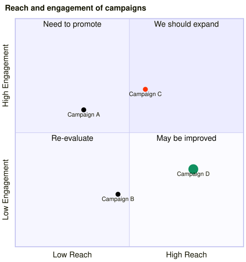

A [QuadrantChart](cref:Meziantou.Framework.Mermaid.QuadrantChart) draws
[points](cref:Meziantou.Framework.Mermaid.QuadrantChartPoint) on two axes that go from 0 to 1, over a square split into
four quadrants (Mermaid `quadrantChart`):

<!-- ref:../../../tests/Meziantou.Framework.Mermaid.Tests/QuadrantChartTests.cs;region=Mermaid_QuadrantChart;format=md-fenced-code-block;dedent=true -->
```csharp
var diagram = new QuadrantChart
{
    Title = "Reach and engagement of campaigns",
    XAxisLeftLabel = "Low Reach",
    XAxisRightLabel = "High Reach",
    YAxisBottomLabel = "Low Engagement",
    YAxisTopLabel = "High Engagement",
    Quadrant1Label = "We should expand",
    Quadrant2Label = "Need to promote",
    Quadrant3Label = "Re-evaluate",
    Quadrant4Label = "May be improved",
};
diagram.AddPoint("Campaign A", 0.3, 0.6);
diagram.AddPoint("Campaign B", 0.45, 0.23);
diagram.AddPoint("Campaign C", 0.57, 0.69).Style.Color = SceneColor.Parse("#ff3300");
diagram.AddPoint("Campaign D", 0.78, 0.34).ClassName = "important";
diagram.ClassDefinitions["important"] = new QuadrantChartPointStyle { Radius = 10, Color = SceneColor.Parse("#109060") };
```
<!-- endref -->



## Quadrants and axes

The quadrants are numbered as in mathematics:
[Quadrant1Label](cref:Meziantou.Framework.Mermaid.QuadrantChart.Quadrant1Label) is the text of the top right
quadrant, then the top left, the bottom left and the bottom right ones. Without points, the texts of the quadrants are
in their middle; with points, at their top, so they do not hide the points.

Each axis has two texts: [XAxisLeftLabel](cref:Meziantou.Framework.Mermaid.QuadrantChart.XAxisLeftLabel) and
[XAxisRightLabel](cref:Meziantou.Framework.Mermaid.QuadrantChart.XAxisRightLabel), drawn in the middle of their
half of the axis, or only the first one, drawn at its start. The texts of the y axis are turned to read from the bottom.
[XAxisPosition](cref:Meziantou.Framework.Mermaid.QuadrantChart.XAxisPosition) puts the texts of the x axis at the top,
the default, or at the bottom; as in Mermaid, they are always at the bottom when the chart has points.
[YAxisPosition](cref:Meziantou.Framework.Mermaid.QuadrantChart.YAxisPosition) puts the texts of the y axis on the left
or on the right. The axes have no ticks: the texts name the ends of the axes.

[Width](cref:Meziantou.Framework.Mermaid.QuadrantChart.Width) and
[Height](cref:Meziantou.Framework.Mermaid.QuadrantChart.Height) are the size of the chart with the texts of the
axes, 500 pixels by default; the [Title](cref:Meziantou.Framework.Mermaid.MermaidChart.Title) is drawn above it, and
makes the image taller. The paddings, the font sizes and the widths of the borders of Mermaid are properties too, such
as [QuadrantLabelFontSize](cref:Meziantou.Framework.Mermaid.QuadrantChart.QuadrantLabelFontSize),
[ExternalBorderWidth](cref:Meziantou.Framework.Mermaid.QuadrantChart.ExternalBorderWidth) and
[PointRadius](cref:Meziantou.Framework.Mermaid.QuadrantChart.PointRadius). A line feed in a text starts a new line.

## Points and styles

A point has a text drawn below it, and a [Style](cref:Meziantou.Framework.Mermaid.QuadrantChartPoint.Style): its
radius, its fill color, and the color and the width of its border. A point can also take the style of a class: its
[ClassName](cref:Meziantou.Framework.Mermaid.QuadrantChartPoint.ClassName) is a key of
[ClassDefinitions](cref:Meziantou.Framework.Mermaid.QuadrantChart.ClassDefinitions). The values of the point
take precedence over the ones of its class, which take precedence over the default. The first points are drawn above
the next ones, as in Mermaid. A large point is not clipped to the quadrants: it can cover the texts near it.

The quadrants are filled with the primary color of the [theme](../../Diagrams/05-Theming.md), a little lighter from
the first quadrant to the fourth one, and the points are black, as Mermaid draws them (the text color on a dark theme).
[Colors](cref:Meziantou.Framework.Mermaid.QuadrantChart.Colors) replaces any of these colors, as the `quadrant*`
theme variables of Mermaid do.

A markdown text keeps its markdown when it is written back, but its bold and italic parts are drawn as plain text.

## Customize the drawing

The chart is drawn with [Meziantou.Framework.Charts](../../Charts/01-Introduction.md):
[ToPlot](cref:Meziantou.Framework.Mermaid.MermaidChart.ToPlot) returns a [Plot](cref:Meziantou.Framework.Charts.Plot)
whose x and y scales go from 0 to 1, with hidden axes, and whose marks draw the quadrants, the borders, the points and
the texts. Add marks to it, then draw it:

<!-- ref:../../../tests/Meziantou.Framework.Mermaid.Tests/QuadrantChartTests.cs;region=Mermaid_QuadrantChartToPlot;format=md-fenced-code-block;dedent=true -->
```csharp
var diagram = new QuadrantChart { Title = "Risks", XAxisLeftLabel = "Unlikely", XAxisRightLabel = "Likely" };
diagram.AddPoint("Outage", 0.8, 0.9);
diagram.AddPoint("Data loss", 0.2, 0.95);

// The axes go from 0 to 1: a dashed line marks the likelihood above which a risk needs a plan
var plot = diagram.ToPlot();
plot.Add(new RuleXMark(0.7) { StrokeColor = SceneColor.Parse("#cc0000"), StrokeDashArray = [4, 4] });
var svg = plot.ToSvg();
```
<!-- endref -->

The plot has a fixed [Margin](cref:Meziantou.Framework.Charts.Plot.Margin), which leaves room for the title and the
texts of the axes only: change it too when you add a subtitle or a legend.

## Mermaid syntax

<!-- ref:../../../tests/Meziantou.Framework.Mermaid.Tests/QuadrantChartDiagramParserTests.cs;region=Mermaid_QuadrantChartDiagram;format=md-fenced-code-block;dedent=true -->
```csharp
var diagram = (QuadrantChart)MermaidDocument.Parse("""
    quadrantChart
        title Reach and engagement of campaigns
        x-axis Low Reach --> High Reach
        y-axis Low Engagement --> High Engagement
        quadrant-1 We should expand
        quadrant-2 Need to promote
        quadrant-3 Re-evaluate
        quadrant-4 May be improved
        Campaign A: [0.3, 0.6]
        Campaign B:::important: [0.45, 0.23] radius: 12, color: #ff3300
        classDef important stroke-color: #310085, stroke-width: 2px
    """).Content;
```
<!-- endref -->

The parser follows the grammar of Mermaid, and accepts and rejects the same texts. A statement ends at a line feed or a
semicolon, and the keywords ignore the case. `x-axis left --> right` sets the texts of the x axis, `x-axis left -->`
adds an arrow to the left one; `y-axis bottom --> top` the texts of the y axis. A point is
`text:::class: [x, y] styles`, where the class is optional, a coordinate is `0`, `1`, or `0.` followed by digits, and
the styles are `radius: 10`, `color: #ff3300`, `stroke-color: #10f0f0` and `stroke-width: 5px`, separated by commas.
`classDef name styles` defines a class.

A text is made of words, spaces, dashes and most punctuation, but no colon. A text between double quotes can contain any
character but a double quote, and `` "`text`" `` is a markdown text. As in Mermaid, `title`, `x-axis` and the other
keywords start their statement wherever a word starts, and `%%` starts a comment, so such a text needs quotes. The
parser reads the `quadrantChart` section of the configuration (`chartWidth`, `chartHeight`, `pointRadius`,
`xAxisPosition`...), and the `quadrant*` theme variables.

The writer quotes the texts that need it. It throws for a text with a double quote, a markdown text with a backquote, a
class name with other characters than letters, digits and underscores, or a color that is not opaque.
