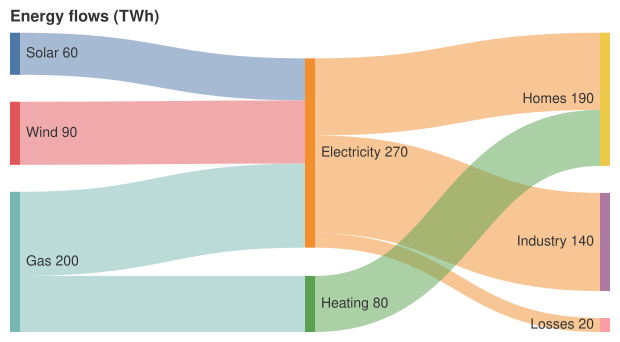

A [SankeyChart](cref:Meziantou.Framework.Mermaid.SankeyChart) draws flows between nodes: each
[link](cref:Meziantou.Framework.Mermaid.SankeyLink) goes from a source node to a target node, as wide as its value, and
the nodes are as high as the flows that go through them (Mermaid `sankey`). The chart is drawn by the
[SankeyMark\<T\>](cref:Meziantou.Framework.Charts.SankeyMark{T}) of Meziantou.Framework.Charts:

<!-- ref:../../../tests/Meziantou.Framework.Mermaid.Tests/SankeyChartTests.cs;region=Mermaid_SankeyChart;format=md-fenced-code-block;dedent=true -->
```csharp
var diagram = new SankeyChart { Title = "Energy flows (TWh)", Height = 300 };
diagram.AddLink("Solar", "Electricity", 60);
diagram.AddLink("Wind", "Electricity", 90);
diagram.AddLink("Gas", "Electricity", 120);
diagram.AddLink("Gas", "Heating", 80);
diagram.AddLink("Electricity", "Homes", 110);
diagram.AddLink("Electricity", "Industry", 140);
diagram.AddLink("Electricity", "Losses", 20);
diagram.AddLink("Heating", "Homes", 80);
```
<!-- endref -->



## Nodes and links

[AddLink](cref:Meziantou.Framework.Mermaid.SankeyChart.AddLink) adds a link between two nodes, named by the link: the
nodes are the sources and the targets of the links, in the order they appear
([GetNodes](cref:Meziantou.Framework.Mermaid.SankeyChart.GetNodes)). The values are positive numbers, or zero. Two
links between the same nodes are drawn as two links.

The links must not form a cycle: the parser rejects one, and a link that closes a cycle in a chart built in code is not
drawn, nor a node that only such links name, such as a node linked to itself.

## Layout

The layout is the one of d3-sankey, which Mermaid uses. The nodes are placed in columns by the number of links before
them, then moved toward the nodes they are linked to. [NodeAlignment](cref:Meziantou.Framework.Mermaid.SankeyChart.NodeAlignment)
chooses the column of the nodes: [Justify](cref:Meziantou.Framework.Mermaid.SankeyNodeAlignment.Justify) (the default)
puts the nodes without outgoing links in the last column, [Left](cref:Meziantou.Framework.Mermaid.SankeyNodeAlignment.Left)
keeps every node in the column of its depth, [Right](cref:Meziantou.Framework.Mermaid.SankeyNodeAlignment.Right) aligns
the nodes on the last column, and [Center](cref:Meziantou.Framework.Mermaid.SankeyNodeAlignment.Center) puts the nodes
without incoming links just before their first target.

[Width](cref:Meziantou.Framework.Mermaid.SankeyChart.Width) and [Height](cref:Meziantou.Framework.Mermaid.SankeyChart.Height)
are the size of the area of the nodes and the links, 600 by 400 pixels by default: the image adds a margin of 10 pixels
around it, and the title above it. [NodeWidth](cref:Meziantou.Framework.Mermaid.SankeyChart.NodeWidth) is the width of a
node, and [NodePadding](cref:Meziantou.Framework.Mermaid.SankeyChart.NodePadding) the space between the nodes of a
column, to which Mermaid adds 15 pixels when the labels show the values.

## Colors and labels

The nodes take the colors of the Tableau 10 scheme, in their order, as in Mermaid, whatever the theme, unless
[NodeColors](cref:Meziantou.Framework.Mermaid.SankeyChart.NodeColors) gives them one. The links are half transparent.
[LinkColoring](cref:Meziantou.Framework.Mermaid.SankeyChart.LinkColoring) colors them with the color of their
[Source](cref:Meziantou.Framework.Mermaid.SankeyLinkColoring.Source) or of their
[Target](cref:Meziantou.Framework.Mermaid.SankeyLinkColoring.Target), and
[LinkColor](cref:Meziantou.Framework.Mermaid.SankeyChart.LinkColor) gives every link the same color instead. The
default, [Gradient](cref:Meziantou.Framework.Mermaid.SankeyLinkColoring.Gradient), a gradient from the color of the
source to the color of the target in Mermaid, is drawn as `Source`.

The label of a node is its name and its value, the larger of the totals of its incoming and outgoing links, rounded to
two decimals and written as JavaScript writes numbers, between [ValuePrefix](cref:Meziantou.Framework.Mermaid.SankeyChart.ValuePrefix)
and [ValueSuffix](cref:Meziantou.Framework.Mermaid.SankeyChart.ValueSuffix).
[ShowValues](cref:Meziantou.Framework.Mermaid.SankeyChart.ShowValues) hides the values. The labels are after the nodes
of the left half and before the nodes of the right half, on one line. The tooltip of a link gives its source, its target
and its value.

[LabelStyle](cref:Meziantou.Framework.Mermaid.SankeyChart.LabelStyle) is written back, but
[Outlined](cref:Meziantou.Framework.Mermaid.SankeyLabelStyle.Outlined) is drawn as
[Legacy](cref:Meziantou.Framework.Mermaid.SankeyLabelStyle.Legacy): the labels are not outlined, nor placed by
column.

## Customize the drawing

[ToPlot](cref:Meziantou.Framework.Mermaid.MermaidChart.ToPlot) returns the [Plot](cref:Meziantou.Framework.Charts.Plot)
that draws the chart, with one `SankeyMark<T>` and the colors of the nodes in the palette of its theme. Change it to go
beyond what Mermaid can say, as the [overview](01-Overview.md) shows.

## Mermaid syntax

<!-- ref:../../../tests/Meziantou.Framework.Mermaid.Tests/SankeyDiagramParserTests.cs;region=Mermaid_SankeyDiagram;format=md-fenced-code-block;dedent=true -->
```csharp
var diagram = (SankeyChart)MermaidDocument.Parse("""
    sankey

    Solar,Electricity,60
    Wind,Electricity,90
    Gas,Electricity,120
    Gas,Heating,80
    Electricity,"Homes, offices",110
    Electricity,Industry,140
    Heating,"Homes, offices",80
    """).Content;
```
<!-- endref -->

`sankey` and `sankey-beta` are read the same. Each line is a link, `source,target,value`, as a row of a CSV file: a name
with a comma, a quote or a line break is between double quotes, and a quote in it is written twice (`"a ""b"", c"`). The
names are trimmed, and the blank lines are ignored. A value is the number that starts its field, as JavaScript reads it
(`1e3` is 1000). The parser reads `width`, `height`, `nodeWidth`, `nodePadding`, `linkColor` (`gradient`, `source`,
`target` or a color), `nodeAlignment`, `showValues`, `prefix`, `suffix`, `labelStyle` (`legacy` or `outlined`) and
`nodeColors` (a mapping of the names of the nodes to colors) in the `sankey` section of the configuration, and the title
of the front matter.

Mermaid rejects the names with characters that are not ASCII, and draws nothing for the values that are not positive
numbers and for the links that form a cycle. Here, the names can have any character, and a value that is not a positive
number or a cycle is an error. The grammar has no accessibility statements, so the writer rejects a chart with an
[AccessibleTitle](cref:Meziantou.Framework.Mermaid.MermaidChart.AccessibleTitle) or a
[Description](cref:Meziantou.Framework.Mermaid.MermaidChart.Description).
