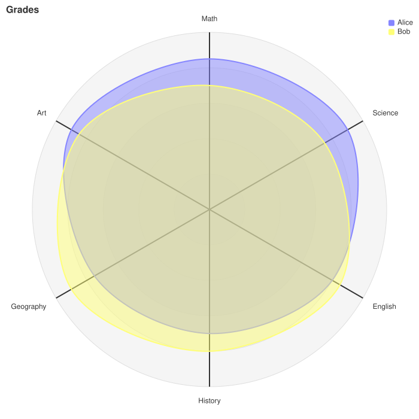
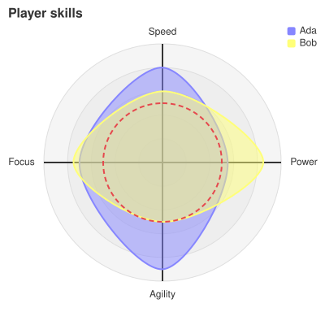

A [RadarChart](cref:Meziantou.Framework.Mermaid.RadarChart) draws axes around a center, and curves that join a value
on each axis, to compare several series over several dimensions (Mermaid `radar-beta`). It is also known as a spider,
star or polar chart, or a Kiviat diagram:

<!-- ref:../../../tests/Meziantou.Framework.Mermaid.Tests/RadarChartTests.cs;region=Mermaid_RadarChart;format=md-fenced-code-block;dedent=true -->
```csharp
var diagram = new RadarChart { Title = "Grades", Maximum = 100 };
diagram.AddAxis("m", "Math");
diagram.AddAxis("s", "Science");
diagram.AddAxis("e", "English");
diagram.AddAxis("h", "History");
diagram.AddAxis("g", "Geography");
diagram.AddAxis("a", "Art");
diagram.AddCurve("a", "Alice", 85, 90, 80, 70, 75, 90);
diagram.AddCurve("b", "Bob", 70, 75, 85, 80, 90, 85);
```
<!-- endref -->



The chart is drawn with [Meziantou.Framework.Charts](../../Charts/01-Introduction.md), in polar coordinates, in the
colors of the [Theme](cref:Meziantou.Framework.Mermaid.MermaidChart.Theme): it looks like the other charts of that
library, not like the output of Mermaid.

## Axes and curves

A [RadarAxis](cref:Meziantou.Framework.Mermaid.RadarAxis) has a [Name](cref:Meziantou.Framework.Mermaid.RadarAxis.Name)
and a [Label](cref:Meziantou.Framework.Mermaid.RadarAxis.Label), drawn at its end. The axes are clockwise from the top.
A [RadarCurve](cref:Meziantou.Framework.Mermaid.RadarCurve) has a name, a label for the legend, and
[Values](cref:Meziantou.Framework.Mermaid.RadarCurve.Values) in the order of the axes. The curves are closed and filled.
They take the colors of the palette of the theme, in their order, and the legend lists them in the top right corner.

As Mermaid:

- A curve that does not have a value for each axis is not drawn, but the legend lists it.
- The values out of the scale are drawn at the center or at the end of the axes.
- No curve is drawn when the maximum is not greater than the minimum.

## Scale

| Property | Description | Default |
| --- | --- | --- |
| [Maximum](cref:Meziantou.Framework.Mermaid.RadarChart.Maximum) | The value at the end of the axes | The largest value of the curves |
| [Minimum](cref:Meziantou.Framework.Mermaid.RadarChart.Minimum) | The value at the center | 0 |
| [Ticks](cref:Meziantou.Framework.Mermaid.RadarChart.Ticks) | The number of circles or polygons of the scale, up to 32 | 5 |
| [Graticule](cref:Meziantou.Framework.Mermaid.RadarChart.Graticule) | Circles with rounded curves, or polygons with straight curves | Circle |
| [ShowLegend](cref:Meziantou.Framework.Mermaid.RadarChart.ShowLegend) | Whether the legend lists the curves | true |

## Layout and style

The chart is [Width](cref:Meziantou.Framework.Mermaid.RadarChart.Width) by
[Height](cref:Meziantou.Framework.Mermaid.RadarChart.Height) (600), within margins of 50
([MarginTop](cref:Meziantou.Framework.Mermaid.RadarChart.MarginTop)...). The labels of the axes are drawn in the
margins, and the title and the legend in the top margin: give long labels wider margins.
[AxisScaleFactor](cref:Meziantou.Framework.Mermaid.RadarChart.AxisScaleFactor) sets the length of the axis lines, and
[AxisLabelFactor](cref:Meziantou.Framework.Mermaid.RadarChart.AxisLabelFactor) the distance of their labels, as ratios
of the radius.

The colors, widths, opacities and font sizes are the radar theme variables of Mermaid:
[AxisColor](cref:Meziantou.Framework.Mermaid.RadarChart.AxisColor),
[AxisStrokeWidth](cref:Meziantou.Framework.Mermaid.RadarChart.AxisStrokeWidth),
[AxisLabelFontSize](cref:Meziantou.Framework.Mermaid.RadarChart.AxisLabelFontSize),
[CurveOpacity](cref:Meziantou.Framework.Mermaid.RadarChart.CurveOpacity),
[CurveStrokeWidth](cref:Meziantou.Framework.Mermaid.RadarChart.CurveStrokeWidth),
[GraticuleColor](cref:Meziantou.Framework.Mermaid.RadarChart.GraticuleColor),
[GraticuleOpacity](cref:Meziantou.Framework.Mermaid.RadarChart.GraticuleOpacity),
[GraticuleStrokeWidth](cref:Meziantou.Framework.Mermaid.RadarChart.GraticuleStrokeWidth) and
[LegendFontSize](cref:Meziantou.Framework.Mermaid.RadarChart.LegendFontSize).

[CurveTension](cref:Meziantou.Framework.Mermaid.RadarChart.CurveTension) is written back to Mermaid, but it is only
partly drawn: the rounded curves are Catmull-Rom splines, which have no tension, and a tension of 0 draws straight lines.

## Customize the drawing

[ToPlot](cref:Meziantou.Framework.Mermaid.MermaidChart.ToPlot) returns the [Plot](cref:Meziantou.Framework.Charts.Plot)
that draws the chart, to add marks before drawing it. Around the circle, the x scale goes from 0 to 1, with the axes at
equal steps from 0. The y scale is the scale of the values, from the minimum at the center to the maximum at the end of
the axes:

<!-- ref:../../../tests/Meziantou.Framework.Mermaid.Tests/RadarChartTests.cs;region=Mermaid_RadarChartToPlot;format=md-fenced-code-block;dedent=true -->
```csharp
var chart = new RadarChart { Title = "Player skills", Maximum = 100, Width = 300, Height = 300 };
chart.AddAxis("speed", "Speed");
chart.AddAxis("power", "Power");
chart.AddAxis("agility", "Agility");
chart.AddAxis("focus", "Focus");
chart.AddCurve("ada", "Ada", 80, 55, 90, 70);
chart.AddCurve("bob", "Bob", 60, 85, 50, 75);

// The radius is the scale of the values: a rule at 50 is a circle halfway to the end of the axes
var plot = chart.ToPlot();
plot.Add(new RuleYMark(50) { StrokeColor = SceneColor.Parse("#e5484d"), StrokeWidth = 2, StrokeDashArray = [6, 4] });
var svg = plot.ToSvg();
```
<!-- endref -->



When the chart draws no curve, because the maximum is not greater than the minimum, or when the values at the end of the
axis lines or at their labels do not fit a `double`, the y scale goes from 0 to 1 instead, as fractions of the radius.

## Mermaid syntax

<!-- ref:../../../tests/Meziantou.Framework.Mermaid.Tests/RadarDiagramParserTests.cs;region=Mermaid_RadarDiagram;format=md-fenced-code-block;dedent=true -->
```csharp
var diagram = (RadarChart)MermaidDocument.Parse("""
    radar-beta
      title Restaurant Comparison
      axis food["Food Quality"], service["Service"], price["Price"]
      axis ambiance["Ambiance"]
      curve a["Restaurant A"]{4, 3, 2, 4}
      curve b["Restaurant B"]{ price: 3, service: 4, ambiance: 3, food: 3 }
      graticule polygon
      max 5
    """).Content;
```
<!-- endref -->

`axis` declares axes, `id` or `id["label"]`, separated by commas. `curve` declares curves, `id["label"]{values}`, where
the values are numbers in the order of the axes, or `axis: value` pairs in any order. The options are `showLegend`
(`true` or `false`), `ticks`, `max`, `min` and `graticule` (`circle` or `polygon`); the last value of an option wins. As
the grammar of Mermaid, the statements do not need their own lines, and the values of a curve can span lines.

An identifier is made of ASCII letters, digits, underscores and dashes, and starts with a letter or an underscore. As
Mermaid, an identifier cannot be a keyword, nor start with `true`, `false`, `circle`, `polygon` or `title`, which Mermaid
reads as other tokens.

The parser reads `width`, `height`, the margins, `axisScaleFactor`, `axisLabelFactor` and `curveTension` in the `radar`
section of the configuration, and the `radar` theme variables. The differences with Mermaid:

- A number of ticks that is not an integer is rounded up, and reported as a warning.
- The colors of the curves repeat after the 12 colors of the palette, where Mermaid leaves the next curves black.
- The names `accTitle` and `accDescr` are not identifiers.
