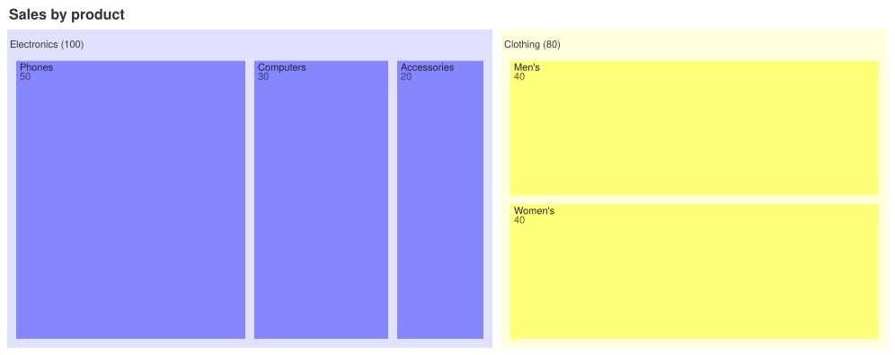

A [TreemapChart](cref:Meziantou.Framework.Mermaid.TreemapChart) draws a hierarchy as nested rectangles: each leaf
has an area proportional to its value, and each section surrounds its children, with its name and its total in a header
(Mermaid `treemap`):

<!-- ref:../../../tests/Meziantou.Framework.Mermaid.Tests/TreemapChartTests.cs;region=Mermaid_TreemapChart;format=md-fenced-code-block;dedent=true -->
```csharp
var diagram = new TreemapChart { Title = "Sales by product" };
var electronics = diagram.AddNode("Electronics");
electronics.AddChild("Phones", 50);
electronics.AddChild("Computers", 30);
electronics.AddChild("Accessories", 20);
var clothing = diagram.AddNode("Clothing");
clothing.AddChild("Men's", 40);
clothing.AddChild("Women's", 40);
```
<!-- endref -->



## Sections and leaves

[AddNode](cref:Meziantou.Framework.Mermaid.TreemapChart.AddNode) adds a top-level node, and
[AddChild](cref:Meziantou.Framework.Mermaid.TreemapNode.AddChild) a node under a section. As in Mermaid, a
[TreemapNode](cref:Meziantou.Framework.Mermaid.TreemapNode) with a [Value](cref:Meziantou.Framework.Mermaid.TreemapNode.Value)
is a leaf, and a node without one is a section, whose value is the total of its children. The values are positive
numbers; a leaf or a section whose value is 0 has no area, so it is not drawn.

The chart is drawn with the [TreemapMark\<T\>](cref:Meziantou.Framework.Charts.TreemapMark{T}) of
[Meziantou.Framework.Charts](../../Charts/01-Introduction.md), whose squarified layout is the one of d3-hierarchy that
Mermaid uses: the nodes of each section are sorted by decreasing value, then placed in rows whose rectangles are as
square as possible. A node that is twice in the tree is drawn once.

| Property | Description | Default |
| --- | --- | --- |
| [NodeWidth](cref:Meziantou.Framework.Mermaid.TreemapChart.NodeWidth) | A tenth of the width of the treemap, in pixels | 100 |
| [NodeHeight](cref:Meziantou.Framework.Mermaid.TreemapChart.NodeHeight) | A tenth of the height of the treemap, in pixels | 40 |
| [InnerPadding](cref:Meziantou.Framework.Mermaid.TreemapChart.InnerPadding) | The space between the nodes of a section, in pixels | 10 |
| [DiagramPadding](cref:Meziantou.Framework.Mermaid.TreemapChart.DiagramPadding) | The space around the treemap, in pixels | 8 |

The treemap is laid out in 1,000 by 400 pixels by default. As in Mermaid, every section, the hidden root included,
leaves a 35-pixel header above its children, where its name is drawn, and 10 pixels on its other sides; the image is cut
to the top-level nodes, with [DiagramPadding](cref:Meziantou.Framework.Mermaid.TreemapChart.DiagramPadding) around
them, under the title.

## Colors and labels

The colors are the palette of the [Theme](cref:Meziantou.Framework.Mermaid.MermaidChart.Theme), as Mermaid gives them:
each section name takes the next color, from the top-level sections down, and a leaf takes the color of its section. A
top-level leaf, which Mermaid leaves transparent, takes the color of its own name. A section is drawn in a light shade of
its color behind its children, with its name in its header; a leaf is drawn in its color, with its name and its value
when they fit.

[ValueFormat](cref:Meziantou.Framework.Mermaid.TreemapChart.ValueFormat) formats the values with a format specifier
of d3-format, as Mermaid does: `,` (the default) adds thousands separators, `.1f` writes one decimal, `.0%` a
percentage, and `$0,0` or `$.2f` add a dollar sign. A section writes its total after its name, as `Clothing (80)`, and
a leaf writes its value under its name. [ShowValues](cref:Meziantou.Framework.Mermaid.TreemapChart.ShowValues) hides the values. The
tooltip of a node is its path and its formatted value.

[ClassDefinitions](cref:Meziantou.Framework.Mermaid.TreemapChart.ClassDefinitions) holds styles by class name, and the
[CssClass](cref:Meziantou.Framework.Mermaid.TreemapNode.CssClass) of a node applies one. The fill and the opacity of a
style color the node; its border, its text color and its font are kept, so
[MermaidWriter](cref:Meziantou.Framework.Mermaid.MermaidWriter) writes them back, but they are not drawn.

## Customize the drawing

[ToPlot](cref:Meziantou.Framework.Mermaid.MermaidChart.ToPlot) returns the [Plot](cref:Meziantou.Framework.Charts.Plot)
that draws the chart: a single [TreemapMark\<T\>](cref:Meziantou.Framework.Charts.TreemapMark{T}) whose nodes carry
the [TreemapNode](cref:Meziantou.Framework.Mermaid.TreemapNode) they draw, an ordinal color scale that gives each node
its color, and no legend. Change the mark, for instance its tiling, then draw the plot:

<!-- ref:../../../tests/Meziantou.Framework.Mermaid.Tests/TreemapChartTests.cs;region=Mermaid_TreemapChart_ToPlot;format=md-fenced-code-block;dedent=true -->
```csharp
var chart = new TreemapChart { Title = "Sales by product" };
var electronics = chart.AddNode("Electronics");
electronics.AddChild("Phones", 50);
electronics.AddChild("Computers", 30);
chart.AddNode("Clothing").AddChild("Shoes", 40);

var plot = chart.ToPlot();
var mark = (TreemapMark<TreemapNode?>)plot.Marks[0];
mark.Tiling = TreemapTiling.SliceDice;
var svg = plot.ToSvg();
```
<!-- endref -->

## Mermaid syntax

<!-- ref:../../../tests/Meziantou.Framework.Mermaid.Tests/TreemapDiagramParserTests.cs;region=Mermaid_TreemapDiagram;format=md-fenced-code-block;dedent=true -->
```csharp
var diagram = (TreemapChart)MermaidDocument.Parse("""
    treemap
      title Sales by product
      "Electronics"
          "Phones": 50
          "Computers": 30
          "Accessories": 20
      "Clothing"
          "Men's": 40
          "Women's": 40
    """).Content;
```
<!-- endref -->

`treemap` and `treemap-beta` are read the same. A line is a quoted name (between double or single quotes, without
escapes): a section, or a leaf when `: value` (or `, value`) follows it. The indentation makes the tree as in Mermaid: a
node is a child of the last section above it that is less indented, so a node more indented than a leaf is a child of
the section of the leaf. A value is made of digits and points, the commas are ignored (`1,000.5`), and it stops at a
second point or an underscore, as JavaScript reads it. `:::class` after a node sets its class, and
`classDef name fill:#f96,stroke:#333;` defines one (the name has at least two characters, as in Mermaid). The parser
reads the title and the accessibility statements, and `diagramPadding`, `padding`, `nodeWidth`, `nodeHeight`,
`showValues` and `valueFormat` in the `treemap` section of the configuration.

Mermaid reads several nodes on a line and rejects a line that ends with spaces; here, a line holds one node, and the
spaces at the end of a line are ignored. A value that is not a number is an error, where Mermaid draws nothing.
