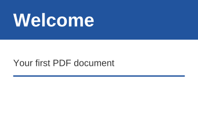

## Install the package

Add the `Meziantou.Framework.Pdf` package to a project:

```bash
dotnet add package Meziantou.Framework.Pdf
```

The examples of this documentation omit the `using` directives. Most only need `using Meziantou.Framework.Pdf;`; see
[Namespaces](01-Introduction.md#namespaces) for the others.

## Create a document

Create a document, add a page, draw on it with a content builder, and save it:

<!-- ref:../../tests/Meziantou.Framework.Pdf.Tests/PdfDocumentTests.cs;region=Pdf_CreateCard;format=md-fenced-code-block;dedent=true -->
```csharp
public static void CreateCard(string outputPath)
{
    var document = new PdfDocument();
    document.Information.Title = "Welcome";

    // A page of 300 by 180 points (1 point is 1/72 inch); the origin is its lower-left corner
    var page = document.Pages.Add(new PdfSize(300, 180));
    var bold = PdfFont.GetStandardFont(PdfStandardFont.HelveticaBold);
    var regular = PdfFont.GetStandardFont(PdfStandardFont.Helvetica);

    page.CreateContentBuilder()
        .SetFillRgb(0.13, 0.33, 0.62).Rectangle(0, 120, 300, 60).Fill() // a band at the top of the page
        .SetFillGray(1).DrawText("Welcome", bold, 28, 20, 140) // x and y are the start of the baseline
        .SetFillGray(0.2).DrawText("Your first PDF document", regular, 14, 20, 80)
        .SetStrokeRgb(0.13, 0.33, 0.62).SetLineWidth(2).MoveTo(20, 65).LineTo(280, 65).Stroke();

    document.Save(outputPath);
}
```
<!-- endref -->



- Sizes and coordinates are in points, 1/72 inch. The origin is the lower-left corner of the page, and y grows upward.
- `CreateContentBuilder` returns a builder whose methods can be chained. A path is built first (`Rectangle`, `MoveTo`,
  `LineTo`), then painted (`Fill`, `Stroke`) with the current colors.
- `DrawText` shows one line of text, starting at a point of its baseline. `Helvetica` is one of the 14 standard fonts,
  which every PDF reader has: the document does not need to embed them.
- `Save` writes the file. The output depends only on the document and the options: no date or random value is added.

## Read a document

`PdfDocument.Open` reads a file, a stream or an array of bytes. The pages give their text back:

<!-- ref:../../tests/Meziantou.Framework.Pdf.Tests/PdfDocumentTests.cs;region=Pdf_ReadDocument;format=md-fenced-code-block;dedent=true -->
```csharp
var document = PdfDocument.Open(file);
var pageCount = document.Pages.Count;
var text = document.Pages[0].ExtractText();
```
<!-- endref -->

See [Opening documents](05-ReadingAndModifying/02-OpeningDocuments.md) for passwords and damaged files, and
[Extracting text](05-ReadingAndModifying/03-ExtractingText.md) for what `ExtractText` returns.

## Render a page

`PdfRenderer` draws a page to an image of `Meziantou.Framework.Imaging`, which can be saved to PNG, JPEG, WebP and other
formats:

<!-- ref:../../tests/Meziantou.Framework.Pdf.Tests/PdfRendererTests.cs;region=PdfRendering_RenderPage;format=md-fenced-code-block;dedent=true -->
```csharp
var page = document.Pages[0];

// 144 dpi: two pixels per point
using var image = PdfRenderer.RenderPage(page, new PdfRenderOptions { Dpi = 144 });
using var png = new MemoryStream();
image.Save(png, new Imaging.Formats.PngEncoder());
```
<!-- endref -->

The images of this documentation are pages rendered this way. See [Rendering](06-Rendering/01-Overview.md).

## Next steps

- [Creating documents](03-CreatingDocuments/01-Overview.md): pages, shapes, text, fonts and images.
- [Modifying documents](05-ReadingAndModifying/04-ModifyingDocuments.md): add content to existing pages and save the
  changes.
- [Encryption](07-Security/02-Encryption.md) and [Digital signatures](07-Security/03-DigitalSignatures.md).
