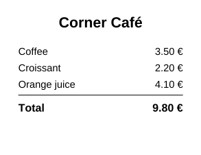
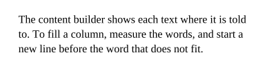
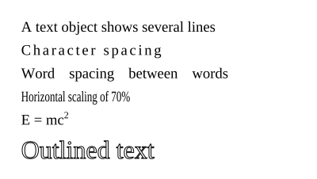

[DrawText](cref:Meziantou.Framework.Pdf.PdfContentBuilder.DrawText) shows a line of text at a position, with a font and a size. The text is painted with the fill color, and the
position is the start of its baseline.

## Align text

The builder places a text where it is told to: center or align it to the right by measuring it with [GetTextWidth](cref:Meziantou.Framework.Pdf.PdfFont.GetTextWidth):

<!-- ref:../../../tests/Meziantou.Framework.Pdf.Tests/PdfFontTests.cs;region=Pdf_DrawReceipt;format=md-fenced-code-block;dedent=true -->
```csharp
public static void DrawReceipt(string outputPath)
{
    var regular = PdfFont.GetStandardFont(PdfStandardFont.Helvetica);
    var bold = PdfFont.GetStandardFont(PdfStandardFont.HelveticaBold);
    (string Name, decimal Price)[] items = [("Coffee", 3.50m), ("Croissant", 2.20m), ("Orange juice", 4.10m)];

    var document = new PdfDocument();
    var builder = document.Pages.Add(new PdfSize(220, 170)).CreateContentBuilder();

    // Centered: the text starts half its width before the center of the page
    var title = "Corner Café";
    builder.DrawText(title, bold, 16, (220 - bold.GetTextWidth(title, 16)) / 2, 140);

    // One line per item: the name at the left margin, the price aligned on the right margin
    var y = 110.0;
    foreach (var (name, price) in items)
    {
        var amount = price.ToString("0.00 €", CultureInfo.InvariantCulture);
        builder.DrawText(name, regular, 11, 20, y)
            .DrawText(amount, regular, 11, 200 - regular.GetTextWidth(amount, 11), y);
        y -= 18;
    }

    builder.SetLineWidth(0.5).MoveTo(20, y + 10).LineTo(200, y + 10).Stroke();
    var total = items.Sum(item => item.Price).ToString("0.00 €", CultureInfo.InvariantCulture);
    builder.DrawText("Total", bold, 12, 20, y - 8)
        .DrawText(total, bold, 12, 200 - bold.GetTextWidth(total, 12), y - 8);

    document.Save(outputPath);
}
```
<!-- endref -->



- [GetTextWidth](cref:Meziantou.Framework.Pdf.PdfFont.GetTextWidth) returns the width of a text at a font size, in points, without the character and word spacing. It
  throws `ArgumentException` when a character has no glyph in the font.
- [Ascent](cref:Meziantou.Framework.Pdf.PdfFont.Ascent), [Descent](cref:Meziantou.Framework.Pdf.PdfFont.Descent) and [CapHeight](cref:Meziantou.Framework.Pdf.PdfFont.CapHeight) give the vertical metrics of the font, in thousandths of the font size: the height
  of the capital letters of a 16-point text is `font.CapHeight * 16 / 1000`, to center a text vertically in a box.

## Wrap a paragraph

The builder does not break lines. To fill a column, measure the words, and start a new line before the word that does
not fit:

<!-- ref:../../../tests/Meziantou.Framework.Pdf.Tests/PdfFontTests.cs;region=Pdf_DrawParagraph;format=md-fenced-code-block;dedent=true -->
```csharp
public static void DrawParagraph(string outputPath)
{
    var font = PdfFont.GetStandardFont(PdfStandardFont.TimesRoman);
    var text = "The content builder shows each text where it is told to. To fill a column, measure the words, and start a new line before the word that does not fit.";
    var fontSize = 12.0;
    var maxWidth = 260.0;

    var document = new PdfDocument();
    var builder = document.Pages.Add(new PdfSize(300, 80)).CreateContentBuilder()
        .BeginText()
        .SetFont(font, fontSize)
        .SetTextLeading(16)
        .MoveTextPosition(20, 55);

    var line = "";
    foreach (var word in text.Split(' '))
    {
        var candidate = line.Length == 0 ? word : line + " " + word;
        if (line.Length > 0 && font.GetTextWidth(candidate, fontSize) > maxWidth)
        {
            builder.ShowText(line).MoveToNextLine();
            line = word;
        }
        else
        {
            line = candidate;
        }
    }

    builder.ShowText(line).EndText();
    document.Save(outputPath);
}
```
<!-- endref -->



A text object ([BeginText](cref:Meziantou.Framework.Pdf.PdfContentBuilder.BeginText) to [EndText](cref:Meziantou.Framework.Pdf.PdfContentBuilder.EndText)) shows several texts with the same font: [SetTextLeading](cref:Meziantou.Framework.Pdf.PdfContentBuilder.SetTextLeading) sets the distance
between the lines, [MoveTextPosition](cref:Meziantou.Framework.Pdf.PdfContentBuilder.MoveTextPosition) moves to the start of a line, and [MoveToNextLine](cref:Meziantou.Framework.Pdf.PdfContentBuilder.MoveToNextLine) goes down by the leading.

## The standard fonts

[PdfFont.GetStandardFont](cref:Meziantou.Framework.Pdf.PdfFont.GetStandardFont) returns one of the 14 standard fonts: Times, Helvetica and Courier in four styles each, Symbol
and ZapfDingbats. PDF readers have them, so the document does not embed them and stays small.

They show the characters of `WinAnsiEncoding`, the Latin characters of Western European languages and a few symbols
(the euro sign, the typographic quotes and dashes); Symbol and ZapfDingbats have their own characters. [CanEncode](cref:Meziantou.Framework.Pdf.PdfFont.CanEncode) tells
whether a font can show a text. For other characters, or for PDF/A documents, which must embed their fonts, embed a
font: see [Fonts](04-Fonts.md).

## Spacing, scaling and rendering

Inside a text object, the text state changes how the glyphs are placed and painted:

<!-- ref:../../../tests/Meziantou.Framework.Pdf.Tests/PdfFontTests.cs;region=Pdf_DrawTextStyles;format=md-fenced-code-block;dedent=true -->
```csharp
public static void DrawTextStyles(string outputPath)
{
    var font = PdfFont.GetStandardFont(PdfStandardFont.TimesRoman);
    var document = new PdfDocument();
    document.Pages.Add(new PdfSize(300, 170)).CreateContentBuilder()
        .BeginText()
        .SetFont(font, 14)
        .SetTextLeading(22) // the distance between two baselines
        .MoveTextPosition(20, 140) // the start of the first line
        .ShowText("A text object shows several lines")
        .SetCharacterSpacing(2).ShowTextOnNextLine("Character spacing").SetCharacterSpacing(0)
        .SetWordSpacing(10).ShowTextOnNextLine("Word spacing between words").SetWordSpacing(0)
        .SetHorizontalScaling(70).ShowTextOnNextLine("Horizontal scaling of 70%").SetHorizontalScaling(100)
        .MoveToNextLine().ShowText("E = mc").SetTextRise(6).SetFont(font, 9).ShowText("2").SetTextRise(0).SetFont(font, 14)
        .SetFont(font, 24).SetTextLeading(32).SetLineWidth(0.5).SetTextRenderingMode(PdfTextRenderingMode.Stroke).ShowTextOnNextLine("Outlined text")
        .EndText();

    document.Save(outputPath);
}
```
<!-- endref -->



| Method | Effect |
| --- | --- |
| [SetCharacterSpacing](cref:Meziantou.Framework.Pdf.PdfContentBuilder.SetCharacterSpacing) | Space added after each glyph |
| [SetWordSpacing](cref:Meziantou.Framework.Pdf.PdfContentBuilder.SetWordSpacing) | Space added after each space character (standard fonts only: an embedded font has no single-byte space) |
| [SetHorizontalScaling](cref:Meziantou.Framework.Pdf.PdfContentBuilder.SetHorizontalScaling) | Stretches or condenses the glyphs, in percent |
| [SetTextRise](cref:Meziantou.Framework.Pdf.PdfContentBuilder.SetTextRise) | Moves the baseline up (superscript) or down (subscript) |
| [SetTextRenderingMode](cref:Meziantou.Framework.Pdf.PdfContentBuilder.SetTextRenderingMode) | Fills, strokes or both; invisible text; text used as a clip |
| [SetTextMatrix](cref:Meziantou.Framework.Pdf.PdfContentBuilder.SetTextMatrix) | Places and transforms the text with a [PdfMatrix](cref:Meziantou.Framework.Pdf.PdfMatrix), for a turned or slanted text |
| `ShowText(segments)` | Texts with adjustments between them, in thousandths of the font size, for kerning or justification |

The text state lasts until the end of the graphics state, not of the text object: reset what you changed, as the
example does.
