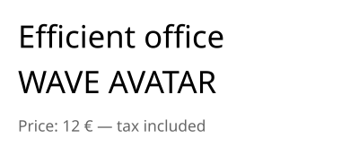

An embedded font shows any text it has the glyphs of, in any script. Load the font file once with [PdfFont.Load](cref:Meziantou.Framework.Pdf.PdfFont.Load), and use
it like a standard font:

<!-- ref:../../../tests/Meziantou.Framework.Pdf.Tests/PdfFontTests.cs;region=Pdf_DrawEmbeddedText;format=md-fenced-code-block;dedent=true -->
```csharp
public static void DrawEmbeddedText(string fontPath, string outputPath)
{
    // A TrueType or OpenType font file: the document embeds the glyphs it shows
    var font = PdfFont.Load(fontPath);

    var document = new PdfDocument();
    document.Pages.Add(new PdfSize(300, 130)).CreateContentBuilder()
        .DrawText("Efficient office", font, 26, 15, 90) // the "ffi" and "ff" ligatures of the font
        .DrawText("WAVE AVATAR", font, 26, 15, 52) // kerning: the pairs "WA", "AV" and "TA" are tightened
        .SetFillRgb(0.4, 0.4, 0.4)
        .DrawText("Price: 12 € — tax included", font, 13, 15, 20);

    document.Save(outputPath);
}
```
<!-- endref -->



## What is embedded

- [PdfFont.Load](cref:Meziantou.Framework.Pdf.PdfFont.Load) reads a `.ttf`, `.otf`, `.ttc`, `.woff` or `.woff2` file, from a path or from bytes; the `faceIndex`
  argument chooses a font of a collection (`.ttc`). [PdfFont.FromFace](cref:Meziantou.Framework.Pdf.PdfFont.FromFace) takes a [FontFace](cref:Meziantou.Framework.Fonts.FontFace) of `Meziantou.Framework.Fonts`
  that is already loaded.
- Each document embeds the subset of the glyphs it shows, as a composite font. The subset is written when the document
  is saved, so it grows with the content until then.
- The document also gets a `ToUnicode` map from the glyphs to their characters: the text can be extracted, searched and
  copied in readers. A text whose glyphs cannot give it back (a ligature, a right-to-left run) is marked with its
  replacement text.
- A [PdfFont](cref:Meziantou.Framework.Pdf.PdfFont) does not belong to a document and is thread-safe: load it once, and use it in every document.

## Shaping

The text is shaped with the OpenType layout tables of the font: ligatures, kerning, marks, and the complex scripts such
as Arabic or Devanagari. It is ordered by the Unicode Bidirectional Algorithm, so a right-to-left text is shown in the
right order. Use a font that has the glyphs of the script.

A text already shaped and laid out by another engine is shown with [ShowGlyphs](cref:Meziantou.Framework.Pdf.PdfContentBuilder.ShowGlyphs), in a text object: the glyph identifiers
of the font at their positions, which are not shaped again, and the text they show so that it can still be extracted.
[ShowGlyphs](cref:Meziantou.Framework.Pdf.PdfContentBuilder.ShowGlyphs) needs a font loaded from a file, not a standard font.

## Choose between a standard and an embedded font

A standard font keeps the file small, but only shows the characters of `WinAnsiEncoding`. [CanEncode](cref:Meziantou.Framework.Pdf.PdfFont.CanEncode) tells whether a
font has a glyph for every character of a text:

<!-- ref:../../../tests/Meziantou.Framework.Pdf.Tests/PdfFontTests.cs;region=Pdf_ChooseFont;format=md-fenced-code-block;dedent=true -->
```csharp
// A standard font shows the characters of WinAnsiEncoding (Latin-1, the euro sign, the typographic quotes...)
var helvetica = PdfFont.GetStandardFont(PdfStandardFont.Helvetica);
var font = helvetica.CanEncode(text) ? helvetica : PdfFont.Load(fontPath);
```
<!-- endref -->

Showing a character a font has no glyph for throws `ArgumentException`. The [PDF/A](../08-AccessibilityAndArchiving/03-PdfA.md)
and [PDF/UA](../08-AccessibilityAndArchiving/02-TaggedPdfAndPdfUA.md) documents must embed their fonts: the standard
fonts cannot be used.

## Fonts that cannot be embedded

[PdfFont.Load](cref:Meziantou.Framework.Pdf.PdfFont.Load) throws:

- [InvalidFontException](cref:Meziantou.Framework.Fonts.InvalidFontException) when the file is not a valid font;
- [UnsupportedPdfFeatureException](cref:Meziantou.Framework.Pdf.UnsupportedPdfFeatureException) when its outlines cannot be embedded (CFF2 and bitmap fonts) or when its license
  does not allow embedding;
- `ArgumentOutOfRangeException` when `faceIndex` is not a font of the file.

The instances of variable fonts are not embedded.
