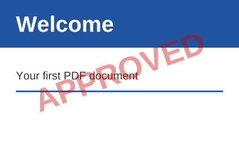

## Stamp the pages of a document

A content builder created for a page of an existing document draws over its content:

<!-- ref:../../../tests/Meziantou.Framework.Pdf.Tests/PdfDocumentTests.cs;region=Pdf_StampPages;format=md-fenced-code-block;dedent=true -->
```csharp
public static void StampPages(string inputPath, string outputPath)
{
    var document = PdfDocument.Open(inputPath);
    var font = PdfFont.GetStandardFont(PdfStandardFont.HelveticaBold);
    var translucent = new PdfExtGState { FillAlpha = 0.4 };
    var width = font.GetTextWidth("APPROVED", 40);

    foreach (var page in document.Pages)
    {
        // The new content is painted over the content of the page, from the default graphics state
        var box = page.CropBox;
        page.CreateContentBuilder()
            .SetGraphicsState(translucent)
            .SetFillRgb(0.8, 0, 0)
            .Translate(box.Left + (box.Width / 2), box.Bottom + (box.Height / 2)) // the center of the page
            .Rotate(20)
            .DrawText("APPROVED", font, 40, -width / 2, -14);
    }

    document.Save(outputPath);
}
```
<!-- endref -->



- The new content is painted after the content of the page, so over it. The existing content, the content of the
  builders created before included, is wrapped between a save and a restore of the graphics state first, so that the
  new content starts with the default graphics state, whatever the existing content left. This relies on the content
  of each builder being balanced: [Complete](cref:Meziantou.Framework.Pdf.PdfContentBuilder.Complete) checks that every save of the graphics state, text object and marked-content
  sequence is closed.
- The fonts and images a builder adds go to the resources of the page: the resources it shares with other pages are
  copied first, so that the other pages do not change.
- Use the crop box, not the media box, to place content in the visible area. The coordinates of a page whose [Rotation](cref:Meziantou.Framework.Pdf.PdfPage.Rotation)
  is set are those of the page before it is turned.
- Use [DisplayToUserSpace](cref:Meziantou.Framework.Pdf.PdfPage.DisplayToUserSpace) to draw on a rotated or cropped page as on an upright page: see
  [Managing pages](07-ManagingPages.md#draw-on-a-rotated-or-cropped-page).
- Add, remove, move, duplicate and import pages with [Pages](cref:Meziantou.Framework.Pdf.PdfDocument.Pages): see [Managing pages](07-ManagingPages.md).

## Full and incremental saves

A document read from a file can be saved in two ways:

| Save | Writes | Use it to |
| --- | --- | --- |
| [Save](cref:Meziantou.Framework.Pdf.PdfDocument.Save), [SaveAsync](cref:Meziantou.Framework.Pdf.PdfDocument.SaveAsync), [ToByteArray](cref:Meziantou.Framework.Pdf.PdfDocument.ToByteArray) | A new file with the objects the document uses, renumbered | Get a clean, compact file; remove the objects of deleted pages; change the encryption |
| [SaveIncremental](cref:Meziantou.Framework.Pdf.PdfDocument.SaveIncremental), [SaveIncrementalAsync](cref:Meziantou.Framework.Pdf.PdfDocument.SaveIncrementalAsync) | The bytes of the original file, followed by the objects that changed | Keep the original bytes, so that its signatures stay valid; write little for a small change of a large file |

<!-- ref:../../../tests/Meziantou.Framework.Pdf.Tests/PdfDocumentTests.cs;region=Pdf_IncrementalUpdate;format=md-fenced-code-block;dedent=true -->
```csharp
var document = PdfDocument.Open(file);
document.Information.Author = "Reviewer";

using var output = new MemoryStream();
document.SaveIncremental(output);
```
<!-- endref -->

- The incremental update holds the objects that were added or changed: the library notices the changes, whether they are
  made through the high-level API or the object model.
- It keeps the kind of cross-reference of the original file (a table or a stream). When the file has cross-reference
  streams, the objects of the update are written in object streams, which makes the update smaller; set
  [UseObjectStreams](cref:Meziantou.Framework.Pdf.PdfSaveOptions.UseObjectStreams) to `false` to write them one by one.
  Streams, signature dictionaries and the objects of a generation other than 0 are never in an object stream.
- An object removed with `Objects.Remove` is written as a free entry of the update: the object no longer exists in the
  new revision, while the earlier revisions keep it. Its number is not given to a new object.
- The private entries of the trailer are kept, by incremental and full saves.
- When nothing changed, the original file is written as it is, without an empty update.
- The original file is copied to the output as it is, without being buffered again.
- It throws `InvalidOperationException` for a document that was not read from a file, or that was repaired
  ([IsRepaired](cref:Meziantou.Framework.Pdf.PdfDocument.IsRepaired)). It cannot change the encryption of the document either: use a full save.
- A full save of a document read from an encrypted file keeps its encryption: see
  [Encryption](../07-Security/02-Encryption.md).

To sign a document, use [PdfSigner](cref:Meziantou.Framework.Pdf.Signing.PdfSigner), which appends the signature as an incremental update itself: see
[Digital signatures](../07-Security/04-DigitalSignatures.md).
