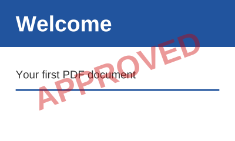
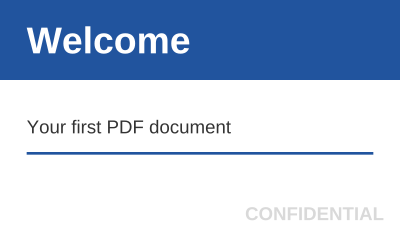
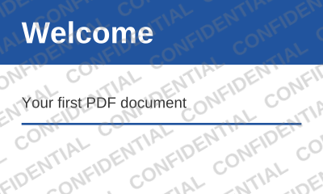

## Stamp the pages of a document

A content builder created for a page of an existing document draws over its content:

<!-- ref:../../../tests/Meziantou.Framework.Pdf.Tests/PdfDocumentTests.cs;region=Pdf_StampPages;format=md-fenced-code-block;dedent=true -->
```csharp
public static void StampPages(string inputPath, string outputPath)
{
    var document = PdfDocument.Open(inputPath);
    var font = PdfFont.GetStandardFont(PdfStandardFont.HelveticaBold);
    var translucent = new PdfExtGState { FillAlpha = 0.4 };
    var width = font.GetTextWidth("APPROVED", 40);

    foreach (var page in document.Pages)
    {
        // The new content is painted over the content of the page, from the default graphics state
        var box = page.CropBox;
        page.CreateContentBuilder()
            .SetGraphicsState(translucent)
            .SetFillRgb(0.8, 0, 0)
            .Translate(box.Left + (box.Width / 2), box.Bottom + (box.Height / 2)) // the center of the page
            .Rotate(20)
            .DrawText("APPROVED", font, 40, -width / 2, -14);
    }

    document.Save(outputPath);
}
```
<!-- endref -->



- The new content is painted after the content of the page, so over it. The existing content, the content of the
  builders created before included, is wrapped between a save and a restore of the graphics state first, so that the
  new content starts with the default graphics state, whatever the existing content left. This relies on the content
  of each builder being balanced: [Complete](cref:Meziantou.Framework.Pdf.PdfContentBuilder.Complete) checks that every save of the graphics state, text object and marked-content
  sequence is closed.
- The fonts and images a builder adds go to the resources of the page: the resources it shares with other pages are
  copied first, so that the other pages do not change.
- Use the crop box, not the media box, to place content in the visible area. The coordinates of a page whose [Rotation](cref:Meziantou.Framework.Pdf.PdfPage.Rotation)
  is set are those of the page before it is turned.
- Use [DisplayToUserSpace](cref:Meziantou.Framework.Pdf.PdfPage.DisplayToUserSpace) to draw on a rotated or cropped page as on an upright page: see
  [Managing pages](07-ManagingPages.md#draw-on-a-rotated-or-cropped-page).
- Add, remove, move, duplicate and import pages with [Pages](cref:Meziantou.Framework.Pdf.PdfDocument.Pages): see [Managing pages](07-ManagingPages.md).

## Draw under the content of a page

[CreateContentBuilder](cref:Meziantou.Framework.Pdf.PdfPage.CreateContentBuilder) with [PdfContentPlacement.Under](cref:Meziantou.Framework.Pdf.PdfContentPlacement.Under) draws before the content of the page, so
under it: a background, a letterhead, or a watermark that the text and the images of the page cover.

<!-- ref:../../../tests/Meziantou.Framework.Pdf.Tests/PdfPageTests.cs;region=Pdf_Underlay;format=md-fenced-code-block;dedent=true -->
```csharp
// A background: the content of the page is painted over it
page.CreateContentBuilder(PdfContentPlacement.Under)
    .SetFillRgb(0.9, 0.9, 1)
    .Rectangle(page.MediaBox)
    .Fill()
    .Complete();
```
<!-- endref -->

- The new content starts with the default graphics state and is closed by a restore of the graphics state, so the
  content of the page starts as it did before.
- Each new builder under the page draws under the content of the builders created under it before.
- An opaque page covers what is under it: a scanned page is an image of the whole page, and some documents paint a
  white rectangle first. Draw over the content, with transparency, to be seen on these pages.

## Add a watermark

[PdfDocument.AddWatermark](cref:Meziantou.Framework.Pdf.PdfDocument.AddWatermark) writes a text across every page, such as "DRAFT" or "CONFIDENTIAL":

<!-- ref:../../../tests/Meziantou.Framework.Pdf.Tests/PdfPageTests.cs;region=Pdf_Watermark;format=md-fenced-code-block;dedent=true -->
```csharp
// On every page, along its diagonal; the text is drawn once and painted by each page
document.AddWatermark("DRAFT", new PdfWatermarkOptions { Opacity = 0.2 });
```
<!-- endref -->

- The text is centered on the page as it is displayed, cropped and rotated, along the diagonal from the lower-left to
  the upper-right corner, and sized to fit in 80% of the page. [PdfWatermarkOptions](cref:Meziantou.Framework.Pdf.PdfWatermarkOptions) sets the font, the font
  size, the color, the opacity, the angle, and whether it is painted over or under the content.
- The text is drawn once, in a form XObject that each page paints, so a long document stays small.
  [PdfPage.AddWatermark](cref:Meziantou.Framework.Pdf.PdfPage.AddWatermark) adds a watermark to one page.
- The watermark is marked as an artifact, so that screen readers skip it in tagged documents. It is part of the content:
  the text extraction returns it, and it can be removed only by editing the content.

### Place the watermark in a corner

[Position](cref:Meziantou.Framework.Pdf.PdfWatermarkOptions.Position) puts the text in a corner or along an edge of the page instead of its center:

<!-- ref:../../../tests/Meziantou.Framework.Pdf.Tests/PdfPageTests.cs;region=Pdf_WatermarkInACorner;format=md-fenced-code-block;dedent=true -->
```csharp
public static void WatermarkInACorner(string inputPath, string outputPath)
{
    var document = PdfDocument.Open(inputPath);

    // Horizontal, in the lower-right corner of every page, 12 points from its edges
    document.AddWatermark("CONFIDENTIAL", new PdfWatermarkOptions
    {
        Position = PdfWatermarkPosition.BottomRight,
        Margin = 12,
        FontSize = 14,
    });

    document.Save(outputPath);
}
```
<!-- endref -->



- [Margin](cref:Meziantou.Framework.Pdf.PdfWatermarkOptions.Margin) is the distance, in points, between the box of the text
  and the edges of the page as it is displayed. The default is 36, half an inch.
- The text is horizontal unless you set [Rotation](cref:Meziantou.Framework.Pdf.PdfWatermarkOptions.Rotation); the margin
  applies to the box of the rotated text.
- Without a [FontSize](cref:Meziantou.Framework.Pdf.PdfWatermarkOptions.FontSize), the text is 1/20 of the diagonal of the
  page.

### Repeat the watermark over the page

[IsTiled](cref:Meziantou.Framework.Pdf.PdfWatermarkOptions.IsTiled) repeats the text over the whole page, which makes
the watermark harder to crop away:

<!-- ref:../../../tests/Meziantou.Framework.Pdf.Tests/PdfPageTests.cs;region=Pdf_TiledWatermark;format=md-fenced-code-block;dedent=true -->
```csharp
public static void TiledWatermark(string inputPath, string outputPath)
{
    var document = PdfDocument.Open(inputPath);

    // Repeated over the whole page, along its diagonal, the rows offset by half a copy
    document.AddWatermark("CONFIDENTIAL", new PdfWatermarkOptions
    {
        IsTiled = true,
        FontSize = 18,
        TileSpacing = 12,
    });

    document.Save(outputPath);
}
```
<!-- endref -->



- The copies are in rows along the diagonal of the page, or along
  [Rotation](cref:Meziantou.Framework.Pdf.PdfWatermarkOptions.Rotation), and each row is offset by half a copy from the
  previous one, like the bricks of a wall. One copy is centered on the page.
- [TileSpacing](cref:Meziantou.Framework.Pdf.PdfWatermarkOptions.TileSpacing) is the space, in points, between the
  copies, horizontally and vertically. The default is the height of the text.
- Without a [FontSize](cref:Meziantou.Framework.Pdf.PdfWatermarkOptions.FontSize), the text is 1/20 of the diagonal of the
  page. A tiled watermark ignores [Position](cref:Meziantou.Framework.Pdf.PdfWatermarkOptions.Position) and
  [Margin](cref:Meziantou.Framework.Pdf.PdfWatermarkOptions.Margin).
- The page paints a tiling pattern whose cell paints the form of the text, so the document stays small. The pages of
  the same size and rotation share the pattern. The text extraction does not return the text of a pattern.

### Choose the pages

[FirstPageIndex](cref:Meziantou.Framework.Pdf.PdfWatermarkOptions.FirstPageIndex) and
[LastPageIndex](cref:Meziantou.Framework.Pdf.PdfWatermarkOptions.LastPageIndex) limit
[PdfDocument.AddWatermark](cref:Meziantou.Framework.Pdf.PdfDocument.AddWatermark) to a range of pages. The indexes start
at 0, and the last page is included; an index after the last page of the document stands for the last page.
[PdfPage.AddWatermark](cref:Meziantou.Framework.Pdf.PdfPage.AddWatermark) ignores them.

## Add headers and footers

[AddHeaderFooter](cref:Meziantou.Framework.Pdf.PdfDocument.AddHeaderFooter) stamps texts at the top and the bottom of the pages, such as page numbers or a date:

<!-- ref:../../../tests/Meziantou.Framework.Pdf.Tests/PdfDocumentTests.cs;region=Pdf_HeaderFooter;format=md-fenced-code-block;dedent=true -->
```csharp
document.AddHeaderFooter(new PdfHeaderFooterOptions
{
    HeaderLeft = "Annual report",
    HeaderRight = "{date}",
    FooterCenter = "Page {page} of {pages}",
    FooterRight = "{{{label}}}",
    Date = new DateTimeOffset(2026, 3, 1, 0, 0, 0, TimeSpan.Zero),
    FontSize = 9,
});
```
<!-- endref -->

- [PdfHeaderFooterOptions](cref:Meziantou.Framework.Pdf.PdfHeaderFooterOptions) has three texts for the header and three for the footer: on the left, in the center
  and on the right of the page as it is displayed, its rotation applied, at [Margin](cref:Meziantou.Framework.Pdf.PdfHeaderFooterOptions.Margin) from its edges.
- The tokens of a text are replaced for each page: `{page}` (from [StartPageNumber](cref:Meziantou.Framework.Pdf.PdfHeaderFooterOptions.StartPageNumber)), `{pages}` (the number
  of pages, or [PageCount](cref:Meziantou.Framework.Pdf.PdfHeaderFooterOptions.PageCount)), `{label}` (the [page label](../04-MetadataAndNavigation/05-PageLabels.md)), `{date}` and
  `{bates}`. `{{` and `}}` are braces. An unknown token throws `ArgumentException`.
- `{date}` is [Date](cref:Meziantou.Framework.Pdf.PdfHeaderFooterOptions.Date) in [DateFormat](cref:Meziantou.Framework.Pdf.PdfHeaderFooterOptions.DateFormat): the library never writes the current date by itself, so
  that a document is saved the same way every time.
- [FirstPageIndex](cref:Meziantou.Framework.Pdf.PdfHeaderFooterOptions.FirstPageIndex) and [LastPageIndex](cref:Meziantou.Framework.Pdf.PdfHeaderFooterOptions.LastPageIndex) stamp a range of pages, such as all the pages but the cover.
- The texts are pagination artifacts, which assistive technologies skip. A text the font cannot show throws
  `ArgumentException` before any page changes.

### Bates numbering

Bates numbers identify each page of a legal production with a sequential number. [PdfBates.Apply](cref:Meziantou.Framework.Pdf.PdfBates.Apply) stamps them
on several documents, the numbers of a document following those of the previous one:

<!-- ref:../../../tests/Meziantou.Framework.Pdf.Tests/PdfDocumentTests.cs;region=Pdf_BatesNumbering;format=md-fenced-code-block;dedent=true -->
```csharp
var ranges = PdfBates.Apply([first, second], new PdfHeaderFooterOptions
{
    FooterRight = "{bates}",
    Bates = new PdfBatesNumbering { Prefix = "ABC", Digits = 6, StartNumber = 41 },
});
```
<!-- endref -->

[PdfBatesNumbering](cref:Meziantou.Framework.Pdf.PdfBatesNumbering) has the prefix, the suffix, the number of digits and the first number; the `{bates}` token of the
texts is the number of the page. Each [PdfBatesRange](cref:Meziantou.Framework.Pdf.PdfBatesRange) gives the first and last numbers of a document, for the index of
the production. For one document, set [Bates](cref:Meziantou.Framework.Pdf.PdfHeaderFooterOptions.Bates) and call [AddHeaderFooter](cref:Meziantou.Framework.Pdf.PdfDocument.AddHeaderFooter).

## Full and incremental saves

A document read from a file can be saved in two ways:

| Save | Writes | Use it to |
| --- | --- | --- |
| [Save](cref:Meziantou.Framework.Pdf.PdfDocument.Save), [SaveAsync](cref:Meziantou.Framework.Pdf.PdfDocument.SaveAsync), [ToByteArray](cref:Meziantou.Framework.Pdf.PdfDocument.ToByteArray) | A new file with the objects the document uses, renumbered | Get a clean, compact file; remove the objects of deleted pages; change the encryption |
| [SaveIncremental](cref:Meziantou.Framework.Pdf.PdfDocument.SaveIncremental), [SaveIncrementalAsync](cref:Meziantou.Framework.Pdf.PdfDocument.SaveIncrementalAsync) | The bytes of the original file, followed by the objects that changed | Keep the original bytes, so that its signatures stay valid; write little for a small change of a large file |

<!-- ref:../../../tests/Meziantou.Framework.Pdf.Tests/PdfDocumentTests.cs;region=Pdf_IncrementalUpdate;format=md-fenced-code-block;dedent=true -->
```csharp
var document = PdfDocument.Open(file);
document.Information.Author = "Reviewer";

using var output = new MemoryStream();
document.SaveIncremental(output);
```
<!-- endref -->

- The incremental update holds the objects that were added or changed: the library notices the changes, whether they are
  made through the high-level API or the object model.
- It keeps the kind of cross-reference of the original file (a table or a stream). When the file has cross-reference
  streams, the objects of the update are written in object streams, which makes the update smaller; set
  [UseObjectStreams](cref:Meziantou.Framework.Pdf.PdfSaveOptions.UseObjectStreams) to `false` to write them one by one.
  Streams, signature dictionaries and the objects of a generation other than 0 are never in an object stream.
- An object removed with `Objects.Remove` is written as a free entry of the update: the object no longer exists in the
  new revision, while the earlier revisions keep it. Its number is not given to a new object.
- The private entries of the trailer are kept, by incremental and full saves.
- When nothing changed, the original file is written as it is, without an empty update.
- The original file is copied to the output as it is, without being buffered again.
- It throws `InvalidOperationException` for a document that was not read from a file, or that was repaired
  ([IsRepaired](cref:Meziantou.Framework.Pdf.PdfDocument.IsRepaired)). It cannot change the encryption of the document either: use a full save.
- A full save of a document read from an encrypted file keeps its encryption: see
  [Encryption](../07-Security/02-Encryption.md).

To sign a document, use [PdfSigner](cref:Meziantou.Framework.Pdf.Signing.PdfSigner), which appends the signature as an incremental update itself: see
[Digital signatures](../07-Security/04-DigitalSignatures.md).

## Revisions

A file saved incrementally keeps its previous versions: [Revisions](cref:Meziantou.Framework.Pdf.PdfDocument.Revisions) lists them, the original file then one per
incremental update. Each revision opens as a document, and lists the changes made after it:

<!-- ref:../../../tests/Meziantou.Framework.Pdf.Tests/PdfNavigationTests.cs;region=Pdf_Revisions;format=md-fenced-code-block;dedent=true -->
```csharp
var revisions = document.Revisions;

// The document as it was before the incremental updates, and what they changed
var firstVersion = revisions[0].Open();
var changes = revisions[0].GetModifications();
```
<!-- endref -->

- A revision is a prefix of the file, which ends at an end-of-file marker (`%%EOF`). The first-page section of a
  linearized file belongs to the revision of the rest of the file.
- A repaired file is one revision, and a document that was not read from a file has none.
- [GetModifications](cref:Meziantou.Framework.Pdf.PdfRevision.GetModifications) compares the revision with the document as it is now, the changes not saved yet included, as the
  verification of the signatures does: see [Digital signatures](../07-Security/04-DigitalSignatures.md).
