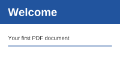

`PdfRenderer` draws a page to an image of `Meziantou.Framework.Imaging`, which can then be saved to PNG, JPEG, WebP and
the other formats it writes, resized or drawn on. The types are in the [Meziantou.Framework.Pdf.Rendering](cref:Meziantou.Framework.Pdf.Rendering) namespace.

<!-- ref:../../../tests/Meziantou.Framework.Pdf.Tests/PdfRendererTests.cs;region=PdfRendering_RenderPage;format=md-fenced-code-block;dedent=true -->
```csharp
var page = document.Pages[0];

// 144 dpi: two pixels per point
using var image = PdfRenderer.RenderPage(page, new PdfRenderOptions { Dpi = 144 });
using var png = new MemoryStream();
image.Save(png, new Imaging.Formats.PngEncoder());
```
<!-- endref -->

`PdfRenderer.RenderPage(page, options)` and the extension method `page.Render(options)` are the same. The image is the
crop box of the page, turned by its `Rotation`, as viewers show it, in sRGB. It is an `Image<Rgba32>`: dispose of it.

## Render thumbnails

Choose the resolution from the size you want:

<!-- ref:../../../tests/Meziantou.Framework.Pdf.Tests/PdfRendererTests.cs;region=PdfRendering_RenderThumbnails;format=md-fenced-code-block;dedent=true -->
```csharp
public static void RenderThumbnails(string pdfPath, string outputDirectory)
{
    var document = PdfDocument.Open(pdfPath);
    for (var i = 0; i < document.Pages.Count; i++)
    {
        // The width of the page as it is shown: a rotation of 90 or 270 degrees exchanges its sides
        var page = document.Pages[i];
        var width = page.Rotation is 90 or 270 ? page.CropBox.Height : page.CropBox.Width;

        // 72 dpi is one pixel per point: the resolution that gives images 200 pixels wide
        var options = new PdfRenderOptions
        {
            Dpi = 72 * 200 / width,
            UseSystemFonts = false, // the same pixels on every machine
        };

        using var image = page.Render(options);
        image.Save(Path.Combine(outputDirectory, $"page-{i + 1}.png"));
    }
}
```
<!-- endref -->



## Options

| Option | Default | Effect |
| --- | --- | --- |
| `Dpi` | 72 | The resolution: 72 renders one pixel per point, 144 two |
| `Background` | White | The color painted before the content; `null` for a transparent background |
| `RenderAnnotations` | `true` | Draws the appearances of the annotations, such as stamps and form fields |
| `FontResolver`, `UseSystemFonts` | none, `true` | The fonts that replace the fonts the document does not embed: see [Fonts that are not embedded](02-FontsThatAreNotEmbedded.md) |
| `MaxOperations` | 50,000,000 | The work a page may do: see below |
| `Configuration` | `null` | The configuration of the image: its limits and allocation scope (see [Resource limits](../../Imaging/05-LoadingAndSaving/07-ResourceLimits.md)) |

`PdfRenderOptions` is immutable: create the options once and render many pages with them.

## What is drawn

- **Graphics**: paths, line styles, dashes, clipping by paths and text, the optional content (layers) of the default
  configuration, and the appearances of the annotations.
- **Text**: embedded TrueType, CFF, OpenType and Type 1 fonts, Type 3 fonts, the text rendering modes, and the fonts
  that are not embedded, replaced by other fonts.
- **Colors**: the device color spaces, ICC profiles, `CalRGB`, `CalGray`, `Lab`, `Indexed`, `Separation` and `DeviceN`;
  CMYK colors are converted with a CMYK profile.
- **Images**: every filter (JPEG, CMYK JPEG included, JPEG 2000, CCITT fax, JBIG2), 1 to 16 bits per component, the
  masks and soft masks, and the inline images.
- **Shadings and patterns**: the functions, the seven types of shadings, and the colored and uncolored tiling patterns.
- **Transparency**: opacity, the blend modes, the transparency groups (isolated and knockout), the soft masks, and the
  transfer functions.

## Damaged and hostile pages

A damaged content is drawn as viewers draw it: an operator whose operands or resources are invalid is skipped, and a
font, an image or a shading that cannot be read is not drawn. The rest of the page is drawn.

The work of a page is bounded: `MaxOperations` limits the operators, glyphs and pixels it processes (a content can paint
forms and patterns many times), and the images, the shadings, the nesting of forms and the clips have limits of their
own. A page beyond a limit, or too large at the resolution, throws `PdfResourceLimitException`. For the files of
untrusted users, also bound the read: see [Errors and limits](../05-ReadingAndModifying/06-ErrorsAndLimits.md).

## In this section

- [Fonts that are not embedded](02-FontsThatAreNotEmbedded.md): the fonts that replace them, and how to choose them.
