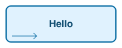
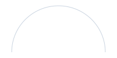
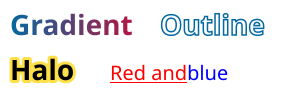
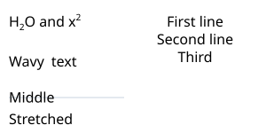
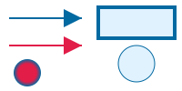
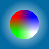
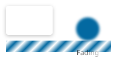
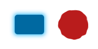

## Install the package

Add the `Meziantou.Framework.VectorGraphics` package to a project:

<InstallNuGetPackage Id="Meziantou.Framework.VectorGraphics" />

The types are in the [Meziantou.Framework.VectorGraphics](cref:Meziantou.Framework.VectorGraphics) namespace.

## Build a scene

A [Scene](cref:Meziantou.Framework.VectorGraphics.Scene) has a size, a font family and a list of elements, drawn in
order. [SvgSceneRenderer](cref:Meziantou.Framework.VectorGraphics.SvgSceneRenderer) writes it as SVG:

<!-- ref:../../tests/Meziantou.Framework.VectorGraphics.Tests/SvgSceneRendererTests.cs;region=VectorGraphics_CreateScene;format=md-fenced-code-block;dedent=true -->
```csharp
var scene = new Scene(width: 200, height: 80, fontFamily: AfmTextMeasurer.Default.FontFamily) { Title = "A box", Background = SceneColor.White };

// Shapes are filled and stroked; texts are positioned by their baseline
scene.Root.Add(new SceneRectangle(10, 10, 180, 60) { Fill = (SceneColor)"#e0f2fe", Stroke = (SceneColor)"#0369a1", StrokeWidth = 2, CornerRadius = 8 });
scene.Root.Add(new SceneText(100, 45, "Hello", new SceneFont(16, Weight: SceneFont.BoldWeight), (SceneColor)"#0c4a6e") { Anchor = SceneTextAnchor.Middle });

// Paths use the commands of SVG
var arrow = new PathBuilder().MoveTo(20, 60).LineTo(60, 60).LineTo(55, 55).MoveTo(60, 60).LineTo(55, 65).Build();
scene.Root.Add(new ScenePath(arrow) { Stroke = (SceneColor)"#0369a1" });

var svg = SvgSceneRenderer.Render(scene);
```
<!-- endref -->



The coordinates are in pixels, with the origin at the top-left corner and the y axis pointing down. A
[SceneText](cref:Meziantou.Framework.VectorGraphics.SceneText) is one line of text, positioned by its baseline and
anchored at its start, its middle or its end; its [SceneFont](cref:Meziantou.Framework.VectorGraphics.SceneFont) sets
the size, the weight and the style. The family is the one of the scene.

## Text styles

[SceneFont.Weight](cref:Meziantou.Framework.VectorGraphics.SceneFont.Weight) is a weight from 1 to 1000, as in CSS:
[NormalWeight](cref:Meziantou.Framework.VectorGraphics.SceneFont.NormalWeight) (400) and
[BoldWeight](cref:Meziantou.Framework.VectorGraphics.SceneFont.BoldWeight) (700) are the usual ones. With the
[fonts of a scene](05-Fonts.md), the face of the nearest weight draws the text; without them, the weights from 600 are
drawn as bold. [SceneText.Decorations](cref:Meziantou.Framework.VectorGraphics.SceneText.Decorations) draws an
underline, a strikethrough, an overline or several of them, in the color of the text, at the position and of the
thickness the font gives. [LetterSpacing](cref:Meziantou.Framework.VectorGraphics.SceneText.LetterSpacing) adds space
after each character, and [WordSpacing](cref:Meziantou.Framework.VectorGraphics.SceneText.WordSpacing) after each
space, as the CSS properties of the same names; a span can set its own:

<!-- ref:../../tests/Meziantou.Framework.VectorGraphics.Tests/SvgSceneRendererTests.cs;region=VectorGraphics_TextStyles;format=md-fenced-code-block;dedent=true -->
```csharp
var scene = new Scene(width: 300, height: 125, fontFamily: "sans-serif");

// A weight from 1 to 1000, as in CSS, and lines drawn with the text
scene.Root.Add(new SceneText(10, 20, "Light", new SceneFont(16, Weight: 300), SceneColor.Black));
scene.Root.Add(new SceneText(10, 45, "Bold and underlined", new SceneFont(16, Weight: SceneFont.BoldWeight), SceneColor.Black) { Decorations = SceneTextDecorations.Underline });
scene.Root.Add(new SceneText(10, 70, "Removed", new SceneFont(16), SceneColor.Black) { Decorations = SceneTextDecorations.Strikethrough });

// Space between the letters and the words, in pixels, and a line over the text
scene.Root.Add(new SceneText(10, 105, "Spaced and overlined", new SceneFont(16), SceneColor.Black) { LetterSpacing = 2, WordSpacing = 6, Decorations = SceneTextDecorations.Overline });

var svg = SvgSceneRenderer.Render(scene);
```
<!-- endref -->


The measurers measure a text with its spacing:
[Measure(SceneText)](cref:Meziantou.Framework.VectorGraphics.TextMeasurerExtensions.Measure) gives the width the
renderers draw.

### Several styles in one text

A text made of [SceneTextSpan](cref:Meziantou.Framework.VectorGraphics.SceneTextSpan) has parts with their own font,
color or lines; what a span does not set is the style of the text. The spans are drawn one after the other on the
baseline of the text, unless they are moved (see below), and the anchor applies to the whole
text. Measure them with
[Measure](cref:Meziantou.Framework.VectorGraphics.TextMeasurerExtensions.Measure):

<!-- ref:../../tests/Meziantou.Framework.VectorGraphics.Tests/SvgSceneRendererTests.cs;region=VectorGraphics_TextSpans;format=md-fenced-code-block;dedent=true -->
```csharp
var scene = new Scene(width: 300, height: 40, fontFamily: "sans-serif");
var font = new SceneFont(16);

// A text whose parts have their own font, color or lines: what a span does not set is the style of the text
SceneTextSpan[] spans =
[
    new("Total: "),
    new("42") { Font = font with { Weight = SceneFont.BoldWeight }, Color = (SceneColor)"#0369a1" },
    new(" items, "),
    new("3 removed") { Decorations = SceneTextDecorations.Strikethrough },
];
var measurer = AfmTextMeasurer.Default;
scene.Root.Add(new SceneText(10, 25, spans, font, SceneColor.Black) { MeasuredWidth = measurer.Measure(spans, font).Width });

var svg = SvgSceneRenderer.Render(scene);
```
<!-- endref -->


### Text along a path

A text with a [Path](cref:Meziantou.Framework.VectorGraphics.SceneText.Path) follows it, as an SVG `textPath`: each
character is turned to the direction of the path at the middle of its advance. The text is anchored at
[PathStartOffset](cref:Meziantou.Framework.VectorGraphics.SceneText.PathStartOffset) along the path, and the
characters beyond its ends are not drawn:

<!-- ref:../../tests/Meziantou.Framework.VectorGraphics.Tests/SvgSceneRendererTests.cs;region=VectorGraphics_TextOnPath;format=md-fenced-code-block;dedent=true -->
```csharp
var scene = new Scene(width: 200, height: 110, fontFamily: "sans-serif");

// The text follows the arc, centered on its middle
var arc = new PathBuilder().MoveTo(20, 105).ArcTo(80, 80, 0, largeArc: false, sweep: true, 180, 105).Build();
scene.Root.Add(new ScenePath(arc) { Stroke = (SceneColor)"#cbd5e1" });
scene.Root.Add(new SceneText(0, 0, "Text along a path", new SceneFont(16), SceneColor.Black)
{
    Path = arc,
    PathStartOffset = arc.GetLength() / 2,
    Anchor = SceneTextAnchor.Middle,
});

var svg = SvgSceneRenderer.Render(scene);
```
<!-- endref -->



The text stands on the left of the path, in the direction it goes. To draw it on the other side, as the SVG
`textPath` does with `side="right"`, follow the path backwards:
[PathData.Reverse](cref:Meziantou.Framework.VectorGraphics.PathData.Reverse) gives the same path, drawn from its end to
its start.

### Paints and outlines

A text is painted with its [Color](cref:Meziantou.Framework.VectorGraphics.SceneText.Color), or with a
[Fill](cref:Meziantou.Framework.VectorGraphics.SceneText.Fill) of any paint: a gradient or a pattern, in the
coordinates of the text. A [Stroke](cref:Meziantou.Framework.VectorGraphics.SceneText.Stroke) draws the outline of
the glyphs, with the width, the dashes, the caps and the joins of a shape;
[PaintOrder](cref:Meziantou.Framework.VectorGraphics.SceneText.PaintOrder) paints it under the fill, as the SVG
`paint-order` property, for a halo that leaves the glyphs whole. A span has its own
[Fill](cref:Meziantou.Framework.VectorGraphics.SceneTextSpan.Fill) and
[Stroke](cref:Meziantou.Framework.VectorGraphics.SceneTextSpan.Stroke). The lines of a text have the paint of its
glyphs, or their own [DecorationFill](cref:Meziantou.Framework.VectorGraphics.SceneText.DecorationFill): SVG paints the
lines of an element with its own fill, under children of other colors:

<!-- ref:../../tests/Meziantou.Framework.VectorGraphics.Tests/SvgSceneRendererTests.cs;region=VectorGraphics_TextPaints;format=md-fenced-code-block;dedent=true -->
```csharp
var scene = new Scene(width: 300, height: 100, fontFamily: "sans-serif");
var font = new SceneFont(28, Weight: SceneFont.BoldWeight);

// A text filled with a gradient, and an outlined text: a stroke and a transparent fill
var gradient = new LinearGradientPaint(10, 0, 140, 0, [new(0, (SceneColor)"#0369a1"), new(1, (SceneColor)"#be123c")]);
scene.Root.Add(new SceneText(10, 35, "Gradient", font, SceneColor.Black) { Fill = gradient });
scene.Root.Add(new SceneText(160, 35, "Outline", font, SceneColor.Transparent) { Stroke = (SceneColor)"#0369a1", StrokeWidth = 1.5 });

// A thick outline painted under the fill, as a halo
scene.Root.Add(new SceneText(10, 80, "Halo", font, SceneColor.Black) { Stroke = (SceneColor)"#fde047", StrokeWidth = 6, LineJoin = SceneLineJoin.Round, PaintOrder = ScenePaintOrder.StrokeFillMarkers });

// Lines painted with the color of the text under spans of other colors, as SVG paints the lines of a parent element
SceneTextSpan[] spans = [new("Red and "), new("blue") { Color = (SceneColor)"#0000ff" }];
scene.Root.Add(new SceneText(110, 80, spans, new SceneFont(20), (SceneColor)"#ff0000") { Decorations = SceneTextDecorations.Underline, DecorationFill = (SceneColor)"#ff0000" });

var svg = SvgSceneRenderer.Render(scene);
```
<!-- endref -->



### Positions, baselines and length

A span can be placed as an SVG `tspan`: [X](cref:Meziantou.Framework.VectorGraphics.SceneTextSpan.X) and
[Y](cref:Meziantou.Framework.VectorGraphics.SceneTextSpan.Y) move it to a position, and start a new chunk of text,
which the anchor of the text applies to; [Dx](cref:Meziantou.Framework.VectorGraphics.SceneTextSpan.Dx) and
[Dy](cref:Meziantou.Framework.VectorGraphics.SceneTextSpan.Dy) shift it and the spans that follow it.
[BaselineShift](cref:Meziantou.Framework.VectorGraphics.SceneTextSpan.BaselineShift) raises or lowers the span alone,
for a superscript or a subscript, and
[GlyphRotation](cref:Meziantou.Framework.VectorGraphics.SceneTextSpan.GlyphRotation) turns each of its characters.

The [Baseline](cref:Meziantou.Framework.VectorGraphics.SceneText.Baseline) of a text is the line on its y coordinate,
as the SVG `dominant-baseline` property: the alphabetic baseline, the middle of the lowercase letters, the middle or
the edges of the em box. [TextLength](cref:Meziantou.Framework.VectorGraphics.SceneText.TextLength) stretches or
compresses the text to a length, by its spacing or by scaling its glyphs
([LengthAdjust](cref:Meziantou.Framework.VectorGraphics.SceneText.LengthAdjust)), and
[Direction](cref:Meziantou.Framework.VectorGraphics.SceneText.Direction) writes it from right to left: it starts at its
right end, and its spans follow each other to the left:

<!-- ref:../../tests/Meziantou.Framework.VectorGraphics.Tests/SvgSceneRendererTests.cs;region=VectorGraphics_TextPositions;format=md-fenced-code-block;dedent=true -->
```csharp
var scene = new Scene(width: 300, height: 150, fontFamily: "sans-serif");
var font = new SceneFont(16);
var small = font with { Size = 10 };

// A formula with a subscript and a superscript: the shift applies to its span only
scene.Root.Add(new SceneText(10, 30, [new("H"), new("2") { Font = small, BaselineShift = -4 }, new("O and x"), new("2") { Font = small, BaselineShift = 7 }], font, SceneColor.Black));

// Spans at their own positions: each line is a text chunk, centered on its x
scene.Root.Add(new SceneText(220, 30, [new("First line"), new("Second line") { X = 220, Dy = 20 }, new("Third") { X = 220, Dy = 20 }], font, SceneColor.Black) { Anchor = SceneTextAnchor.Middle });

// Turned letters, and a span moved to the right
scene.Root.Add(new SceneText(10, 75, [new("Wavy") { GlyphRotation = 15 }, new("text") { Dx = 8 }], font, SceneColor.Black));

// A text centered vertically on its y, and a text stretched to 120 pixels
scene.Root.Add(new SceneLine(10, 110, 140, 110) { Stroke = (SceneColor)"#cbd5e1" });
scene.Root.Add(new SceneText(10, 110, "Middle", font, SceneColor.Black) { Baseline = SceneTextBaseline.Middle });
scene.Root.Add(new SceneText(10, 140, "Stretched", font, SceneColor.Black) { TextLength = 120, LengthAdjust = SceneTextLengthAdjust.SpacingAndGlyphs });

var svg = SvgSceneRenderer.Render(scene);
```
<!-- endref -->



The renderers compute the baselines from the ascent, the descent and the x-height of the font of each span: the
middle baseline is half the x-height above the alphabetic baseline, the central one halfway between the ascent and the
descent, the hanging one at eight tenths of the ascent and the mathematical one at half of it, as browsers do.
[Measure(SceneText)](cref:Meziantou.Framework.VectorGraphics.TextMeasurerExtensions.Measure) gives the length of a
fitted text, and the extent of a text whose spans are moved.

## Strokes

The outline of a shape ([SceneShape](cref:Meziantou.Framework.VectorGraphics.SceneShape)) has a
[StrokeWidth](cref:Meziantou.Framework.VectorGraphics.SceneShape.StrokeWidth), a
[LineCap](cref:Meziantou.Framework.VectorGraphics.SceneShape.LineCap) for the ends of open outlines, and a
[LineJoin](cref:Meziantou.Framework.VectorGraphics.SceneShape.LineJoin) for the corners: a miter join is beveled when
the corner is so sharp that its point would be longer than
[MiterLimit](cref:Meziantou.Framework.VectorGraphics.SceneShape.MiterLimit) times the width (4 by default, as in SVG).
[StrokeDashArray](cref:Meziantou.Framework.VectorGraphics.SceneShape.StrokeDashArray) draws the outline as dashes and
gaps, and [StrokeDashOffset](cref:Meziantou.Framework.VectorGraphics.SceneShape.StrokeDashOffset) shifts where the
pattern starts.

### Paint order, context paints and non-scaling strokes

A shape paints its fill, then its stroke, then its markers;
[PaintOrder](cref:Meziantou.Framework.VectorGraphics.SceneShape.PaintOrder) changes that order, as the `paint-order` of
SVG: with the stroke first, the fill covers the inner half of the stroke.
[NonScalingStroke](cref:Meziantou.Framework.VectorGraphics.SceneShape.NonScalingStroke) keeps the width and the dashes
of the stroke in the coordinates of the scene, whatever the transforms of the shape and of its groups
(`vector-effect="non-scaling-stroke"`). In the content of a marker,
[ContextPaint](cref:Meziantou.Framework.VectorGraphics.ContextPaint) paints with the fill or the stroke of the shape
the marker is drawn on (`context-fill` and `context-stroke`), so one arrowhead serves lines of every color.
[FocalRadius](cref:Meziantou.Framework.VectorGraphics.RadialGradientPaint.FocalRadius) starts a radial gradient on a
circle around its focal point (`fr`):

<!-- ref:../../tests/Meziantou.Framework.VectorGraphics.Tests/SvgSceneRendererTests.cs;region=VectorGraphics_PaintOptions;format=md-fenced-code-block;dedent=true -->
```csharp
var scene = new Scene(width: 200, height: 100, fontFamily: "sans-serif");

// One arrowhead for lines of every color: it is painted with the stroke of the line it ends
var arrow = new SceneMarker { RefX = 10, RefY = 5 };
arrow.Content.Add(new ScenePath(new PathBuilder().AddPolygon((0, 0), (10, 5), (0, 10)).Build()) { Fill = ContextPaint.Stroke });
scene.Root.Add(new SceneLine(10, 20, 90, 20) { Stroke = (SceneColor)"#0369a1", StrokeWidth = 2, MarkerEnd = arrow });
scene.Root.Add(new SceneLine(10, 50, 90, 50) { Stroke = (SceneColor)"#e11d48", StrokeWidth = 2, MarkerEnd = arrow });

// The stroke under the fill, and a stroke of 1 pixel in a group scaled 20 times
scene.Root.Add(new SceneRectangle(110, 10, 80, 30) { Fill = (SceneColor)"#e0f2fe", Stroke = (SceneColor)"#0369a1", StrokeWidth = 8, PaintOrder = ScenePaintOrder.StrokeFillMarkers });
var zoomed = scene.Root.Add(new SceneGroup { Transform = SceneTransform.Scale(20, 20) });
zoomed.Add(new SceneCircle(7.5, 3.5, 1) { Fill = (SceneColor)"#e0f2fe", Stroke = (SceneColor)"#0369a1", NonScalingStroke = true });

// A radial gradient whose first color fills a circle of 10 pixels around the focal point
scene.Root.Add(new SceneCircle(30, 80, 15) { Fill = new RadialGradientPaint(30, 80, 15, [new(0, (SceneColor)"#e11d48"), new(1, (SceneColor)"#0369a1")]) { FocalRadius = 10 } });

var svg = SvgSceneRenderer.Render(scene);
```
<!-- endref -->



## Paths

A [PathBuilder](cref:Meziantou.Framework.VectorGraphics.PathBuilder) adds the commands of SVG one by one, and common
shapes in one call: [AddRectangle](cref:Meziantou.Framework.VectorGraphics.PathBuilder.AddRectangle),
[AddRoundedRectangle](cref:Meziantou.Framework.VectorGraphics.PathBuilder.AddRoundedRectangle),
[AddCircle](cref:Meziantou.Framework.VectorGraphics.PathBuilder.AddCircle),
[AddEllipse](cref:Meziantou.Framework.VectorGraphics.PathBuilder.AddEllipse) and
[AddPolygon](cref:Meziantou.Framework.VectorGraphics.PathBuilder.AddPolygon). Each shape is a closed contour, so one
path can hold several of them.
[PathData.Translate](cref:Meziantou.Framework.VectorGraphics.PathData.Translate) moves a path, and
[Append](cref:Meziantou.Framework.VectorGraphics.PathBuilder.Append) copies the commands of a path into another one:

<!-- ref:../../tests/Meziantou.Framework.VectorGraphics.Tests/SvgSceneRendererTests.cs;region=VectorGraphics_PathShapes;format=md-fenced-code-block;dedent=true -->
```csharp
// A triangle, an ellipse and a rounded rectangle in a single path
var path = new PathBuilder()
    .AddPolygon((0, 0), (10, 0), (5, 8))
    .AddEllipse(centerX: 30, centerY: 5, radiusX: 10, radiusY: 5)
    .AddRoundedRectangle(x: 50, y: 0, width: 20, height: 10, radius: 2)
    .Build();

// Paths can be moved, and combined into a new path
var moved = path.Translate(offsetX: 0, offsetY: 20);
var both = new PathBuilder().Append(path).Append(moved).Build();
Assert.HasCount(2 * path.Commands.Count, both.Commands);
```
<!-- endref -->

[GetLength](cref:Meziantou.Framework.VectorGraphics.PathData.GetLength) measures a path, and
[GetPointAtLength](cref:Meziantou.Framework.VectorGraphics.PathData.GetPointAtLength) gives the point at a distance
along it, with the direction of the path there, to place a label or an arrow on a curve:

<!-- ref:../../tests/Meziantou.Framework.VectorGraphics.Tests/SvgSceneRendererTests.cs;region=VectorGraphics_PathMeasure;format=md-fenced-code-block;dedent=true -->
```csharp
var path = new PathBuilder().MoveTo(0, 0).LineTo(30, 40).LineTo(30, 100).Build();

// The length of the path, and a point at a distance along it with the direction of the path there
Assert.Equal(110, path.GetLength(), 1e-9);
var point = path.GetPointAtLength(80);
Assert.Equal(30, point.X, 1e-9);
Assert.Equal(70, point.Y, 1e-9);
Assert.Equal(90, point.Angle, 1e-9); // Down: the y axis points down
```
<!-- endref -->

## Markers

A [SceneMarker](cref:Meziantou.Framework.VectorGraphics.SceneMarker) is a drawing placed on the vertices of a path or
a line, such as an arrowhead: [MarkerStart](cref:Meziantou.Framework.VectorGraphics.ScenePath.MarkerStart) on the
first vertex, [MarkerEnd](cref:Meziantou.Framework.VectorGraphics.ScenePath.MarkerEnd) on the last one, and
[MarkerMid](cref:Meziantou.Framework.VectorGraphics.ScenePath.MarkerMid) on the others. Its point
([RefX](cref:Meziantou.Framework.VectorGraphics.SceneMarker.RefX), [RefY](cref:Meziantou.Framework.VectorGraphics.SceneMarker.RefY))
is on the vertex, it is turned to the direction of the path, and it is scaled by the width of the stroke unless its
[Units](cref:Meziantou.Framework.VectorGraphics.SceneMarker.Units) are the coordinates of the shape:

<!-- ref:../../tests/Meziantou.Framework.VectorGraphics.Tests/SvgSceneRendererTests.cs;region=VectorGraphics_Markers;format=md-fenced-code-block;dedent=true -->
```csharp
var scene = new Scene(width: 200, height: 100, fontFamily: "sans-serif");

// An arrowhead whose tip, at (10, 5), is on the vertex: it follows the direction of the path, scaled by the stroke width
var arrow = new SceneMarker { RefX = 10, RefY = 5 };
arrow.Content.Add(new ScenePath(new PathBuilder().AddPolygon((0, 0), (10, 5), (0, 10)).Build()) { Fill = (SceneColor)"#0369a1" });

// A dot on every vertex between the ends, in the coordinates of the path
var dot = new SceneMarker { Units = SceneMarkerUnits.UserSpace };
dot.Content.Add(new SceneCircle(0, 0, 3) { Fill = (SceneColor)"#0369a1" });

var path = new PathBuilder().MoveTo(10, 80).LineTo(60, 20).LineTo(110, 80).LineTo(170, 30).Build();
scene.Root.Add(new ScenePath(path) { Stroke = (SceneColor)"#0369a1", StrokeWidth = 2, MarkerMid = dot, MarkerEnd = arrow });

var svg = SvgSceneRenderer.Render(scene);
```
<!-- endref -->


[Orientation](cref:Meziantou.Framework.VectorGraphics.SceneMarker.Orientation) turns the marker at the start of the
path back (an arrowhead that points out of both ends), or by a fixed angle.
[GetVertices](cref:Meziantou.Framework.VectorGraphics.PathData.GetVertices) gives the vertices and their directions.

## Images, clipping and radial gradients

A [SceneImage](cref:Meziantou.Framework.VectorGraphics.SceneImage) draws a PNG, JPEG, GIF or WebP image, stretched to
its rectangle: the SVG embeds its bytes. Its [Alignment](cref:Meziantou.Framework.VectorGraphics.SceneImage.Alignment)
keeps its proportions instead, as the `preserveAspectRatio` of SVG: the image fits in the rectangle, aligned as the value
says, or covers it and is cut to it with [Slice](cref:Meziantou.Framework.VectorGraphics.SceneImage.Slice). [SceneGroup.ClipPath](cref:Meziantou.Framework.VectorGraphics.SceneGroup.ClipPath)
clips a group to any path, in the coordinates of its parent, and
[RadialGradientPaint](cref:Meziantou.Framework.VectorGraphics.RadialGradientPaint) paints a gradient from a focal
point to a circle:

<!-- ref:../../tests/Meziantou.Framework.VectorGraphics.Tests/SvgSceneRendererTests.cs;region=VectorGraphics_ImagesAndClipping;format=md-fenced-code-block;dedent=true -->
```csharp
var png = Convert.FromBase64String("iVBORw0KGgoAAAANSUhEUgAAAAIAAAACCAIAAAD91JpzAAAAEklEQVR4nGP4zwAE/0Ho////AB/uBftt3M6tAAAAAElFTkSuQmCC");
var scene = new Scene(width: 100, height: 100, fontFamily: "sans-serif");

// A radial gradient, from white at the center to blue on the circle
scene.Root.Add(new SceneRectangle(0, 0, 100, 100) { Fill = new RadialGradientPaint(50, 50, 50, [new(0, SceneColor.White), new(1, (SceneColor)"#0369a1")]) });

// An image, stretched to its rectangle and clipped to a circle
var avatar = scene.Root.Add(new SceneGroup { ClipPath = new PathBuilder().AddCircle(50, 50, 30).Build() });
avatar.Add(new SceneImage(20, 20, 60, 60, png));

var svg = SvgSceneRenderer.Render(scene);
```
<!-- endref -->



The image and PDF renderers decode the images: an image they cannot decode is not drawn.

### Clipping paths

Every element has a [ClippingPath](cref:Meziantou.Framework.VectorGraphics.SceneElement.ClippingPath), as the
`clip-path` of SVG: a [SceneClipPath](cref:Meziantou.Framework.VectorGraphics.SceneClipPath) whose content is shapes and
texts. The element is drawn inside the union of their geometry: the interior of each shape by its fill rule, whatever
its paints, and the glyphs of each text. The content is in the coordinates of the parent of the element, as a mask, and
a clipping path can be cut by another one
([SceneClipPath.ClippingPath](cref:Meziantou.Framework.VectorGraphics.SceneClipPath.ClippingPath)):

<!-- ref:../../tests/Meziantou.Framework.VectorGraphics.Tests/SvgSceneRendererTests.cs;region=VectorGraphics_ClippingPaths;format=md-fenced-code-block;dedent=true -->
```csharp
var scene = new Scene(width: 200, height: 100, fontFamily: "sans-serif");

// The union of two circles, in the coordinates of the parent of the clipped element
var circles = new SceneClipPath();
circles.Content.Add(new SceneCircle(40, 50, 30));
circles.Content.Add(new SceneCircle(80, 50, 30));
scene.Root.Add(new SceneRectangle(0, 0, 120, 100) { Fill = (SceneColor)"#0369a1", ClippingPath = circles });

// The glyphs of a text show a gradient
var letters = new SceneClipPath();
letters.Content.Add(new SceneText(130, 70, "Clip", new SceneFont(40, Weight: SceneFont.BoldWeight), SceneColor.Black));
var gradient = new LinearGradientPaint(130, 0, 200, 0, [new(0, (SceneColor)"#0369a1"), new(1, (SceneColor)"#e11d48")]);
scene.Root.Add(new SceneRectangle(120, 0, 80, 100) { Fill = gradient, ClippingPath = letters });

var svg = SvgSceneRenderer.Render(scene);
```
<!-- endref -->


A gradient ([SceneGradientPaint](cref:Meziantou.Framework.VectorGraphics.SceneGradientPaint)) pads its end colors
beyond its ends by default; [Spread](cref:Meziantou.Framework.VectorGraphics.SceneGradientPaint.Spread) repeats it or
reflects it instead, and [Transform](cref:Meziantou.Framework.VectorGraphics.SceneGradientPaint.Transform) rotates,
skews or stretches it, as the `gradientTransform` of SVG.

## Patterns

A [PatternPaint](cref:Meziantou.Framework.VectorGraphics.PatternPaint) paints a shape with a tile of drawing repeated
side by side, as an SVG `pattern`: its [Content](cref:Meziantou.Framework.VectorGraphics.PatternPaint.Content) is drawn
in the [Tile](cref:Meziantou.Framework.VectorGraphics.PatternPaint.Tile), in the coordinates of the shape, and its
[Transform](cref:Meziantou.Framework.VectorGraphics.PatternPaint.Transform) rotates or scales the pattern:

<!-- ref:../../tests/Meziantou.Framework.VectorGraphics.Tests/SvgSceneRendererTests.cs;region=VectorGraphics_Patterns;format=md-fenced-code-block;dedent=true -->
```csharp
var scene = new Scene(width: 200, height: 100, fontFamily: "sans-serif");

// A tile of 10 by 10 pixels with a dot, repeated over the shapes it paints
var dots = new PatternPaint(new SceneBounds(0, 0, 10, 10));
dots.Content.Add(new SceneCircle(5, 5, 2) { Fill = (SceneColor)"#0369a1" });
scene.Root.Add(new SceneRectangle(10, 10, 80, 80) { Fill = dots, Stroke = SceneColor.Black });

// Hatches: a line in a tile, turned by the transform of the pattern
var hatches = new PatternPaint(new SceneBounds(0, 0, 8, 8)) { Transform = SceneTransform.Rotate(45) };
hatches.Content.Add(new SceneLine(0, 4, 8, 4) { Stroke = (SceneColor)"#b91c1c", StrokeWidth = 2 });
scene.Root.Add(new SceneCircle(150, 50, 40) { Fill = hatches, Stroke = SceneColor.Black });

var svg = SvgSceneRenderer.Render(scene);
```
<!-- endref -->


## Effects

Every element has a [Filter](cref:Meziantou.Framework.VectorGraphics.SceneElement.Filter): a
[SceneBlurFilter](cref:Meziantou.Framework.VectorGraphics.SceneBlurFilter), a
[SceneDropShadowFilter](cref:Meziantou.Framework.VectorGraphics.SceneDropShadowFilter), or a
[SceneColorMatrixFilter](cref:Meziantou.Framework.VectorGraphics.SceneColorMatrixFilter), whose factories are the
color functions of CSS (`Grayscale`, `Sepia`, `Saturate`, `HueRotate`, `Invert`, `Brightness`, `Contrast`). It also
has an opacity
[Mask](cref:Meziantou.Framework.VectorGraphics.SceneElement.Mask), whose content shows the element by its luminance or
its alpha, and a [BlendMode](cref:Meziantou.Framework.VectorGraphics.SceneElement.BlendMode), the blend modes of CSS
and PDF. As in SVG, the filter applies first, then the clips, the mask, the opacity and the blend mode. The masks and
the filters are in the coordinates of the parent of the element:

<!-- ref:../../tests/Meziantou.Framework.VectorGraphics.Tests/SvgSceneRendererTests.cs;region=VectorGraphics_Effects;format=md-fenced-code-block;dedent=true -->
```csharp
var scene = new Scene(width: 200, height: 100, fontFamily: "sans-serif");

// A card with a drop shadow, and a blurred circle
scene.Root.Add(new SceneRectangle(10, 10, 80, 50) { Fill = SceneColor.White, CornerRadius = 4, Filter = new SceneDropShadowFilter(offsetX: 0, offsetY: 2, standardDeviation: 3, (SceneColor)"#00000040") });
scene.Root.Add(new SceneCircle(150, 50, 20) { Fill = (SceneColor)"#0369a1", Filter = new SceneBlurFilter(standardDeviation: 2) });

// Stripes: a gradient of 10 pixels, reflected, and rotated by its transform
var stripes = new LinearGradientPaint(0, 0, 10, 0, [new(0, SceneColor.White), new(1, (SceneColor)"#0369a1")])
{
    Spread = SceneGradientSpread.Reflect,
    Transform = SceneTransform.Rotate(45),
};
scene.Root.Add(new SceneRectangle(10, 70, 180, 20) { Fill = stripes, BlendMode = SceneBlendMode.Multiply });

// A group faded from left to right by a luminance mask
var faded = scene.Root.Add(new SceneGroup { Mask = new SceneMask() });
faded.Mask!.Content.Add(new SceneRectangle(100, 0, 100, 100) { Fill = new LinearGradientPaint(100, 0, 200, 0, [new(0, SceneColor.White), new(1, SceneColor.Black)]) });
faded.Add(new SceneText(150, 95, "Fading", new SceneFont(12), SceneColor.Black) { Anchor = SceneTextAnchor.Middle });

var svg = SvgSceneRenderer.Render(scene);
```
<!-- endref -->



### Filter graphs

A [SceneFilterGraph](cref:Meziantou.Framework.VectorGraphics.SceneFilterGraph) is a filter of SVG made of primitives:
blurs, offsets, floods, composites, blends, merges, morphologies, turbulences, displacement maps, convolution matrices,
diffuse and specular lightings, component transfers, tiles, images and color matrices. Each primitive reads the drawing
of the element, its alpha, or the result of an earlier primitive
([SceneFilterInput](cref:Meziantou.Framework.VectorGraphics.SceneFilterInput)), by default the result of the primitive
before it. As in SVG, the primitives compute in linear light unless their
[ColorSpace](cref:Meziantou.Framework.VectorGraphics.SceneFilterPrimitive.ColorSpace) is sRGB. The region of the graph,
the subregions of the primitives and the positions of the lights are in the coordinates of the parent of the element;
without a [Region](cref:Meziantou.Framework.VectorGraphics.SceneFilterGraph.Region), the graph draws in the bounds of the
element enlarged by how far its primitives move them:

<!-- ref:../../tests/Meziantou.Framework.VectorGraphics.Tests/SvgSceneRendererTests.cs;region=VectorGraphics_FilterGraph;format=md-fenced-code-block;dedent=true -->
```csharp
var scene = new Scene(width: 200, height: 100, fontFamily: "sans-serif");

// A glow: the alpha of the shape, thickened, blurred and colored, under the shape
var glow = new SceneFilterGraph(
[
    new SceneMorphologyPrimitive(SceneMorphologyOperator.Dilate, radiusX: 2, radiusY: 2) { Input = SceneFilterInput.SourceAlpha },
    new SceneGaussianBlurPrimitive(standardDeviation: 4),
    new SceneFloodPrimitive((SceneColor)"#38bdf8"),
    new SceneCompositePrimitive(SceneCompositeOperator.In, SceneFilterInput.Result(1)),
    new SceneMergePrimitive(SceneFilterInput.Previous, SceneFilterInput.SourceGraphic),
]);
scene.Root.Add(new SceneRectangle(30, 30, 60, 40) { Fill = (SceneColor)"#0369a1", CornerRadius = 6, Filter = glow });

// A rough edge: the shape moved by noise, in a region of its own
var rough = new SceneFilterGraph(
[
    new SceneTurbulencePrimitive(SceneTurbulenceType.FractalNoise, baseFrequencyX: 0.05, baseFrequencyY: 0.05, octaves: 2, seed: 3),
    new SceneDisplacementMapPrimitive(scale: 10, map: SceneFilterInput.Previous)
    {
        Input = SceneFilterInput.SourceGraphic,
        XChannel = SceneColorChannel.Red,
        YChannel = SceneColorChannel.Green,
    },
])
{
    Region = new SceneBounds(110, 10, 80, 80),
};
scene.Root.Add(new SceneCircle(150, 50, 30) { Fill = (SceneColor)"#b91c1c", Filter = rough });

var svg = SvgSceneRenderer.Render(scene);
```
<!-- endref -->



An [image primitive](cref:Meziantou.Framework.VectorGraphics.SceneImagePrimitive) draws an element, which does not need
to be in the scene otherwise: an image without effects is written in the SVG filter itself, another element in the
definitions of the SVG, by its identifier.

PDF has no filters, not even the color matrices: the PDF renderer throws for a scene that has one. See the
[limitations](07-Limitations.md).

## Groups

A [SceneGroup](cref:Meziantou.Framework.VectorGraphics.SceneGroup) applies a clip rectangle or path, and its transform,
opacity and effects, to its children. Every element has a
[Transform](cref:Meziantou.Framework.VectorGraphics.SceneElement.Transform) and a
[Hyperlink](cref:Meziantou.Framework.VectorGraphics.SceneElement.Hyperlink), which makes it a link in the SVG and in the
PDF; the address is written as is, so only set addresses you trust. An element is drawn as if it were the only child of
a group with them: its mask and its filter are in the coordinates of its parent.

<!-- ref:../../tests/Meziantou.Framework.VectorGraphics.Tests/SvgSceneRendererTests.cs;region=VectorGraphics_ElementTransformAndLink;format=md-fenced-code-block;dedent=true -->
```csharp
var scene = new Scene(width: 200, height: 100, fontFamily: "sans-serif");

// Any element has a transform and a hyperlink, without a group around it
scene.Root.Add(new SceneRectangle(0, 0, 40, 20)
{
    Fill = (SceneColor)"#0369a1",
    Transform = SceneTransform.Rotate(30).Then(SceneTransform.Translate(20, 10)),
    Hyperlink = "https://example.com/",
});

// The rotation of a text applies before its transform
scene.Root.Add(new SceneText(0, 0, "Moved", new SceneFont(12), SceneColor.Black) { Rotation = -90, Transform = SceneTransform.Translate(150, 90) });

var svg = SvgSceneRenderer.Render(scene);
```
<!-- endref -->

Every element has an [Id](cref:Meziantou.Framework.VectorGraphics.SceneElement.Id), its `id` attribute in the SVG, a
[CssClass](cref:Meziantou.Framework.VectorGraphics.SceneElement.CssClass), a
[Tooltip](cref:Meziantou.Framework.VectorGraphics.SceneElement.Tooltip) and `data-*` attributes
([SetDataAttribute](cref:Meziantou.Framework.VectorGraphics.SceneElement.SetDataAttribute)) for the scripts of a web
page.

[SceneTransform](cref:Meziantou.Framework.VectorGraphics.SceneTransform) creates translations, rotations and scales;
[Then](cref:Meziantou.Framework.VectorGraphics.SceneTransform.Then) combines two transforms, in the order they apply:

<!-- ref:../../tests/Meziantou.Framework.VectorGraphics.Tests/SvgSceneRendererTests.cs;region=VectorGraphics_Transforms;format=md-fenced-code-block;dedent=true -->
```csharp
// Scale by 2 around the origin, then move by (10, 20)
var transform = SceneTransform.Scale(2, 2).Then(SceneTransform.Translate(10, 20));
Assert.Equal((16.0, 28.0), transform.Apply(3, 4));
Assert.Equal(new SceneTransform(2, 0, 0, 2, 10, 20), transform);
```
<!-- endref -->

### Identifiers and reuse

The identifiers of the elements must be different: the SVG renderer throws when two elements have the same one, and
the identifiers it generates avoid them:

<!-- ref:../../tests/Meziantou.Framework.VectorGraphics.Tests/SvgSceneRendererTests.cs;region=VectorGraphics_Ids;format=md-fenced-code-block;dedent=true -->
```csharp
var scene = new Scene(width: 100, height: 50, fontFamily: "sans-serif");

// The identifier of an element is its id attribute: a script or a style sheet finds the element with it
scene.Root.Add(new SceneRectangle(10, 10, 30, 30) { Id = "north", Fill = SceneColor.Black });

var svg = SvgSceneRenderer.Render(scene);
```
<!-- endref -->

A [SceneUse](cref:Meziantou.Framework.VectorGraphics.SceneUse) draws an element again, with its own transform and
effects. The SVG writes the element once and refers to it with a `use` element; when the element is not in the scene,
the SVG writes it in its definitions. The image and PDF renderers draw it again:

<!-- ref:../../tests/Meziantou.Framework.VectorGraphics.Tests/SvgSceneRendererTests.cs;region=VectorGraphics_Reuse;format=md-fenced-code-block;dedent=true -->
```csharp
var scene = new Scene(width: 200, height: 60, fontFamily: "sans-serif");

// A star that is not in the scene: the SVG writes it once in its definitions, and each use refers to it
var star = new ScenePath(new PathBuilder().AddPolygon((0, -20), (6, -6), (20, -6), (9, 3), (13, 18), (0, 9), (-13, 18), (-9, 3), (-20, -6), (-6, -6)).Build()) { Fill = (SceneColor)"#eab308" };
for (var i = 0; i < 3; i++)
{
    scene.Root.Add(new SceneUse(star) { Transform = SceneTransform.Translate(30 + (i * 50), 30) });
}

// An element of the scene drawn again, smaller
var circle = scene.Root.Add(new SceneCircle(0, 0, 10) { Id = "dot", Fill = (SceneColor)"#0369a1", Transform = SceneTransform.Translate(180, 15) });
scene.Root.Add(new SceneUse(circle) { Transform = SceneTransform.Scale(0.5, 0.5, 180, 45) });

var svg = SvgSceneRenderer.Render(scene);
```
<!-- endref -->


### View boxes

A group with a [ViewBox](cref:Meziantou.Framework.VectorGraphics.SceneGroup.ViewBox) maps a rectangle of the
coordinates of its children to a viewport, which cuts what is outside of it, as a nested SVG `svg` element. The box
keeps its proportions as [Alignment](cref:Meziantou.Framework.VectorGraphics.SceneViewBox.Alignment) and
[Slice](cref:Meziantou.Framework.VectorGraphics.SceneViewBox.Slice) say, as the `preserveAspectRatio` of SVG:

<!-- ref:../../tests/Meziantou.Framework.VectorGraphics.Tests/SvgSceneRendererTests.cs;region=VectorGraphics_ViewBox;format=md-fenced-code-block;dedent=true -->
```csharp
var scene = new Scene(width: 200, height: 100, fontFamily: "sans-serif");

// A drawing of 100 by 100 units, fitted in a viewport of 200 by 80 pixels: scaled by 0.8 and centered
var chart = scene.Root.Add(new SceneGroup { ViewBox = new SceneViewBox(new SceneBounds(0, 0, 100, 100), new SceneBounds(0, 10, 200, 80)) });
chart.Add(new SceneRectangle(0, 0, 100, 100) { Fill = (SceneColor)"#e0f2fe", Stroke = (SceneColor)"#0369a1" });
chart.Add(new SceneCircle(50, 50, 40) { Fill = (SceneColor)"#0369a1" });

var svg = SvgSceneRenderer.Render(scene);
```
<!-- endref -->


## SVG options

[SvgRenderOptions](cref:Meziantou.Framework.VectorGraphics.SvgRenderOptions) sets the number of decimals, whether the
`xmlns` attribute is written (turn it off for SVG inlined in HTML), and the prefix of the identifiers of the gradients,
clip paths, patterns and markers: give each drawing of an HTML page its own prefix, so the identifiers do not collide.
