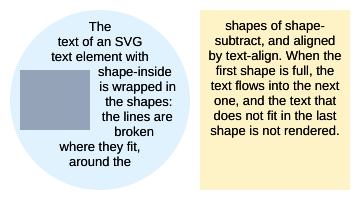

The library lays the pages out as a browser does: blocks and inline text, floats, flexbox, grid, tables, positioning,
multi-column, writing modes, SVG and MathML. The layout is internal: it runs when a web API needs the geometry, and its
results are read through the APIs of the browsers.

<!-- ref:../../../tests/Meziantou.Framework.WebPlatform.Tests/Dom/CssomViewTests.cs;region=WebPlatform_Geometry;format=md-fenced-code-block;dedent=true -->
```csharp
using var context = new BrowsingContext(new BrowsingContextOptions
{
    Viewport = new ViewportOptions { Width = 800, Height = 600 },
});

var document = context.Navigate("https://example.com/", _ => """
    <!DOCTYPE html>
    <style>
      body { margin: 0 }
      header { height: 60px }
      .sidebar { position: absolute; top: 60px; width: 25%; height: 300px }
    </style>
    <header>Title</header>
    <div class="sidebar">Menu</div>
    """);

// The layout runs when the geometry is read
var sidebar = document.QuerySelector(".sidebar")!;
var rect = sidebar.GetBoundingClientRect();
Assert.Equal((0, 60, 200, 300), (rect.X, rect.Y, rect.Width, rect.Height));
Assert.Same(sidebar, document.ElementFromPoint(100, 100));

// A new viewport size lays the document out again
context.Viewport = new ViewportOptions { Width = 1200, Height = 600 };
Assert.Equal(300, sidebar.GetBoundingClientRect().Width);
```
<!-- endref -->

## The geometry APIs

| API | Returns |
| --- | --- |
| [GetBoundingClientRect()](cref:Meziantou.Framework.WebPlatform.Dom.Element.GetBoundingClientRect), [GetClientRects()](cref:Meziantou.Framework.WebPlatform.Dom.Element.GetClientRects) | The border box of an element in the viewport, transforms included, or the boxes of each fragment (the lines of an inline element) |
| [OffsetLeft](cref:Meziantou.Framework.WebPlatform.Dom.HtmlElement.OffsetLeft), [OffsetTop](cref:Meziantou.Framework.WebPlatform.Dom.HtmlElement.OffsetTop), [OffsetWidth](cref:Meziantou.Framework.WebPlatform.Dom.HtmlElement.OffsetWidth), [OffsetHeight](cref:Meziantou.Framework.WebPlatform.Dom.HtmlElement.OffsetHeight), [OffsetParent](cref:Meziantou.Framework.WebPlatform.Dom.HtmlElement.OffsetParent) | The position and the size of an element relative to its offset parent |
| [ClientWidth](cref:Meziantou.Framework.WebPlatform.Dom.Element.ClientWidth), [ClientHeight](cref:Meziantou.Framework.WebPlatform.Dom.Element.ClientHeight), [ScrollWidth](cref:Meziantou.Framework.WebPlatform.Dom.Element.ScrollWidth), [ScrollHeight](cref:Meziantou.Framework.WebPlatform.Dom.Element.ScrollHeight) | The size of the padding box and of the scrollable area |
| `ElementFromPoint(x, y)`, `ElementsFromPoint(x, y)` | The element at a point of the viewport, found by the hit testing of the browsers |
| `Window.GetComputedStyle(element)` | The used values: `width: 50%` reads as a length in pixels |
| [CheckVisibility()](cref:Meziantou.Framework.WebPlatform.Dom.Element.CheckVisibility) | Whether the element is rendered and visible |
| [InnerText](cref:Meziantou.Framework.WebPlatform.Dom.HtmlElement.InnerText) | The text as rendered, with the line breaks |

The geometry is in CSS pixels. Changing the document, its styles or the viewport invalidates the layout, which runs again
the next time a geometry API is called: read the geometry after a batch of changes, not between each change.

An `iframe` keeps its default size (300x150) whatever its document contains, unless both documents opt into
[responsive sizing](https://drafts.csswg.org/css-sizing-4/#responsive-iframes): the `iframe` has `frame-sizing:
content-height` (or another `content-*` value), and the embedded document has
`<meta name="responsive-embedded-sizing" content="allow-origins=*">` in its `head` (the list of the origins allowed to
embed it). The `iframe` then takes the size of the contents of its document once the document is loaded, and again
when its scripts call `window.requestResize()`.

## Scrolling

[Window.ScrollTo](cref:Meziantou.Framework.WebPlatform.Dom.Window.ScrollTo), [Element.ScrollTo](cref:Meziantou.Framework.WebPlatform.Dom.Element.ScrollTo), [Element.ScrollIntoView](cref:Meziantou.Framework.WebPlatform.Dom.Element.ScrollIntoView), [ScrollTop](cref:Meziantou.Framework.WebPlatform.Dom.Element.ScrollTop) and [ScrollLeft](cref:Meziantou.Framework.WebPlatform.Dom.Element.ScrollLeft) scroll the viewport and the
scroll containers, with the `scroll` events, the scroll snapping and the scroll anchoring. The user input scrolls too: the wheel, a panning touch and the keys (see
[User input](06-UserInput.md)).

## Observers

[ResizeObserver](cref:Meziantou.Framework.WebPlatform.Dom.ResizeObserver) and [IntersectionObserver](cref:Meziantou.Framework.WebPlatform.Dom.IntersectionObserver) report the changes of size and of visibility of the elements, and the lazy
loading of the images and frames (`loading="lazy"`) follows the viewport. They are run by the rendering updates of the
event loop: run the event loop to get their callbacks (see [Time and the event loop](07-TimeAndTheEventLoop.md)).

## Fonts and text

The text is measured with the fonts bundled with the library (Tinos for `serif`, Arimo for `sans-serif`, Cousine for
`monospace`, metric-compatible with Times New Roman, Arial and Courier New), the web fonts of the page (`@font-face`), and,
when you allow it, the fonts installed on the machine: see [Fonts](../07-Rendering/06-Fonts.md). The positions of the
text are the same on every machine with the bundled fonts.

## SVG text in shapes

An SVG `text` element is laid out on one line, unless it is auto-wrapped: with `inline-size`, its lines are broken in a
block of that width; with `shape-inside`, they are broken in shapes. The shapes are basic shapes (`circle()`, `ellipse()`,
`polygon()`, `path()`...) or references to SVG shape elements (`url(#id)`), in the coordinates of the text. The text fills
the first shape, then flows into the next ones:

<!-- ref:../../../tests/Meziantou.Framework.WebPlatform.Imaging.Tests/DocumentationImageTests.cs;region=WebPlatformImaging_SvgTextInShapes;format=md-fenced-code-block;dedent=true -->
```csharp
using var context = new BrowsingContext(new BrowsingContextOptions
{
    Viewport = new ViewportOptions { Width = 360, Height = 200 },
    RenderingBackend = new ImagingRenderingBackend(),
});
var document = context.Navigate("https://example.com/", _ => """
    <style>body { margin: 0 }</style>
    <svg width="360" height="200" style="font: 13px sans-serif">
      <circle id="circle" cx="100" cy="100" r="90" fill="#e0f2fe" />
      <rect id="photo" x="20" y="70" width="70" height="60" fill="#94a3b8" style="shape-margin: 6px" />
      <rect id="box" x="200" y="10" width="150" height="180" fill="#fef3c7" />
      <!-- The text fills the circle around the photo, then overflows into the box -->
      <text style="shape-inside: url(#circle) url(#box); shape-subtract: url(#photo); shape-padding: 8px; text-align: center">
        The text of an SVG text element with shape-inside is wrapped in the shapes: the lines are broken where
        they fit, around the shapes of shape-subtract, and aligned by text-align. When the first shape is full,
        the text flows into the next one, and the text that does not fit in the last shape is not rendered.
      </text>
    </svg>
    """);
context.EventLoop.RunUntilIdle();

using var screenshot = context.TakeScreenshot();
```
<!-- endref -->



- A line box is placed where it fits in the shape, from its top: the edges of the shapes are sampled every pixel, and a
  line is broken into several segments when a shape or `shape-subtract` cuts it.
- `shape-padding` insets the shapes, and `shape-subtract` removes shapes from them, each expanded by its own
  `shape-margin` (the one of the text element for a basic shape).
- The segments are aligned by `text-align` (`justify` widens the spaces); `text-anchor` and the `x`, `y`, `dx`, `dy` and
  `rotate` attributes do not apply. The text that does not fit in the last shape is not rendered.

