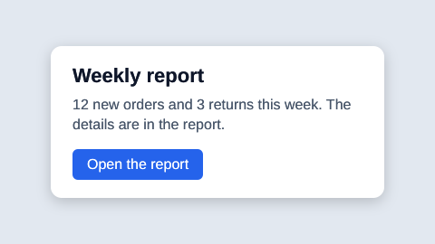
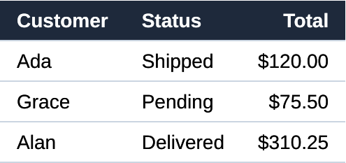

The [TakeScreenshot](cref:Meziantou.Framework.WebPlatform.Imaging.ImagingScreenshotExtensions.TakeScreenshot) extension methods of the [Meziantou.Framework.WebPlatform.Imaging](cref:Meziantou.Framework.WebPlatform.Imaging) namespace draw the current state of
a page. Load the page and its resources first:

<!-- ref:../../../tests/Meziantou.Framework.WebPlatform.Imaging.Tests/DocumentationImageTests.cs;region=WebPlatformImaging_PageScreenshot;format=md-fenced-code-block;dedent=true -->
```csharp
using var context = new BrowsingContext(new BrowsingContextOptions
{
    Viewport = new ViewportOptions { Width = 480, Height = 270 },
    RenderingBackend = new ImagingRenderingBackend(),
});

context.Navigate("https://example.com/", _ => """
    <!DOCTYPE html>
    <style>
      body { margin: 0; height: 100vh; display: grid; place-items: center; background: #e2e8f0; font-family: sans-serif }
      .card { width: 320px; padding: 20px 24px; border-radius: 12px; background: white; box-shadow: 0 4px 16px rgb(0 0 0 / 0.2) }
      h1 { margin: 0 0 8px; font-size: 22px; color: #0f172a }
      p { margin: 0 0 16px; color: #475569; line-height: 1.4 }
      button { font: inherit; padding: 8px 16px; border: 0; border-radius: 6px; background: #2563eb; color: white }
    </style>
    <div class="card">
      <h1>Weekly report</h1>
      <p>12 new orders and 3 returns this week. The details are in the report.</p>
      <button>Open the report</button>
    </div>
    """);
context.EventLoop.RunUntilIdle();

using var screenshot = context.TakeScreenshot(); // the viewport: 480x270 pixels
var png = context.TakeScreenshotAsPng();          // the same pixels, encoded as PNG
```
<!-- endref -->



| Method | Result |
| --- | --- |
| `BrowsingContext.TakeScreenshot(options)` | The viewport of the page, as an [Image\<Rgba32\>](cref:Meziantou.Framework.Imaging.Image{TPixel}) that you own and dispose |
| `Document.TakeScreenshot(options)` | The viewport of a document (the area of its `iframe` for a frame) |
| `Element.TakeScreenshot(options)` | The border box of an element, with what is painted over it |
| `TakeScreenshotAsPng(options)`, `TakeScreenshotAsJpeg(options)` | The same screenshots, encoded |

## Take a screenshot of an element

The screenshot of an element covers its border box (the rectangle of [GetBoundingClientRect()](cref:Meziantou.Framework.WebPlatform.Dom.Element.GetBoundingClientRect), transforms included),
rounded outwards to device pixels. Here at twice the resolution of the page:

<!-- ref:../../../tests/Meziantou.Framework.WebPlatform.Imaging.Tests/DocumentationImageTests.cs;region=WebPlatformImaging_ElementScreenshot;format=md-fenced-code-block;dedent=true -->
```csharp
using var context = new BrowsingContext(new BrowsingContextOptions { RenderingBackend = new ImagingRenderingBackend() });
var document = context.Navigate("https://example.com/", _ => """
    <!DOCTYPE html>
    <style>
      body { font-family: sans-serif }
      table { border-collapse: collapse; font-size: 14px }
      th, td { padding: 6px 12px; border-bottom: 1px solid #cbd5e1; text-align: left }
      th { background: #1e293b; color: white }
      th:last-child, td:last-child { text-align: right }
    </style>
    <h1>Orders</h1>
    <table id="orders">
      <tr><th>Customer</th><th>Status</th><th>Total</th></tr>
      <tr><td>Ada</td><td>Shipped</td><td>$120.00</td></tr>
      <tr><td>Grace</td><td>Pending</td><td>$75.50</td></tr>
      <tr><td>Alan</td><td>Delivered</td><td>$310.25</td></tr>
    </table>
    """);
context.EventLoop.RunUntilIdle();

// The border box of the element, at twice the resolution of the page
var table = document.GetElementById("orders")!;
using var screenshot = table.TakeScreenshot(new ScreenshotOptions { DevicePixelRatio = 2 });
```
<!-- endref -->



The parts of the element outside of the viewport are painted too. An element that is not rendered (`display: none`, or an
empty box) throws an `InvalidOperationException`.

## Options

[ScreenshotOptions](cref:Meziantou.Framework.WebPlatform.Imaging.ScreenshotOptions) has the options of the screenshots of Playwright:

| Option | Effect |
| --- | --- |
| [DevicePixelRatio](cref:Meziantou.Framework.WebPlatform.Imaging.ScreenshotOptions.DevicePixelRatio) | The number of pixels per CSS pixel; the device pixel ratio of the viewport by default. It scales the painting without changing the layout |
| [FullPage](cref:Meziantou.Framework.WebPlatform.Imaging.ScreenshotOptions.FullPage) | The whole scrollable area of the page instead of the viewport |
| [Clip](cref:Meziantou.Framework.WebPlatform.Imaging.ScreenshotOptions.Clip) | An area, in CSS pixels, relative to the viewport (to the page with [FullPage](cref:Meziantou.Framework.WebPlatform.Imaging.ScreenshotOptions.FullPage)) |
| [OmitBackground](cref:Meziantou.Framework.WebPlatform.Imaging.ScreenshotOptions.OmitBackground) | A transparent background instead of the white canvas (the backgrounds of the page are still painted) |
| [Quality](cref:Meziantou.Framework.WebPlatform.Imaging.ScreenshotOptions.Quality) | The quality of the JPEG screenshots, from 0 to 100 (80 by default) |

The size of a screenshot is the size of its area in CSS pixels multiplied by the device pixel ratio. The pixels are sRGB,
8 bits per component, not premultiplied. The JPEG screenshots are drawn over white.

## What is painted

A screenshot paints the current state of the page: the layout is computed when it is out of date, and the CSS
animations are painted at the time of the clock of the event loop. Take it from the thread of the event loop, after the
resources are loaded ([RunUntilIdleAsync()](cref:Meziantou.Framework.WebPlatform.Dom.DomEventLoop.RunUntilIdleAsync)): an image that is not loaded yet is not drawn.

## Animated images

The animated images (GIF, animated PNG, WebP and AVIF) play on the clock of the event loop: a screenshot shows the frame
displayed at the time it is taken. To get the same pixels every time, freeze the animations with the `image-animation`
property ([CSS Image Animation](https://drafts.csswg.org/css-image-animation-1/)), which applies to the `img` elements,
the poster frames of the `video` elements and the CSS images (backgrounds, `content`, list markers, border images, masks):

```css
/* every image shows its first frame */
:root { image-animation: stopped }
```

| Value | Effect |
| --- | --- |
| `normal` | The default: the images play, and the images of the same URL show the same frame |
| `running` | The images play on a timeline of the element: they start when they are added, and continue from the displayed frame when the value changes to `running` |
| `paused` | The images keep the frame displayed when the value changed to `paused` (the first frame when they were not playing) |
| `stopped` | The images show their first frame |

The property is inherited. Setting it from a script (`element.style.imageAnimation = "paused"`) freezes the frame displayed
when the style is next computed. An element hidden by `display: none` starts its animations again from the first frame when
it is displayed again. The background propagated from the `body` element to the canvas follows the value of the root
element. The `:animated-image` pseudo-class matches the `img` elements, the image buttons and the `video` elements whose
image (or poster frame) is an animated image of more than one frame, so a page can pause only them:
`img:animated-image { image-animation: paused }`.

The SVG images are always drawn in their initial state: their animations do not play, whatever the value.

## Other painting details

The elements with `content-visibility: auto` that are close to the viewport are painted with their contents, also in a
screenshot taken before the first animation frame of the page: as in a browser, the screenshot finds them before it
paints. The ones far from the viewport stay skipped until the page is scrolled to them and a rendering update runs.

The painting follows the order of CSS: backgrounds, borders, shadows, text, images, SVG, transforms, filters, masks,
clipping, blend modes, the scrollbars and the caret. The positions of the boxes and of the text are snapped to the device
pixels as in Chromium. See [Limitations](../09-Limitations.md) for what is not painted.

The form controls look and measure as in Chromium. They use the font of the browsers (13.333px Arial, monospace in the
`textarea` elements and the date and time fields), not the font of their parent, and they get the paddings, the borders
and the margins of Chromium. The text fields, the `textarea` and `select` elements, the buttons and the color wells are
drawn with a thin rounded frame in the color of their border. A control whose background or border is set by the page
is drawn with plain CSS instead, as in the browsers. With `appearance: base`, the controls inherit the font of their
parent.

The bullets of the lists (`disc`, `circle`, `square`) and the triangles of the `summary` elements are drawn as shapes, with
the sizes and the positions of Chromium, not with the glyphs of a font.

The text is antialiased with a contrast and a gamma like the ones Chromium (Skia) applies to its glyphs: the text has about
the weight it has in Chromium. The glyphs are not hinted.

A document that is not the active document of a browsing context, such as a document parsed by [HtmlDocumentParser](cref:Meziantou.Framework.WebPlatform.HtmlDocumentParser),
cannot be painted: load it with [BrowsingContext.Navigate](cref:Meziantou.Framework.WebPlatform.Dom.BrowsingContext.Navigate).
