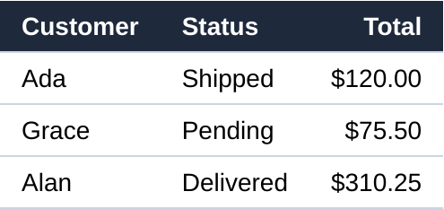

The [TakeScreenshot](cref:Meziantou.Framework.WebPlatform.Imaging.ImagingScreenshotExtensions.TakeScreenshot) extension methods of the [Meziantou.Framework.WebPlatform.Imaging](cref:Meziantou.Framework.WebPlatform.Imaging) namespace draw the current state of
a page. Load the page and its resources first:

<!-- ref:../../../tests/Meziantou.Framework.WebPlatform.Imaging.Tests/DocumentationImageTests.cs;region=WebPlatformImaging_PageScreenshot;format=md-fenced-code-block;dedent=true -->
```csharp
using var context = new BrowsingContext(new BrowsingContextOptions
{
    Viewport = new ViewportOptions { Width = 480, Height = 270 },
    RenderingBackend = new ImagingRenderingBackend(),
});

context.Navigate("https://example.com/", _ => """
    <!DOCTYPE html>
    <style>
      body { margin: 0; height: 100vh; display: grid; place-items: center; background: #e2e8f0; font-family: sans-serif }
      .card { width: 320px; padding: 20px 24px; border-radius: 12px; background: white; box-shadow: 0 4px 16px rgb(0 0 0 / 0.2) }
      h1 { margin: 0 0 8px; font-size: 22px; color: #0f172a }
      p { margin: 0 0 16px; color: #475569; line-height: 1.4 }
      button { font: inherit; padding: 8px 16px; border: 0; border-radius: 6px; background: #2563eb; color: white }
    </style>
    <div class="card">
      <h1>Weekly report</h1>
      <p>12 new orders and 3 returns this week. The details are in the report.</p>
      <button>Open the report</button>
    </div>
    """);
context.EventLoop.RunUntilIdle();

using var screenshot = context.TakeScreenshot(); // the viewport: 480x270 pixels
var png = context.TakeScreenshotAsPng();          // the same pixels, encoded as PNG
```
<!-- endref -->


| Method | Result |
| --- | --- |
| `BrowsingContext.TakeScreenshot(options)` | The viewport of the page, as an [Image\<Rgba32\>](cref:Meziantou.Framework.Imaging.Image{TPixel}) that you own and dispose |
| `Document.TakeScreenshot(options)` | The viewport of a document (the area of its `iframe` for a frame) |
| `Element.TakeScreenshot(options)` | The border box of an element, with what is painted over it |
| `TakeScreenshotAsPng(options)`, `TakeScreenshotAsJpeg(options)` | The same screenshots, encoded |

## Take a screenshot of an element

The screenshot of an element covers its border box (the rectangle of [GetBoundingClientRect()](cref:Meziantou.Framework.WebPlatform.Dom.Element.GetBoundingClientRect), transforms included),
rounded outwards to device pixels. Here at twice the resolution of the page:

<!-- ref:../../../tests/Meziantou.Framework.WebPlatform.Imaging.Tests/DocumentationImageTests.cs;region=WebPlatformImaging_ElementScreenshot;format=md-fenced-code-block;dedent=true -->
```csharp
using var context = new BrowsingContext(new BrowsingContextOptions { RenderingBackend = new ImagingRenderingBackend() });
var document = context.Navigate("https://example.com/", _ => """
    <!DOCTYPE html>
    <style>
      body { font-family: sans-serif }
      table { border-collapse: collapse; font-size: 14px }
      th, td { padding: 6px 12px; border-bottom: 1px solid #cbd5e1; text-align: left }
      th { background: #1e293b; color: white }
      th:last-child, td:last-child { text-align: right }
    </style>
    <h1>Orders</h1>
    <table id="orders">
      <tr><th>Customer</th><th>Status</th><th>Total</th></tr>
      <tr><td>Ada</td><td>Shipped</td><td>$120.00</td></tr>
      <tr><td>Grace</td><td>Pending</td><td>$75.50</td></tr>
      <tr><td>Alan</td><td>Delivered</td><td>$310.25</td></tr>
    </table>
    """);
context.EventLoop.RunUntilIdle();

// The border box of the element, at twice the resolution of the page
var table = document.GetElementById("orders")!;
using var screenshot = table.TakeScreenshot(new ScreenshotOptions { DevicePixelRatio = 2 });
```
<!-- endref -->



The parts of the element outside of the viewport are painted too. An element that is not rendered (`display: none`, or an
empty box) throws an `InvalidOperationException`.

## Options

[ScreenshotOptions](cref:Meziantou.Framework.WebPlatform.Imaging.ScreenshotOptions) has the options of the screenshots of Playwright:

| Option | Effect |
| --- | --- |
| [DevicePixelRatio](cref:Meziantou.Framework.WebPlatform.Imaging.ScreenshotOptions.DevicePixelRatio) | The number of pixels per CSS pixel; the device pixel ratio of the viewport by default. It scales the painting without changing the layout |
| [FullPage](cref:Meziantou.Framework.WebPlatform.Imaging.ScreenshotOptions.FullPage) | The whole scrollable area of the page instead of the viewport |
| [Clip](cref:Meziantou.Framework.WebPlatform.Imaging.ScreenshotOptions.Clip) | An area, in CSS pixels, relative to the viewport (to the page with [FullPage](cref:Meziantou.Framework.WebPlatform.Imaging.ScreenshotOptions.FullPage)) |
| [OmitBackground](cref:Meziantou.Framework.WebPlatform.Imaging.ScreenshotOptions.OmitBackground) | A transparent background instead of the white canvas (the backgrounds of the page are still painted) |
| [Quality](cref:Meziantou.Framework.WebPlatform.Imaging.ScreenshotOptions.Quality) | The quality of the JPEG screenshots, from 0 to 100 (80 by default) |

The size of a screenshot is the size of its area in CSS pixels multiplied by the device pixel ratio. The pixels are sRGB,
8 bits per component, not premultiplied. The JPEG screenshots are drawn over white.

## What is painted

A screenshot paints the current state of the page: the layout is computed when it is out of date, and the CSS
animations are painted at the time of the clock of the event loop. Take it from the thread of the event loop, after the
resources are loaded ([RunUntilIdleAsync()](cref:Meziantou.Framework.WebPlatform.Dom.DomEventLoop.RunUntilIdleAsync)): an image that is not loaded yet is not drawn.

The painting follows the order of CSS: backgrounds, borders, shadows, text, images, SVG, transforms, filters, masks,
clipping, blend modes, the scrollbars and the caret. The positions of the boxes and of the text are snapped to the device
pixels as in Chromium. See [Limitations](../09-Limitations.md) for what is not painted.

A document that is not the active document of a browsing context, such as a document parsed by [HtmlDocumentParser](cref:Meziantou.Framework.WebPlatform.HtmlDocumentParser),
cannot be painted: load it with [BrowsingContext.Navigate](cref:Meziantou.Framework.WebPlatform.Dom.BrowsingContext.Navigate).
