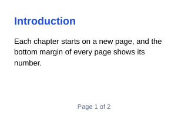
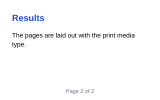

Printing lays a document out with the `print` media type and cuts it into pages, as the print preview of a browser does:
the `@page` rules set the size and the margins of the pages, the page breaks start new pages, and the page-margin boxes
(`@top-center`, `@bottom-center`...) print headers and footers. [RenderPages](cref:Meziantou.Framework.WebPlatform.Imaging.ImagingPrintExtensions.RenderPages) returns one image per page:

<!-- ref:../../../tests/Meziantou.Framework.WebPlatform.Imaging.Tests/DocumentationImageTests.cs;region=WebPlatformImaging_PrintPages;format=md-fenced-code-block;dedent=true -->
```csharp
using var context = new BrowsingContext(new BrowsingContextOptions { RenderingBackend = new ImagingRenderingBackend() });
context.Navigate("https://example.com/", _ => """
    <!DOCTYPE html>
    <style>
      @page {
        size: 320px 200px;
        margin: 24px 24px 36px;
        @bottom-center { content: "Page " counter(page) " of " counter(pages); font: 11px sans-serif; color: #64748b }
      }
      body { margin: 0; font: 13px/1.4 sans-serif }
      h2 { margin: 0 0 8px; font-size: 18px; color: #1d4ed8 }
      .chapter { break-before: page }
    </style>
    <h2>Introduction</h2>
    <p>Each chapter starts on a new page, and the bottom margin of every page shows its number.</p>
    <div class="chapter">
      <h2>Results</h2>
      <p>The pages are laid out with the print media type.</p>
    </div>
    """);
context.EventLoop.RunUntilIdle();

// One image per page: 320x200 pixels each, as set by the @page rule
var pages = context.RenderPages();
```
<!-- endref -->




- [RenderPages](cref:Meziantou.Framework.WebPlatform.Imaging.ImagingPrintExtensions.RenderPages) returns [Image\<Rgba32\>](cref:Meziantou.Framework.Imaging.Image{TPixel}) images that you own and dispose; [RenderPagesAsPng](cref:Meziantou.Framework.WebPlatform.Imaging.ImagingPrintExtensions.RenderPagesAsPng) returns PNG files.
- Each page is painted on white paper ([ScreenshotOptions.OmitBackground](cref:Meziantou.Framework.WebPlatform.Imaging.ScreenshotOptions.OmitBackground) makes it transparent), at the device pixel
  ratio of the viewport or of [ScreenshotOptions.DevicePixelRatio](cref:Meziantou.Framework.WebPlatform.Imaging.ScreenshotOptions.DevicePixelRatio).
- Printing does not change the page on screen: the document is styled and laid out again for the print, and no event is
  fired.
- An image or a web font used only by the print styles is fetched by the printing, but drawn only once it is loaded:
  run the event loop, then print again.

## Print options

[PrintOptions](cref:Meziantou.Framework.WebPlatform.Dom.PrintOptions) has the options of the PDF of Playwright (`page.pdf()`), for the pages that the `@page` rules do not size:

| Option | Default | Effect |
| --- | --- | --- |
| [PageWidth](cref:Meziantou.Framework.WebPlatform.Dom.PrintOptions.PageWidth), [PageHeight](cref:Meziantou.Framework.WebPlatform.Dom.PrintOptions.PageHeight) | US Letter | The size of the pages of `size: auto`, in CSS pixels (A4 is 794x1123) |
| [MarginTop](cref:Meziantou.Framework.WebPlatform.Dom.PrintOptions.MarginTop), [MarginRight](cref:Meziantou.Framework.WebPlatform.Dom.PrintOptions.MarginRight), [MarginBottom](cref:Meziantou.Framework.WebPlatform.Dom.PrintOptions.MarginBottom), [MarginLeft](cref:Meziantou.Framework.WebPlatform.Dom.PrintOptions.MarginLeft) | 0.5 in | The margins when no `@page` rule sets them |
| [Landscape](cref:Meziantou.Framework.WebPlatform.Dom.PrintOptions.Landscape) | false | Swaps the width and the height of the pages of `size: auto` |
| [Scale](cref:Meziantou.Framework.WebPlatform.Dom.PrintOptions.Scale) | 1 | From 0.1 to 2: the scale of the content |
| [PrintBackground](cref:Meziantou.Framework.WebPlatform.Dom.PrintOptions.PrintBackground) | true | Prints the backgrounds; when false, as in a browser, the backgrounds are not printed unless `print-color-adjust: exact` |
| [PreferCssPageSize](cref:Meziantou.Framework.WebPlatform.Dom.PrintOptions.PreferCssPageSize) | true | Uses the `size` of the `@page` rules; when false, the pages are printed on the paper of [PageWidth](cref:Meziantou.Framework.WebPlatform.Dom.PrintOptions.PageWidth) x [PageHeight](cref:Meziantou.Framework.WebPlatform.Dom.PrintOptions.PageHeight) |
| [PageRanges](cref:Meziantou.Framework.WebPlatform.Dom.PrintOptions.PageRanges) | all | The pages to print, such as `1-5, 8, 11-` |
| [DisplayHeaderFooter](cref:Meziantou.Framework.WebPlatform.Dom.PrintOptions.DisplayHeaderFooter), [HeaderTemplate](cref:Meziantou.Framework.WebPlatform.Dom.PrintOptions.HeaderTemplate), [FooterTemplate](cref:Meziantou.Framework.WebPlatform.Dom.PrintOptions.FooterTemplate) | none | HTML printed in the margins of each page, as in Chromium |

The margins, [PrintBackground](cref:Meziantou.Framework.WebPlatform.Dom.PrintOptions.PrintBackground) and [PreferCssPageSize](cref:Meziantou.Framework.WebPlatform.Dom.PrintOptions.PreferCssPageSize) have other defaults than `page.pdf()` of Playwright: set the
margins to 0 and the two others to false to print as Playwright does.

The header and footer templates are small documents of their own, as wide as the page: the elements of class `date`,
`title`, `url`, `pageNumber` and `totalPages` get the date, the title and the URL of the document, the number of the page
and the number of pages. Their scripts do not run.

To get a PDF document instead of images, see [PDF output](04-PdfOutput.md).
