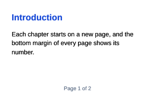
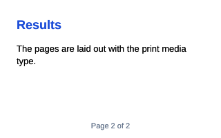

Printing lays a document out with the `print` media type and cuts it into pages, as the print preview of a browser does:
the `@page` rules set the size and the margins of the pages, the page breaks start new pages, and the page-margin boxes
(`@top-center`, `@bottom-center`...) print headers and footers. [RenderPages](cref:Meziantou.Framework.WebPlatform.Imaging.ImagingPrintExtensions.RenderPages) returns one image per page:

<!-- ref:../../../tests/Meziantou.Framework.WebPlatform.Imaging.Tests/DocumentationImageTests.cs;region=WebPlatformImaging_PrintPages;format=md-fenced-code-block;dedent=true -->
```csharp
using var context = new BrowsingContext(new BrowsingContextOptions { RenderingBackend = new ImagingRenderingBackend() });
context.Navigate("https://example.com/", _ => """
    <!DOCTYPE html>
    <style>
      @page {
        size: 320px 200px;
        margin: 24px 24px 36px;
        @bottom-center { content: "Page " counter(page) " of " counter(pages); font: 11px sans-serif; color: #64748b }
      }
      body { margin: 0; font: 13px/1.4 sans-serif }
      h2 { margin: 0 0 8px; font-size: 18px; color: #1d4ed8 }
      .chapter { break-before: page }
    </style>
    <h2>Introduction</h2>
    <p>Each chapter starts on a new page, and the bottom margin of every page shows its number.</p>
    <div class="chapter">
      <h2>Results</h2>
      <p>The pages are laid out with the print media type.</p>
    </div>
    """);
context.EventLoop.RunUntilIdle();

// One image per page: 320x200 pixels each, as set by the @page rule
var pages = context.RenderPages();
```
<!-- endref -->




- [RenderPages](cref:Meziantou.Framework.WebPlatform.Imaging.ImagingPrintExtensions.RenderPages) returns [Image\<Rgba32\>](cref:Meziantou.Framework.Imaging.Image{TPixel}) images that you own and dispose; [RenderPagesAsPng](cref:Meziantou.Framework.WebPlatform.Imaging.ImagingPrintExtensions.RenderPagesAsPng) returns PNG files.
- Each page is painted on white paper ([ScreenshotOptions.OmitBackground](cref:Meziantou.Framework.WebPlatform.Imaging.ScreenshotOptions.OmitBackground) makes it transparent), at the device pixel
  ratio of the viewport or of [ScreenshotOptions.DevicePixelRatio](cref:Meziantou.Framework.WebPlatform.Imaging.ScreenshotOptions.DevicePixelRatio).
- Printing does not change the page on screen: the document is styled and laid out again for the print, and no event is
  fired.
- An image or a web font used only by the print styles is fetched by the printing, but drawn only once it is loaded:
  run the event loop, then print again.
- The pages may have different sizes and margins (`@page :first`, the named pages, `:left` and `:right`): the content of a
  page whose page area has another width is laid out again in it, also when the page starts in the middle of a paragraph
  (its lines continue in the width of the new page), between the rows of a table, between the items of a column flex
  container, between the lines of a flex container that wraps (the items after the break start a new line in the width of
  the new page), or between the rows of a grid. When the number of columns of the grid depends on its width (`auto-fill`,
  `auto-fit`), the items after the break start a new row in the width of the new page; this needs items placed in their
  order (`grid-auto-flow: row`, with `dense` or not, and the items with a definite row before the break; an item with a
  definite column is placed in it). The items after the break do not fill the holes of the rows before it.
- A page of another width may also start in the middle of a table row, of a flex line or of a grid row: the content of
  each cell or item continues in the width of the new page, from the line or the box where its own break is, and the
  content of all of them starts at the top of the page. As in Chromium, the cells of such a row are not aligned
  (`vertical-align`) in the new page; neither are the flex and grid items (`align-self`): an item centered or aligned at
  the end of the row continues at the top of the page too, and an aligned item that starts after the break starts the new
  page whole, beside the content of the others. A table cell or a grid item that spans the rows after its row continues
  beside them (in a grid whose number of columns depends on its width, the items after the row start the next row, beside
  it), and so does a grid item that spans the rows before the broken row (in a grid whose number of columns does not
  depend on its width). The items of a subgrid of the rows of its grid (`grid-template-rows: subgrid`) are items of these
  rows. The items of a flex line stay in one line, even when they no longer fit in the new width: they shrink, or
  overflow the container. The content of an item may also continue between the rows of a table, of a grid (also a subgrid
  of the columns) or of a column flex container of the item: its rows after the break are moved down with the content of the
  other items. When the break crosses a row of an item (a row of its grid or of its table, a flex line), the items of that
  row continue beside the others, as items of the broken row. The items must stay side by side in the new width; otherwise the page keeps the width of the
  previous one.
- A page of another width may also start in the middle of content taller than a page, which the break slices: an image, a
  box with size containment, or a line box (an inline-block taller than the page). The rest of the content continues at
  the top of the new page, and the content after it is laid out in the width of the new page. The content must be laid out
  the same way in the new width (the same size and position, and for a line box the same content), so that its rest
  continues the part printed in the previous page: an image as wide as its container, a centered image, or a line that would
  hold more words in the new width keeps the width of the previous page.
- The same applies to an image, a box with size containment or a line box in a table cell, a flex item or a grid item (or
  an image that is the item): the content of the other cells or items continues beside its rest, from the same height.
  There, the content only needs the same size and content, as it moves with its column; otherwise the page keeps the width
  of the previous one.
- A page of another width may also start in the middle of a multi-column container: its columns in the new page have the
  width of the new page, and continue with the content of the last column of the previous page (a paragraph continues from
  its next line); its last columns are balanced as usual. The new page may also start before or after a column spanner
  (`column-span: all`), or in the columns after it. A container with a height or a maximum height continues with the rest
  of it (its content that does not fit overflows in more columns, as usual). The break at the end of the last column may be
  anywhere it may be outside of the columns: between two boxes or two lines, between the rows of a table, a grid or a flex
  container, or inside one of their rows (the content of its cells or items continues side by side, as described above). An
  image or a line taller than a column is not sliced by the columns: it overflows its column. The page keeps the width of
  the previous one when the container has `column-height`, or absolutely positioned boxes or multi-column containers in its
  columns.
- The header (`thead`) and the footer (`tfoot`) of a table are repeated on each page where the table continues, as in
  Chromium, when they are not taller than a quarter of the page area (the page without its margins). A repeated header
  stays with the rows after it; a taller header is printed once, and the rows after it may start the next page (a row with
  `break-inside: avoid` that does not fit below the header moves to the next page whole).

## Print options

[PrintOptions](cref:Meziantou.Framework.WebPlatform.Dom.PrintOptions) has the options of the PDF of Playwright (`page.pdf()`), for the pages that the `@page` rules do not size:

| Option | Default | Effect |
| --- | --- | --- |
| [PageWidth](cref:Meziantou.Framework.WebPlatform.Dom.PrintOptions.PageWidth), [PageHeight](cref:Meziantou.Framework.WebPlatform.Dom.PrintOptions.PageHeight) | US Letter | The size of the pages of `size: auto`, in CSS pixels (A4 is 794x1123) |
| [MarginTop](cref:Meziantou.Framework.WebPlatform.Dom.PrintOptions.MarginTop), [MarginRight](cref:Meziantou.Framework.WebPlatform.Dom.PrintOptions.MarginRight), [MarginBottom](cref:Meziantou.Framework.WebPlatform.Dom.PrintOptions.MarginBottom), [MarginLeft](cref:Meziantou.Framework.WebPlatform.Dom.PrintOptions.MarginLeft) | 0.5 in | The margins when no `@page` rule sets them |
| [Landscape](cref:Meziantou.Framework.WebPlatform.Dom.PrintOptions.Landscape) | false | Swaps the width and the height of the pages of `size: auto` |
| [Scale](cref:Meziantou.Framework.WebPlatform.Dom.PrintOptions.Scale) | 1 | From 0.1 to 2: the scale of the content |
| [PrintBackground](cref:Meziantou.Framework.WebPlatform.Dom.PrintOptions.PrintBackground) | true | Prints the backgrounds; when false, as in a browser, the backgrounds are not printed unless `print-color-adjust: exact` |
| [PreferCssPageSize](cref:Meziantou.Framework.WebPlatform.Dom.PrintOptions.PreferCssPageSize) | true | Uses the `size` of the `@page` rules; when false, the pages are printed on the paper of [PageWidth](cref:Meziantou.Framework.WebPlatform.Dom.PrintOptions.PageWidth) x [PageHeight](cref:Meziantou.Framework.WebPlatform.Dom.PrintOptions.PageHeight) |
| [PageRanges](cref:Meziantou.Framework.WebPlatform.Dom.PrintOptions.PageRanges) | all | The pages to print, such as `1-5, 8, 11-` |
| [DisplayHeaderFooter](cref:Meziantou.Framework.WebPlatform.Dom.PrintOptions.DisplayHeaderFooter), [HeaderTemplate](cref:Meziantou.Framework.WebPlatform.Dom.PrintOptions.HeaderTemplate), [FooterTemplate](cref:Meziantou.Framework.WebPlatform.Dom.PrintOptions.FooterTemplate) | none | HTML printed in the margins of each page, as in Chromium |

The margins, [PrintBackground](cref:Meziantou.Framework.WebPlatform.Dom.PrintOptions.PrintBackground) and [PreferCssPageSize](cref:Meziantou.Framework.WebPlatform.Dom.PrintOptions.PreferCssPageSize) have other defaults than `page.pdf()` of Playwright: set the
margins to 0 and the two others to false to print as Playwright does.

The header and footer templates are small documents of their own, as wide as the page: the elements of class `date`,
`title`, `url`, `pageNumber` and `totalPages` get the date, the title and the URL of the document, the number of the page
and the number of pages. Their scripts do not run.

To get a PDF document instead of images, see [PDF output](04-PdfOutput.md).
