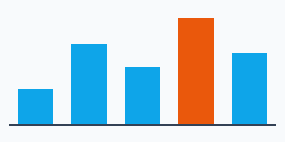
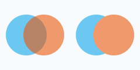

With a rendering backend, the `canvas` elements have a 2D context, as in a browser. The scripts of the page draw on it,
and so can .NET, with the same API:

<!-- ref:../../../tests/Meziantou.Framework.WebPlatform.Imaging.Tests/DocumentationImageTests.cs;region=WebPlatformImaging_CanvasChart;format=md-fenced-code-block;dedent=true -->
```csharp
using var context = new BrowsingContext(new BrowsingContextOptions
{
    RenderingBackend = new ImagingRenderingBackend(),
    ScriptingEnabled = true, // as in a browser, a canvas shows its fallback content when scripting is disabled
});
var document = context.Navigate("https://example.com/", _ => """<canvas id="chart" width="320" height="160"></canvas>""");
context.EventLoop.RunUntilIdle();

// Without a rendering backend, GetContext("2d") returns null, as in a browser without canvas support
var canvas = (HtmlCanvasElement)document.GetElementById("chart")!;
var context2D = (CanvasRenderingContext2D)canvas.GetContext("2d")!;
context2D.FillStyle = "#f8fafc";
context2D.FillRect(0, 0, 320, 160);

double[] values = [40, 90, 65, 120, 80];
for (var i = 0; i < values.Length; i++)
{
    context2D.FillStyle = i == 3 ? "#ea580c" : "#0ea5e9";
    context2D.FillRect(20 + (i * 60), 140 - values[i], 40, values[i]);
}

context2D.StrokeStyle = "#334155";
context2D.LineWidth = 2;
context2D.BeginPath();
context2D.MoveTo(10, 141);
context2D.LineTo(310, 141);
context2D.Stroke();

using var screenshot = canvas.TakeScreenshot();
```
<!-- endref -->



- [CanvasRenderingContext2D](cref:Meziantou.Framework.WebPlatform.Dom.CanvasRenderingContext2D) has all the members of the canvas of the browsers: paths, rectangles, text, images,
  gradients and patterns, transformations, shadows, filters (the CSS filter functions, and the SVG `filter` elements of the
  page referenced by `url(#id)`), compositing, [GetImageData](cref:Meziantou.Framework.WebPlatform.Dom.CanvasRenderingContext2DBase.GetImageData) and [PutImageData](cref:Meziantou.Framework.WebPlatform.Dom.CanvasRenderingContext2DBase.PutImageData).
- The bitmap of a canvas has 8 bits per component by default. Request [CanvasColorType.Float16](cref:Meziantou.Framework.WebPlatform.Dom.CanvasColorType.Float16)
  in [CanvasRenderingContext2DSettings.ColorType](cref:Meziantou.Framework.WebPlatform.Dom.CanvasRenderingContext2DSettings.ColorType) to use half-float pixels. [ToDataUrl()](cref:Meziantou.Framework.WebPlatform.Dom.HtmlCanvasElement.ToDataUrl) and [ToBlob()](cref:Meziantou.Framework.WebPlatform.Dom.HtmlCanvasElement.ToBlob) serialize it as PNG,
  JPEG or WebP.
- A canvas is rendered only when scripting is enabled: as in a browser, a page without scripting shows the fallback
  content of the `canvas` element. Set [ScriptingEnabled](cref:Meziantou.Framework.WebPlatform.Dom.BrowsingContextOptions.ScriptingEnabled) (or give a script engine) when you draw from .NET.
- [OffscreenCanvas](cref:Meziantou.Framework.WebPlatform.Dom.OffscreenCanvas) works the same way, also in the workers.
- Without a backend, `GetContext("2d")` returns null, as in a browser without canvas support.

## Gradient interpolation

The colors of the gradients of `createLinearGradient()`, `createRadialGradient()` and `createConicGradient()` are
interpolated as in the CSS gradients of the browsers: in sRGB when all the color stops are legacy sRGB colors (`#rgb`,
`rgb()`, `hsl()`, `hwb()`, the named colors), else in Oklab (for example a stop written with `color()`, `oklch()` or
`color-mix()`). [ColorInterpolationMethod](cref:Meziantou.Framework.WebPlatform.Dom.CanvasGradient.ColorInterpolationMethod)
sets the color space of the interpolation (`srgb`, `srgb-linear`, `display-p3`, `lab`, `oklab`, `xyz`, the polar `hsl`,
`hwb`, `lch` and `oklch`...), and [HueInterpolationMethod](cref:Meziantou.Framework.WebPlatform.Dom.CanvasGradient.HueInterpolationMethod)
how the hues of the polar color spaces are interpolated (`shorter`, `longer`, `increasing` or `decreasing`), as the
`in <color-space> <hue> hue` of the CSS gradients. These two properties implement a
[proposal](https://github.com/whatwg/html/pull/10986) (`WEBPLATEXP0018`, see
[Experimental APIs](../09-Limitations.md#experimental-apis)). As in the browsers, the colors of the canvas gradients are
interpolated without premultiplying the alpha.

## Wide-gamut colors

Request [PredefinedColorSpace.DisplayP3](cref:Meziantou.Framework.WebPlatform.Dom.PredefinedColorSpace.DisplayP3) in [CanvasRenderingContext2DSettings.ColorSpace](cref:Meziantou.Framework.WebPlatform.Dom.CanvasRenderingContext2DSettings.ColorSpace)
to draw the colors of Display P3, whose gamut is wider than the one of sRGB, as in a browser:

- The CSS colors and the images keep their colors outside of sRGB. The Imaging backend decodes an image whose color
  profile is wider than sRGB (such as Display P3 or Adobe RGB), a PNG image tagged as Display P3 with a `cICP` chunk,
  and a CMYK JPEG image a second time, without clipping, the first time a Display P3 or a half-float canvas draws it.
  The pages, which are sRGB, and the 8-bit sRGB canvases clip these colors.
- [GetImageData](cref:Meziantou.Framework.WebPlatform.Dom.CanvasRenderingContext2DBase.GetImageData) and [PutImageData](cref:Meziantou.Framework.WebPlatform.Dom.CanvasRenderingContext2DBase.PutImageData) convert between the color space of the canvas and the
  one of the [ImageData](cref:Meziantou.Framework.WebPlatform.Dom.ImageData).
- `createImageBitmap()` keeps the color space of a canvas or of an image data, and the colors of an image outside of
  sRGB: a bitmap drawn on a Display P3 canvas keeps them.
- [ToDataUrl()](cref:Meziantou.Framework.WebPlatform.Dom.HtmlCanvasElement.ToDataUrl) and [ToBlob()](cref:Meziantou.Framework.WebPlatform.Dom.HtmlCanvasElement.ToBlob) serialize the pixels of the canvas in its color space: a PNG image
  is tagged as Display P3 with a `cICP` chunk, a JPEG or WebP image with the ICC profile of Display P3.

## Half-float pixels

The Imaging backend stores `float16` canvases as half-precision floating-point pixels. [GetContextAttributes](cref:Meziantou.Framework.WebPlatform.Dom.CanvasRenderingContext2DBase.GetContextAttributes)
reports that backing format, including after a resize or reset. Request [ImageDataPixelFormat.RgbaFloat16](cref:Meziantou.Framework.WebPlatform.Dom.ImageDataPixelFormat.RgbaFloat16)
when reading pixels to retain their precision: the default readback is still `rgba-unorm8`.

[PutImageData](cref:Meziantou.Framework.WebPlatform.Dom.CanvasRenderingContext2DBase.PutImageData) preserves half-float samples, including negative
colors and highlights above one. Color-space conversion is performed before quantization and does not clip half-float colors to the destination gamut.
Drawing images, creating image bitmaps, cropping, resizing and transferring an offscreen bitmap also retain floating-point pixels.
PNG serialization uses 16-bit integer samples; values outside zero to one are clipped. Decoding these PNG images and creating image bitmaps from them retain their higher precision. Incomplete 16-bit PNG images retain the decoded rows and interlace passes at that precision; pixels not decoded remain transparent. JPEG and WebP use 8-bit samples.

Solid paints preserve floating-point colors. Gradients and intermediate layers, filters and shadows still use the drawing backend's 16-bit normalized colors.
Drawing a floating-point image onto an 8-bit canvas clips its color channels to zero to one.

## Layers

[BeginLayer](cref:Meziantou.Framework.WebPlatform.Dom.CanvasRenderingContext2DBase.BeginLayer) and [EndLayer](cref:Meziantou.Framework.WebPlatform.Dom.CanvasRenderingContext2DBase.EndLayer)
implement the canvas layers of the [proposal](https://github.com/whatwg/html/pull/9537) that Chromium ships behind a flag: the
drawings between the two calls are composited with each other, then drawn on the canvas as one image. In the layer, the
global alpha, the compositing operator, the shadow, the filter and the clip region are reset; `EndLayer()` restores them
and draws the layer with them:

<!-- ref:../../../tests/Meziantou.Framework.WebPlatform.Imaging.Tests/DocumentationImageTests.cs;region=WebPlatformImaging_CanvasLayers;format=md-fenced-code-block;dedent=true -->
```csharp
using var context = new BrowsingContext(new BrowsingContextOptions
{
    RenderingBackend = new ImagingRenderingBackend(),
    ScriptingEnabled = true,
});
var document = context.Navigate("https://example.com/", _ => """<canvas id="circles" width="240" height="120"></canvas>""");
context.EventLoop.RunUntilIdle();

var canvas = (HtmlCanvasElement)document.GetElementById("circles")!;
var context2D = (CanvasRenderingContext2D)canvas.GetContext("2d")!;
context2D.FillStyle = "#f8fafc";
context2D.FillRect(0, 0, 240, 120);

// Left: each circle is drawn with the global alpha, so they show through each other.
// Right: the circles are drawn in a layer, which is drawn with the global alpha as one image.
for (var i = 0; i < 2; i++)
{
    context2D.Save();
    context2D.Translate(i * 120, 0);
    context2D.GlobalAlpha = 0.6;
    #pragma warning disable WEBPLATEXP0017 // The canvas layers are a proposal
    if (i == 1)
    {
        context2D.BeginLayer();
    }

    context2D.FillStyle = "#0ea5e9";
    context2D.BeginPath();
    context2D.Arc(45, 60, 35, 0, 2 * Math.PI);
    context2D.Fill();
    context2D.FillStyle = "#ea580c";
    context2D.BeginPath();
    context2D.Arc(75, 60, 35, 0, 2 * Math.PI);
    context2D.Fill();

    if (i == 1)
    {
        context2D.EndLayer();
    }
    #pragma warning restore WEBPLATEXP0017

    context2D.Restore();
}

using var screenshot = canvas.TakeScreenshot();
```
<!-- endref -->



- The layers nest, and they share the stack of [Save](cref:Meziantou.Framework.WebPlatform.Dom.CanvasRenderingContext2DBase.Save): `Restore()` throws an
  `InvalidStateError` when the last saved state is a layer, and `EndLayer()` when it is not. `Reset()` discards the open layers.
- The filter of [BeginLayerOptions](cref:Meziantou.Framework.WebPlatform.Dom.BeginLayerOptions) is a CSS filter applied to the layer before the
  filter of the state, in the coordinates of the transformation matrix. The `CanvasFilter` objects are not supported: a
  filter that is not a string is ignored.
- While a layer is open, the pixels of the canvas cannot be read or replaced: `GetImageData()`, `PutImageData()`,
  `ToDataUrl()`, `ToBlob()`, `createImageBitmap()` and drawing the canvas into another one throw an `InvalidStateError`.
  The page shows the pixels drawn before the layer was opened.
- The API is experimental (`WEBPLATEXP0017`, see [Experimental APIs](../09-Limitations.md#experimental-apis)); the scripts of the page use
  it without restriction.
